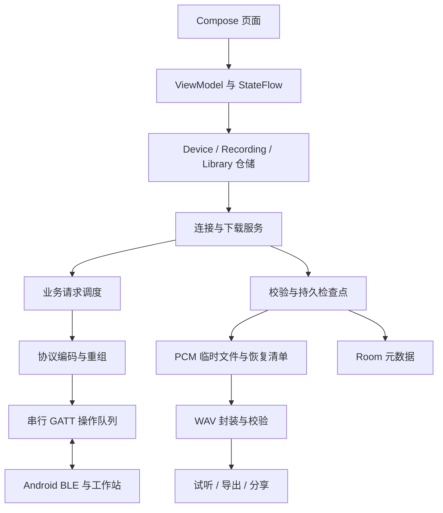

> 2026-10-20实现进展：基础v1及显式协商下载扩展已在25K独立工程验证，配套APP0.2.10。实现/兼容规则见[25K协议工程](projects/25k/example/RTL8723DS_PROTOCOL/README.md)及[二阶无损扩展](projects/25k/example/RTL8723DS_PROTOCOL/docs/SECOND_TRANSFER_EXTENSION.md)，实测见[第十八轮](projects/25k/example/RTL8723DS_PROTOCOL/reports/speed18_20261020/README.md)。这些可选扩展不改变默认v1上限；未声明138K工作站已实现业务GATT、外部实时录音或手机硬件验收。
# 安卓端实现方案

日期：2026-10-20。原始方案范围：安卓 App 的需求、架构、通信与下载设计、开发顺序和验收方案。后续已进入开发并交付首版工程与调试 APK，见下方执行更新。

后续执行更新：用户已授权开发，首版工程见 [`clients/android`](clients/android/README.md)，构建与模拟验证见[验证记录](clients/android/docs/VALIDATION.md)。下文保留原设计目标；具体已实现范围以工程 README 和验证记录为准。

依赖：[功能与实施方案](BLUETOOTH_CONTROL_PLAN.md)、[蓝牙业务协议 v1.0](BLUETOOTH_PROTOCOL_V1.md)。v1.0 是首个兼容目标；高速下载仍为待定扩展，不按已经存在的设备能力实现。

## 1. 产品范围和默认选择

App 负责系统设置、控制设备内置录音、下载与管理录音、展示实时状态。声音由 FPGA 合成，录音在设备端完成；手机端在已下载文件上试听。

| 项目 | 建议选择 |
|---|---|
| 技术栈 | Kotlin、Jetpack Compose、Material 3、Coroutines/Flow、AndroidX ViewModel |
| 平台范围 | minSdk 26（Android 8.0）；优先覆盖 Android 12 及以上真机。compileSdk/targetSdk 在建工程时选择已验证稳定且满足当时发行要求的版本，版本目录与 Gradle Wrapper 锁定依赖 |
| 蓝牙实现 | 系统 BluetoothLeScanner / BluetoothGatt 封装成统一适配层；不依赖设备名称或固定句柄 |
| 本地保存 | Room 存作品/下载元数据，DataStore 存偏好，应用私有目录存下载中间文件；完成后支持导出 WAV |
| 长下载 | connectedDevice 类型前台服务持有连接和传输任务；页面只是订阅状态 |
| 第一版连接数 | 一次连接一台工作站；一个录音下载任务 |
| 首版语言 | 简体中文，字符串资源化以便扩展 |
| 账户与网络 | 本地使用，无需账户或云服务；Wi-Fi 文件通道作为后续扩展 |

首版提供原音质 PCM→WAV 下载；ADPCM、FLAC 等选项仅在两端协商出明确编码和能力后出现。首版不提供手机麦克风录音、实时无线监听、BLE MIDI 演奏、设备固件升级或多设备混音。

## 2. 页面和关键交互

底部导航为“控制 / 录音 / 作品”，设备连接使用独立入口；所有在线页面顶部显示设备名、连接状态及状态更新时间。

### 2.1 设备连接

- 首次使用说明蓝牙用途，按操作请求权限；缺少权限或蓝牙关闭时显示可直接执行的系统授权/开启入口。
- 用户发起扫描，默认扫描 10 秒，可手动重扫或停止。业务服务 UUID 为主过滤条件，结果显示名称、RSSI 和当前连接状态；RSSI 是信号强度参考，不换算成精确距离。
- 支持选择设备、连接、断开、最近连接列表。业务服务未出现的 `RTL8723-BLE` 可以放入“底层测试设备”诊断入口，只检查 FFF1/BTST；不能显示为可设置或可录音的工作站。
- 显示“已连接、正在准备”“可控制”“请在设备上开启控制窗口”“协议不兼容”等实际阶段。底层 GATT 连接成功后不立即显示业务就绪。
- 最近设备地址只作为扫描定位提示，BLE 随机地址可能变化；不把 MAC 或广播名称作为录音身份。首版重扫后由用户选择，未来若需可靠自动识别同一设备，应补充设备稳定 ID。

### 2.2 功能控制

| 区域 | UI | 对应协议 |
|---|---|---|
| 模式与音色 | A/B/C 分段选择；五种内置音色选择 | GET/SET_PARAMETER，ID 0x0002/0x0003 |
| 音量与路由 | 音量滑条、数值、立体声/仅左/仅右/静音 | ID 0x0001/0x0004 |
| 表达 | 颤音、滑音滑条 | ID 0x0005/0x0006 |
| 效果 | 总开关、效果选择、拖拽排序、应用按钮 | GET/SET_EFFECT_CHAIN，整条链原子设置 |
| 状态摘要 | 活动声部、左右电平、clip、参数生效状态 | GET_STATUS、Status Notify、有效位 |

滑条本地拖动可以流畅显示，但设备写入最多约每 150–200 ms 合并一次；始终只保留该参数最新待提交值，手指松开后提交最终值。设备繁忙时不累积大量旧值。

界面分开保存“用户正在编辑的值”“设备请求值”和“设备实际值”。模式等待声部释放时显示“等待当前声部结束”，设备确认后更新实际模式。收到 REVISION_CONFLICT 时刷新设置并说明“设备设置已由其他控制端更新”，不自动覆盖 Push/MIDI 的新值。

参数编辑队列按设备最新 config_revision 依次提交。不能让多个 SET 共用同一个 revision 并发发送。效果拖动只编辑本地草稿，点击应用才提交；应用期间保留响应和任务状态。

能力位只说明功能类别。逐项读取已定义的参数；某 ID 返回 UNSUPPORTED 时隐藏或禁用相应项并注明原因，不能因“参数写”能力置位就假定所有参数可写。

### 2.3 录音

“设备录音槽”和“手机下载状态”分别展示，避免把设备 READY 与下载完成混为同一状态。

动作映射固定为：开始→REC_START，停止→REC_STOP，刷新槽→REC_INFO，清除→REC_CLEAR；下载使用 REC_OPEN / REC_READ / TRANSFER_ACK / REC_CLOSE，暂停或取消时使用 TRANSFER_CANCEL。按钮状态由录音与下载状态机共同决定。

- EMPTY：可选最大时长，点击开始；STARTING 禁止重复点击；RECORDING 显示已提交帧数对应时长及容量进度，提供停止。
- FINALIZING：显示正在保存录音，等待封存；READY：显示时长、格式、完整性、停止原因、下载、清除；ERROR：显示故障和清除入口。
- 第一版单槽，已有录音需显式清除才能重新开始；清除通过确认对话框说明将删除设备上的录音。本地已下载作品不随设备清除而删除。
- 设备断线时将实时状态标为陈旧，说明设备默认继续录音；重连用 REC_INFO 恢复，不能自动再发 START 或 STOP。
- 下载显示有效进度、已确认字节、近 5 秒平滑速度、估计剩余时间和暂停/取消。起始样本不足时剩余时间显示“正在估算”，不以瞬时蓝牙速率计算。
- 暂停保留临时文件及恢复信息，并尽可能释放传输引用；取消下载通过用户选择决定保留或删除临时文件，均不清除设备录音。
- incomplete＝1 的可封存录音可下载，但持续标注“录音曾中断”和原因，不能展示为完整作品。

### 2.4 本地作品

列表展示名称、下载时间、时长、采样格式、文件大小、来源、完整性；支持重命名、手机试听、导出、分享和删除。手机时间仅代表本地保存时间，设备协议没有墙钟录音时间，不能伪造“录制日期”。

采用 Media3 或等效已验证 WAV 播放组件。首版试听限前台，离开试听页或进入后台暂停；若后续要求后台播放，另加 mediaPlayback 前台服务与媒体通知。部分 PCM 不进入作品列表的“可播放”状态。

## 3. 工程结构与职责

建议后续在主交付仓库创建 `clients/android/`，与 FPGA 构建入口独立，避免客户端依赖生成结果目录。首版只拆四个 Gradle 模块，页面按包组织，不为每个页面单独建模块。

```text
clients/android/
  app/                    # Compose 页面、导航、ViewModel、依赖装配
  core/protocol/          # 纯 Kotlin 编解码、分片重组、CRC、模型、协议向量
  core/ble/               # 扫描、GATT 回调、操作队列、连接会话
  core/data/              # 仓储、前台服务、下载状态机、Room、文件与 WAV
  docs/                   # 构建、真机联调、兼容性与发布说明
  gradle/libs.versions.toml
```

依赖方向：app→data→ble/protocol；ble→protocol 仅使用必要的特征定义，protocol 不引用 Android SDK。页面通过 Repository 和 StateFlow 观察业务状态，不能直接持有 BluetoothGatt。BleConnectionService 为活跃连接唯一所有者，防止页面和服务各建立一个 GATT。



## 4. BLE 连接状态机

`Idle → Scanning → Connecting → Discovering → ReadingCapability → EnablingNotifications → Handshaking → Synchronizing → Ready`。任一步错误进入可解释的 Failed/Disconnected；下载过程中掉线进入 WaitingForReconnect，而不是假装下载完成。

连接步骤：

1. 用户选中扫描结果后停止扫描，使用 LE 连接；初次连接采用明确的直接连接，设置约 15 秒连接超时，超时 disconnect/close 并释放资源。
2. 发现服务并按 UUID 检查必需特征、属性和 CCCD。发现业务服务缺失时停止业务握手，提示底层测试固件或不兼容版本。
3. 读取 20 字节 Capability，检查 major、boot_id、包长、能力和块大小边界。协议 major 未支持时拒绝写入，不尝试猜测解析。
4. 对响应特征先调用 setCharacteristicNotification，再写 CCCD；等待 descriptor 回调成功后才进行下一操作。状态和传输特征按能力启用。仅启用本地通知标志不代表完成订阅。
5. SecureRandom 生成非零 64 bit session_nonce，HELLO 从 request_id＝1 开始；确认回显及 boot_id 后 GET_STATUS、GET_EFFECT_CHAIN、REC_INFO 和必要参数读取，再 SUBSCRIBE。
6. 启动页在需要的初始同步完成后进入 Ready。默认状态 5 Hz、录音 1 Hz；下载时演奏状态降至 1 Hz，保留控制响应与故障事件。

GATT 所有 read/write/descriptor/MTU 请求由单一 actor/队列串行执行，等待对应回调完成。通知从独立入口接收，不占用操作队列。业务命令还有独立规则：最多一个请求等待首次业务响应；同一逻辑命令的全部分片不能插入另一条命令。

为每次连接分配本地 connectionEpoch，回调同时核对 BluetoothGatt 实例和 epoch，旧连接迟到的通知/写入回调不得完成新连接的请求。API 33 及以上使用携带 value 参数的新读写/通知 API；兼容旧 API 时立即复制 byte[]，避免共享 characteristic.value 被覆盖。

GATT 操作超时与业务超时分开：GATT 初始建议 5 秒，业务按协议 3 秒。等待业务响应的计时从最后一片 ATT 写入确认后开始；响应可能早于最后一个本地写回调到达，pending request 必须预先注册。Transfer 数据可能早于对应 Response 回调，亦应先注册接收槽。无法确认 GATT 回调对应关系的超时后重建连接，避免把迟到回调误配到下一操作。

重连在已有用户启动的活跃会话/下载中采用有上限退避，例如 1、2、4、8、15 秒，最多 5 次；每次重连均重新发现、订阅、HELLO 和同步。蓝牙关闭、权限撤销、用户断开或主动取消时停止重连。不使用隐藏的 GATT refresh 方法作为常规恢复手段。

## 5. 协议实现与状态一致性

| 组件 | 规则 |
|---|---|
| Codec | 小端整数、固定长度/枚举/保留位检查、CRC32/ISO-HDLC，严格上限 512 字节 |
| Reassembler | 每个特征独立槽；v1.0 片头 6 字节、数据最多 14 字节、2 秒超时；跳片/错误 CRC 不交给业务层 |
| RequestDispatcher | 串行分配 request_id、匹配 opcode/nonce/ID、同字节重试；不因 ATT 成功就结束业务任务 |
| OperationTracker | ACCEPTED/PENDING 跟踪 operation_id；关键事件＋GET_OPERATION 查询；任务过期后查实际参数或 REC_INFO |
| StateReducer | 设备为实际值来源，按 valid_mask 合并；snapshot_id 和时间采用 u32 回绕比较；重连清空旧序号基准 |
| ErrorMapper | 区分权限、系统 GATT、协议、设备业务、文件错误；UI 提供重试/重连/刷新/释放空间等对应操作 |

整数处理避免 Java/Kotlin 的有符号陷阱：u32 在业务和数据库中存 Long，u64 标识使用无符号包装类型，并以固定 16 位十六进制保存；CRC32 用 java.util.zip.CRC32 的 Long 值再编码低 32 bit。不要把大于 Long.MAX_VALUE 的 boot_id 解析为负数后与文本做比较。

状态陈旧阈值随订阅周期调整，例如超过 max(3×周期, 3 秒) 标为陈旧，再安排一次 GET_STATUS；请求需进入统一调度，不能同时产生多个补读。没有有效位的电平显示“暂无数据”，不显示为静音。页面动画可以插值，但实际状态和时间戳不能由动画补造。

## 6. 可靠下载与文件恢复

### 6.1 v1.0 兼容路径

下载状态：`Preparing → Opening → Receiving → Verifying → Closing → Packaging → Completed`，另有 Paused、WaitingForReconnect、Cancelled、Failed。收到全部字节后仍需校验和封装，UI 不提前宣布完成。

1. 下载前 REC_INFO 检查 READY/CRC 有效、48 kHz/双声道/PCM16、frames×4＝pcm_bytes，并检查可用存储。boot_id 与当前连接能力记录一致；未知格式拒绝按 PCM16 封装。
2. 为每个本地设备记录、boot_id、recording_id 建独立任务目录，保存 objectBytes、objectCrc、格式、stopReason、incomplete 和连续检查点 offset。跨会话不持久复用 nonce、request_id 或 transfer_id。
3. 从本地可验证检查点 REC_OPEN，length 为 min(设备块上限,256,剩余字节)，保持 4 字节对齐。READ 的首次业务响应与完整 D0 数据均成功后继续处理；各自允许回调乱序。
4. 验证身份、offset、长度、逻辑 CRC 和块 CRC，写入 PCM `.part` 的指定 offset。重复块只覆盖原位置；并行文件写入禁止，处理慢时不发送下一 READ。
5. 将本块及恢复信息可靠保存后才发 ACK；ACK 成功后更新设备已确认进度。区分 receivedOffset、durableOffset、serverAckOffset，不能把“收到了通知”作为可恢复下载进度。
6. 3 秒超时按协议重发原 READ/ACK，不复用 ID 执行不同内容。若请求已从设备缓存淘汰且收到 STALE_REQUEST，关闭本会话并重新握手，从本地检查点 OPEN，不以新 ID 盲目继续旧传输。
7. EOF 后从磁盘重新计算整体 CRC，与元数据比较，再 REC_CLOSE。封装 WAV 后重新检查文件头、文件长度和 data 区 CRC；在应用私有目录中原子完成文件重命名，更新 Room 为 Completed。
8. REC_CLOSE 前后掉线、但本地 PCM 已完整且整体 CRC 正确时，可以完成本地 WAV；标记设备端关闭尚未确认并在重连后对账，不重复下载已验证内容。设备断线会释放下载引用。

### 6.2 持久检查点和崩溃一致性

PCM 文件和 Room 事务不具备跨资源原子性。顺序采用：写入 PCM → FileDescriptor.sync/等价持久操作 → 用 AtomicFile 写入包含 durableOffset、最近块范围与 CRC 的恢复清单 → 再 ACK。Room 用于索引/UI，可以从恢复清单重建；不能先把数据库 offset 提前到尚未可靠保存的字节。

恢复时校验清单版本、任务身份、实际文件长度及检查点块 CRC；PCM 比检查点长时截断未确认尾部，短于检查点或校验失败时回退到可验证的更早检查点，无法证明前缀完整时从 0 重下。服务端 ACK 成功但本地完成记录未写入时，重连 OPEN 仍以本地已持久前缀为准。

v1.0 每块最多 256 字节且要求可靠保存后 ACK，逐块 sync 可能成为显著开销。先测量该开销，不能为提速提前 ACK 仍在易失内存里的数据；产品优化应在高速协议中按窗口批量写入、持久化、累计 ACK。

进程被系统结束后不承诺自动恢复 BLE。再次打开 App 或用户点击恢复时从清单恢复，重新建立连接并比对 `(boot_id, recording_id, length, CRC, format)`；对象已不存在则显示“设备端录音已失效”，保留完整本地作品，部分文件不冒充可续传对象。

### 6.3 高速下载扩展

抽象 `RecordingTransfer`，v1.0 实现为 RequestBlockTransfer，未来为 WindowStreamTransfer；两者复用文件、校验、作品库和 UI。v1.1 字段和协商未定前，不把 1 KiB/窗口 4 写入现有 v1.0 命令。

- 由设备明确宣告版本和高速能力，完成模式握手后才启用紧凑数据通知、较大校验块和窗口；未知能力默认忽略，回退 v1.0。
- 请求更大 MTU 后仅采用 onMtuChanged 确认的协商结果；v1.0 即使系统 MTU 更大，也继续发送不超过 20 字节的特征值。Android 14 及以上系统对首个 MTU 请求有特殊行为，不能把 requestMtu(247) 当作精确得到 247 的保证。
- 下载期间可以请求高连接优先级；它只是系统请求，不保证手机或外围设备采用特定 interval。完成/暂停后恢复默认优先级。
- UART 速率由 FPGA/控制器管理，手机不能通过提高 MTU 直接把模组 UART 切成 921600。App 根据实际有效字节/秒给出耗时，不把理论值作为承诺。
- 高速接收队列和缺块表均有界；落盘/校验过慢时通过应用窗口降低发送速率。若本地队列溢出，应停止推进 ACK 并触发恢复，禁止静默丢文件片段。

## 7. 安卓权限、后台和资源生命周期

| 系统范围/能力 | 处理方式 |
|---|---|
| Android 8–11 扫描 | 声明旧 BLUETOOTH/BLUETOOTH_ADMIN，并按版本请求扫描所需位置权限；旧权限 maxSdkVersion＝30，说明部分系统还需开启位置服务 |
| Android 12+ | 运行时 BLUETOOTH_SCAN、BLUETOOTH_CONNECT；不做外设广播，无需 ADVERTISE |
| 不推断位置 | 满足条件时为 SCAN 使用 neverForLocation；该标志可能影响部分扫描结果，必须用实际业务广播验证 |
| 长下载 | 声明 FOREGROUND_SERVICE；按新系统要求声明 FOREGROUND_SERVICE_CONNECTED_DEVICE，服务类型 connectedDevice；在可见页面由用户点击连接/下载启动，启动后及时提供持续通知 |
| Android 13+ 通知 | 在开始长下载前解释并请求 POST_NOTIFICATIONS；拒绝后不将其误报为蓝牙权限缺失，按系统允许的前台服务行为运行，App 内始终可暂停/取消 |
| 文件保存/分享 | 私有目录无需存储权限；SAF ACTION_CREATE_DOCUMENT 导出，FileProvider 分享并授予临时读权限；不申请所有文件权限 |

手机不采集音频，不需要 RECORD_AUDIO；管理自有文件不需要为此申请 READ_MEDIA_AUDIO。初版不在后台持续扫描；用户在前台连接后，活跃下载由前台服务保持。后台启动限制、强制停止、撤销权限和厂商省电策略均需真机验证。

下载服务负责通知中的进度、暂停/取消入口和连接生命周期。页面旋转、切换导航、熄屏都不创建第二个任务。无下载且 App 在后台超过约 60 秒可关闭连接；设备本次录音默认继续。任务结束/取消后释放前台状态、GATT、队列和文件句柄。

持续 BLE 下载使用 connectedDevice 服务类型；若后续引入独立后台批量导出或 Wi-Fi 同步，须重新核对其工作性质及 dataSync 类型/时限要求，不能把所有后台文件工作都挂在 connectedDevice 下。WorkManager 可用于可延后的本地整理任务，不作为实时 GATT 连接保活手段。

## 8. 本地数据和导出

| 数据 | 主要字段 | 保存位置 |
|---|---|---|
| DeviceRecord | localDeviceKey、显示名、最近扫描地址、最近连接时间 | Room；地址不是稳定设备身份 |
| DownloadTask | UUID、设备键、boot_id、recording_id、格式、总长度/CRC、offset、状态、错误 | Room 索引＋任务目录恢复清单 |
| RecordingEntry | UUID、名称、保存时间、帧数/格式、私有路径、CRC、完整性、来源任务 | Room |
| UserPreferences | 最近页面、显示偏好、通知引导状态 | DataStore |

建议目录：`files/downloads/<taskUuid>/audio.pcm.part`、`checkpoint.json`；完成为 `files/recordings/<entryUuid>.wav`。不要使用 cacheDir 保存需要跨清理恢复的下载。文件名由本地 UUID 生成，设备提供的名字若后续加入也不得直接拼接路径。

保留 PCM 到 WAV 转换可能需要约两份音频空间，开始前按实现选择预留 2×PCM＋少量余量；空间不足中途出现时暂停且不 ACK 未持久化块，提示释放空间。导出通过内容 URI 流式复制，部分 DocumentsProvider 不支持 seek，先在私有目录完成 WAV 再复制。导出失败不丢失已下载作品。

WAV 使用协议给定的 44 字节 PCM 头，48 kHz、双声道、16 bit；RIFF/data 长度用 Long 检查后编码 u32，超出传统 WAV 长度限制拒绝普通封装。分享仅提供完成文件的 content URI，不暴露私有路径。

## 9. 测试和验收

采用三层验证，模拟验证不等于射频或安卓系统验证：

1. 纯 Kotlin：规范 HELLO 和 CRC 向量、大小端、u32/u64、消息边界、37 片重组、重复/跳片/超时、响应乱序、revision 冲突及 request 去重策略。
2. FakeGatt/FakePeripheral：按同一协议提供设备状态，模拟 REC_START/STOP、D0、掉包、CRC 错误、设备复位、缓存过期、ACK 丢失、磁盘满、崩溃检查点；用于 UI 和业务闭环开发。
3. 安卓真机＋实际工作站：权限、扫描、订阅回调、MTU、连接稳定性、锁屏/后台、前台通知、断线恢复、吞吐和音频回归。至少覆盖一台较新 AOSP/Pixel、一台三星和一台国内主流厂商设备，具体 OS 版本记录在兼容矩阵；API 26–30 支持也需至少一台真机或明确下调支持承诺。

| 编号 | 验收项 | 通过条件 |
|---|---|---|
| A01 | 扫描与握手 | 找到业务设备，按 UUID 发现，Capability/CCCD/HELLO/同步完整；底层测试设备不误报可控制 |
| A02 | 功能设置 | 各参数和效果顺序与设备一致；模式 pending 明确；Push/MIDI 改值后 App 同步且冲突不覆盖 |
| A03 | 录音流程 | 开始、停止、容量满、封存、清除均映射正确；重复点击和超时不重复创建对象 |
| A04 | 下载一致性 | 10 秒与 60 秒固定录音逐字节 CRC 相同，WAV 帧数/声道/长度正确；实际性能单独记录 |
| A05 | 续传 | 接收中、持久化后 ACK 前、ACK 后、CLOSE 前后分别断线/杀进程，恢复后不重复追加且无损坏 |
| A06 | 对象失效 | 设备重启或清除后旧任务不能拼接新对象，错误信息可理解 |
| A07 | 安卓生命周期 | 页面旋转、后台、锁屏仍只有一个下载；取消/断开能释放资源；强制停止后下次可恢复清单 |
| A08 | 文件流程 | 私有保存、试听、重命名、SAF 导出、分享、删除及空间不足均正常；权限最小化 |
| A09 | 性能与影响 | 连续状态无无界积压；文件最终 CRC 正确；记录下载时控制响应延迟及 FPGA deadline/underrun 前后变化 |

性能指标分三类报告：扫描/连接耗时、业务实际生效延迟、PCM 持久写入的净吞吐。先建立 v1.0 基准，再比较高速模式。MTU、UART 配置、手机型号/OS、RSSI、状态订阅频率、块大小/窗口和录音内容必须随结果记录；不以空包通知数替代文件吞吐。

## 10. 开发顺序与设备端依赖

| 阶段 | 安卓交付 | 设备端依赖 / 完成门槛 |
|---|---|---|
| A0 工程与模拟 | Gradle 工程、四模块、协议模型/向量、FakePeripheral、基础页面 | 不依赖真实业务固件；明确标识模拟模式 |
| A1 BLE 连通 | 扫描、权限、GATT 队列、能力读取、CCCD、HELLO、连接状态 | FPGA 业务服务、会话/boot_id 和常驻生命周期可用 |
| A2 设置与状态 | 控制页、状态 reducer、任务与冲突处理 | 参数读写、效果原子配置、一致快照与应用确认可用 |
| A3 录音闭环 | 录音页、REC_INFO、短录音下载、WAV、作品库 | 有界录音与协议数据回读可用；先证明短文件正确 |
| A4 连续与恢复 | 前台下载服务、持久检查点、续传、文件导出与故障流程 | DDR 连续录音及不可变对象、CRC、断连释放策略通过 |
| A5 提速与整机 | 协商高速策略、窗口实现、MTU 真机矩阵、发布 APK 与说明 | 高速协议字段定稿，FPGA MTU/队列/HCI 额度和 UART 提速实测 |

安卓可先完成 A0，并用模拟器开发 A2/A3 的 UI 与业务逻辑；A1–A5 的实物验收必须等待相应设备能力。先交付可复现的 v1.0 正确路径，再启用高速实现；高速与 v1.0 共用作品格式和恢复模型，避免另做一套下载页面。

最终开发交付应包括源码、可复现构建步骤、调试 APK、协议联调记录、真机兼容矩阵和下载性能记录。签名密钥由项目持有人管理，不写入源码；正式发行方式在发布前选择，不阻塞当前方案。

## 11. 需要在安卓开发前冻结的接口

- v1.0 字段、UUID 与规范向量作为两端共同契约，REC_INFO 的文档章节引用以其 48 字节布局为准；参数 0x0003 的业务 ID→实际 profile 映射由 FPGA 适配明确验证。
- 定义蓝牙控制窗口的本地开启方式、持续时间和下载时是否允许延长；当前协议关闭窗口会使会话失效，若窗口短于下载耗时且不可延长，长下载无法完成。客户端只显示剩余可用状态，不能自行绕过。
- 明确“控制窗口关闭”对进行中模式切换任务的终态反馈和下载引用释放；窗口内已启动的录音保持独立运行。
- 高速版本须补充能力协商、专用片格式、累计 ACK/缺块重传、窗口上限和兼容规则；尚未定稿时客户端保持 v1.0。
- 当前协议不提供稳定设备 ID、固件版本字段或 RTC 时间；首版 UI 不宣称具备这些信息，确需展示时新增向后兼容查询接口。

## 12. 安卓官方参考

以下为实施时应核对的官方接口入口；平台行为和发行要求以建工程时对应版本的文档与真机结果为准。

- [BLE 总览](https://developer.android.com/develop/connectivity/bluetooth/ble/ble-overview)
- [蓝牙权限](https://developer.android.com/develop/connectivity/bluetooth/bt-permissions)
- [后台 BLE 通信](https://developer.android.com/develop/connectivity/bluetooth/ble/background)
- [BluetoothGatt 与 MTU/回调 API](https://developer.android.com/reference/android/bluetooth/BluetoothGatt)
- [前台服务类型与 connectedDevice](https://developer.android.com/develop/background-work/services/fgs/service-types#connected-device)
- [通知运行时权限](https://developer.android.com/develop/ui/views/notifications/notification-permission)
- [Storage Access Framework](https://developer.android.com/training/data-storage/shared/documents-files)
- [FileProvider](https://developer.android.com/reference/androidx/core/content/FileProvider)
