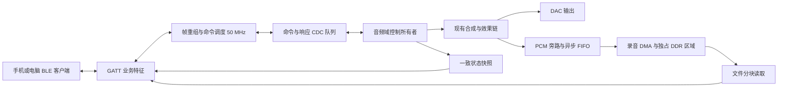

> 2026-10-20实现进展：基础v1及显式协商下载扩展已在25K独立工程验证，配套APP0.2.10。实现/兼容规则见[25K协议工程](projects/25k/example/RTL8723DS_PROTOCOL/README.md)及[二阶无损扩展](projects/25k/example/RTL8723DS_PROTOCOL/docs/SECOND_TRANSFER_EXTENSION.md)，实测见[第十八轮](projects/25k/example/RTL8723DS_PROTOCOL/reports/speed18_20261020/README.md)。这些可选扩展不改变默认v1上限；未声明138K工作站已实现业务GATT、外部实时录音或手机硬件验收。
# 蓝牙控制功能准备方案

日期：2026-10-20。状态：需求与接口草案，尚未实现业务 RTL、客户端或实板验收。

本轮按用户确认，仅完成需求、蓝牙协议和实施方案。沿用外接 RTL8723DS 的 BLE 路径；用户已选择制定安卓端方案，客户端设计见[安卓端实现方案](ANDROID_IMPLEMENTATION_PLAN.md)，电脑联调工具保留为辅助入口。字段、UUID、命令、错误码、分片与续传规则见[蓝牙业务协议 v1.0](BLUETOOTH_PROTOCOL_V1.md)。下文为实施概览，不代表现有接口已实现；与协议细节不一致时，以协议文档为准。

## 1. 现有基础与缺口

| 项目 | 本地证据 | 本次需要补齐 |
|---|---|---|
| BLE 底层 | UART 8E1 → H5 → HCI → ATT/GATT；独立候选 0x91 的 50 MHz 时序通过 | 138K 外接模组的扫描、连接、订阅实测；工作站集成时序 |
| GATT | FFF0 服务、只读/通知 FFF1、MTU 23、20 字节 BTST 测试通知；写入仅用于 CCCD | 业务命令接收、响应、状态与文件数据发送 |
| 生命周期 | 原驱动每次会话上限 180 秒，停止释放输出，BUTTON1 同时复位工作站 | 常驻运行、蓝牙独立重连/恢复、明确的停止与资源释放 |
| 参数控制 | 工作站已有 `{kind,a,b}` 事件、Push/MIDI 控制、模式与效果状态 | 业务参数白名单、绝对值设置、应用确认与多端同步 |
| 录音 | 有界采样队列、enable、样本序号及左右 PCM 回读；P27 文档描述为 256 帧 | 连续录音存储、录音对象元数据、结束封存、分块下载与续传 |
| 状态 | 已有音频诊断、工作站状态及 BLE 独立状态串口 | 面向客户端的一致快照、订阅、节流、故障事件 |

完整 BLE 集成候选 0x90 存在 BLE/DDR 时序退化，不能据独立工程通过认定工作站已完成蓝牙功能。项目中 P28/P29 与后续 full85 等记录来自不同阶段；真正集成前应核对所选基线 manifest、UserCode、位流 SHA256 和板端读回，本文不推断当前实板镜像。

## 2. 第一版功能范围

### 2.1 功能设置

| 设置项 | 第一版行为 | 接入原则 |
|---|---|---|
| 主音量 | 读取与绝对值设置，范围 0–127 | 复用现有音量控制及平滑 |
| A/B/C 模式 | 请求模式，回传请求值、当前值和 pending | 沿用等待声部释放的现有切换条件 |
| 内置音色 | 枚举当前可用 profile，并按 ID 选择 | 由设备能力表给出，不依赖客户端写死名称 |
| 效果 | 总开关、已选效果及顺序的查询和设置 | 保留 P10 串行顺序；新增绝对值配置入口，不能靠重放“按一次”事件设置 |
| 输出路由 | 立体声、左、右、静音 | 校验能力和枚举值后复用现有控制 |
| 现有表达参数 | 颤音深度、滑音等已开放参数 | 按参数描述表限定范围和生效条件 |

第一版设置在运行期生效。非易失预设保存、自由 ADSR 编辑、键位映射、几何模式扩展参数分别通过能力位开放，不把尚无写接口的能力列为已支持。

每次设置都返回设备实际值和 `config_revision`。Push、MIDI、蓝牙在同一个控制所有者处提交，按接受顺序串行生效；携带过期 `expected_revision` 的蓝牙写入返回冲突并附最新 revision。不能在蓝牙侧再维护一套独立“实际状态”。

### 2.2 内置录音控制与下载

- `REC_START`：创建一次录音，返回任务及对象 ID，格式、容量和最大时长通过 `REC_INFO` 读取；已有录音时拒绝新建，不隐式覆盖。
- `REC_STOP`：停止采集、排空写队列并封存；只有进入 READY 后才允许下载。
- `REC_INFO`：查询当前对象的状态、有效样本帧数、字节数、停止原因和数据完整性。
- `REC_OPEN / REC_READ / REC_CLOSE`：打开指定录音，从字节 offset 读取有界数据块，确认完成或取消本次下载。
- `REC_CLEAR`：显式清除已封存对象；正在录音或有下载引用时拒绝清除。

第一版采用单个录音槽，停止后下载；录音期间返回 BUSY，不并行下载。先支持实时合成最终输出的 48 kHz、双声道 PCM16，建议在效果和输出路由之后采集，并明确 PCM32→PCM16 的舍入/饱和规则。TF 文件选源可能改变输出采样率，第一版在该来源启用时拒绝开始录音，不能把非 48 kHz 数据标成 48 kHz。

短录音联调先复用有界队列，只验收控制和 PCM 一致性。产品录音另接专用 DDR 区域与写入 DMA；现有 256 帧仅相当于 48 kHz 下约 5.33 ms 缓冲，不能作为连续录音存储。DDR 分配必须先核对显示、模型、效果和 TF 等内存区域，不能直接使用一个假定空闲的地址。

首版 DDR 录音断电不保留；TF/FAT 文件持久化属于后续存储工作。客户端下载 PCM 后封装 WAV，只有长度与校验通过后显示“下载完成”。板内首版无需新增 WAV 文件系统或 MP3/FLAC 编码器。

### 2.3 实时状态回传

| 类别 | 字段 | 建议发送策略 |
|---|---|---|
| 连接与能力 | 协议版本、boot_id、session_nonce、能力位、连接/订阅状态 | 连接后读取；恢复连接重新握手 |
| 设置状态 | 当前/请求模式、音色、音量、效果选择/有效 mask/顺序、路由、config_revision | 变化合并发送；支持主动查询 |
| 演奏摘要 | 活动声部数、左右峰值、clip | 默认 5 Hz，可配置 1–10 Hz；预算不足时降频 |
| 录音状态 | 状态、recording_id、帧数、字节数、容量、停止原因 | 默认 1 Hz；开始/结束/故障立即排队 |
| 传输状态 | transfer_id、已确认 offset、总长度、进度、校验结果 | 每个确认窗口更新；客户端据已确认字节计算进度 |
| 故障 | deadline_miss、underrun、note_drop、record_drop 及通信错误 | 计数变化时发送摘要；详细内容按需读取 |

每次跨域先锁存一致快照，再拆分发送；包含快照序号、设备时间和字段有效位。客户端对过期快照显示失联/陈旧状态。电平统计需要新增观察器，不能把 synth clip 位当作左右最终输出电平。波形/FFT 大数组不放入第一版周期通知。

## 3. 数据通路与实现落点

建议新增代码均进入 `projects/138k/push2_workstation/usb_a/` 的交付构建路径：

| 建议模块 | 职责 |
|---|---|
| `rtl/bluetooth/adaptations/bt_gatt.v` | 在构建副本接入业务特征；分周期构造 ATT 回复，解决既有长组合路径 |
| `rtl/bluetooth/ble_command_bridge.sv` | 帧重组、版本/长度/CRC 检查、请求去重、错误返回 |
| `rtl/bluetooth/ble_control_dispatch.sv` | 参数白名单与读取、控制事件转换、应用确认 |
| `rtl/bluetooth/ble_status_publisher.sv` | 快照锁存、订阅、变化合并和发送预算 |
| `rtl/recording/pcm_recorder.sv` | 录音状态机、帧边界控制与完整性计数 |
| `rtl/recording/recording_dma.sv` | DDR 写入、封存、分块只读出口和引用保护 |
| `rtl/bluetooth/ble_record_transfer.sv` | 下载会话、offset、确认与重传 |
| `tools/ble_control.py` | 后续电脑端联调入口：设置、状态订阅、录音与 WAV 下载 |

冻结 `vendor/rtl8723ds_ble/` 不直接改写；通过 adaptations 和 staging 生成业务版本。实际集成依据 `build.py` 生成后的控制服务接线，不能只改冻结基线文件却遗漏 overlay。

## 4. GATT 与业务协议草案

保留现有 FFF0/FFF1 测试行为供独立回归使用。业务版本另设自定义 128 bit UUID 服务，避免让原 BTST 客户端误解业务数据；UUID 和句柄表已在协议 v1.0 中分配。

| 逻辑特征 | 属性 | 用途 |
|---|---|---|
| Capability | Read | 协议版本、boot_id、session_id、能力、包长和窗口限制 |
| Command | Write with response | 设置、查询、录音和下载控制 |
| Response/Event | Notify | 带 request_id 的业务结果、关键状态事件 |
| Status | Read / Notify | 可分片的一致状态快照 |
| Transfer | Notify | 下载数据块 |

从 MTU 23 的 20 字节特征值开始工作，不以大 MTU 或更高波特率作为首版前提。协议 v1.0 定义 6 字节分片头、每片最多 14 字节逻辑数据、最大 512 字节逻辑消息及 CRC32，并规定 request_id/session_nonce、重组超时和规范测试向量。文件块的 payload 长度应扣除上述开销后计算，不能默认每条通知都有 20 字节 PCM。

建议命令组：

| 命令组 | 逻辑命令 |
|---|---|
| 系统 | Capability 特征读取、`HELLO`、`GET_STATUS`、`SUBSCRIBE`、`GET_OPERATION` |
| 设置 | `GET_PARAMETER`、`SET_PARAMETER`、`GET_EFFECT_CHAIN`、`SET_EFFECT_CHAIN` |
| 录音 | `REC_START`、`REC_STOP`、`REC_INFO`、`REC_CLEAR` |
| 下载 | `REC_OPEN`、`REC_READ`、`TRANSFER_ACK`、`REC_CLOSE`、`TRANSFER_CANCEL` |

业务规则：

1. ATT Write Response 只证明特征写入成功。业务结果另带 request_id，区分 ACCEPTED、APPLIED、PENDING 和错误；只有控制域确认后才能返回 APPLIED。
2. 同一 session 内缓存近期请求结果。相同 request_id、相同内容重试不重复执行；同一 ID 不同内容拒绝。长任务另有 operation_id，支持状态查询。
3. 模式等待生效时返回 PENDING；后续事件报告 APPLIED 或失败。客户端不能把排队成功显示成模式已经切换。
4. 断线撤销业务会话及未提交的消息，重连获取新的 session_id；不自动重放开始、清除或切换命令。读取新状态后再发新请求。
5. 下载块带 boot_id、recording_id、offset、有效长度及块 CRC；最终对象提供总长度与整体 CRC32。客户端只确认连续且校验通过的字节，重复 offset 覆盖同一位置，不能重复追加。
6. 从窗口 1、最多 256 字节 PCM 的块开始确认和重传，严格限制在途块及队列大小。断线后通过 boot_id、对象标识和元数据校验再续传；设备重启或对象已清除返回 OBJECT_GONE，禁止拼接新旧数据。
7. 客户端超时可重发同一请求或查询任务；超时、缓存过期和序号回绕规则要在 v1 定稿中明确。未知命令、越界参数、坏 CRC、队列满、状态冲突都返回明确错误。
8. 第一版单客户端控制；建立控制会话后才允许修改状态。设备端显式启用蓝牙控制窗口，超时/断连后撤销。现有底层没有配对加密，此窗口不等于身份认证；若要求常开远程写入，需要另行实现认证机制。

## 5. 录音状态与实时性

状态路径：`EMPTY → STARTING → RECORDING → FINALIZING → READY`。READY 对象可以进入下载引用状态，关闭引用后仍为 READY；显式 CLEAR 后回 EMPTY。采集故障保留可证明连续的前缀并标记 `incomplete`，等待封存完成后才可导出；无法封存时进入 ERROR 并拒绝下载。

- START 只在 EMPTY 接受，在完整立体声样本帧边界启动；STOP 在帧边界停止，并以实际落入存储的帧数计算长度。
- 容量耗尽按完整帧自动停止，报告 CAPACITY_REACHED；FIFO 溢出或 DDR 超时报告具体错误，不能悄悄漏样后生成看似完整的录音。
- 蓝牙掉线默认继续本次板内录音，直到停止、容量上限或故障；重连后查询恢复显示。
- 蓝牙 TX、状态订阅和录音存储均不能反压音频输出。录音写入不能及时完成时停止录音并报错，音频继续运行。
- 命令结果及关键事件优先于周期状态，周期状态优先于文件数据；各队列有界，普通状态可以合并，关键结果必须可查询恢复。
- 50 MHz BLE、76.8 MHz 音频和 DDR 域使用已有可验证 CDC 方法；多位状态使用握手快照/异步 FIFO，不能逐位两级同步。

## 6. 容量和下载速度预算

48,000 帧/秒 × 2 声道 × 2 字节 = **192,000 字节/秒**。1 分钟 PCM16 双声道约 **11.52 MB（10.99 MiB）**。若未来明确保留 64 MiB 专用 DDR，可容纳约 349.5 秒；这是容量示例，不是已分配内存。

模组 UART 115200、8E1 每字节占起始 1＋数据 8＋奇偶 1＋停止 1＝11 bit，线路上限约 **10,473 字节/秒**。H5/SLIP、ACL/ATT、业务头、ACK 和状态通知会进一步降低有效文件速率。1 分钟上述 PCM 的理论最短传输时间已约 **18.3 分钟**，实际更长；保留原每 500 ms 一条测试通知的节奏甚至只有 40 字节/秒特征值，业务发送必须重做调度。

因此第一版提供停止后下载、进度、取消和续传，并以实测有效字节/秒估算剩余时间。若需要“数分钟录音在几十秒内下载”，应另立吞吐目标，评估提高 UART 速率及控制器配置、压缩或其他传输通道；仅提高手机侧 MTU 不能突破当前 UART 上限。

### 6.1 下载优化方案（2026-10-20 补充）

现有协议 v1.0 的 256 字节块、窗口 1 用于先验证正确性，正式下载建议增加可协商的高速模式；不将 v1.0 的低吞吐参数作为产品性能目标。以下属于后续 v1.1 设计方向，尚未修改 v1.0 的字段或兼容规则。

| 优先级 | 优化 | 具体改动与限制 |
|---|---|---|
| P1 | 连续分块、累计确认 | 一次启动指定范围的下载，设备连续发送；先评估 1 KiB 校验块、4 块窗口，累计 ACK 只推进已持久保存的连续前缀；显式缺块请求负责重传。窗口受可用 RAM、控制器额度及客户端能力限制 |
| P1 | 减少重复头 | 对象标识和总长度在 OPEN 时确认，块元数据只发一次；数据通知使用紧凑序号和片索引，不再把每个文件块套入完整通用命令信封。继续保留块 CRC32、整体 CRC32 和断点续传 |
| P1 | 下载期间调整通知预算 | 保留设置响应和故障通知，普通状态降低到 1 Hz；文件流使用剩余额度，队列有界。客户端报告已确认的有效字节/秒和剩余时间 |
| P2 | 协商大 MTU | 以 185 或 247 为评估值，回退 MTU 23；两端和控制器实际能力决定最终值。当前 GATT 固定 MTU 23，TX 缓冲仅 80 字节，必须改 ATT 处理和缓存，不能只在手机端请求大 MTU |
| P2 | 提高 UART 速率 | 先验证 921600，再根据模组资料与稳定性评估 1.5/3 Mbaud；同步修改启动波特率切换、HCI FC17、补丁配置和 FPGA UART，验证流控、误码及 H5 重传，不预先宣称模组支持这些速率 |
| P3 | 压缩下载表示 | 原始 PCM/WAV 保留；可评估无损压缩，压缩比取决于录音内容。另提供明确标识的 ADPCM 快速副本时，4 bit 相对 PCM16 的数据量约为 1/4，含块头会略大；这是有损选项，不能替代原音质下载 |
| 按吞吐目标决定 | 独立高速文件通道 | 若要求 1 分钟原音质录音在约 30 秒内取出，PCM 净吞吐至少 384 kB/s，应评估 Wi-Fi 或 USB 文件通道，BLE 保留控制、状态和备用下载；现有 BL616 仅有诊断串口使用证据，J18 是 USB Host，均不能直接当作已具备的手机文件传输功能 |

块大小、发送窗口、校验点和 ATT 通知大小是不同层次的参数。1 KiB 块应切成多条通知流式发送，不受 v1.0 的 512 字节通用消息上限约束；因此高速模式必须新增能力协商及专用传输格式，不能直接把 v1.0 的 max_pcm_chunk 改为 1024。连续下载还需协调 H5 ACK、HCI Number Of Completed Packets 和应用层窗口，不能因放大应用窗口而越过控制器发送额度。

仅按 UART 原始字节预算，1 分钟 PCM16 双声道的传输下限如下。它们不含协议/无线开销，也不代表实测或保证速度：

| UART 候选速率（8E1） | UART 字节/秒上限 | 11.52 MB 传输时间下限 |
|---|---:|---:|
| 115200（当前配置） | 10,473 | 18 分 20 秒 |
| 921600（待验证） | 83,782 | 2 分 18 秒 |
| 1.5 Mbaud（待验证） | 136,364 | 1 分 24 秒 |
| 3 Mbaud（待验证） | 272,727 | 42 秒 |

MTU 增大、紧凑数据包和窗口发送用于提高有效载荷占比及减少空等，不能让有效吞吐超过 UART 或无线瓶颈。当前 UART 在 50 MHz 下使用整数分频，高速档还要核对分频误差和 RX 采样裕量，必要时采用更准确的波特率发生器。

建议顺序：先用 v1.0 完成数据正确性闭环，随后优先实现窗口流式传输和紧凑数据通知，再联合评估大 MTU 与 921600；原音质下载保留，压缩副本和独立高速通道按目标耗时决定。性能测试固定使用同一段 60 秒双声道录音，记录端到端有效吞吐、控制响应时间、H5 重试、断线续传和音频故障计数；随机数据与实际录音分别测量，以暴露 SLIP 转义及压缩内容差异。

## 7. 实施顺序与验收

| 阶段 | 可交付结果 | 验收条件 |
|---|---|---|
| M0：底层收口 | 模组实测、常驻生命周期、蓝牙独立恢复、基线确认 | 138K 扫描/连接/订阅通过；连续运行超过 180 秒；BLE 重连不复位音频；完整集成时序复核通过 |
| M1：设置与状态 | 业务 GATT、命令桥、少量设置、快照订阅、电脑联调工具 | 无效写入被拒绝；实际应用后确认；Push/MIDI 与客户端状态一致；断线重连重新同步 |
| M2：短录音闭环 | 受限采样、开始/停止、PCM 下载、客户端 WAV | 标明容量；左右声道、样本顺序与长度逐项一致；重复命令不重复启动 |
| M3：连续录音 | 专用 DDR 区域、DMA、封存和容量控制 | 指定最大时长连续录音；容量满/溢出/DDR 超时不破坏音频；对象与长度正确 |
| M4：可靠下载 | 分块校验、确认、取消、续传、完整 WAV | 传输中断后续传逐字节一致；丢包/重复/乱序可恢复；新旧录音不混淆；报告有效吞吐 |
| M5：客户端与整机 | 根据选定平台完成控制界面，回归全工作站 | 设置、录音、下载、状态三条流程闭环；Push、MIDI、耳机、TF、HDMI、模型功能回归 |

M2 仅证明短录音闭环；用户要求的完整“内置录音控制与下载”需 M3、M4 一起完成。协议仿真需覆盖 MTU 23 分片、队列背压、重复请求、断线、对象失效、CRC 错误、模式 pending、多端设置冲突；整机压力验证需记录 deadline_miss/underrun 等计数的前后变化。

## 8. 开发前需落定的选择

客户端方向已确定为安卓 App，电脑工具用于辅助联调；沿用 RTL8723DS、单录音槽、48 kHz/PCM16/双声道、DDR 临时保存、停止后下载。正式开发时进一步确定目标录音时长与允许下载时间、是否要求断电保留；这些选择决定存储落点及是否需要另加高速传输。

## 9. 依据

- [现有蓝牙驱动与板级接线](projects/138k/push2_workstation/usb_a/rtl/bluetooth/README.md)
- [BLE 迁移、独立时序与集成缺口](projects/138k/push2_workstation/usb_a/reports/RTL8723DS_BLE_MIGRATION_20261007.md)
- [现有 GATT 实现](projects/138k/push2_workstation/usb_a/vendor/rtl8723ds_ble/rtl/bt_gatt.v)
- [现有录音寄存器服务](projects/138k/push2_workstation/results/workstation_20260911_174045_306332/Prj1/src/migration/gw138k_audio_services.sv)
- [工作站 overlay 与控制服务 staging](projects/138k/push2_workstation/usb_a/build.py)
- [现有录音控制绑定边界](projects/138k/push2_workstation/usb_a/P27_CONTROL_BINDINGS_VERIFICATION.md)
- [工作站源代码与构建说明](projects/138k/push2_workstation/usb_a/README.md)
