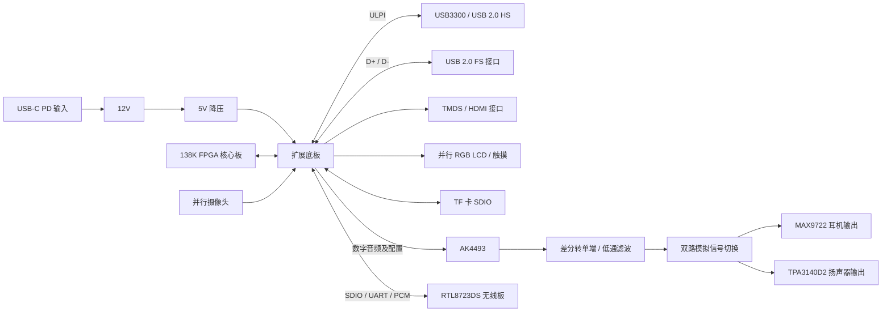

# Hardware 三份原理图解析

解析日期：2026-10-23。

## 1. 范围与结论

本次逐张阅读了以下三份 PDF 的整页及关键局部，结合可提取文字核对了器件、网络名、连接器针号和 FPGA 管脚标注：

| 文件 | 作用 | 核心器件 |
| --- | --- | --- |
| SCH_MY_138K_1_2026-10-23.pdf | 138K FPGA 核心板的扩展底板 | CH224Q、SCT2450、USB3300、TXS0108/0104/0102，以及 LCD、HDMI、摄像头、TF、子板连接器 |
| SCH_Schematic2_2026-10-23.pdf | 双声道 DAC、模拟滤波、耳机和扬声器输出板 | AK4493SEQ-L、OPA1611 ×2、MAX9722、TPA3140D2、TPS5430 |
| SCH_Schematic3_2026-10-23.pdf | Wi-Fi / Bluetooth 模块板 | RTL8723DS、ME6217C33、射频匹配与天线接口 |

三张图构成“FPGA 扩展底板 + 音频子板 + 无线子板”。FPGA 芯片本体及其核心供电、存储器等不在这三张图内，底板通过 J0/J1/J2 连接核心板。

这些 PDF 不是可执行 ERC 的源工程。以下“图中确认”指图上的导线、针号与标注；器件额定值、PCB 实际连通、排线接触面方向和动态性能仍需源工程、BOM、数据手册或实测确认。未改动原图，也未修改 RTL 或约束文件。

## 2. 系统连接关系

音频路径为播放输出路径，三图中没有音频 ADC 输入电路。

## 3. 主扩展板：SCH_MY_138K_1

### 3.1 电源

| 环节 | 图中实现 | 说明 |
| --- | --- | --- |
| PD 输入 | USB4 + F3 + CH224Q U12 | 标注“24K→12V”，意图向适配器申请 12V；F3 标注 3A |
| 电源开关 | U14，SS12D10G5 | 控制后级 +12V 路径；需与实际开关封装针号一致 |
| 12V→5V | U10 SCT2450QSTER、L1 4.7µH | R29=43kΩ、R30=8.2kΩ；以 0.8V 反馈参考计算约 5.00V，参考值需按准确型号核实 |
| 主 3.3V | U15 AMS1117-3.3 | 从 +5V 产生 +3V3 |
| USB PHY 3.3V | U1 ME6217C33M5G | 独立网络 3V3_USB3300 |
| 振荡器 3.3V | U9 XC6206P332MR | 独立网络 3V3_OSC |
| HDMI 3.3V | U6 XC6206P332MR | 独立网络 3V3_VP |
| 摄像头电源 | U18 / U19 XC6206 | 从 +3V3 产生 +2V8 与 +1V5，另提供 +3V3 DIOVDD |

音频子板同时接收 12V 与 5V；无线子板接收 5V 后自行产生 3.3V。PD 的保险丝标称电流不等于整机可用功率，整机预算还取决于 PD 合同、降压器、电感、排线和连接器。

### 3.2 USB Full Speed

- USB1 为 Type-C，标注 12Mb/s。
- D+ 经 R33=0Ω 连接 BANK3_H13，D− 经 R34=0Ω 连接 BANK3_G13。
- R35/R36 各 15kΩ 下拉，图中标为默认 host。
- R37 为预留 1.5kΩ 上拉，图中标为 device 使用。
- VBUS1 经 F1 与 +5V 相连；CC1/CC2 各使用 5.1kΩ 下拉。

这部分没有独立 USB FS PHY。FPGA 侧需要实现相应 USB 收发与协议控制；仅接好 D+/D− 不会自动具备 USB 功能。

**角色配置存在矛盾：**Type-C 的双 5.1kΩ CC 下拉表示 Sink/UFP，而“默认 host”和向 VBUS 送出 5V 表示 Source/DFP 意图。应先确定最终角色，再统一 CC、VBUS 电源开关和 D+/D− 上下拉；切到 device 也不能只装一个 1.5kΩ 电阻而保留固定向外供电。

### 3.3 USB High Speed

USB2 → USB3300 U2 → ULPI → FPGA。USB3300 配置 24MHz 晶体和内部 1.8V 电源去耦。ULPI 包括 8 根数据、CLK、DIR、NXT、STP；常见 ULPI 时钟为 60MHz，480Mb/s 是 USB 线速，不是每根 FPGA 数据线的时钟频率。

| ULPI 信号 | 主板 FPGA 标注 |
| --- | --- |
| D0 / D1 | BANK2_A21 / BANK2_B21 |
| D2 / D3 | BANK2_A20 / BANK2_B20 |
| D4 / D5 | BANK2_A19 / BANK2_A18 |
| D6 / D7 | BANK2_B18 / BANK2_B17 |
| CLK | BANK2_C18 |
| STP | BANK2_E17 |
| DIR | BANK2_F16 |
| NXT | BANK2_D16 |

图中 U4 TXS0108E 转换 DATA[7:0]，U5 TXS0104E 转换控制/时钟，A 侧供电为 VDD_1V8，B 侧为 3V3_USB3300。

**需要优先核查 ULPI 电平和时序：**USB3300 的内部 1.8V 核心电源不能直接作为 ULPI IO 电平的依据。应依据 USB3300-EZK 手册确认 IO 供电、输出幅度及 TXS A 侧容限，再确认电平转换是否需要。TXS 的自动方向、驱动能力及负载也必须满足 ULPI 双向总线与时钟时序，不能仅按电源电压匹配判断可用。

### 3.4 HDMI / DVI

图中没有 HDMI 编码芯片，TMDS 四对信号直接来自 FPGA。需要 FPGA 内实现视频时序、TMDS 编码和串化，并满足对应 IO 与时钟要求。

| 信号 | FPGA 标注 |
| --- | --- |
| D2+ / D2− | BANK3_J17 / BANK3_K17 |
| D1+ / D1− | BANK3_H15 / BANK3_J15 |
| D0+ / D0− | BANK3_H14 / BANK3_J14 |
| CLK+ / CLK− | BANK3_G16 / BANK3_G15 |
| DDC SCL / SDA | BANK3_M13 / BANK3_L13 |
| CEC / HPD | BANK3_K14 / BANK3_K13 |

- 每根 TMDS 线上有 100nF 串联电容，FPGA 侧有 49.9Ω 上拉到 3V3_VP。
- DDC 使用 TXS0102，连接 3.3V 与 5V 两侧。
- HPD 使用 5.1kΩ/10kΩ 电阻网络和保护器件。
- 必须确认此“FPGA IO + 上拉 + AC 耦合”方案与目标 FPGA 的输出模式、接收端偏置和目标像素时钟相容；不能仅凭差分对名称认定符合 HDMI 电气规范。
- 接口具备 CEC 引脚不等于 RTL 已实现 CEC；视频能显示也不等于具备 HDMI 音频功能。

### 3.5 LCD 与触摸

FPC4 为 40Pin，提供 5V、并行 RGB、PCLK/HSYNC/VSYNC/DE、背光控制和触摸控制。

| 信号 | FPGA 管脚，按信号从低到高排列 |
| --- | --- |
| LCD_R[4:0] | N22、M22、M21、L21、L19，均为 BANK3 |
| LCD_G[5:0] | L20、K21、K22、J22、H22、J20，均为 BANK3 |
| LCD_B[4:0] | BANK3_J21、BANK3_G17、BANK3_G18、BANK2_G21、BANK2_G22 |
| PCLK / HSYNC | BANK2_F18 / BANK2_E18 |
| VSYNC / DE | BANK2_C22 / BANK2_B22 |
| BL | BANK2_F21 |
| CTP_RST / SDA / SCL / INT | BANK2_E22 / D22 / E21 / D21 |

实际可编程颜色线为 5+6+5=16 根，其他 R5～R7、G6～G7、B5～B7 在接口处接地。不能把它当作完整 RGB888 接口。

**位权需要检查：**如果目标屏的 R0/G0/B0 确实是最低有效位，则把高位接地会限制最大亮度。RGB565 接 RGB888 通常需优先接高位，再处理低位；应以屏幕数据手册的针脚位权为准。LCD_BL 是控制信号，图中未见独立大电流背光驱动，能否直接使用取决于屏模组是否内置驱动。

### 3.6 摄像头

FPC1 为 24Pin，并行 8 位 DVP 接口，配置通常通过 SCCB/I²C 完成。

| 信号 | FPGA 标注 |
| --- | --- |
| D0 / D1 / D2 / D3 | BANK4_AB21 / Y21 / Y22 / AB22 |
| D4 / D5 / D6 / D7 | BANK4_AA21 / AB20 / W22 / V20 |
| MCLK / PCLK | BANK4_W21 / AA20 |
| HSYNC / VSYNC | BANK4_U20 / N17 |
| PWDN / RESET | BANK4_P17 / N15 |
| SCL / SDA | BANK4_N13 / N14 |

提供 2.8V 模拟、1.5V 核心和 3.3V IO 电源，SDA/SCL 以 5.1kΩ 上拉到 3.3V。供电、电平、时钟和针序是否适合具体摄像头模组，必须逐项核对；它不是 MIPI CSI 接口。

### 3.7 TF 卡、晶振与调试

| TF 信号 | FPGA 标注 |
| --- | --- |
| D2 / D3 | BANK5_AA15 / AB15 |
| CMD / CLK | BANK5_Y16 / W15 |
| D0 / D1 | BANK5_V15 / W14 |

TF 卡为 3.3V、4 位 SDIO 接口，CMD 与 DAT 配有 10kΩ 上拉。无线板的 SDIO 使用另外一组管脚，两者并非同一总线。

| 其他信号 | FPGA 标注 |
| --- | --- |
| OSC_12.288M / OSC_16.9344M | BANK3_K18 / J19 |
| JTAG TMS / TDO / TCK / TDI | BANK10_T13 / U13 / V12 / R13 |
| SWITCH_MODE2 / MODE1 / MODE0 | BANK10_U9 / U10 / U11 |
| DIP_SWITCH_0 | BANK5_V13 |
| CFG | BANK10_U8，图示 1kΩ 上拉 |

12.288MHz 对应 48kHz 的 256fs；16.9344MHz 对应 44.1kHz 的 384fs，两者不能直接套用同一 MCLK/fs 比值。时钟应使用合适的 FPGA 时钟资源，并结合 DAC 采样率与时钟模式配置。

**音频晶振实测（2026-10-24）：** 以核心板 V22 的标称 50MHz 时钟为参考，在 FPGA 内对两个输入独立计数，连续采集 6 个窗口，每窗口 500,000,000 个参考周期，累计名义 60 秒。

| 主板时钟网络 | FPGA 球号 | 标称频率 | 实测折算频率 | 相对标称偏差 |
| --- | --- | ---: | ---: | ---: |
| OSC_12.288M | K18 | 12,288,000Hz | 12,287,945.73Hz | −4.416ppm |
| OSC_16.9344M | J19 | 16,934,400Hz | 16,934,270.15Hz | −7.668ppm |

各输入在六个窗口内的读数跨度均为 0.1Hz。参考晶振未作外部校准，以上频率与 ppm 是以 50MHz 为假定基准的相对测量，不代表绝对频率标定或抖动测试。测量后已恢复左右交替音频 `0x13802401`，数字检查通过，未写 Flash。方法与复现见[双晶振测频说明](../example/CLOCK_MEASURE/README.md)，原始计数及汇总见[测量记录](../example/CLOCK_MEASURE/reports/measurement.json)。

## 4. 音频板：SCH_Schematic2

### 4.1 电源树

- INPUT_12V 经过 R1/R2/R3 及大容量去耦到 AVDD_12V。
- U5 LP2985-50 从 AVDD_12V 产生 AVDD_5V，供 DAC 模拟部分及 REF_5V。
- U9 LP2985-50 为 MAX9722 单独提供 5V。
- U6 ME6217C33 从外部 +5V 产生 DVDD_3V3，经 R6=0Ω 到 AVDD_3V3。
- U8 TPS5430 采用反相升降压连接：芯片 GND/EP 接负输出 AVSS-12，电感另一端接系统 GND；它不是普通正压 buck 接法。
- 正负电源再各经过 10Ω + 220µF 等滤波，得到 OPA_AVDD12 与 OPA_AVSS-12。

**R1/R2/R3 的图示值均为 200MΩ。**若按此实装，三者串联为 600MΩ，12V 下即使输出短路也只有约 20nA，无法给 DAC、运放或功放供电。必须检查是否误把 200mΩ 写成 200MΩ，或本应使用磁珠/其他滤波器件；不能未经确认直接替换为某个值。

### 4.2 DAC 与控制方式

AK4493 输入 MCLK、BICK、SDATA、LRCK，输出左右声道各一对差分模拟信号。放大核查 U1 左下角连线：DIF0、DIF1、DIF2 与 PSN 同接 DVDD_3V3，ACKS 经 R10=0Ω 接 DVDD_3V3，INV 接地；采用引脚控制模式、32 位 I²S、自动时钟检测。PSN 不是接地，不能按三线 SPI 配置。

| 主板网络 | DAC 引脚功能 | FPGA 使用含义 |
| --- | --- | --- |
| DA_PDN | PDN | 上电复位/掉电控制；图有 10kΩ 下拉 |
| DA_MCLK | MCLK | 主时钟 |
| DA_BICK | BICK | 音频位时钟 |
| DA_SDATA | SDATA | 串行音频数据 |
| DA_LRCK | LRCK | 采样/左右声道时钟 |
| DA_SSLOW | SSLOW | 数字滤波选择，测试置低 |
| DA_SMUTE | SMUTE | 高电平软静音，低电平播放 |
| DA_SD | SD | 数字滤波选择，测试置低 |
| DA_SLOW | SLOW | 数字滤波选择，测试置低 |

DIF[2:0]=111 对应 32 位 I²S，LRCK 低为左、高为右，MSB 比 LRCK 翻转晚一个 BICK。例程使用 12.288MHz MCLK、3.072MHz BICK、48kHz LRCK。手册版本及实板验证边界见 `example/AK4493_AMP/README.md`。

### 4.3 模拟处理与输出

1. DAC 输出 AOUT_LP/LN、AOUT_RP/RN。
2. U3/U7 两颗 OPA1611 将差分输出转换为单端 ANALOG_L/R，并通过周围 RC 网络低通滤波。按图示电阻，低频理想关系约为 `Vout = VP − VN`；实际频响与共模抑制需要电路仿真或实测。
3. RLY1 双路切换模拟信号，分别送往耳机支路和扬声器支路。
4. 耳机支路为 MAX9722，带电荷泵电源，输出 OUT_L/OUT_R，供两种耳机插座使用。
5. 扬声器支路为 TPA3140D2，经过 LC 滤波，从 CN1/CN2 输出 OUT_L+/−、OUT_R+/−。

TPA3140D2 为桥接输出，扬声器跨接每个声道的“+、−”，负端不是系统地。图中没有独立 line-out 连接器；ANALOG_L/R 是内部模拟节点。

耳机插入检测由两个插座的切换触点、D2/D3、PLUG_DET、Q1/Q2、SHDN_EAR/SHDN_SPK 和继电器联动实现。最终电平状态需结合插座实物触点定义验证，不能仅凭“插入”字样判断高低。

2026-10-23 无声反馈后的专项核对：用户确认 6.35mm 耳机插座无声，U4 实装为 **MAX9722A**。该型号需要外接左右两组 RIN/RF，官方手册第 12 页 Figure 7 明确给出 `AV=−RF/RIN`。当前图中 C90/C91 直接接 INL−/INR−，没有各声道反馈；R41=1kΩ 接在 OUTL 与 OUTR 之间，不能作为反馈电阻。按图实现的 A 型电路不能正常闭环放大；实际 PCB 是否另有修订仍待核对。

此外，PLUG_DET 同时直连 Q1/Q2 基极及 R38=0Ω→SHDN_EAR。若两管是普通 NPN，其基极结会把节点钳在约 0.6～0.8V，低于 MAX9722 的 SHDN 高电平要求 2V。两管型号未知，需区分普通 NPN 与内置电阻的数字晶体管。**FPGA_DET 经 R43 接的是 Q2 集电极 / SHDN_SPK，不是 PLUG_DET 基极节点**；FPGA 输入低不能直接解释为“没有检测到耳机”。

对 D4 的更正：放大并沿完整线网追踪，阴极接 +5V / RLY1.8，阳极接 Q1 集电极 / RLY1.1，低边续流方向正确。此前认定其反接是误读。继电器符号标注的线圈正负与供电连接相反，需另查准确器件资料；不能据此把 D4 改反。详细图纸证据、官方手册与修正草案见 [6.35mm 无声定位](../example/AK4493_AMP/docs/6.35mm无声定位.md)。

### 4.4 音频 FPC 与管脚标注差异

主板 FPC2 与音频板 FPC1 按 `主板针号 + 子板针号 = 25` 倒序对应，信号与供电位置相符。这里的倒序是两个符号针号之间的对应关系，不代表仅凭 PDF 就能决定使用同面或异面排线，仍需核对两个连接器封装和接触面。

| 主板 FPC2 | 音频 FPC1 | 信号 | 主板 J1 对应 FPGA | 音频图内嵌的 FPGA 后缀 |
| --- | --- | --- | --- | --- |
| 17 | 8 | PDN | BANK2_C13 | BANK2_C13 |
| 16 | 9 | MCLK | BANK2_B13 | BANK2_B17 |
| 15 | 10 | BICK | BANK2_A13 | BANK2_A16 |
| 14 | 11 | SDATA | BANK2_A14 | BANK2_A15 |
| 13 | 12 | LRCK | BANK2_B15 | BANK2_B16 |
| 12 | 13 | SSLOW | BANK2_B16 | BANK2_B15 |
| 11 | 14 | SMUTE/CSN | BANK2_A15 | BANK2_A14 |
| 10 | 15 | SD/CCLK | BANK2_A16 | BANK2_A13 |
| 9 | 16 | SLOW/CDTI | BANK2_D17 | BANK2_B13 |
| 8 | 17 | PLUG_DET ↔ FPGA_DET | BANK2_C17 | 未嵌入 FPGA 后缀 |
| 1、2、23、24 | 24、23、2、1 | +12V | — | INPUT_12V |
| 5、20 | 20、5 | +5V | — | +5V |
| 3、4、6、7、18、19、21、22 | 22、21、19、18、7、6、4、3 | GND | — | GND |

**两套 FPGA 管脚名不一致，但 FPC 功能顺序可匹配。**制定本版主板的约束时，应沿主板 J1 实际连线追踪，不能直接复制音频板网络名里的旧管脚后缀。例如主板 B17 已分给 USB_HS_D7，若再按音频板标注把 MCLK 约束到 B17，会发生功能冲突。最终以核心板资料和 PCB 网表复核后的分配为准。

## 5. 无线板：SCH_Schematic3

### 5.1 模块、电源与接口

U1 ME6217C33 将 +5V 转为 VCC=3.3V，供 RTL8723DS 模块的 VBAT_IN、VDDIO 等。C7=33µF、C8=100nF 位于模块电源附近。

| 接口 | 图中信号 | 所需 FPGA / 软件功能 |
| --- | --- | --- |
| Wi-Fi | SD_CLK/CMD/D0…D3 | SDIO host、模块固件加载、驱动和网络协议栈 |
| Bluetooth 控制/数据 | UART_IN/OUT | 对应模块固件的 UART/HCI 传输与上层协议 |
| Bluetooth 同步音频 | PCM_CLK/SYNC/IN/OUT | 按模块支持模式配置 PCM；不能直接当作任意立体声 I²S 输入 |
| 电源/休眠控制 | WL_DIS#、BT_DIS#、BT_HOST_WAKE_DEV | 使能、复位及唤醒时序 |

BT_DIS#、WL_DIS#、BT_HOST_WAKE_DEV 各有 10kΩ 上拉。UART_CTS 与 BT_DEV_WAKE_HOST 标为不连接；VBAT_EN、MAIN_XTAL_IN、SUSCLK_IN 也未外接，应根据实际模块而非仅凭 RTL8723DS 芯片名称确认是否允许。若 44Pin 模块内部集成时钟和相关使能电路，外部未连接可能是正常用法。

### 5.2 板间对应与 UART 方向

主板 FPC3 与无线板 FPC1 同样按 `n ↔ 25−n` 对应；放大核查后，以下信号及 NC 均可匹配，不存在仅凭针号看起来的整体错位。

| 主板 FPC3 | 无线 FPC1 | 网络 | FPGA 标注 |
| --- | --- | --- | --- |
| 19 | 6 | WL_DIS# | BANK5_AA13 |
| 18 | 7 | BT_HOST_WAKE_DEV | BANK5_AB13 |
| 17 | 8 | SD_D1 | BANK5_Y12 |
| 16 | 9 | SD_D0 | BANK5_AB12 |
| 15 | 10 | SD_CLK | BANK5_V10 |
| 14 | 11 | SD_CMD | BANK5_W11 |
| 13 | 12 | SD_D3 | BANK5_Y11 |
| 12 | 13 | SD_D2 | BANK5_W10 |
| 11 | 14 | PCM_OUT | BANK5_AB11 |
| 10 | 15 | PCM_CLK | BANK5_AA11 |
| 9 | 16 | PCM_IN | BANK5_AB10 |
| 8 | 17 | PCM_SYNC | BANK5_AA10 |
| 7 | 18 | BT_DIS# | BANK5_AA9 |
| 6 | 19 | UART_TX | BANK5_W12 |
| 5 | 20 | UART_RX | BANK5_T14 |
| 20 | 5 | NC | — |
| 1、2、23、24 | 24、23、2、1 | +5V | — |
| 3、4、21、22 | 22、21、4、3 | GND | — |

**UART 名称以模块侧为准：**图中 UART_TX 接模块 UART_OUT，因此 FPGA 的 W12 应作为接收输入；UART_RX 接模块 UART_IN，因此 FPGA 的 T14 应作为发送输出。若 RTL 按 FPGA 视角直接把同名 TX 设为输出，会形成方向错误。PCM_IN/OUT 也应按模块方向理解，CLK/SYNC 的主从关系按配置决定。

### 5.3 射频

ANT 经过 C5=1.8pF、L1=2.2nH、C6=2.2pF 的 π 型匹配网络，连接 RF1 芯片天线与 RF2 外部射频座。图上两个天线路径共享节点，没有独立选择开关；应核查 RF2 是否具备机械切换，以及实际装配是否需要二选一。匹配值依赖 PCB 层叠、走线、外壳和天线布局，不能只据原理图确认射频性能。

连接天线与数字接口不代表已经具备 Wi-Fi 或蓝牙音频功能。尤其不能把 PCM 口直接理解为“手机蓝牙音乐会从这里输出”；这取决于固件、蓝牙 profile 及音频路由。

## 6. 优先检查清单

| 优先级 | 位置 | 图中证据与影响 | 建议动作 |
| --- | --- | --- | --- |
| 高 | 音频 R1/R2/R3 | 均标 200MΩ，串在 AVDD_12V 主供电路径，按标称值不能供电 | 核对单位、BOM 与预期滤波器件 |
| 高 | 音频 U4 / R41 | 用户确认 MAX9722A；图上缺少两声道外部 RIN/RF，R41=1kΩ 跨左右输出 | 对照官方 Figure 7 核对 PCB；每声道建立独立负反馈，不把 R41 当作反馈 |
| 高（取决于 Q1/Q2 型号） | 音频 PLUG_DET / SHDN_EAR | 普通 NPN 基极与耳放使能节点直接共用，可能钳在约 0.7V；SHDN 高电平要求至少 2V | 明确 Q1/Q2 型号，隔离逻辑检测与晶体管驱动，核实 U4.2 实际电平 |
| 待核对 | 音频 RLY1 线圈 | 符号 1 标“+”、8 标“−”，图中 +5V 接 8、Q1 接 1；D4 本身阴极接 +5V，续流方向正确 | 查准确继电器手册与封装极性；撤销此前 D4 反接判断 |
| 高 | USB3300 + TXS0108/0104 | PHY 侧转换器供电为 1.8V，需确认是否符合 USB3300 ULPI IO 电平；同时存在高速时序风险 | 查准确数据手册，确认 IO 电压、器件方向策略与 ULPI 时序 |
| 高 | USB1 Type-C FS | CC 双 Rd 与默认 host/VBUS 外供意图不一致 | 统一 USB 角色、CC 配置、VBUS 控制和收发配置 |
| 高 | 音频信号 FPGA 管脚 | 主板 J1 与音频图网络后缀明显不同 | 统一接口文档；以实际主板连线生成并复核约束 |
| 中 | LCD RGB 位权 | 高位名称 R5…/G6…/B5…对应针接地 | 按屏幕手册确认位权，必要时改接高位 |
| 中 | FPGA_DET | R43=10kΩ、R44=30kΩ，若上游为 5V，未计钳位时得到 3.75V，另有标称 3.3V 保护器件 | 核实 FPGA 绝对最大值、钳位曲线及输入阈值，不应只凭“有 3.3V 管”认定安全 |
| 中 | 继电器控制 Q1/Q2 | 型号未明确，检测节点同时驱动两管，电流由插座电路限制 | 明确 NPN 型号、增益与线圈电流，验证饱和及插拔切换状态 |
| 中 | LP2985 C17/C87 | BYPASS 电容均标 18pF，数值很小 | 核对原厂推荐值、噪声目标及 BOM 单位 |
| 中 | HDMI TMDS | FPGA 直接驱动、49.9Ω 上拉和 AC 耦合 | 依据 FPGA IO 方案确认电气条件，并做眼图/显示兼容测试 |
| 中 | 无线模块时钟/使能 | 多个时钟及使能引脚未外接 | 确认具体模块集成情况、上电顺序与固件要求 |

FPC 倒序映射本身不是错误。上述两块子板均应以实际接触面与 PCB 封装验证排线关系；不能因符号一左一右就推定导体自动交叉。

## 7. 建议验证顺序

1. 先在源工程核对供电阻值、MAX9722A 反馈与使能、继电器线圈极性、ULPI 电平和 USB 角色问题；执行 ERC，检查所有悬空电源脚、隐藏引脚与连接器针号。
2. 不接 FPGA 核心板和子板时，确认 PD 输入及 12V、5V、3.3V；再分别限流验证子板电源，包含音频负电源。
3. 用通断测试确认 FPC 的 `n ↔ 25−n` 映射，先测电源和地，再测全部信号，核对核心板 Bank VCCIO。
4. 音频先验证 PSN/DIF 引脚模式、PDN、MCLK、SMUTE 和 LRCK/BICK，再用数字正弦检查 DAC 差分输出、运放输出、耳放及假负载下的扬声器输出。
5. 无线先核对 UART 方向及使能时序，再做模块通信、固件加载和 SDIO/PCM 功能；不要以“UART 有波形”代替蓝牙协议验证。
6. USB HS 验证 24MHz、ULPI 时钟与寄存器访问后再枚举；LCD、摄像头、TF 和 HDMI 分别使用最小测试工程验证。

本文为图纸解析和静态连接核对结果，不构成电路已通过电气验证、时序验证或可直接投板的结论。
