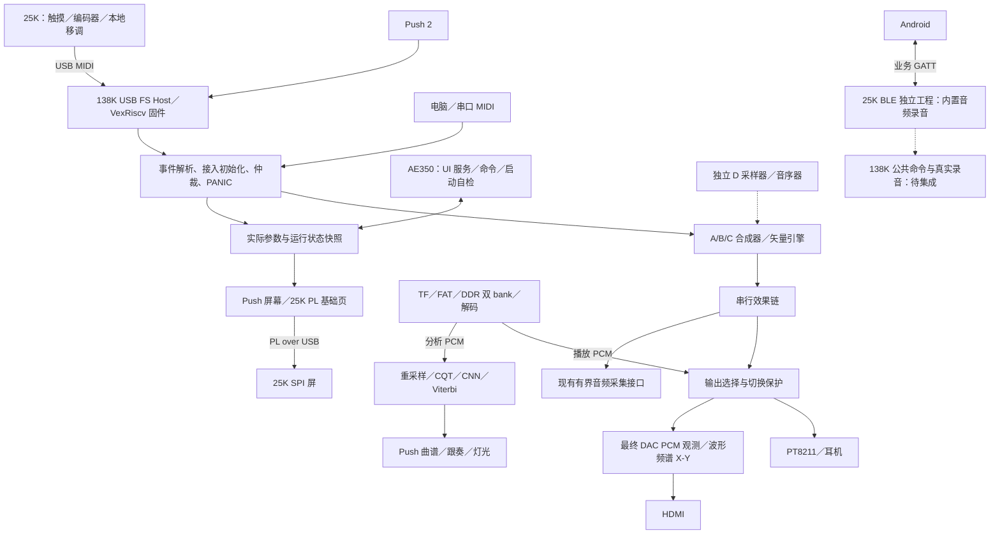
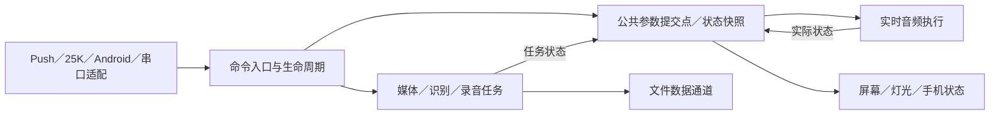

# 全链路架构与工程收敛

核对日期：2026-10-21。范围：138K 工作站、25K 面板、Android、构建验证与发布。

本文基于仓库代码、构建脚本与已有记录。阶段 A 已完成生产输入闭包、prepare 比较和针对性仿真，见[实施记录](../../projects/138k/push2_workstation/usb_a/reports/SOURCE_CLOSURE_20261021.md)；阶段 A 本身未做物理验证。后续控制与装配重整已完成新候选综合、布局布线及授权的 SRAM 核心检查，范围与未完成验收见[边界重整报告](../../projects/138k/push2_workstation/usb_a/reports/ARCHITECTURE_REFACTOR_20261021.md)。标为“目标”的内容仍待实施；冻结来源与历史证据不改。

## 1. 总体结论

现在并非没有模块，而是缺少贯穿各模块的**输入来源、状态归属和交付流程**。继续按功能追加顶层补丁、编号脚本和 README 日志，会让“源码在哪里、构建用了什么、板上是什么”越来越难回答。

收敛到一个方向：**138K 是工作站业务核心，Push／25K／Android 是不同交互适配端；实时音频、后台任务、显示和传输分离；构建从显式源码清单产生候选，候选经独立验收后才成为部署记录。** 不引入服务化框架，不重写已有 DSP。

必须先守住五条边界：

1. 一个公共参数只有一个权威写入点；面板缓存和屏幕不是另一套业务状态。
2. 音频采样节拍不等待屏幕、BLE、文件下载或 CNN；慢任务自行背压、缓存或报告失败。
3. 源码、构建产物、离线候选、实板验收、实际部署分别记录，不能互相代替。
4. 新的生产功能进入现有模块和构建配置，不再靠复制完整工程或新增长期编号补丁链交付。
5. 先恢复可追溯、可复现的主线，再扩展 D 模式与 138K BLE 业务；不借整理破坏既有回退基线。

## 2. 当前事实：不能合并成一个“最新版”

下表是核对日的快照；持续状态由“依据”列维护，而不是不断给本文追加版本日志。

| 对象 | 仓库记录能够证明什么 | 不能据此宣称什么 | 依据 |
|---|---|---|---|
| full83 | 有用户验收记录，是 `--current-workstation` 的冻结输入基线 | 不是最新部署，也不等于所有时序已闭合 | [验收记录](../../projects/138k/push2_workstation/usb_a/reports/CNN_83_ACCEPTANCE_20261006.json) |
| full85／`0x85` | 2026-10-12 有配置 Flash 写入、校验与核心 smoke 记录 | 全板时序、Push 重连、物理断电启动及完整声画验收仍不能视为完成；不能推断此刻 SRAM 内容 | [部署索引](../../projects/138k/push2_workstation/usb_a/LATEST_WORKSTATION.json)、[Flash 证据](../../projects/138k/push2_workstation/usb_a/reports/FLASH85_20261012.json) |
| T24／`0xC1102024` | 离线整机时序、CDC、PLL 与功能绑定通过；物理 BSRAM 234/340，最小 setup 余量 0.022 ns | 未板测、未部署；不继承 full83 的实体验收 | [候选清单](../../projects/138k/push2_workstation/usb_a/RESOURCE_TIMING_CANDIDATE.json) |
| 原生装配候选／`0xC110210A` | 新源码整机离线门禁通过；已 SRAM 下载、精确身份读回及 UART 核心 smoke，健康字为零 | 不是 Flash 发布；setup 仅 0.009 ns，SRAM 后自动启动失败标志仍置位，未做冷启动、物理 DAC/HDMI 或 Push/25K 验收 | [本轮证据](../../projects/138k/push2_workstation/usb_a/reports/architecture_refactor_20261021/verification.json) |
| 25K MIDI 面板 | 已导入设备工程，已接受控件及 MIDI／PL 接口有离线实现和测试 | 不等于板间实测、专有 4×4 效果工作流或完整双向状态同步完成 | [25K 入口](../../projects/25k/README.md)、[接口规划](../../整机接口规划.md) |
| Android＋25K BLE | 有业务协议、内置音频录音与可靠下载实现，另有电脑联调证据 | 不是从 138K 实际音频输出录音；Android 真机链路与 138K 集成仍须独立验收 | [Android](../../clients/android/README.md)、[25K 协议工程](../../projects/25k/example/RTL8723DS_PROTOCOL/README.md) |
| D 采样器 | 有独立播放、音序器与三项效果后端 | 尚未成为整机音源；不能直接把旧 Push 8×8 映射用于 25K 连续 16 键 | [功能边界](../../整机接口规划.md#25k专有功能的当前完成度) |
| 138K 触摸诊断 | 有 QT2160 独立工程、接线和调试资料 | 不等于已解决采样异常或已接入工作站 | [独立测试目录](../../projects/138k/push2_workstation/touchboard_test/) |

根目录原 P28／P29 说明是早期历史。尤其不能把“P28 当时未写 Flash”扩展成“整个仓库从未写过 Flash”。已有 `resource_readiness.json` 的 `release_ready=true` 也仅能结合其 `hardware_tested=false` 理解为离线门禁结果，不能当作产品发布授权。

## 3. 当前运行链路

实线表示当前工作站连接，虚线表示独立验证或待集成边界。Push 与 25K 轮流使用同一个 J18 USB-A，图中不是 USB Hub 或同时连接方案。



### 3.1 启动与就绪

板级复位和 PLL 产生各时钟域复位释放；USB Host 的 VexRiscv 与 AE350 分别执行各自固件。DDR 校准、启动 BIST 和客户端就绪门控属于平台层，不能因为 CPU 已启动就假定 DDR／模型已可用。

模型就绪另有装载与 CRC 门禁。full85 记录中模型保留在 Flash，但该部署的重载仍使用 UART 装入 DDR；不能把自动 Flash→DDR 实验候选当成默认启动能力。接入设备需要初始化、消息保留与断开取消，不能重连后回放旧持音。后续应汇总各子系统就绪状态，但不要求所有外设全部就绪才能发声。

### 3.2 演奏、控制与发声

USB 枚举与 MIDI／Push 传输在 Host 侧完成，Push 专用映射和普通 MIDI 分开处理；串口输入也汇入音频事件边界。当前核心事件为 18 bit：`{kind[3:0], a[6:0], b[6:0]}`，通过 `valid/ready` 交接。它不是完整 MIDI 封包，不能声称保留了独立的 channel／cable／设备身份。

接入初始化、普通事件和断开／PANIC 有不同的处理条件。音频域负责实际执行事件，再进入声部分配、合成／矢量引擎和串行效果。76.8 MHz 下名义 48 kHz 采样节拍为每 1600 clocks 一次；事件排队不能拖停采样。压力、延音、全音符关闭和 PANIC 的已有语义必须保留。

主要实现：[事件与音频边界](../../projects/138k/push2_workstation/usb_a/rtl/audio/gw138k_event_workstation.sv)、[USB 控制适配](../../projects/138k/push2_workstation/usb_a/rtl/push2_usb_a_control.sv)。

### 3.3 TF 播放与识别是两条消费路径

TF 经 FAT 文件读取、DDR 双 bank 流缓存和解码，分别向播放与分析提供 PCM。当前完整构建配置以 WAV 为主；MP3／FLAC 有源码或专项测试，不自动成为当前完整镜像已验收能力。

播放 PCM 经自己的发送／输出选择路径接入最终 DAC，不能按逻辑框图想当然地认为它已经走过合成器的全部效果与录音链。识别路径可背压文件分析读取，播放输出则必须独立保证采样连续性；切换、热拔卡、取消分析时需要清理各自的旧事务。

识别路径为 PCM 重采样、CQT、CNN、Viterbi、音符序列和 Push 跟奏。T24 的资源优化配置使用 22.05 kHz 分析输入、每秒 4 个分析时刻与频率分块，和 accepted full83 是不同输入策略，须分别记录算法回归与人工效果验收。25K 当前不提供曲谱入口、跟奏画面或引导灯。

### 3.4 显示是状态的消费者

HDMI 的分析输入来自最终 DAC 观测，再跨域提交 PCM、参考、声部与健康状态。Push 屏幕／灯光和 25K PL 基础页消费公共状态，但三者的数据载荷与传输并非完全相同。

目标是共享已提交的业务状态和同帧音频分析结果，而非让每块屏幕各推导一套“当前参数”。显示刷新慢、丢旧帧或断开，不能反向阻塞发声；PL ACK 也不是参数已被音频域执行的证明。具体字节布局继续由 [显示数据契约](../../projects/138k/push2_workstation/usb_a/DISPLAY_DATA_LAYOUT_V1.md) 与 [PL 契约](../../projects/138k/push2_workstation/usb_a/GW25K_PANEL.md) 管理。

### 3.5 录音与下载不能跨项目“拼成已完成”

138K 现有 `audio_visual_extensions` 从工作站音频适配器采样，提供有界采集 FIFO／记录包；不是已经实现的“最终 DAC 全来源长录音＋DDR 文件服务”。TF 在最终输出选择处接入，因此不能仅凭存在 recorder 模块就宣称 TF 也已录入。

25K BLE 独立工程录制内置测试音频，Android 已有分片、CRC、检查点、ACK、恢复和 WAV 保存链。138K BLE 驱动的旧 FFF0／FFF1 BTST 服务又是另一条链，不能直接替代 Android 所需的业务 GATT 服务。三者之间缺的是实际录音存储、公共命令适配和整机集成，不是再写一套手机界面。

目标链路为“明确定义的录音 tap → 非阻塞采集 → 存储对象 → 冻结录音身份 → 可靠传输 → Android 持久化 → WAV”；录音 tap、容量、DDR 区域与身份生命周期要先确定，再接线。BLE 下载不作为实时音频流，也不能占住实时控制队列。

### 3.6 D 模式单独作为音源集成

已有 D 后端先保持独立验证；后续以音源接口接入，而不是在屏幕、Host 固件、顶层和效果链各加一套 D 状态。25K 的 16 键映射需要专用适配，效果上下文进入／退出、按住或锁定及作用路径尚待产品决策，不在架构整理中擅自补规则。

## 4. 目标分层与状态归属

以下是职责边界，不是当前已完成的目录重构。一个业务核心不意味着一个巨型状态机：公共参数集中写入，各子系统仍拥有自己的运行状态。

| 层 | 负责 | 不负责 | 主要状态所有者 |
|---|---|---|---|
| 平台与传输 | PLL／复位、DDR 控制、USB／UART／BLE／SPI、CDC、硬件约束 | 音色默认值、效果组合、下载作品规则 | 各驱动的链路与复位状态 |
| 交互适配 | Push 映射、25K 本地输入、PL 包、Android 请求解析 | 直接维护另一份音源真值或改写 DSP 内部寄存器 | 连接会话、请求队列、本地控件状态 |
| 控制核心 | 参数范围、接入默认值、事件仲裁、效果顺序、命令接受／应用 | 渲染像素、传输 PCM 文件、执行卷积 | 138K 公共参数；以音频执行点为最终提交边界 |
| 实时音频 | 声部、合成／矢量／未来 D、效果、源选择、DAC 节拍 | 等待网络或显示、同步读文件 | 音符与 DSP 运行态 |
| 后台业务 | TF 媒体、识别／跟奏、录音对象和长任务 | 拖停采样、抢占参数的权威写入点 | 各任务的状态／取消／错误及存储对象 |
| 展示与客户端 | HDMI／Push／PL 渲染、Android UI／文件与作品库 | 推断命令已生效、篡改设备录音身份 | 显示缓存、手机持久化状态 |
| 组合根 | 实例化、跨域桥、接口连接、构建配置绑定 | 追加协议业务、音符分配或大型逐文本功能补丁 | 只有装配关系，不新增业务真值 |



AE350 继续承载既有 UI／服务请求，VexRiscv 继续承载 USB Host；不在本轮把全部控制搬到某个 CPU。目标是让它们通过明确接口请求更新，不与音频 RTL 并行维护同一参数的权威副本。25K 保留本地移调等自身职责，Android 的作品库也不迁进 FPGA。

## 5. 需要冻结的接口契约

以下“目标约束”是迁移要求；不得未经版本设计就直接改现有 USB／PL／BLE 报文。

| 边界 | 当前事实／保留项 | 目标约束与故障处理 |
|---|---|---|
| 交互 → 控制 | 18 bit 事件、`valid/ready`；已有接入生命周期事件 | 未接受时保持事件；满队列策略和溢出计数明确；断开作废旧会话，PANIC 有专用处理路径；未来来源元数据使用内部封装，不偷偷塞入现有 MIDI 位域 |
| 控制 → 执行 | 实际参数由事件／服务路径应用 | 公共参数在一个提交点生效；区分接收 ACK 与应用完成；效果整链原子提交，不能出现半套顺序；跨端并发的 revision 语义需先定契约 |
| 音源 → 效果／输出 | 内部 32 bit 定点，按采样提交；TF 有独立路径 | 每个端口明确采样率、位宽、缩放／饱和、声道、延迟和有效节拍；跨源切换、静音与 PANIC 有确定行为 |
| 文件 PCM → 识别 | PCM16 左右声道、采样率、结束／格式状态及背压 | 停止／换曲／热拔卡后旧窗口不能污染新任务；accepted 与资源候选的参数分别绑定 |
| 状态 → 显示 | CDC 快照、显示数据布局与 PL 传输 | 参数、声部、健康状态不能逐位独立同步造成撕裂；允许跳过旧显示帧，不允许丢执行结果后伪报成功 |
| 客户端 → DDR | 业务字节地址，经适配转原生地址；共享仲裁 | 地址分配统一登记，明确读返回归属、写掩码和最大 outstanding；时延敏感客户端有可测服务边界 |
| 录音 → 下载 | BLE 协议已有录音身份、块校验与 ACK；138K 后端未接齐 | 对象冻结后才可下载；重启／重配置／清除后禁止拼接旧对象；先可靠持久化再 ACK，区分 received／durable／confirmed |

参数／MIDI 语义继续以 [整机接口规划](../../整机接口规划.md) 为入口；BLE 线协议以 [业务协议](../../BLUETOOTH_PROTOCOL_V1.md) 及其显式协商扩展为准。迁移后可从统一机器可读表生成 C／RTL／Kotlin 常量和测试向量，但在生成链建立前不要先复制一份“新规范”与现有规范竞争。

## 6. 时钟、CDC 与存储是架构约束

| 域 | 当前作用 | 边界要求 |
|---|---|---|
| 50 MHz 业务域 | TF 控制、识别、部分显示与诊断 | 后台任务可背压，取消与就绪必须传播到消费者 |
| 48 MHz USB 域 | Host、MIDI、Push／PL 传输 | 事件 FIFO／握手跨域；设备断开不能留下旧事件 |
| 76.8 MHz 音频域 | 合成、效果、采样与 DAC | 48 kHz 实时预算；持续观测 deadline／overflow／drop |
| 100 MHz DDR UI 域 | 共享内存请求与响应 | CDC 请求队列、返回路由、写掩码、启动隔离 |
| 400 MHz DDR 存储时钟 | DDR PHY | 由平台 IP 和约束管理，不作为普通业务时钟 |
| 148.5 MHz 视频像素域 | 扫描输出 | 优先保证扫描；帧／行缓存不把背压传回音频 |
| 50／100 MHz CPU 总线／核心域 | AE350 控制与软件执行 | MMIO／AHB 桥明确完成条件、复位与跨域关系 |

单 bit 稳态、事件脉冲、多 bit 快照和连续流分别使用合适的同步器、握手或异步 FIFO；不能靠给整组总线打两拍解决一致性。保持现有 routed CDC／PLL 审计，不能以降低时钟、扩大 false path 或删功能换取“时序通过”。

DDR 地址唯一依据是 [ddr_address_map.vh](../../projects/138k/push2_workstation/usb_a/rtl/ddr_address_map.vh)，不要在本文另建完整地址表。需要牢记：

- 物理容量 1 GiB；一次 BL8 为 32 bytes；原生 `app_addr` 按 32 bit 字计数，事务步进为 8，不是字节地址。
- BIST 在启动阶段复用视频区，不是可并发运行的业务客户端。
- TF 两个 64 MiB bank 是流缓存；NN／bulk 的预留区不等于已实现的通用分配器或录音服务。
- DDR delay 已占用 bulk 池中的区间，新录音／D 素材申请不能把整个 bulk 池当空闲。
- 当前仲裁混合固定优先级与让出机会，不能宣称所有客户端都有严格带宽／最大等待保证；新增录音或素材 DMA 前先测竞争与欠载。
- 综合 BSRAM 等效计数与 P&R 物理块计数分别报告；T24 的 234/340 是物理计数，不能与不同阶段计数直接相减。

## 7. 当前构建链与已完成的输入闭包

仓库有三个层次，不能只看 `rtl/`：

1. **锁定来源**：`usb_a/baselines/` 描述 accepted full83／full85 与资源优化参考输入，复用已跟踪的早期 `Prj1`／vendor，缺少的冻结内容按哈希去重保存；历史本机暂存不再是这些生产路径的输入。
2. **活动源与变换**：`usb_a/rtl/`、USB 固件、overlay、精确字符串替换和时序结构变换。
3. **真正编译的工程**：脚本写入 `results/<build>/Prj1`，由它的 `.gprj`、约束、固件 ROM 与 manifest 决定最终输入。

因此，“改了活动 RTL”仍不一定意味着 accepted 配置采用它。阶段 A 已保证三类生产 prepare 可在无私有历史暂存的克隆中运行，且保留输入与迁移前逐字节一致；这不代表重新生成了相同位流或完成整机验收。

| 当前入口 | 实际输入策略 | 限制 |
|---|---|---|
| 不带整机选择参数的 `build.py` | 早期冻结工作站＋USB-A 叠加路径 | 不应被根 README 当作当前完整工作站默认入口 |
| `--current-workstation` | 可版本化 accepted full83 基线；保护 CNN 输入，不隐式采用活动 CNN | 锁定来源缺失／漂移必须失败，不回退历史暂存 |
| 再加 `--cnn-timing85` | 只允许清单绑定的六个 full85 CNN 时序文件 | 不能扩成“选最新 CNN” |
| `--resource-rework` | 从整机准备流程形成显式活动 CNN／资源候选 | 算法配置、资源与功能证据须另立候选 |
| 再加 `--resource-timing` | 从可版本化的固定资源参考基线出发，再叠加结构时序修复 | 锁定参考 ROM 与活动 overlay 分开；重新准备不自动重现 T24 的位流哈希 |

初次梳理时 `usb_a/tools` 中 Git 跟踪的 Python 文件为 107 个，其中 30 个以 `build_` 开头、20 个属于 `build_full_song_` 系列。这不是按行数判定“坏代码”，而是表明历史实验已经挤进生产依赖面。阶段 A 只新增通用基线解析器，不增加编号生产入口；整机路径也已解除对编号脚本中 DDR 常量的导入。其余历史入口不立即删除。

依据：[总入口](../../projects/138k/push2_workstation/usb_a/build.py)、[整机准备](../../projects/138k/push2_workstation/usb_a/tools/build_current_workstation.py)、[资源候选](../../projects/138k/push2_workstation/usb_a/tools/build_resource_rework.py)、[输入门禁](../../projects/138k/push2_workstation/usb_a/tools/workstation_sources.py)。

## 8. 统一研发与交付流程


每步输出和失败边界：

| 阶段 | 必须输出 | 不允许越过的边界 |
|---|---|---|
| 需求／契约 | 所属模块、影响端、输入输出、未决项、验收标准 | 不把未定的 25K 效果工作流写进生产实现 |
| 局部实现 | 模块测试、协议向量或 RTL 仿真、对应回归 | 不以“独立工程通过”代替整机接入 |
| prepare | 配置身份、逐文件输入哈希、固件／模型来源、生成过程、工具信息 | 缺锁定源码明确失败；不回退历史目录或复制数据库伪造复现 |
| 工具链 | 综合与 P&R 分开记录、位流 SHA256／UserCode、输入未漂移 | 退出码为零不等于整机通过 |
| 离线门禁 | 保留功能层次、物理资源、所有时钟时序、CDC／PLL、功能绑定 | `tool_flow_passed`、`offline_verified`、`hardware_accepted` 分开解释 |
| SRAM／实体 | 写前／写后读回、连接与音频实测、人工未通过项、回退方法 | 未经本轮授权不操作板卡；只观察到核心 smoke 不升级成全功能通过 |
| Flash／发布 | 分区保护、配置校验、重启／断电与模型路径、实际部署记录 | Flash 写入独立授权；仅在证据满足时更新部署身份 |

候选与发布记录的目标字段：源码 commit 及工作区差异、构建配置、输入清单哈希、工具版本、约束／模型／固件哈希、位流哈希与 UserCode、各门禁结果、实测范围、SRAM／Flash 操作记录、剩余问题与回退身份。允许某字段未知，但不能以 `passed=true` 掩盖未知。

已有编号记录、SHA256 与历史绝对路径不追改。后续由同一候选 manifest 汇总各阶段结果，部署记录引用它；`LATEST_BUILD.txt` 只作本地便利指针，不能触发发布。

### 现有可用命令

从仓库根目录执行；这些是**现有命令**，不是未来构建器的伪接口：

```sh
python3 projects/138k/push2_workstation/usb_a/build.py --current-workstation --prepare-only
python3 projects/138k/push2_workstation/usb_a/build.py --current-workstation --cnn-timing85 --prepare-only
python3 projects/138k/push2_workstation/usb_a/build.py --resource-rework --resource-timing --prepare-only
python3 projects/138k/push2_workstation/usb_a/sim/test_current_workstation_sources.py
```

前三条会从版本化闭包新建本地暂存输出，无需私有历史暂存；需要重新构建 USB 固件的路径仍依赖外部 bare-metal RISC-V 工具链，prepare 不进行烧录。干净克隆验证入口、逐字节来源和已知边界见[基线说明](../../projects/138k/push2_workstation/usb_a/baselines/README.md)。完整构建须显式选择输入策略；资源入口的 PNR/all 现强制提供新的 UserCode，物理门禁失败返回非零。通过配置及来源哈希见[原生装配说明](../../projects/138k/push2_workstation/usb_a/rtl/workstation/README.md)和本轮报告，不能复用历史 T24 编号或把工具门禁当发布授权。

25K 面板回归入口是 `projects/25k/example/MIDI_KEYBOARD/run_sim.sh`，支持 `--help`／`--output`；25K BLE 使用自身独立 `run_sim.sh`。Android 在 `clients/android` 执行：

```sh
./gradlew :core:protocol:test :core:ble:testDebugUnitTest :core:data:testDebugUnitTest :app:assembleDebug :app:lintDebug
```

测试矩阵按“事件与生命周期、DSP、TF／DDR、识别、显示／PL、D、BLE、Android”维护，不用一条巨大测试代替模块边界。没有涉及的硬件验收不因单元测试通过而打勾。

## 9. 目录收敛方向

不另起第二个整机仓库，也不立即全量移动文件。目标职责如下；标注“待建”的内容仅在对应迁移阶段建立。

| 位置 | 维护什么 | 约束 |
|---|---|---|
| `docs/architecture/` | 稳定总图、边界、迁移标准；重大决策另立简短决策记录 | 不堆每轮实验日志 |
| 根接口／协议文档 | 跨板业务语义与线协议 | 一项契约只保留一个维护入口 |
| `projects/138k/push2_workstation/usb_a/rtl/` | 138K 活动实现，逐步按 input／control／audio／media／analysis／display／platform 分域 | 现有目录暂不重命名；先建立清单再迁移 |
| `usb_a/baselines/` | 已落地的第一方／依赖来源映射、原始清单、去重冻结内容 | 不依赖忽略目录提供唯一生产源码；统一构建配置仍待收敛 |
| `usb_a/tools/` | 通用 prepare／build／audit／test 工具 | 不继续新增长期生产编号脚本；实验入口不能成为唯一交付链 |
| `usb_a/vendor/` 与现有冻结来源 | 第三方输入、许可证、原始哈希 | 原始输入不就地修补，适配独立记录 |
| `projects/25k/example/MIDI_KEYBOARD/` | 当前实际面板产品入口 | 不因目录名为 example 就误认没有生产职责 |
| `projects/25k/example/RTL8723DS_PROTOCOL/` | BLE 业务协议与录音下载独立验证 | 不冒充已集成的整机蓝牙后端 |
| `clients/android/` | app → core/data → core/ble → core/protocol | 保持已有依赖方向，不让 UI 自行编码协议 |
| `results/`／`out/`／构建目录 | 生成工程、网表、位流、波形与原始捕获 | 不作为未来生产链的唯一输入；现有依赖解除前不删除 |
| `reports/` 与版本 JSON | 验证证据、输入绑定、候选／部署记录 | 不靠日志顺序推断当前状态 |

外层 `fpga/`、`Mega_138K/`、旧 `migration/` 兼容路径和板级历史目录不直接升格成另一条生产主线。后续如需复用其中代码，应明确来源和依赖；不能仅因本地存在就偷偷加入搜索路径。

## 10. 风险与整改顺序

| 优先级 | 根因／现有证据 | 收敛措施 | 完成判据 |
|---|---|---|---|
| P0 | P28 历史、full85 部署、T24 离线候选混用“当前” | 根入口区分三类状态，统一跳转事实记录 | 不再把离线通过写成已上板，不把旧 README 当实时状态 |
| P1：prepare 已完成 | 原整机与资源构建器读取忽略的历史暂存树，且部分 Git 输入存在换行差异 | 锁定来源、必要字节还原与去重冻结内容；保留原始清单 | 三类 prepare 已在无私有历史暂存的克隆通过；完整实现尚未重跑 |
| P1 | 生产装配依赖字符串补丁，活动文件未必被采用 | 建立源文件→变换→暂存目标→哈希映射，逐步将业务逻辑归位 | 每个编译文件来源可追溯；改对应生产源码能被配置实际消费 |
| P1 | `tool_flow_passed`／`release_ready`／实体验收含义不一致 | 拆分工具、离线、实板、部署门禁，并由构建器统一失败语义 | 离线门禁失败不能输出整体成功；未实测候选不能升级部署 |
| P2 | 初始化默认值、参数映射、页面缓存跨多处实现 | 公共参数单写入口，适配层请求，展示消费状态 | Push／25K／电脑互改参数后反馈一致，重连无旧事件，PANIC 行为保持 |
| P2 | 多路音频的效果／显示／录音 tap 容易混淆 | 显式音源选择、分析 tap 与录音 tap 契约 | 每种来源测到实际 DAC、显示与录音所见内容，禁止靠名称推断 |
| P3 | Android、25K BLE、138K BLE 独立通过被误读为闭环 | 先接 138K 公共命令，再接录音后端和数据传输 | 真机录到目标 tap；重启不混录、CRC 与恢复通过，音频无新增欠载 |
| P3 | D 后端存在，但产品交互与整机路径未定 | 先确认 25K 工作流，再通过音源接口集成 | 不破坏 A/B/C／TF／矢量；16 键与效果上下文有端到端测试 |

### 阶段 A：止血与基线固化

已完成架构入口、状态纠偏和开发约束，并将三类整机 prepare 输入移到版本化闭包。原始清单保持；每类明确剔除 180 项非生产资料／中间产物，保留输入与迁移前逐字节一致。另完成干净克隆、换行还原、篡改拒绝与针对性 CDC／生命周期验证。没有完成运行架构重构、重新完整实现或新增硬件验收。

已建立的闭包覆盖第一方 RTL、顶层、固件／模型数据、IP、约束与既有脚本；已有不可变来源复用，缺少内容按哈希去重导出。Git 的 LF 存储与历史原始字节有差异时显式锁定还原规则，再验证最终 SHA256，不修改供应商原文件或历史哈希。旧链保留作对照。

prepare 完成标准已满足：干净工作区无需忽略的历史 `results/`，来源可审计，三种配置的保留输入相同。Git 已跟踪的旧冻结树仍保留在其原路径，不把目录名为 `results` 等同于私有依赖。完整综合／P&R 的复核仍需另行执行；工具安装属于显式前提，不冒充已入库源码。

### 阶段 B：构建器收敛

把当前三类输入策略做成显式配置，由一个流水线执行 prepare、工具链和 audit；现有 `build.py` 逐步成为薄入口。通用工具不得为了一个新实验继续导入另一个编号构建脚本。历史编号脚本保留作证据，不要求重写全部历史。

逐项退出字符串业务补丁：先将稳定顶层及第一方业务改动归位；确需保留的 vendor／工具适配必须有输入哈希、唯一锚点、失败检查、针对性测试和退出条件。不要把“若干 replace 的列表”改名为配置后就算完成重构。

完成标准：不同配置的差异可列举、输入策略不串用、门禁失败能使相应阶段失败、修改生产实现不必再复制一份完整工程。T24 等历史候选哈希和验收记录保持原样。

### 阶段 C：控制与数据通路归位

从现有事件执行点提取公共参数提交与生命周期边界，先不改变线协议。将合成／矢量、效果、TF 源选择、分析与采集 tap 的接口列清，顶层只保留连接。状态版本／来源元数据如需加入，先做兼容设计与测试，不把它伪装成已有字段。

完成标准：接入／断开／初始化期间普通事件行为可测；多输入仲裁可解释；效果整链提交；显示滞后不会覆盖音频真值；持续采样预算、CDC、时序与回退功能不退化。

### 阶段 D：在稳定边界上接 D 与 BLE

先做最小纵向闭环：一个公共参数请求能在音频域应用并被不同显示端确认；一段指定 tap 的真实音频能生成带身份的录音并下载成正确 WAV。再扩大 D 效果组合、录音容量和可选高速传输。两项都须重新做整机资源、DDR 竞争、时序与实体验收，不继承独立工程结论。

## 11. 后续每次变更的完成条件

- 能指出所属模块、唯一维护入口、是否影响跨板契约；不在组合根塞新业务状态机。
- 能指出实际构建采用的源文件、配置、生成过程和哈希；不能只说“活动 RTL 已修改”。
- 有与改动匹配的局部测试和必要整机回归；输入／取消／队满／断开／复位等失败路径有说明。
- 涉及音频的改动给出采样预算及 deadline／欠载／丢弃情况；涉及跨域和 DDR 的改动给出对应检查。
- 状态说明分别写清源码、离线、实板和部署；没有证据的项写“未验证”，不写“应该没问题”。
- 不动无关文件、不覆写他人未提交结果、不重写冻结哈希；新的长驻脚本或重复实现必须解释必要性及淘汰路径。

**生产 prepare 输入闭包已落地，资源时序开发候选也已有原生组合根与控制边界。** 维护入口见 [原生装配说明](../../projects/138k/push2_workstation/usb_a/rtl/workstation/README.md)：会话、公共参数、播放服务和最终输出路由已从原大模块/顶层归位；该候选不再通过字符串补丁实现这三份装配文件。accepted/pinned 来源策略、冻结内容和历史验收身份不变。其余历史入口、底层适配与后续 D/BLE 接入仍按阶段 B～D 继续治理；源码实现、离线门禁和本轮实体结果分别见 [边界重整报告](../../projects/138k/push2_workstation/usb_a/reports/ARCHITECTURE_REFACTOR_20261021.md)，不把边界重整当作全功能验收。
