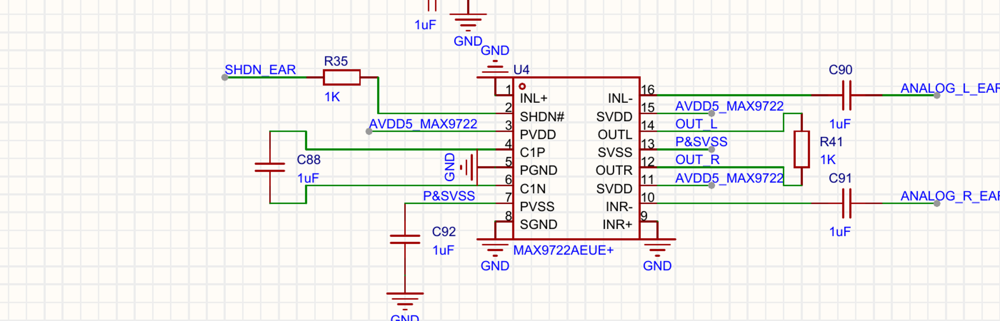
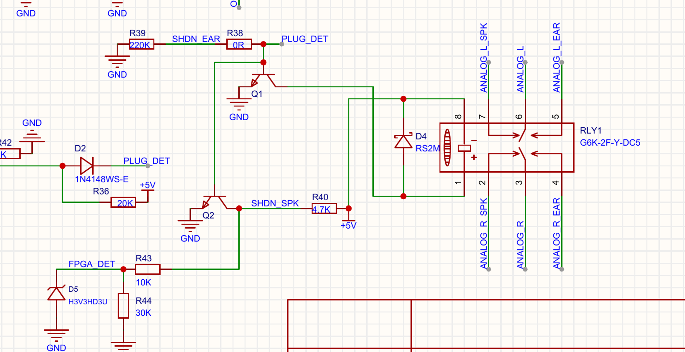

# 6.35mm 耳机输出无声：图纸核对与修正草案

## 已取得的证据

2026-10-23，用户反馈循环测试音在 **6.35mm 耳机插座 J2 无声**，并确认实装 U4 为 **MAX9722A**。Q1/Q2 的具体型号、PCB 实际走线和模拟电压尚未确认。

同日 `../reports/jtag_no_sound.json` 的 JTAG 捕获有效：FPGA 内部源时钟约 12,287,950.03Hz、帧率 48,000.20Hz，PDN=1、SMUTE=0、复位释放，阶段 0→1 持续运行。内部 VCCIO5 ADC 累计 1,551,980 次转换、0 超时，范围约 3.375～3.402V。这些证据确认 FPGA 数字状态，不能确认 FPC 另一端的时钟、DAC 模拟输出或耳放供电。

当前 SRAM 为 `0x13802302` 的低幅度测试音与 ADC 镜像，峰值 −42dBFS；没有写 Flash。本次只核对图纸、整理修正草案，没有再次下载或提高音量。

## 1. MAX9722A 缺少闭环增益网络

来源：`../../../Hardware/SCH_Schematic2_2026-10-23.pdf`，U4 标注 MAX9722AEUE+。用户已确认 A 型。官方 [MAX9722A/MAX9722B 手册](MAX9722-MAX9722B.pdf) 第 12 页 Figure 7 / Amplifier Gain、第 17 页 Typical Application Circuit 明确：**A 型必须外接 RIN 和 RF；B 型才有内部增益电阻**。A 型增益为 `AV = −RF/RIN`，手册推荐 RF=10kΩ。

当前图纸中，C90 直接接 INL−(16)，C91 直接接 INR−(10)，没有串联输入电阻，也没有各声道输出返回反相输入的反馈电阻。R41=1kΩ 两端分别接 OUTL(14)、OUTR(12)，是左右输出间的负载/串扰通路，不能构成所需负反馈。因此**按这份图纸连接的 A 型耳放不具备正常线性放大的闭环电路**。无声原因仍可能叠加供电、关断、继电器或 DAC 上游问题，尚不能单凭 PDF 认定实板唯一故障。

供源原理图和 PCB 核对的修正草案（TSSOP 引脚，与本图相符）：

| 声道 | 输入支路 | 反馈支路 | 非反相输入 |
| --- | --- | --- | --- |
| 左 | ANALOG_L_EAR → C90(1µF) → 新增 RIN_L(10kΩ) → U4.16(INL−) | U4.14(OUTL) → 新增 RF_L(10kΩ) → U4.16 | U4.1(INL+) → GND |
| 右 | ANALOG_R_EAR → C91(1µF) → 新增 RIN_R(10kΩ) → U4.10(INR−) | U4.12(OUTR) → 新增 RF_R(10kΩ) → U4.10 | U4.9(INR+) → GND |

这组值对应每声道 −1 倍增益，1µF/10kΩ 的输入高通截止约 15.9Hz。R41 不应继续跨接左右输出；是否拆除及如何补线，要先核对实际 PCB 与装配，不能把本草案直接当作已核实的返修施工图。A 型确认后，不应套用 B 型的无外部电阻接法。

## 2. SHDN_EAR 与晶体管基极共用节点

图纸连接为：PLUG_DET 同时直连 Q1、Q2 基极，二者发射极接地；PLUG_DET 经 R38=0Ω → SHDN_EAR → R35=1kΩ → U4.2(SHDN#)。Q1/Q2 各自没有画出基极串联电阻。

官方手册第 2 页 Electrical Characteristics 给出 SHDN 输入高电平最小 **2V**、低电平最大 **0.8V**。若实装 Q1/Q2 是普通 NPN，基极-发射极结会将该公共节点钳在约 0.6～0.8V，导致耳放无法可靠使能；R35 位于 SHDN 支路，不能隔离晶体管对 PLUG_DET 的钳位。若实装是带内置电阻的数字晶体管，则需要按具体型号重新计算，当前不能断言此项已在实板发生。

修正设计应保留高阻的插座检测逻辑节点供 SHDN_EAR 使用，并通过独立的驱动级控制继电器和 SHDN_SPK。普通 NPN 的基极支路需要单独限流；阻值和驱动能力必须结合插座的 20kΩ 上拉、Q1/Q2 型号、线圈电流计算。也可评估适配逻辑电平的 MOSFET/缓冲级。只给 SHDN 强上拉而仍与普通 NPN 基极直连，不能解决根本问题。

## 3. FPGA 检测输入的正确含义

FPGA 顶层信号虽然叫 `plug_det`，实际接的是 **FPGA_DET**：它通过 R43=10kΩ 连接 **Q2 集电极 / SHDN_SPK**，并有 R44=30kΩ 下拉及 D5 钳位。它不直接读取 PLUG_DET 或 SHDN_EAR。

所以 JTAG 的 `plug_det=false` 只说明 FPGA_DET 输入低，不能据此认定“没检测到耳机”，也不能证明耳放已解除关断。按控制意图，Q2 导通、扬声器关断时，FPGA_DET 低可以与耳机路径被选择同时出现。C17 应保持输入；图中没有从 FPGA 单独控制 SHDN_EAR 或 RLY1 的 IO。

## 4. 更正 D4 的先前判断

重新沿完整线网核对：**D4 阴极接 +5V / RLY1.8，阳极接 Q1 集电极 / RLY1.1**。按低边开关续流用途，D4 方向正确。此前《原理图解析》中“D4 反接、Q1 导通会短路 +5V”的判断是误读，现已删除并更正。

RLY1 符号把 1 标为“+”、8 标为“−”，而供电连接相反；这是另一个应与准确器件手册/封装核对的线圈极性问题，不能与 D4 方向混为一谈，也尚未认定为继电器不动作的实板原因。

## 后续验证的边界

优先在源工程/BOM/PCB 核对 U4 四个增益电阻及 Q1/Q2 型号，确认实际电路是否与图纸一致；再核对 U4 的 5V 电源、SHDN# 电平、继电器切换和输入/输出模拟信号。A 型闭环和使能均正常后，检查耳放输出直流与波形，再接耳机复测原有低幅度测试音。

本报告初次整理时，BLE 为 H5 超时、Wi-Fi 为 CMD5 超时。2026-10-23 晚间用户修复无线板虚焊后，完全相同的原引脚镜像已通过 BLE 广播/GATT/通知与 Wi-Fi SDIO 识别，见 `../../RTL8723DS/reports/verification_after_repair.json`。这些无线结果与耳放图纸问题独立；本报告中的耳机无声结论尚未取得新的模拟实测结果。

## 资料来源

- 原图：`Hardware/SCH_Schematic2_2026-10-23.pdf`，单页音频板；上述图片为原图局部放大。
- 官方产品页：https://www.analog.com/en/products/max9722.html
- 官方手册下载：https://www.analog.com/media/en/technical-documentation/data-sheets/MAX9722-MAX9722B.pdf
- 本地副本：`MAX9722-MAX9722B.pdf`，21 页，19-3049，Rev 2，10/07；核查完整第 2、12、17 页。
- 实板证据：`../reports/jtag_no_sound.json` 及同名前缀的两份 CSV；用户听音和 A 型确认单独保存在 `../reports/user_feedback.json`，未改写原始 GAO 数据。
