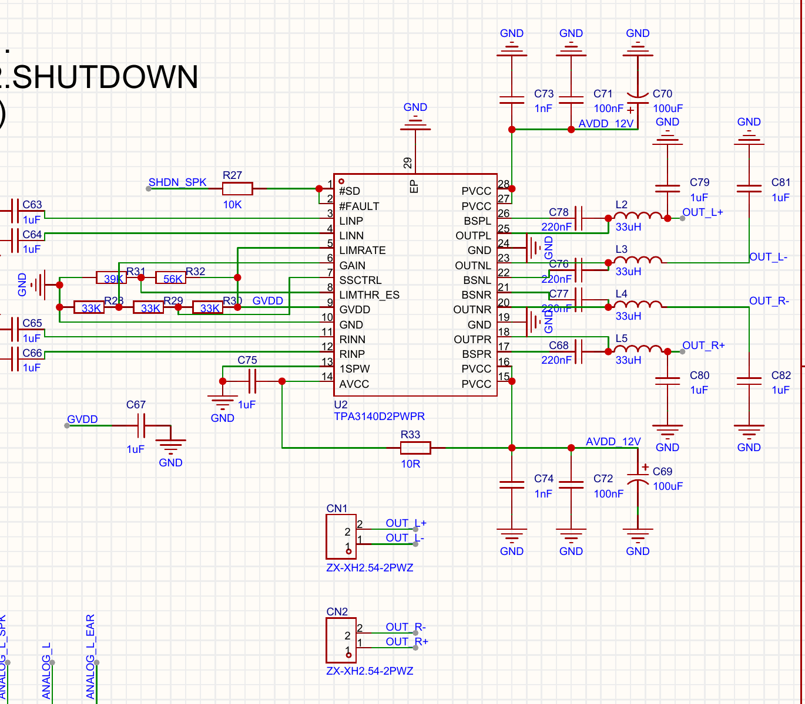
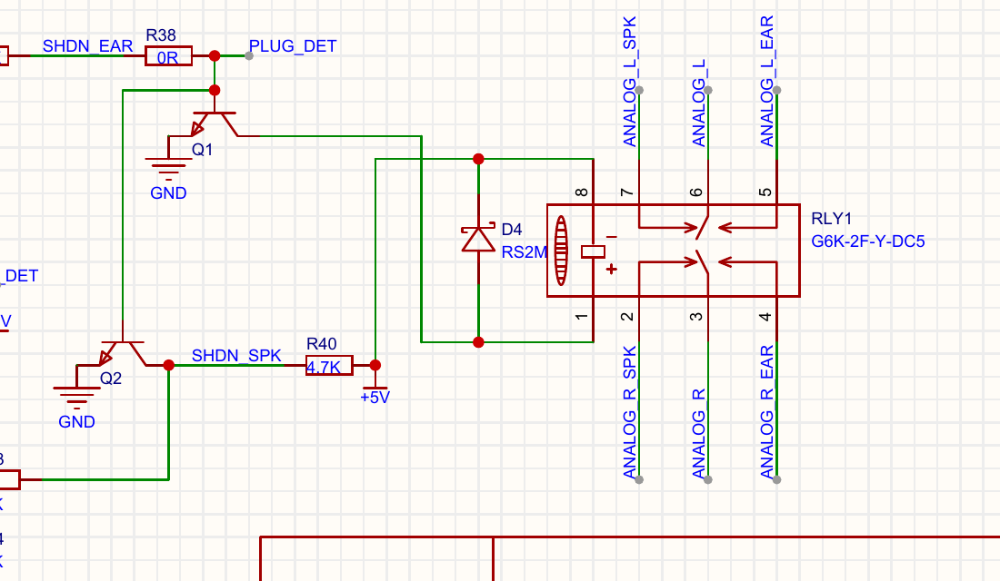

# CN1/CN2 扬声器输出无声定位

**最终进展（2026-10-23）：用户报告修复硬件虚焊，重新下载后确认 CN 接口成功发声，基本听音验证通过。** CN1/CN2 的逐口结果及声道分离未单独确认；修焊具体位置未说明。成功记录见 [speaker_success_after_repair.json](../reports/speaker_success_after_repair.json)。以下保留修焊前无声测量和定位过程，旧电压不代表修焊后状态。

2026-10-23，按用户要求从耳机支路改测两个扬声器输出。重新加载已有 `13802302` SRAM 镜像，仍使用 −42dBFS 的静音、左 1kHz、右 1.5kHz、双声道循环，各 2 秒；没有提高音量或写 Flash。

## 修焊前实测

| 项目 | 结果 | 能确认的范围 |
| --- | --- | --- |
| CN1 / CN2 听音 | 用户反馈两个口都无声 | 扬声器模拟功能未通过 |
| AVDD_12V，提示测 C69/C70 正端 | 用户回复 9.1V | 在 TPA3140D2 的 4.5–14.4V 工作范围内；不代表负载下供电或 AVCC 已验证 |
| U2.1 SD#，提示测 R27 靠 U2 端 | 用户回复 0V | 确认关断输入处于低电平，功放输出不使能 |
| R40 的 +5V / SHDN_SPK 两端 | 用户回复 5V / 0V | +5V 存在，SHDN_SPK 被拉低 |
| PLUG_DET，Q1/Q2 基极节点 | 用户回复 0.657V | 与普通 NPN 的 Q2 导通相符，尚未确认器件型号及插座检测根因 |
| JTAG 数字侧 | 12,287,947.64Hz / 47,999.89Hz，PDN=1，SMUTE=0 | FPGA 数字发生器在运行；未证明 DAC 端收到数据或有模拟输出 |
| C17 / FPGA_DET | 两次捕获均低 | 经 R43 读 SHDN_SPK，与本次 SD# 低一致；不能单独判断 Q2 或 FAULT |

原始数字数据：`../reports/jtag_speaker_resume.json` 及同名前缀 CSV。用户反馈与电压单独记录在 `../reports/speaker_resume.json`，不混入 JTAG 自动测量。

## 关断控制链

图纸连接：+5V → R40（4.7kΩ）→ SHDN_SPK（Q2 集电极）→ R27（10kΩ）→ U2.1 SD#。U2.2 FAULT# 与 SD# 接在同一节点；这是手册允许的自动恢复连接，不能把这项连接本身认定为错误。

Q2 发射极接 GND，基极与 Q1 共接 PLUG_DET。耳机插座检测可以同时切换继电器和拉低扬声器使能。FPGA 的 C17 只有检测输入，没有独立驱动 SD# 或继电器的引脚，不能通过修改 C17 方向强行替代子板使能电路。

TI 官方手册 SLOS882B：第 4 页列出 SD=1 脚、FAULT=2 脚；第 6 页给出供电 4.5–14.4V、SD 高电平至少 2V、低电平至多 0.8V；第 13 页说明拉低 SD 会静音并进入关断；第 18 页说明 FAULT 可以因短路、直流检测或过热而拉低。当前 0V 已足以解释无输出，但仍未定位是谁拉低它。

## 关断测量结果与后续

用户已测得 R40 两端为 5V / 0V、PLUG_DET 为 0.657V，符合下表第二行。应核查插座触点、Q2 实装型号和脚序、焊接及检测电路。此前提出断电后用 1kΩ 将 PLUG_DET 拉向 GND 的诊断办法，尚未收到已实施的确认，不能记为完成或证明有效。

| 测量结果 | 优先检查 |
| --- | --- |
| R40 的 +5V 端缺失 | 主板/FPC 的 +5V 供电、R40 焊接及通断；AVDD_12V 存在不等于 +5V 存在 |
| +5V 正常，SHDN_SPK 低，PLUG_DET 高 | Q2 正在受驱动；核查插座触点、D2/D3、检测信号及继电器当前支路 |
| +5V 正常，SHDN_SPK 低，PLUG_DET 低 | Q2 型号/脚序/漏电、焊接短路、R40 开路等；须结合 R27 两端压差排除故障输出影响 |
| SHDN_SPK 高而 U2.1 仍低 | R27 两端压差、SD/FAULT 节点短路或 U2 报故障；检查输出接线/负载，再核查 AVCC、GVDD |

在此之前不把 SD# 强接到高电平：它与 FAULT 共线，若为保护拉低，应先查故障原因。解除关断且确认使能后，再沿继电器的 ANALOG_L/R_SPK、C63/C66、U2 输入及 LC 输出验证模拟音频。

CN1：2=OUT_L+、1=OUT_L−。CN2：1=OUT_R+、2=OUT_R−。扬声器跨各口两端，负端不是系统 GND。

## DAC 输出续测

重新上电下载后，`../reports/jtag_speaker_repower.json` 仍显示 FPGA 数字发生器通过：音频时钟约 12,287,952.79Hz、帧率 47,999.67Hz、PDN=1、SMUTE=0。这些是 FPGA 内部状态，不能替代 DAC 物理脚测量。

随后用户反馈 U1 AOUTRP/AOUTRN 仅见 0V 附近杂波。要求 DC 耦合测量后，回复原文为 `RP=0 RL=0 DVDD1.8V PDN 2.4V`。RP 为 0V；第二个输出标为 RL，尚需确认是否指 RN（26 脚），不直接写成已确认 RN=0V。DVDD 1.8V 说明内部数字电源存在，但不能证明模拟供电、参考或时钟正常。

PDN 2.4V 低于本工程预期的约 3.3V。参考现有旧版 AK4493 手册 `017012230-E-00`，当 TVDD 为 3.0–3.6V 时 VIH 下限为 0.7×TVDD；若 TVDD=3.3V，则为 2.31V。因此不能仅凭 2.4V 判为复位低，也不能证明它在实际 TVDD 下有足够裕量。该旧手册不等同于实装 AK4493S 的新版 `211100143-E-02`。

下一步在 U1 本体对音频板 GND 测 VDDR（27/28 脚，图纸 5V）、AVDD（44 脚，图纸 3.3V）、TVDD（48 脚，图纸 3.3V），并确认 MCLK（46 脚）是否有 12.288MHz 及正常高低电平。旧版手册说明缺失 MCLK 可令模拟输出高阻，而内部 LDO 仍工作，因此 DVDD=1.8V 不能排除缺时钟。若这些正常，再查参考电压、VCMR/VCML、BICK/LRCK/SDATA、SMUTE 及 PDN 的实际波形。

当前仍使用 −42dBFS 的分段测试音；单端音频只有几十 mVpp，右声道每 8 秒仅后 4 秒有声。正常静音阶段仍应与“没有正常输出偏置”区分。DAC 本体异常与 U2 SD# 已测为低分别记录，尚未证明是同一根因。

### DAC 端缺 MCLK 后的恢复操作

用户随后回复 `5V 3.3V 时钟没有，应该是FPGA提供的吧`，按提问顺序记录 VDDR=5V、AVDD=3.3V；TVDD 没有单独读数，RN 标签也未进一步确认。用户在 DAC 端未看到 MCLK。该时钟由 FPGA 提供，构建后的约束文件确认 `ak_mclk` 是 B13 的 LVCMOS33 输出，综合网表保留时钟门控逻辑与 OBUF。图纸路径为 **FPGA B13 → 主板 FPC2.16 → 子板 FPC1.9 → U1.46**。

22:39 首次 JTAG 复查得到全零采样，诊断为 `Invalid AMP1 signature`，见 `../reports/jtag_dac_missing_mclk.json`。该次无法证明音频镜像仍运行，也不能据此断言一定是排线故障或 FPGA 时钟源失效。随后重新下载同一已校验的 SRAM 镜像，UserCode=0x13802302，下载校验通过，见 `../reports/sram_radio_20261023_223933_496354.json`；没有写 Flash。

重新下载后，`../reports/jtag_dac_mclk_reload.json` 捕获有效、数字检查通过：内部音频时钟约 12,287,980.17Hz、帧率 47,999.73Hz，PDN=1、SMUTE=0。外部物理 MCLK 尚未复测，不能把内部恢复写成 DAC 端时钟已恢复。

请先复测 U1.46（10×探头，约 20–50ns/格）；若仍没有 12.288MHz，再测主板 FPC2.16。主板有而 DAC 无时，沿子板 FPC1.9 查排线、接点及走线；主板也无时，继续核查 FPGA 输出至连接器的路径。此前 PDN=2.4V 也属于重新下载前的测量，需按新状态复核。

## 来源

- 原图：`../../../Hardware/SCH_Schematic2_2026-10-23.pdf`。
- TI 官方手册：[tpa3140d2.pdf](tpa3140d2.pdf)，SLOS882B，2017-12 修订。下载 URL 与 SHA256 见 `sources.json`。

### 用户报告修复虚焊后重新下载

2026-10-23 23:05，用户报告“修复了硬件虚焊的问题，再下载”，具体修焊位置未说明。已重新下载相同音频 SRAM 镜像，Program+Verify 通过，UserCode=0x13802302；证据为 `../reports/sram_radio_20261023_230533_424266.json`。23:06 的 `../reports/jtag_after_solder_repair.json` 捕获有效、数字检查通过：内部音频时钟约 12,287,943.54Hz、帧率 47,999.97Hz，PDN=1、SMUTE=0，测试阶段由左声道推进至右声道。仍为 −42dBFS、各阶段 2 秒的循环；未写 Flash。待实测 U1.46 的物理 MCLK、AOUTRP/RN 的直流偏置及音频波形，尚未证明模拟输出恢复。

### CN 接口发声成功

随后用户要求记录“CN接口成果发声”，结合本轮测试语境，记录为 **CN 扬声器接口成功发声**。基本模拟发声功能依据用户听音确认通过；没有修改既有 JTAG 原始报告的 `analog_verified`，成功反馈单独保存在 `../reports/speaker_success_after_repair.json`。当前镜像、引脚和 −42dBFS 测试音保持原配置。用户未分别说明 CN1/CN2 或声道分离结果，也未提供修焊后 DAC 和功放节点波形，故不将这些项目标记为已验证。
