# 基础实现与原架构的关系

依据 `Dev/Obsidian_GW/FPGA架构.canvas`、`FPGA设计文档.md`、`FPGA完成度统计.md` 的方案，先落实串口演奏的固定32声部分时复用闭环。用户本次确定串口输入、HDMI 显示和板载 HEADPHONE；这些板级选择优先于方案中尚未冻结的参考配置。

## 实际数据流

```mermaid
flowchart LR
    GUI[Python GUI / 琴键 / 32声部预设] --> WORKER[单线程串口队列]
    CLI[Python CLI] --> TRANS[共享协议与事务]
    WORKER --> TRANS
    TRANS --> UART[UART / CRC16]
    UART -->|2 拍 32 bit 命令| CTRL[帧边界提交]
    CTRL --> VOICES[32槽状态RAM / 共享DDS + ADSR + 力度]
    VOICES -->|各路 Q1.31| MIX[40bit顺序宽累加]
    MIX --> OUTPUT[总体音量 / LR平衡 / 最终饱和]
    OUTPUT -->|左右Q1.31| DAC[PCM16 量化 / PT8211 串行输出]
    DAC --> HP[HEADPHONE]
    DAC -->|实际BCK / WS / DIN| OBS[最终PCM双槽解码]
    VOICES -->|最低音DDS周期参考和参数版本 / 随DAC帧缓存| DAC
    OBS -->|M / 同帧参考| CAP[双bank 1024点波形快照]
    OBS -->|L / R PCM16| ACAP[独立双bank 1024点分析块]
    ACAP --> FFT[双FFT / 频带峰值 / MID-SIDE结像]
    FFT --> RENDER
    CAP --> ALIGN[513个窗口整段匹配 / 512点显示RAM / HOLD]
    ALIGN --> RENDER[双像素波形 / 触发状态]
    CAP -->|活动声部 / 源诊断| RENDER
    RENDER --> WRITE[RGB565 后台帧写入]
    BIST[DDR校准 / 前8MiB自检] --> DDR[DDR3 双帧缓存]
    WRITE --> DDR
    DDR --> SCAN[带帧/行标签的双行缓存]
    SCAN --> HDMI[1920x1080 / 60Hz / TMDS]
    CTRL -->|32 bit ACK| UART
    DAC -->|每1024周期 sample_tick| CTRL
    DAC -->|sample_tick| VOICES
```

系统和音频逻辑均运行于 50 MHz。BCK 是输出寄存器产生的引脚波形，不作为内部逻辑时钟；因此音频链内部没有额外音频 CDC。DDR 使用 100 MHz 用户域，视频使用 148.5 MHz 像素域与 742.5 MHz 串化域。波形和立体声分析各有独立两组 1024×32 RAM，波形另有 512×32 显示 RAM，通过请求/确认翻转交接银行所有权；显示无 `ready` 返回音频路径。DDR 校准失败或视频失锁只重置观察与显示路径，UART、合成和 PT8211 保留独立的系统复位。

以上描述对应 Prj1 当前 RTL，不代表原 ACX720 完整链或独立 48 kHz 迁移候选。原链已有128槽三模式、五音色、MIDI表情、延迟/合唱/混响及FFT/录音FIFO/曲谱；合并入口为 `audio_workstation` 的 MIDI字节＋`sample_ce`＋左右Q1.31。G1仍发送31,250 baud MIDI，本项目115200自定义包保留独立语义，不把显式32槽命令直接当作MIDI。原 `audio_processing_system` 与既有验证入口保持。

Prj1 的 `Prj1.gprj` 和 `src/top/prj1_top.v` 当前均未启用 CPU。后续138K版使用器件内置 AE350 负责 UI、控制与调度，逐样本音频继续运行于RTL；PicoRV32仅保留在ACX720验证工程。AE350访问现有DDR、显示共享显存与自由效果画布仍未接通，不能把当前DDR显示仲裁视作CPU内存服务。厂家AHB/APB接口、时钟占位及迁移候选时钟见[硬件适配笔记](../../../../migration/HARDWARE_ADAPTATION_NOTES.md)。

## 文件职责与数值边界

| 文件 | 职责 / 接口 |
|---|---|
| `src/top/prj1_top.v` | 板级连接、HDMI方向、诊断字、共用50MHz延迟时间戳；不在顶层实现算法 |
| `src/platform/reset_release.v` | 上电初始化、异步按键断言、同步延时释放 |
| `src/platform/video_clock_1080p.v` | 两级精确频率 PLL、锁定过滤与显示域复位释放 |
| `src/control/uart_rx.v`, `uart_tx.v` | 物理 8N1 字节与零扩展 32 bit 字适配 |
| `src/control/uart_control.v` | 定长包校验/重同步、两拍命令、序号/CRC 回复 |
| `src/synth/synth_engine.v` | 完整命令验证、采样边界提交、32声部帧调度、完整活动掩码快照、与采样对齐的最低音DDS触发参考和参数版本 |
| `src/synth/synth_voice_bank.v` | 262×32位同步状态RAM、共享振荡器/ADSR/乘法器/正弦ROM、40bit顺序混音和最低音选择，225拍/帧 |
| `src/synth/synth_voice.v` | 保留旧并行单声部作为位精确仿真参考，顶层不实例化 |
| `src/synth/synth_sine_rom.v` | 1024 点 Q1.31 正弦查表，按 DDS 相位高 10 位寻址 |
| `src/diagnostics/audio_latency_monitor.v` | 同一50MHz时间基准的UART→命令→样本→PT8211数字延迟，最新声音记录、阶段有效位和回绕过期 |
| `src/audio/audio_output_stage.v` | 40位直接混音、平滑总体音量/LR平衡、最终饱和与增益后声部贡献标签 |
| `src/audio/pt8211_tx.v` | 左右Q1.31分别舍入饱和到PCM16、成对帧缓存、欠载静音、功放延迟开启 |
| `src/video/feedback_capture.v` | 显示配置双bank连续1024样本、峰值/元数据/参数版本、跨域所有权，换音取消未完成块，不反压音频 |
| `src/video/feedback_wave_align.v` | 全部513个512点窗口比较，平均绝对差≤4匹配单位（新布局约2像素）才原样更新显示RAM，失配HOLD，换音重新捕获 |
| `src/audio/pt8211_observer.v` | 解码最终串行双槽 PCM16，同帧触发参考 |
| `src/video/output_audio_capture.v`, `output_audio_analysis.v` | 双银行最终立体声块、独立 Hann FFT、频带峰值、自动增益结像与左右峰值 |
| `src/video/feedback_renderer.v`, `feedback_dashboard.v` | 匹配与分析后整帧快照、两个RGB888像素/拍、波形/HOLD/频谱/结像与状态 |
| `src/memory/ddr3_platform.v`, `ddr3_bist.v` | DDR物理IP适配、前8MiB两遍写读自检 |
| `src/memory/ddr_frame_writer.v` | RGB565打包、后台帧写入、最后原生写握手后发布 |
| `src/video/video_ddr_scanout.v` | 垂直消隐换帧、DDR双行预取、帧/行标签与欠载黑行 |
| `src/video/video_timing_1080p.v`, `hdmi_display.v` | 2200×1125光栅及显示存储仲裁；RGB/64-bit/256-bit打包局限于显示存储适配 |
| `vendor/sipeed_dvi/` | 示范工程的 TMDS 编码、OSER10、差分缓冲和修改后的 PLL |
| `tools/instrument_backend/protocol.py` | 包编码、ACK 重同步/解析、音高/力度/ADSR 单位换算 |
| `tools/instrument_backend/transport.py` | 串口 stop-and-wait、OS 端口元数据、明确标注的离线控制模拟 |
| `tools/instrument_backend/worker.py` | 唯一串口所有者线程、有界队列、参数合并、清音与失败恢复边界 |
| `tools/instrument_ui/app.py` | Tk 主线程意图与界面刷新，不执行串口阻塞读写 |
| `tools/instrument_ui/latency.py` | 独立延迟窗口、主机阶段与FPGA快照、匹配事务的数字输出区间 |
| `tools/instrument_ui/widgets.py` | 琴键、包络曲线、状态标签和主题 |
| `tools/instrument_ui/voice_model.py`, `presets.py` | 主机32槽所有权及旧四声部固件兼容、预设数值验证和 JSON 持久化 |
| `scripts/generate_sine_lut.py` | 可复现生成正弦 RTL 查表；生成文件随源码提交 |

握手只有 `valid && ready` 才消费命令/回复；数据与 first/last 在背压期间保持。合成样本是每帧固定周期脉冲接口，下游在下帧消费；末端欠载记数并输出零。当前音源为单声道，输出级按总体音量和L/R平衡生成两路Q1.31，PT8211保存并串化完整左右对；最终显示重新解码两路PCM。

## 帧时序

在 PT8211 帧 n 的起点，串行输出装载上次计算完成的样本，同时产生一个 `sample_tick`。合成器在该使能周期更新独立状态、提交已收齐命令，并对更新前的状态计算本帧样本；共享核心225拍完成，引擎再寄存1拍，合计226周期后输出 `sample_valid`。输出适配器先缓存，直到下一帧装载，故控制到声音存在明确的帧偏移。静音声部NOTE_ON从零包络进入ATTACK，还受首个非零样本影响；活动且包络非零时保持相位与电平，更新步进并从当前电平重新起音，避免复用释放尾音时出现幅度断点。仅这次重触发的A/D限幅为每样本满量程1/128，正常较慢包络和逐样本计算语义保持一致。

当前每帧1024周期，32声部运算及输出226周期，占22.1%；空闲槽也扫描，耗时固定。复位逐拍初始化状态RAM，引擎保留初始化期间的首个tick。命令在帧起点锁存，ACK及活动掩码在整帧完成后原子发布。此实现是固定调度，不是运行时任意图引擎。详见[32声部实现](tdm32.md)。每条请求约 1.042 ms，后续 8 字节回复约 0.694 ms；USB 调度、主机、模拟滤波与功放延迟尚未测量。

## 对照原始工作包

“部分实现”表示只覆盖本基础版需要的子集，不表示整个工作包验收通过。

| 原始工作包 | 本版落点 | 保留的后续工作 |
|---|---|---|
| P01/P02/P03 | 实际板级端口、时钟、复位、邮箱 CDC、48.828125 kHz 帧基准 | 板测、更多时钟/平台适配 |
| P04/P05/P06 | 两字控制流、帧提交、32槽状态RAM | 通用 IF-CFG、8 字 IF-EVT/JOB、通用状态服务与互连 |
| P07 | DDR3平台、8MiB启动自检、双帧写入与行预取、显示读优先仲裁 | 板测、全容量测试、通用DMA/IF-MEM、音频访存QoS |
| I02/I03/I04 | CRC 串口协议、显式槽控制、独立 NoteOn/Off | MIDI、事件路由、自动分配、代号/抢占、同帧多音 |
| I01 | 用 UART 参数代替自研外设接入 | 自制多维交互硬件和标定 |
| S01/S04/S05 | 三角/脉冲 DDS、1024 点正弦查表、线性 ADSR、相位连续单音变调 | 可编辑波表、完整 LFO/滑音、带限处理 |
| A02/A08 | 32声部宽位直接混音、总体音量、LR平衡、双槽量化/PT8211输出 | 逐声部声像、通用输出FIFO/可选DAC |
| E01 | DDR 1080p60扫描、最终 PCM 的 M 波形匹配/HOLD、独立 L/R 1024点 Hann FFT、MID-SIDE 结像、左右峰值和诊断；新画面上限约47.7帧/s | 新分析版板测、RMS、密度余辉/相关系数 |
| V01/V02/V03 | 正常串口路径联合仿真、错误计数、独立参考模型 | 全链路板级延迟、可闻单元频谱/计分、规模压力 |
| G01—G05 | 未实现通用图系统 | 模块 ABI、图工具、链接/排程、图执行与热提交 |
| S02/S03/S06/S07 | 未实现 | 加法、FM/PM、弦/模态/钢琴 |
| A01/A03—A07 | 未实现独立通用处理模块 | 滤波、延迟、混响、合唱、失真、外部音频 |
| E02—E07 | 未实现 | LED/曲谱、事件记录、录音、FLAC/MP3、蓝牙/App |

不为未实现方向建立空壳并标记完成。原始 41 工作包与 17 项需求分母保留；[verification.md](verification.md) 只登记本版可复现证据，不把 UART 控制自动算作“自研双维外设验收”，也不把活动掩码自动算作“可闻振荡器数量”。

## 历史版本：四声部演奏界面与第三种波形

以下保留2026-09-08四声部GUI/正弦版本的行为：从鼠标/电脑琴键到四槽参数命令，第五个同时按键忽略，释放后的槽可以重用；手动卡片重用槽后，旧琴键的释放不会停止新音。当时FPGA接收显式voice 0…3。当前默认32槽、旧位流四槽兼容及有界异步串口调度见[32声部实现](tdm32.md)和[主机延迟说明](host_latency.md)；板内通用分配器、事件代号和抢占逻辑仍未实现。

波形枚举在原 `05 WAVEFORM` 命令中增加值 2，不改变 UART 包长度、CRC、采样率和接口位宽。正弦由固定 ROM 提供，32声部分时共享；这只覆盖一种固定波表音色，不等价于运行时任意波表装载、FM 或通用图合成。首版位流仍支持值 0/1，对 2 返回非法值；主机明确报错，待新版位流下载后启用。

主机协议和串口事务从 CLI 抽出共享包，GUI 使用单线程 stop-and-wait。待发参数可合并，NOTE_OFF 取消同槽尚未发送的 NOTE_ON，PANIC 清空待发命令并优先执行。连接先 PING/PANIC，失败不重连或重放；Tk 主线程只排队和消费事件。界面包络为参数示意，ACK 活动状态与测量音频电平保持不同含义。

四组内置预设和32声部JSON（兼容旧4声部） 让参数可以保存、复用；未增加音频录音、蓝牙 App、曲谱或通用图编辑器。操作见 [gui_control.md](gui_control.md)，本轮构建和回归证据见 [verification.md](verification.md)。

## 本轮推进：DDR 显示与真实波形

显示使用核心板 DDR3，两个 RGB565 帧分别位于前 8 MiB 的 4 MiB 对齐窗口。启动校准完成后，BIST 对该保留区先写读地址相关模式，再写读其反码；自检失败不启动显示。它不覆盖整个 1 GiB，更不是通用 DMA/外存服务已经完成。

后台渲染器在 100 MHz 每拍产生两个像素，由写入器打包成 256-bit / 16 像素 BL8。前台扫描以 148.5 MHz 固定光栅运行，经双行 BSRAM 从 DDR 读取；每行包含完整的 epoch/行号标签，晚到数据不被解释为另一行。后台完成的帧只在垂直消隐交接，写入器必须等待最后 DDR 命令与数据一起接受后才发布。读请求优先于写请求；实际持续 60 个新画面仍取决于 DDR 服务和时序余量。

画面不采用时间动画模拟声音。波形由最终串行 PCM 的 M 信号触发采集 1024 点并匹配选出 512 点；独立分析捕获器连续采集 1024 对 L/R PCM 计算频谱、结像与左右峰值。声部/源状态在波形块末锁存，存储计数在渲染开始时锁存。两套捕获各自双银行交接，满时只丢显示观察点。HOLD 只保留波形；分析块与波形块不保证同时开始。详见 [DDR 显示](ddr_display.md)、[反馈接口](feedback_notes.md)、[时钟说明](video_1080p_notes.md) 与 [验证记录](verification.md)。

## 后续扩展约定

新增算法放入 `src/synth/` 或独立效果子目录；公开数值口维持 32 bit，内部高精度运算在出口定义量化。新增接口放入 `src/control/` 或平台适配层。未来实现标准 8 字 IF-EVT 时新增明确的协议转换，不改变已发布串口包语义或暗称当前两字记录等价于标准事件。

变更 RTL 后运行模块测试、完整回归、工程清单检查和 Gowin 构建；新增文件执行 `scripts/update_project.py`。引脚和实际采样率变化必须同步 `constraints/`、主机默认值、README 和硬件记录。原始设计图维持长期架构，当前工程不直接修改其全部节点为“完成”。
