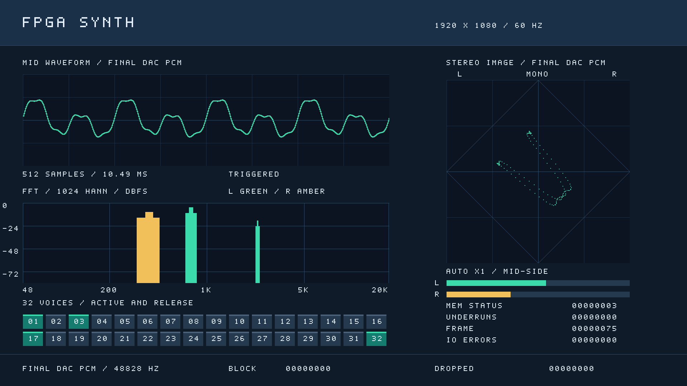
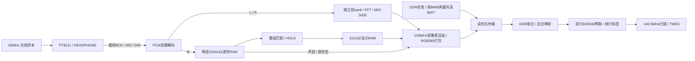

# DDR 帧缓冲与 1080p60 显示

历史 DDR 版本将 `Prj1` 的 HDMI 画面接到核心板 DDR3，目标输出 **1920×1080、逐行、60.000 Hz**。该历史版用户逻辑、20 项 HDL / 62 项 Python 回归及 Gowin 综合/布局布线已通过，setup/hold 违例为 0。DDR版及诊断版已手动下载；串口确认校准、前8MiB自检、首帧有效，诊断版还测到约148.5MHz像素时钟、约60帧/s扫描和渲染、欠载0。随后15:06官方PLL初始化版已稳定显示，用户确认信息页为1920×1080/60Hz，正弦演奏的波形/峰值/声部反馈及松键回落正常。当前位流、完整时序和板测记录统一见 [verification.md](verification.md)。

上图由实际 `feedback_renderer` 输出完整 1,036,800 个双像素 beat 后生成，复现命令是 `python3 scripts/render_feedback_preview.py --analysis`。测试夹具中的正弦组合、MEM STATUS、FRAME 等值仅用于检查布局和像素数据；它不是 FPGA、耳机、DDR 或 HDMI 的实测证据。

## 数据路径和存储范围

核心板原理图是两颗 H5TQ4G63EFR-RDC，合计 32-bit、1 GiB。C 版 Gowin DDR3 IP 工作在 400 MHz DDR CK / 每 DQ 800 Mbit/s，用户口 100 MHz、256 bit。物理与引脚出处见 [DDR 平台](ddr_platform_notes.md)。

| 区域 | 字节地址 | 原生 DDR 地址 | 有效数据 |
|---|---|---|---|
| 帧 0 | `0x00000000` 起 | `0x00000000` 起 | 4,147,200 B = 1920×1080×2 |
| 帧 1 | `0x00400000` 起 | `0x00100000` 起 | 4,147,200 B |
| 启动 BIST | `0x00000000`–`0x007fffff` | 每个 BL8 请求地址递增 8 | 前 8 MiB，包含两帧保留区及对齐余量 |

原生地址单位是 32-bit DQ 字，不是字节或 256-bit beat。一个 BL8 是 32 字节、16 个 RGB565 像素，占 8 个原生地址；保持地址低三位为零。单行 3840 字节，120 个 BL8；每帧 129,600 个 BL8。

## 启动、交接和失败行为

1. DDR PLL/IP 完成自身初始化和 PHY 校准，用户域复位才同步释放。
2. BIST 遍历前 8 MiB，先完整写入地址/位置相关的模式并读回比较，再写入反码并再次比较。连续 100 ms 无命令/响应进展即失败；数据错误也记录失败。该检查覆写保留区，不检查剩余约 1016 MiB，不等于全容量 March 测试。
3. `bist_done && !bist_failed` 后开始渲染后台帧。写入器等待最后一笔 DDR 写命令与写数据一起接受，随后才把完整帧发布为待显示。
4. 扫描器在垂直消隐处理换帧，预取下一帧前两行。可见区以两组 BSRAM 行缓存交替输出，消费完一行后才取下一条同银行的行。
5. 每个缓存行携带帧 epoch 与行号。来迟或缺失的行不与当前扫描混用，输出黑行并记录欠载；读取长期无进展置 `fetch_fault`，需复位恢复。

HDMI 光栅由视频时钟独立运行，不因 DDR 忙暂停计数。视频 PLL 稳定后，DDR 尚未校准、自检及首帧等待期间都输出带同步的 1080p 黑帧。DDR 或视频失锁会共同断言显示路径各时钟域的复位，各域随后同步释放，取消旧快照和在途请求。UART、合成器与 PT8211 不使用 DDR 复位，DDR 不可用时仍可接收串口命令并输出音频。

## 60 Hz 的时序与带宽

水平有效/前肩/同步/后肩为 1920/88/44/148，总 2200；垂直为 1080/4/5/36，总 1125，HS/VS 正极性。148.5 MHz / 2200 / 1125 = 60.000 Hz。TMDS OSER10 使用 742.5 MHz FCLK，每数据通道 1.485 Gbit/s。两级 PLL 的精确比率、LOCK 过滤和官方限值见 [1080p 时钟说明](video_1080p_notes.md)。

仅有效像素读带宽为 248.832 MB/s；每帧全重绘再增加相同写带宽，合计 497.664 MB/s，尚未包含刷新、激活和读写切换。DDR 理论总带宽 3.2 GB/s 不能代替实际服务能力验证。

渲染器输出两个像素/周期，本体约 10.368 ms/帧。当前打包器每 8 拍再等待一次原生写入，理想渲染写入约 11.664 ms；若保守加入每帧 129,600 个扫描读命令占用周期约为 12.960 ms，距 16.667 ms 留约 3.7 ms 额外反压余量。这是容量估算，实际应核对集成仿真、STA、DDR 板测、欠载计数以及连续帧计数。固定 60 Hz 光栅与每秒 60 个新完成画面需要分别验证。

## 音频反馈与诊断

当前波形采集每块 1024 个最终串行 PCM 的 M=(L+R)/2 样本，转为 Q1.31，在其中检查全部 513 个长度为 512 的窗口；与上一显示曲线的整段平均绝对差≤4个 sample>>>23 单位（新布局约2纵向像素）时，原样更新最佳窗口并显示 TRIGGERED，否则保留曲线并显示 HOLD。换音或声音参数变化后重新捕获，全零块自动回到平线。波形采样率 48,828.125 Hz，显示窗口仍为 10.48576 ms；独立分析块的左右峰值使用全部1024点，HOLD时 FFT、结像、左右峰值、声部和状态继续更新，时间不再与保留曲线相同。峰值不是 RMS，声部位包含 ADSR 释放尾音，不是独立声部电平。采集仍保留最低音DDS周期参考、过零回退、静音和超时；超时不强迫接受失配窗口。完整规则见 [音频反馈说明](feedback_notes.md)。双声道独立1024点Hann FFT和MID-SIDE结像来自另一套无触发捕获，参数、对数频带峰值聚合和单声道居中行为见[输出分析](output_analysis.md)。

1024点采集需20.97152ms，持续新画面上限约47.7帧/s，实际还受触发等待、最长约5.3ms匹配、DDR服务和帧缓冲交接影响。HDMI始终按60Hz扫描，无新帧时重复完整前台帧；HOLD时仪表盘仍刷新，曲线接受次数可远低于画面次数。上方15:06版约60个新画面/s的板测属于早期512点采集版本，不能作为本版新画面率。观察数据不回压音频；波形和分析各有两组观察RAM，各自满时丢显示采样点。页脚 BLOCK/DROPPED 对应立体声分析捕获。

屏幕源状态的高 16 位是音频欠载计数低 16 位，低 16 位是 UART 错误计数低 16 位；不是 ACK 的成功/失败返回码。`FRAME` 当前显示完成写入的后台帧计数，不能直接当作测得的 HDMI 刷新率。`UNDERRUNS` 是扫描缓存缺行计数。

| MEM STATUS 位 | 为 1 时的含义 |
|---|---|
| 0 | DDR PHY 校准完成 |
| 1 | 启动 BIST 已结束 |
| 2 | BIST 数据错误或超时失败 |
| 3 | 已有有效前台帧 |
| 4 | 行读取超时故障 |
| 5 | 扫描缺行计数非零 |
| 6 | DDR PLL 锁定 |
| 7 | 视频 PLL 锁定资格通过 |

画面状态在开始渲染时锁存，因此用于观察时允许一帧延迟。DDR 指示块在 BIST 失败时为红色，校准/BIST 等待时为黄色，两者完成且 BIST 成功时为绿色；其他故障同时查看原始状态字。发生启动故障时尚无可读 DDR 帧，黑屏本身不能区分校准、BIST 或传输问题，需要串口状态辅助定位。

运行 `python tools/instrument_cli.py --port COM26 memory-status` 读取上述八个标志位。对应协议命令为 `0x0B`，成功 ACK 的 byte4 是内存状态；其他命令该字节仍为声部掩码。正常稳态且从未欠载时预期 `0xCB`，但状态字不能代替显示器识别或实际画面检查。离线模拟不支持此命令，旧位流也会明确拒绝。

## 验证边界与上板步骤

`tb_ddr3_bist` 使用有反压、延迟和错误注入的内存模型；`tb_ddr_framebuffer` 检查原生用户接口的写入、RGB565、交接、标签和欠载；反馈与时钟/时序有各自独立测试。Icarus 回归不执行加密 DDR PHY，不能由仿真断言其模拟校准通过。

构建/STA通过后下载对应新位流，记录串口 DDR 状态从等待到校准/BIST/前台有效，核对显示器信息页识别为 1920×1080 / 60 Hz。随后演奏已知音色，检查波形、峰值和活动状态随真实输入变化，连续观察缺行计数、帧推进、复位恢复，并保留版本哈希与实测记录。首次 640×480“FPGA SYNTH”及既有 COM26 PING 仅适用于旧版连通性，不能迁移为本轮验收结果。
