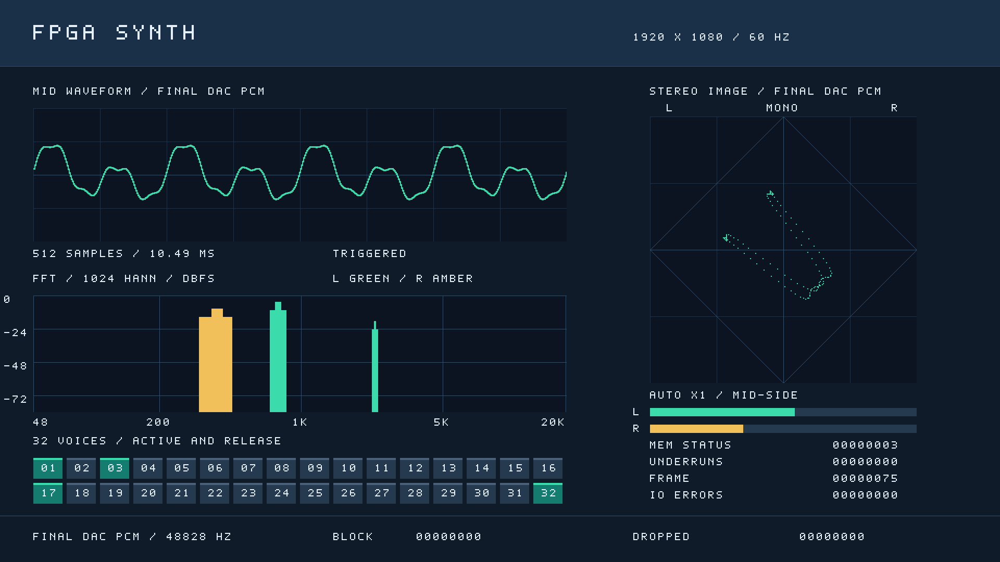

# 最终输出的 FFT 与立体声结像

2026-09-09 新增。HDMI 左上保留匹配/HOLD 波形，左下显示双声道 FFT，右上显示 MID-SIDE 结像场，下方保留左右峰值、32 声部与 DDR 诊断。当前音源经总体音量和L/R平衡形成左右声道。平衡居中时结像呈竖线、频谱重合，偏转时结像倾斜，左右电平相应变化。



## 采样位置

`pt8211_observer` 在 50 MHz 域观察实际顶层输出 `hp_bck/hp_ws/hp_din`，按 BCK 上升沿重新拼出 PT8211 的右槽和左槽；每个完整立体声帧产生一拍 `sample_valid`。`pcm_pair[31:16]` 是左 PCM16，低 16 位是右 PCM16。显示包含最终舍入、饱和、启动零和欠载补零的结果，观察路径没有音频 ready 或背压。

这是 DAC 数字串行输入的采样，不包含模拟 DAC、功放静音/增益、耳机及声学响应。没有用预测量化值替代实际串行字，也没有修改输出波形、音频时钟或合成器参数。

波形输入改为 `M=(L+R)/2`，以 `(signed L16 + signed R16) << 15` 转为 Q1.31。触发参考随同一实际 DAC 帧缓存和解码，欠载时无有效周期参考。FFT 分别处理原始 L/R，不先合并 M；反相立体声仍有频谱能量。

## FFT 数值与坐标

| 项目 | 实现 |
|---|---|
| 采样率 | 48,828.125 Hz（50 MHz / 1024） |
| 窗口 | 每声道 1024 点连续 PCM，20.97152 ms；周期 Hann |
| 变换 | 两次独立 radix-2 DIT FFT，10 级，每级除 2 |
| 定点 | 24 bit 复数 RAM，6 bit 小数保护位；18 bit Q1.17 旋转系数 |
| 频点间距 | 47.68371582 Hz；不通过补零暗示更高分辨率 |
| 横轴 | 512 列、每列两像素，对数刻度约 48 Hz–20 kHz，覆盖 bin 1–419 |
| 显示聚合 | 相邻对数列端点之间所有 bin 取最高值，低频重复端点重复同一 bin；高频窄峰不会因抽点跳过 |
| 纵轴 | 0 至约 −84.3 dBFS；Hann 相干增益已补偿，满幅、落在整数 bin 的正弦对应顶部 |
| 电平计算 | 实部平方＋虚部平方，最高置位＋3 bit 尾数近似 log2；每功率倍频约 8 像素，约 3.0103 dB |
| 颜色 | L 绿色、R 琥珀色、重合浅绿色 |

对数幅度为定点近似，屏幕 −24/−48/−72 刻度取整。Hann 会展宽谱峰；非整数 bin 音调有扇贝损失。该图是频带峰值幅度，不是功率谱密度、RMS 或总频带能量。低于第一个 bin 的音高无法单独分辨；不显示 DC bin，不去除直流，因此窗函数会把直流分量扩散到邻近 bin。20 kHz 以上不显示。

系数和频率映射由 `scripts/generate_analysis_roms.py` 生成，`--check` 校验可复现性。不引入第三方 FFT IP。

## 结像场与电平

同一个未经窗函数修改的 1024 点立体声块绘制到 256×256 一位图，再放大为 512×512 屏幕像素。以右减左作为水平坐标、左右相加作为竖直坐标：

```text
x = 128 + ((R − L) >>> (9 − gain))
y = 128 − ((L + R) >>> (9 − gain))
```

坐标钳位到 0…255。同相等幅为中间竖线；反相等幅为水平线；左声道单独输出沿左上/右下方向，右声道单独输出沿右上/左下方向。中心十字和菱形为固定参考线。

**全左/全右与竖直中轴相差45°是此坐标的正常结果。** 全左时`R=0`，横、纵分量的绝对值都等于`abs(L)`，因此形成45°斜线；全右同理。横纵采用相同增益并等比例放大，没有把声像角度压缩一半。该图表示瞬时左右信号的幅度与相位关系，图上角度不对应耳机声像的方位角。

| 输入关系 | 相对竖直中轴的显示方向 |
|---|---|
| `L=R`，同相等幅 | 0°，竖线 |
| `R=0`，全左 | 上半部向左45°，下半部反向延伸 |
| `L=0`，全右 | 上半部向右45°，下半部反向延伸 |
| `L=-R`，等幅反相 | 90°，水平线 |

检查平衡是否到达端点应看另一声道的最终PCM、FFT或峰值是否归零，不能以斜线是否达到水平判断。要表达全左/全右为±90°的方向，需要另用声像方位显示及相应的刻度定义。

每块根据 `max(abs(L), abs(R))` 自动选择 X1…X128，共用同一增益以保留左右比例，屏幕明确显示 `AUTO Xn`。这是为了观察低电平输出，不能按图形大小推断绝对响度。L/R 峰值条独立显示未放大的 PCM16 线性绝对峰值，包含 −32768。

每个新块先清空一位图再标点，完全静音时图中没有旧音频点。不累计密度，不绘制采样点之间的连线，不实现余辉或相关系数。

## 缓冲、HOLD 与刷新

波形触发采集和立体声分析使用两套独立的双银行 RAM，各为两块 1024×32。前者搜索 512 点窗口，后者无触发地捕获连续左右样本。两块不保证相同开始时刻；HOLD 只保留波形，FFT、结像和左右峰值在新帧继续更新。全新分析块需要约 21 ms；HDMI 始终扫描 60 Hz，新画面理论上限约 47.7/s，实际还受波形触发等待、匹配、分析、DDR 和交接影响。

50 MHz 源域发布银行后保持 RAM 和 `held_*` 元数据，通过 req/ack toggle 与 100 MHz 渲染域交接，并额外等待同步稳定。已发布数据直到整帧最后一个 beat 接受才释放；下一银行可并行采集。两银行都满时仅丢显示观察点，页脚 `DROPPED` 记录这一数量；`BLOCK` 是分析快照序号。显示暂停时可能先显示已经排队的旧块。视频/DDR 复位取消分析与快照所有权，不复位独立音频链。

分析结果在 raster 开始前完成，整帧保持不变。频率映射 ROM 加频谱 RAM 的两拍读取会提前一拍寻址，并随像素背压保持；结像图采用一拍 RAM 读取。现有五级双像素流水和 DDR 原生写入发布规则保持。

## 验证与使用

```sh
python3 scripts/generate_analysis_roms.py --check
python3 scripts/run_tests.py
python3 scripts/check_output_fft.py
python3 scripts/render_feedback_preview.py --analysis
python3 scripts/render_feedback_preview.py --analysis --hold
```

验证覆盖实际 PT8211 引脚解码、舍入/饱和/欠载与参考对齐，双 FFT 校准、低电平、单侧/同相/反相/静音/满幅、被对数端点跳过的高频窄峰，完整 1080p 所有频谱和结像像素及随机背压。独立直接浮点 DFT 核对左右全部 2048 个复数频点，独立于 RTL 蝶形调度。构建哈希、时序、测试日志见 [验证记录](verification.md)。

本版尚未下载或板测。预览为实际 RTL 配合独立左右声道合成夹具，图中的立体声宽度不代表当前平衡居中时的板上输出。下载后应先用正弦演奏核对峰位置、左右重合、中间竖线，再检查和弦/HOLD、松键静音、DDR 欠载与复位恢复。
