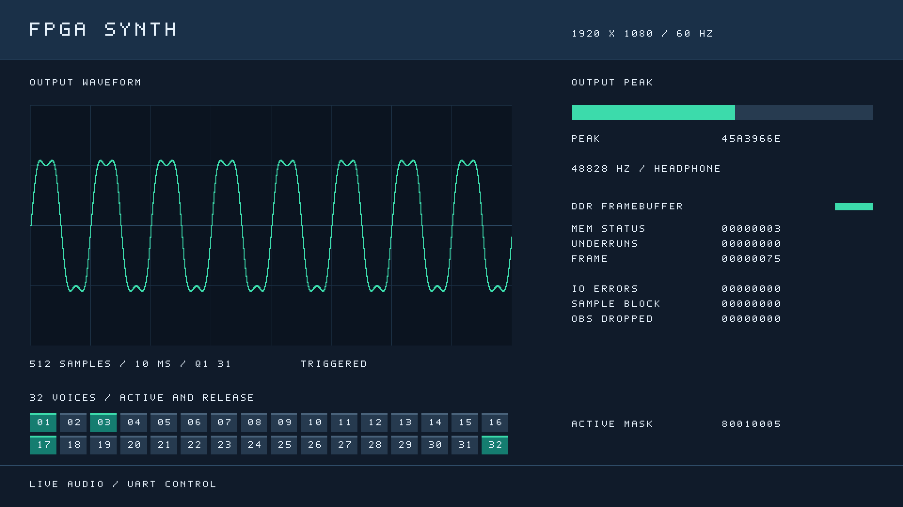

# 32声部分时复用音源

当前顶层支持32个独立声部。各声部保存自己的相位、频率、ADSR、力度和音色，计算时共用一套振荡器/包络运算、一张正弦表和一个完整32位增益乘法器。音频仍由FPGA逐样本生成，DDR继续用于1080p60显示帧缓冲。

## 文件与调度

| 文件 | 职责 |
| --- | --- |
| `src/synth/synth_engine.v` | 命令验证、帧起点锁存、ACK、32位活动快照和显示参考对齐 |
| `src/synth/synth_voice_bank.v` | 状态RAM、分时运算、顺序混音和最低音参考选择 |
| `src/synth/synth_sine_rom.v` | 共享257×32位四分之一周期正弦表，恢复1024点整周期 |
| `src/synth/synth_voice.v` | 保留原并行声部供数值回归；顶层不再实例化 |

状态存储为262bit×32槽，共8384bit（1048字节有效数据）。复位后逐地址初始化，不对整个RAM阵列添加异步复位。每槽的打包顺序为phase、phase_step、envelope、velocity、attack_step、decay_step、sustain_level、release_step（各32位），再加waveform（2位）、envelope_stage（3位）、retrigger_smooth（1位）。

每个音频帧锁存一条已经验证的命令，并按槽0至31执行：

1. 同步读出声部状态。
2. 用更新前的相位和增益取波形；计算下一状态与显示参考。
3. 共用乘法器计算包络增益，并取乘积`[62:31]`。
4. 再使用同一乘法器计算力度增益，并取乘积`[62:31]`。
5. 写回状态并累加样本。

核心每槽7拍，32槽加收尾共225拍，引擎再寄存1拍；从接受tick到`sample_valid`为**226拍/4.52µs**。50MHz时钟、48828.125Hz采样率下，每帧有1024拍，计算占22.07%。空闲槽也扫描，所以负载和音色选择不会改变完成时间。音频、显示参考在同一输出周期有效，只有一个valid脉冲。新顶层输出级再用8个周期处理总体音量与平衡，最终样本事件在234周期，仍在下一DAC帧之前完成。

PT8211复位后的首次tick可能早于32拍RAM初始化完成。引擎保留这一个请求，RAM准备好后补算，仍在下一音频帧前完成；集成仿真检查了此路径的零欠载。

命令只在帧起点锁存，所有槽完成更新后才ACK，并原子发布活动掩码。计算过程中关闭命令ready，后面的槽不会读取到新版本参数。波形使用更新前状态，保持旧实现的采样语义；活动声部NOTE_ON仍保持相位和电平，平滑重触发规则不变。

## 数值与音量

保留Q1.31音频及32位增益，两个乘法阶段分别向负无穷取整，未降低计算精度。32槽在40位累加器中直接求和，以完整40位结果传入总体音量和平衡级，处理后才饱和至32位并由PT8211舍入到PCM16。

已取消旧版固定除32。单声部可达到满幅；多个声部相加超过最终输出范围时饱和，可降低总体音量保留余量。未引入随活动声部数变化的自动增益。[输出链路](output_controls.md)详述先降音量再饱和及左右平衡。硬件复用仅改变计算调度，不把声部状态合并；静音槽仍占状态存储。

## 串口与可视化

- 声部协议编号为0…31；普通8字节ACK继续返回低8位活动掩码。
- 新增全局`0D VOICE_STATUS`，按0…3读四个小端字节。第0字节请求捕获完整32位快照，后续字节不受新命令或尾音释放影响。详见[串口协议](uart_protocol.md)。
- GUI包含8页、每页4个声部参数卡，以及始终可见的32格状态矩阵。连接时探测新版状态命令，旧固件明确降为4声部模式；读取完整状态时不会用普通ACK清除高位。
- 自动演奏循环分配槽位，优先当前状态未活动的空槽，其次复用尾音；手动指定槽仍允许重触发。轮询有延迟，这不是FPGA实时抢占调度。
- 旧4声部预设可扩展为32份独立配置；发送配置仍是逐条UART事务。硬件支持32复音不等于串口一次原子触发32音。
- HDMI底部用2×16格显示01…32（对应协议0…31），右侧显示最终PCM的结像、左右峰值和诊断。DDR1080p60扫描和波形匹配/HOLD继续工作。

## 验证与资源

`tb_voice_bank_tdm`将共享核心与32份旧并行声部逐帧比较，1329帧的未衰减40位混音、饱和值及全部状态逐位一致，覆盖三波形、ADSR、重触发、31号声部、PANIC、帧内输入变化、参考选择和暖复位。

`tb_synth_32voices`连接实际1024拍节奏的PT8211适配器：254次响应、276个精确226拍计算帧、275帧独立解码的双声道PCM，始终零欠载；还检查满载宽位混音、跨字节声部寻址、32位快照、非法请求和ACK背压。

当前构建的实际资源、完整回归记录、位流哈希及上板边界统一记录在[验证记录](verification.md)。旧并行版的[单声部资源评估](voice_resources.md)保留为优化前基线，不应继续乘32估计新版开销。
