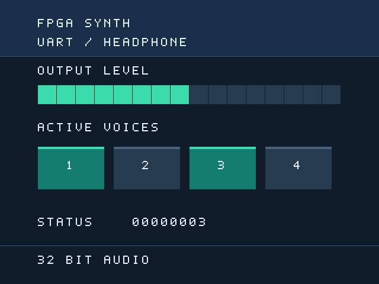

# HDMI 视频来源、接口与验证范围

本项目在 HDMI0 上输出 DVI 兼容 RGB 视频，音频由独立的板载 HEADPHONE 通路输出。当前 DDR 显示目标为 **1920 × 1080、60 Hz、148.5 MHz 像素时钟**，时钟与扫描依据见 [video_1080p_notes.md](video_1080p_notes.md)。没有实现 HDMI 音频包、DDC/EDID 或 HDCP。本文后半部分保留首版 640×480 的来源及验证历史，不能将首版板测结果用于证明当前 1080p60 已上板通过。

## 代码来源和许可证

`vendor/sipeed_dvi/` 中的 `dvi_tx_*.v` 文件来自本仓库外部资料目录 `Doc/tangMega-138K-example/hdmi_colorbar/eda_proj/src/dvi-tx/`。`dvi_tx_tmds_enc.v` 已按下节说明做流水化修改；`dvi_tx_clk_drv.v` 在1080p板测后增加时钟串化，具体见下文。示例仓库顶层 `LICENSE` 为 Apache-2.0，版权声明为 Shenzhen Sipeed Technology Co,Ltd.（2024）；完整许可证随同保存在 `vendor/sipeed_dvi/LICENSE`。

`dvi_tx_top.v` 新增独立的 `serializer_reset` 输入，编码器继续使用像素域复位；`dvi_tx_tmds_phy.v` 删除像素域 `reset_reg`，将平台生成的独立复位直接接到 OSER10。平台先在串化和像素时钟停止期间释放复位，等待 80 ns 后再通过 PLL.ENCLK0 启钟；该顺序与实际路由预算由构建检查器验证，详见 [1080p 时钟说明](video_1080p_notes.md)。

2026-09-08 首个 DDR 位流上板后，DDR 状态连续为 `0xCB`，显示器却报告“无信号”。当前 `dvi_tx_clk_drv.v` 改为第四个 OSER10，D0–D4=0、D5–D9=1，并与数据通道共用 FCLK/PCLK/RESET。这一映射直接参考同板 `Doc/tangMega-138K-example/cam_dvi/cam2dvi/src/dvi_tx/DVI_TX_Top.vo` 的 `u_OSER10_clk`（约512行）；该示例的 `138K_DOCK.cst` 使用相同 G15/G16 时钟引脚。修改保留 ELVDS 输出电气配置，避免直接转发 `CLKDIV /5` 的60%/40%占空比，并使时钟与数据经过一致的串化路径。构建及接收器复测结果以 [验证记录](verification.md) 为准，不能仅凭此结构推断板测成功。

保留的首版 `vendor/sipeed_dvi/video_pll_gw5a.v` 来自同一示例的 `src/gowin_pll/gowin_pll.v`，保留原有 Gowin 版权、工具版本、创建日期和原始目标器件注释。首版做了以下明确修改（当前 1080p60 改用 `video_pll_1080p_gw5a.v`）：

- 模块名 `Gowin_PLL` 改为 `video_pll_gw5a`，避免与其他时钟 IP 重名。
- `MDIV_SEL` 从 30 改为 20，`ODIV0_SEL` 从 10 改为 40，`ODIV1_SEL` 从 2 改为 8。
- 输出从示例的约 150 / 750 MHz 改为 25 / 125 MHz；内部 VCO 从 1500 MHz 改为 1000 MHz。

PLL 文件原有 `Copyright (C)2014-2024 Gowin Semiconductor Corporation. All rights reserved.` 标记继续保留；示例仓库许可证不替代 Gowin 工具及其 IP 的独立许可。本项目没有复制厂商仿真库或工具软件。`src/video/` 和 `src/platform/video_clock.v` 为本项目新增实现。

## 1080p60 TMDS 编码流水改动

2026-09-08 将编码器改为四级寄存流水，端口和 DVI 编码规则保持一致。原组合路径在一次像素周期内串接输入位统计、XOR/XNOR 转换、转换后位统计和运行差分更新，成为 148.5 MHz 实现的长路径候选。新结构为：

1. 采集输入字节，同时用平衡加法树统计输入 1 的个数。
2. 生成并寄存 9-bit `q_m`。采用前缀奇偶式替代逐位串行 XOR/XNOR；XNOR 只在奇数 bit 位置额外翻转，数学结果相同。
3. 寄存 `q_m`，统计其平衡值，并预先计算三种有符号运行差分增量。
4. 根据上一输出符号的运行差分选择翻转形式，更新差分并输出 10-bit TMDS 字。

输入在边沿 N 采样，输出在 N+3 更新；首版为 N+1，因此新增两拍像素延迟。DE 与两个控制位通过完全相同的流水，三条颜色通道同时延迟，不需要在 `dvi_tx_top` 再独立延迟同步信号。连续活动像素保持每周期一个 TMDS 字；消隐控制符将运行差分清零。复位清除所有流水级和差分，解除后以控制码填充流水再恢复有效像素。

`sim/tb_video_tmds.sv` 用独立逐位参考算法和三拍输入历史队列验证，已在 148.5 MHz 激励下通过：全部 256 个输入字节、四种控制码、5632 个随机活动/控制字、逐拍运行差分、相邻 DE/控制切换及流水中复位恢复。此仿真证明编码和延迟一致性；最终 148.5 MHz 布线时序需以最新 Gowin 报告为准。

## 首版官方参数依据（历史）

优先对照本地官方资料：

| 资料 | 位置 | 对本项目的约束 |
|---|---|---|
| `Doc/GW官方/用户指南/UG306-1.0.9_Arora_V时钟资源(Clock)用户指南.pdf` | §2.3，印刷页 9 | 138K/75K VCO 范围 650–1300 MHz，因此使用 1000 MHz |
| 同上 | §5.1，印刷页 33–36、40–43 | PLL 适用 GW5AST-138；静态分频参数及内部反馈计算公式 |
| `Doc/GW官方/用户指南/UG304-1.3.7_Arora_V可编程通用管脚(GPIO)用户指南.pdf` | §3.6.6，印刷页 15–17 | `ELVDS_OBUF`，O 为正端、OB 为负端 |
| 同上 | §4.3.5，印刷页 101–103 | `OSER10` 顺序 D0…D9，PCLK = FCLK / 5 |

计算：`Fvco = 50 MHz / 1 × 1 × 20 = 1000 MHz`；`pixel_clk = Fvco / 40 = 25 MHz`；`serial_clk = Fvco / 8 = 125 MHz`。每个 DDR 串化周期输出两位，TMDS 数据率 250 Mbit/s。两个 PLL 输出相位均为 0；显示复位在锁定失效时异步断言，在本时钟域同步解除。

## 首版顶层接口（历史）

`hdmi_display` 使用 `clk_50m`、低有效 `reset_n`，以下观察数据全部来自同一个 50 MHz 域：

| 端口 | 含义 |
|---|---|
| `sample_data[31:0]` + `sample_valid` | 有符号 Q1.31 音频样本及一拍有效脉冲 |
| `active_voices[31:0]` | 活动声部位图，界面显示低 4 位，包括仍处于包络释放阶段的声部 |
| `status_data[31:0]` | 状态字，界面按 8 个十六进制字符显示，其位定义由系统顶层管理 |
| `tmds_clk_p/n` | HDMI 时钟差分对 |
| `tmds_data_p/n[2:0]` | HDMI 数据差分对，0=蓝/同步，1=绿，2=红 |

`video_monitor_cdc` 使用请求/确认翻转握手。三个独立的 32 bit 观察字从请求发出到确认返回保持稳定；请求经过两级同步和一级额外等待后才锁存数据。邮箱忙时丢弃新的观察样本，没有向音频链路提供 `ready` 或反压。源端与像素端邮箱必须共同复位，包装器在外部复位或视频 PLL 失锁时执行该条件。声部和状态按帧锁存，电平取帧内绝对峰值并带衰减。

约束应保留 50 MHz 根时钟与 PLL 派生时钟关系。若用异步 CDC 例外，只对 `req_meta`/`ack_meta` 第一级同步输入设例外，并对 `held_sample/held_voices/held_status` 到像素快照寄存器施加不大于 80 ns 的路径上限，以保证数据先于延迟请求到达。不要把整个视频域路径无条件设为 false path。未经布局布线的总线延迟和原语行为不属于纯 RTL 仿真证明范围。

HDMI0 物理引脚沿用 colorbar 示例：数据 0=J14/H14，数据 1=J15/H15，数据 2=K17/J17，时钟=G15/G16。使用正端双引脚约束、`IO_TYPE=LVCMOS33D`、`DRIVE=8` 与 `ELVDS_OBUF`。新 Dock 原理图的 HDMI 方向控制由板级顶层另行驱动，不能仅复制旧示例约束。

## 首版仿真和界面（历史）

以下测试已在 Icarus Verilog 11 / vvp 下通过：

- `tb_video_timing`：完整帧计数、有效区边界、水平/垂直同步宽度和极性、帧回卷。
- `tb_video_monitor`：无关相位/频率下的持续过载，三字快照原子性、顺序、允许丢弃和复位中途恢复。
- `tb_video_peak_meter`：负数绝对值、`0x80000000` 满幅、帧边界有效样本、单调衰减至静音。
- `tb_video_tmds`：独立 TMDS 算法模型检查全部 256 个字节、4 种控制码、1024 个随机字节和运行差分。
- `tb_video_dashboard`：电平刻度、四声部独立状态、消隐，并可通过 `+PPM=输出路径` 生成实际 RTL 像素预览。

上图为 RTL 仿真生成的画面：半幅电平、声部 1/3 活动、状态字 00000003。它不是上板照片。完整工程已完成目标器件综合、布局布线和已建模内部路径的时序检查，具体结果及保留告警见 [验证记录](verification.md)；实际显示器上的热插拔、同步、差分极性和视频 PLL 失锁恢复仍待上板核验。

## 2026-09-08 官方视频 PLL 初始化

新增 [video_pll_init.v](../vendor/sipeed_dvi/video_pll_init.v) 来自本机Gowin V1.9.12.03的 `IDE/ipcore/PLL_ADV/data/PLL/pll_init.v`，原文件SHA-256为 `3ef05a1ba92157d73e3c54ed9d589645508a4ae332d8bcf133a0457cc3e866c8`。只重命名模块并注明来源，保留官方搜索表、状态机、计数和复位逻辑。两级wrapper均使用50MHz初始化时钟、CLK_PERIOD=20，表分档参数24/15；实际PLL倍率仍为24.75/15。动态ICP/LPF启用，helper最终O_LOCK进入原有连续2ms资格检查。

官方helper保留4条EX3791计数表达式截断告警（两实例各两条）：RomAddr+1按4bit索引截断；waitcnt+1按17bit计数器回绕，Waitlock检查全1终值。这些是原实现的有限位宽行为，未为消除告警擅改供应商逻辑。新版本的实际构建、传播预算和板测结果见 [验证记录](verification.md)。

可复现数字顺序测试：`wsl -d Ubuntu-22.04 --cd /mnt/e/workspace_cloud/Mega_138K/Dev/Prj1 -- python3 scripts/check_video_pll_sequence.py`。真实wrapper/helper/filter/startup全部参测，PLL/CLKDIV采用声明兼容的静止stub、注入raw LOCK，覆盖4个启动/恢复场景及24/24.75表等价；绕开初始化直接取raw LOCK的故障注入会被拒绝。测试不模拟PLL抖动或模拟稳定性。

## 2026-09-09 最终输出分析

FFT、立体声捕获与结像 RTL 为本项目新增实现，无新增第三方 IP。Hann、旋转系数和频率映射由仓库脚本确定性生成。原自写5×7字体补充减号与小数点，用于负分贝、MID-SIDE 和时间标注；供应商视频/DDR 代码保持原样。
