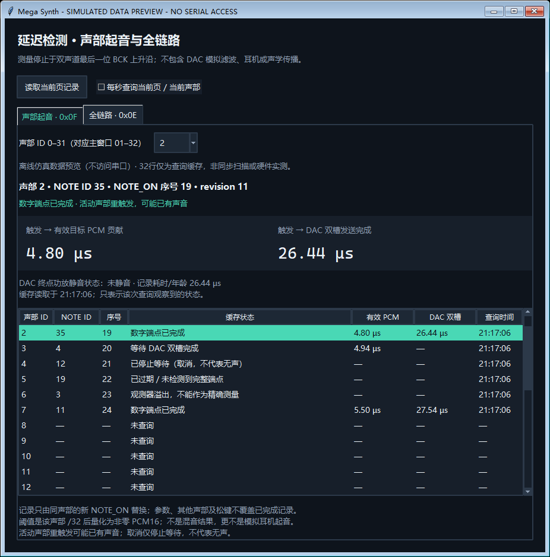

# 声部触发到数字发声的延迟检测

32个声部各自保存最近一次合法NOTE_ON的检测结果。起点是FPGA在音频帧边界接受该声部触发的时刻；终点分别是首次有效目标声部PCM贡献产生，以及首次携带该贡献的PT8211立体声帧发送完成。计数使用50MHz时钟，分辨率20ns。

这项检测适合比较不同音色、力度、Attack和声部复用时的数字响应。耳机DAC内部转换、功放和声学传播仍需要外部测量；电脑按键回调至FPGA提交部分见[全链路检测](latency.md)。

## 使用

下载支持`0F`的新位流、按复位并重新连接串口GUI。打开“延迟检测”，默认“声部起音”页，选择所用声部；按下并松开琴键后仍能查看该声部的最近结果。表格展示各声部上次读取的缓存，只有当前选中声部会自动查询，未查询的槽位不代表实时状态。

```powershell
python tools/instrument_gui.py --port COM26
# CLI查询时先断开GUI对同一串口的连接
python tools/instrument_cli.py --port COM26 voice-onset 0
python tools/instrument_cli.py --port COM26 voice-onset 31 --json
```

CLI只读记录，不会触发测试音。一次查询32个字节，在115200baud下请求/ACK的线路占用约55.6ms；GUI低频读取，每个字节事务后可让位给演奏命令。因而界面结果会晚于实际事件显示，查询耗时不计入FPGA测出的延迟。



## 有效端点与记录保留

| 项目 | 定义 |
| --- | --- |
| 触发→PCM贡献 | 本次NOTE_ON后的样本中，目标声部经过包络、力度、总体音量后，在至少一个声道独立量化为非零PCM16的第一个样本产生时刻 |
| 触发→DAC帧完成 | 携带本次NOTE_ON之后目标贡献标签的首个输出帧，左声道槽最后一位在BCK上升沿发送完成的时刻 |
| 活动声部重触发 | 触发前该声部ADSR非IDLE；可能正在持续发声、处于释放尾音，或仍在零包络起音阶段。该标志不证明触发前可闻 |
| 测量取消 | 首个有效目标贡献样本前收到该声部NOTE_OFF或PANIC，停止等待；后续仍可能输出释放尾音 |
| 端点功放静音 | DAC端点发生时`PA_EN=1`，数字数据已发送但功放关闭；启动约10.5ms内可能出现 |

端点取首次跨过PCM16非零阈值，不是等待Attack达到满幅。样本有效位依据目标声部独立贡献，不依据混音输出非零。另一个声部的声音不会抢先触发此结果；两个声部也可能相互抵消。活动声部重触发可以延续原来的声音，测出的时间不应理解为新的声学起音。

只有同一声部的下一次合法NOTE_ON才替换该槽记录并递增32位`note_id`。调整参数、其他声部触发、PING及诊断都不替换起点。等待期间更改本声部力度或包络会影响测出的时间，这个时间仍从最初NOTE_ON算起。

NOTE_OFF/PANIC只取消尚未检测到贡献样本的记录。样本已经产生而DAC还未发送完成时，继续等待在途输出；完成、取消、过期结果保持到下次NOTE_ON或复位。未到达端点显示“—”，不能把0当作缺失值。总体静音、零力度、零频率正弦、非常慢的Attack可能一直等待；等待达到`2^31`周期（约42.95秒）后停止并标记过期。

## 0F查询协议

请求沿用12字节UART格式，`opcode=0F, voice=0…31, flags=0, value=0…31`。value为字节索引。索引0请求共享观测器读取该声部记录，完成后返回快照byte0；随后索引读取同一32字节副本。快照读取期间音频照常运行。其他声部查询0才开始新的快照；后续索引必须匹配快照声部。

非法voice返回status2。非法flags、index、未先读0或后续索引声部不匹配返回status3。`0E`全链路快照与`0F`声部起音快照各自独立。固件不支持0F时返回未知opcode，主机提示更新固件。

| 小端32位字 | 内容 |
| --- | --- |
| 0 | 由低到高四字节：schema=1、voice、NOTE_ON的sequence、flags |
| 1 | 该声部`note_id`；复位为0，每次合法NOTE_ON加1，按模2^32回绕 |
| 2 | 时钟Hz，当前50000000 |
| 3 | 触发→首次有效目标贡献样本，周期数 |
| 4 | 触发→首个目标贡献DAC帧发送完成，周期数 |
| 5 | 未完结记录为快照年龄；完成/取消/过期记录冻结在相应终点，超时为`80000000` |
| 6 | 触发时24位声音revision，高8位保留为0 |
| 7 | 触发→测量取消，周期数 |

flags：bit0有效记录、bit1贡献样本已检测、bit2DAC端点已检测、bit3触发前声部活动、bit4测量取消、bit5过期、bit6DAC端点时功放静音、bit7观测器事件溢出。溢出表示诊断数据不能作为精确测量；不影响声音通路。状态位与计数独立，0周期也可以有效。

## 实现边界

`src/diagnostics/voice_onset_monitor.v`与音频通路并行，锁存事件发生时的时间戳，再复用运算和记录存储依次处理32个声部。后台处理与查询等待时间不加入测量值。该模块不反压合成器或DAC，也不改变32声部226周期的合成调度。

样本/DAC事件的声音revision必须在对应NOTE_ON之后：24位模差小于`2^23`。这样允许期间发生其他命令，并排除触发前已经计算或正在发送的旧帧；等待超时约42.95秒，远小于当前命令吞吐达到revision半周期所需的时间。时间计数按模2^32相减，允许跨计数器回绕。观测器保持最新记录，不是逐音符历史日志。

最新位流、仿真和时序证据见[验证记录](verification.md)。
