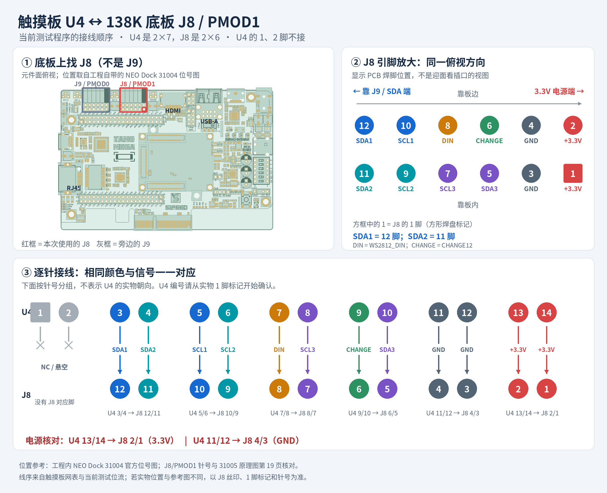

# 自制触摸板 → GW5AST-138C 独立信号测试

2026-10-13 晚间更新（UserCode `0x5442010A`）。目标：GW5AST-LV138PG484AC2/I1 + NEO Dock 31005。输入网表来自 `/home/sphenicidition/Public/touchboard/Netlist_Schematic1_2026-10-12.tel`，已冻结为 `input_netlist.tel`。这是一份可单独下载到 SRAM 的触摸信号探针，不含音频/MIDI 工作站。Flash 内 full85 保留。

## 网表与芯片判断

- 新提供的 `Schematic1.pdf` 确认 U1/U2 为 AT42QT2160-MMUR；冻结副本是 `input_schematic.pdf`。运行时仍必须先读到 `chip ID 0x11` 才配置。两颗器件 I2CA0/I2CA1 在网表中均接地，预期地址为 `0x0D`。实机地址 NACK 时自动查找 QT2160 的四个合法地址 `0x0D/0x17/0x44/0x6B`；必须读到 ID `0x11` 才进行软复位和配置。GUI 显示正在使用/尝试的地址。
- U1：X0–X7 / Y0–Y1，16 键；禁用出厂默认的五段 slider，AKS=0，允许多键。
- U2：X0–X7 / Y0，8 段滑条；slider control=0x28，resolution=0（0–255），K0–K7 AKS=1，K8–K15 burst=0。
- 两颗 CHANGE 开漏输出合并。程序定期读取两颗，避免仅靠合并 CHANGE 无法定位芯片。
- 新原理图确认 U3 为 PCA9685PW,118，A0–A5 接地，正常地址为 0x40；也可能响应 0x70 All Call。第三总线只发地址并记录 ACK；不会写灯光寄存器。早期仅凭网表的 PCA9635 推断已修正。
- WS2812_DIN 固定输出低电平；本次只验证输入，不发 RGB 灯序列。原理图标注 LED 为 WS2812B-2427-V6；实装型号仍需实物确认。

依据：Microchip AT42QT2160 datasheet 9502C，特别是 §§5.1/5.2/6 和 §10 errata；用户提供的触摸板原理图。本地底板依据为 `Mega_138K/Doc/Mega_138K_60K/02_Schematic/DOCK/Tang_Mega_NEO_Dock-138K_31005_Schematics.pdf` 第 19 页及 BTB 管脚表。

QT2160 的指针写入使用 STOP 结束，再发新的 START 读取；START 前检查两条线连续为高至少 100 µs，STOP 后另留100 µs；正常实板相邻事务间隔约200 µs。支持时钟拉伸（触摸总线20 ms超时；独立扫描器默认2 ms）、SDA 卡低时九个恢复时钟，以及失联后 500 ms 自动重试。当前 burst=1（4 次脉冲），threshold=10，LP=1、BREP=1（一次测量）、NDIL=3（四次连续测量）。识别芯片后先软复位并等待 750 ms，逐项写入并读回寄存器 12–69，稳定 100 ms 后校准，并等待 1 秒再开始读取状态；启动或重新连接时请将手移开约三秒。NDIL 加强用于无触摸误报排查，触摸效果尚未验收。BREP=4 的对照产生持续 CYCLE_OVERRUN，已恢复 BREP=1。

## 接线：先按电气编号核对



[高清 PNG](docs/U4_J8_wiring.png) · [打印 PDF](docs/U4_J8_wiring.pdf)。图中底板位置参考工程自带 NEO Dock 31004 位号图，J8 针号与 31005 原理图核对；U4 按针号分组，未推断其实际机械朝向。

**触摸板 U4 是 2×7，底板 J8/J9 是 2×6。U4.1/2 在网表里未接线。有效 U4.3–14 可以覆盖 12 个 PMOD 引脚，但网表没有机械朝向，不能凭“pin-to-pin”推断实际插接方向。** 排阻 RN1/RN2 按标准独立四电阻的 1↔8、2↔7、3↔6、4↔5 追线；`netlist.py` 在构建/下载时校验该对应。当前 J8 镜像按下面电气关系工作，相当于将 U4 有效部分与底板编号反向配对。

| 触摸板 U4 引脚 | 网表信号 | NEO Dock J8 引脚 | FPGA ball |
| --- | --- | --- | --- |
| 1、2 | NC | 不接 | — |
| 3 | SDA1 | 12 | Y22 |
| 4 | SDA2 | 11 | Y21 |
| 5 | SCL1 | 10 | AB22 |
| 6 | SCL2 | 9 | AB21 |
| 7 | WS2812_DIN | 8 | AA21 |
| 8 | SCL3 | 7 | AA20 |
| 9 | CHANGE12 | 6 | AB20 |
| 10 | SDA3 | 5 | AA19 |
| 11 | GND | 4 | — |
| 12 | GND | 3 | — |
| 13 | 3V3 | 2 | — |
| 14 | 3V3 | 1 | — |

J8 为 PMOD1；J9 为 PMOD0。两者引脚编号的电源位置均为 1/2=3.3V、3/4=GND。GPIO 所在 Bank4 的实际 VCCIO 应为 3.3 V（已有底板文档标 TP22）。这八根 GPIO 也连接 SDRAM1/摄像头扩展网络；本测试时让这些共享线上没有其他驱动设备。

若使用 J9，先执行 `python3 build.py --connector J9 --user-code 5442010A`；该模式使用同一表中的 PMOD 引脚序号，换用底板 J9 的球位。若实际连接只交换了行/列或线序不同，修改 `netlist.py` 的 PMOD 配对方式后重新构建；引脚关系明确后再下载对应镜像。

## 运行

在本目录：

```sh
python3 test.py
python3 tests/test_monitor_io.py
python3 build.py
python3 program.py --inventory
python3 program.py
python3 monitor.py --gui
```

`program.py` 校验输入 hash、位流目标器件、UserCode、布局布线 setup/hold 结果，检查调试器序列号 `2025030317`，持有 `/tmp/gw138k_2025030317.lock`，读取写前 UserCode，仅 operation 2 写 SRAM，再独立读取写后 UserCode。没有任何 Flash 写入操作。板卡没有连接时会清楚报错并退出，不会宣称已烧录。

默认调试串口为 `/dev/serial/by-id/usb-SIPEED_USB_Debugger_2025030317-if01-port0`，115200 8N1。DTR/RTS 不置位。可用 `--port` 改路径。串口线输出 `TB2` 十六进制帧，建议用提供的解析器观察：

```sh
python3 monitor.py
python3 monitor.py --seconds 30
python3 monitor.py --gui --port /dev/ttyUSB1
```

GUI 显示 16 键、滑条 0–255、CHANGE、芯片 ID、配置状态、I²C 错误、第三总线 ACK 地址、32 路 signal/reference/delta、CRC 错误和丢帧。`results/capture_*.jsonl` 保存解码日志。GUI 串口断开时会自动等待重连，旧值标为未知。真实模式 GUI 有单窗口锁；重复点击入口会提示使用现有窗口。UART 使用 exclusive 方式避免多个本程序抢读。

`--demo` 只用于界面自检，窗口/控制台明确标“模拟显示，非实体数据”，不得作为触摸验收证据。

## 如何现场检验

1. 核对以上电源和信号连接；连接 138K 的 USB JTAG/UART，下载 SRAM 镜像。
2. 启动 GUI，手离开触摸区域约两秒，等待 U1/U2 的 ID=11、READY。
3. 逐个触摸 16 键，确认对应 K0–K15 点亮、松开熄灭。编号是芯片通道，不代表最终 4×4 物理排列。
4. 在滑条上左右移动，确认触摸标志和位置变化；方向、可达范围由实际电极布局决定。
5. 若 READY 但触摸不触发，观察 `Ref − Sig` 是否随着手指变化；保存日志用于后续灵敏度调节。当前默认连续读取64字节signal/reference，每帧报告每颗芯片一个通道，GUI汇总各通道最近值；读取块也不承诺芯片内部原子快照。`--raw-words` 可恢复逐16位诊断读取，代价是更长总线占用。状态轮询间隔16 ms，不等待16通道报告完。
6. 若地址 NACK，先检查供电、SCL/SDA 和 J8/J9/朝向；若 SCL 超时或 SDA 卡低，界面会分别标识。不要把 GUI 界面正常误当作触摸硬件通过。

板载 Button1 会重新执行初始化与校准。断电后 SRAM 探针消失，底板重新载入已有 Flash 工作站。

## UART 帧

`TB2 <52-byte hex> <CRC16-CCITT-FALSE hex>\r\n`，CRC 初值 FFFF、多项式 1021，覆盖 52 个 payload 字节；约 50 帧/秒。解析器仍兼容早期 TB1 格式。

| payload 字节 | 内容 |
| --- | --- |
| 0–3 | frame sequence，uint32 little endian |
| 4 | PMOD GPIO 电平采样，bit0–7 对应 PMOD pin5–12 |
| 5 | CHANGE_N（0/1） |
| 6 | bit0/1：U1/U2 online |
| 7 | low nibble：U1 error |
| 8 | low nibble：U2 error；high nibble：I²C3 error |
| 9 | bit0/1：配置读回通过；bit2/3：诊断休眠标志；bit4/5：本通道诊断值有效 |
| 10–16 / 17–23 | U1/U2 寄存器 0–6，含 ID、版本、状态、按键、位置、GPIO |
| 24 / 25 | U1/U2 本帧诊断通道 0–15 |
| 26 / 27 | U1/U2 当前 I²C 7-bit 地址（旧版 0 表示默认 0x0D） |
| 28–31 / 32–35 | U1/U2 的 signal uint16、reference uint16，均 little endian |
| 36–51 | I²C3 ACK bitmap，地址0对应 bit0 |

signal 来自地址 100+2×通道，reference 来自 132+2×通道。FPGA 当前连续读取全部信号/基准寄存器，UART 每帧确认后推进通道，传完一轮后获取下一组值；7 字节状态读取不等待16通道传完。默认在启动时核对固定配置12–69和未用GPIO方向；`--audit-config` 可开启每轮检查，异常时清除有效状态并重新初始化。主机按芯片与通道缓存，断开/重置/未就绪时清空缓存；未采到的通道显示 `--`。

error：0 正常，1 地址 NACK，2 数据 NACK，3 SCL 超时，4 SDA 卡低（发过恢复时钟），5 ID 不符，6 配置读回不符，7 芯片复位/需重新配置。online/configured/raw_valid 不满足时，GUI 不把旧按键/原始值显示成当前有效触摸。

## 验证边界

`test.py` 使用行为器件模型驱动实际 RTL：检查 STOP/START 间隔、配置读回、16 键多点及释放、滑条、逐通道原始值、掉线和重连；从实际 UART 8N1 串行波形解码并验证 CRC。单独覆盖时钟拉伸、超时、地址 NACK、SDA 九脉冲恢复。`tests/test_monitor_io.py` 另用本地伪终端检查 pyserial 半帧接收、CRC、丢帧、静默、断开与重连，并检查 Tk GUI 的值和失效清除。仿真不等于真实电极、PCB、焊接、供电或触摸灵敏度通过。

构建和验证证据保存在 `results/`，最新实机进度见 `PROGRESS_20261013.md`；前期记录见 `PROGRESS_20261012.md`。

## 2026-10-13 实机排查

旧版中 U1 始终地址 NACK；U2 有 SDET 事件，但逐通道原始 signal 出现全零。新版改为连续读取信号/基准块、50 Hz 遥测，并显示触摸事件计数，便于确认短暂事件。采样 burst 调整后实测旧基准仍存在，导致无触摸也可能多段触发，因此加入识别后软复位、配置稳定等待及校准。芯片 READY、收到 SDET 与实际无触摸稳定/触摸跟手是不同检查项，实际验收状态以进度记录为准。

LED 链 U5→U6→…→U20 尚未发送灯光帧；单个 U6 发光不能用作触摸成功指示。原理图标注 WS2812B-2427-V6，测试程序只保持输入 DIN 为低。

## 新原理图核对（2026-10-13）

原理图中的 CHANGE/CS 注释不适用于 AT42QT2160：CHANGE 是芯片开漏状态输出，FPGA 应只读取；不能把它当片选由主机拉低。本程序保持其为输入。图中触摸芯片与 LED 共用 3V3，没有画出分开的 LDO；共用供电、去耦和布线的影响需要实测，不能仅凭原理图判定是误报原因。

无触摸诊断可用 `python3 summarize_idle.py capture.jsonl --output summary.json`。该工具只汇总原始触发率和信号/基准范围，不修改或压制触摸事件。最新无触摸对照证据见 `LATEST_IDLE_DIAGNOSTIC.txt`。

## 2026-10-13 凌晨主动 RTL 诊断历史

凌晨冻结构建 UserCode `0x54420109`（晚间已由0A替代）：全部16键、burst=1、threshold=10、NDIL=3、BREP=1、LP=1、轮询32ms、UART50Hz、逐16位原始寄存器读取、运行中配置检查、一次性全黑LED帧。启动全黑帧是软件发送行为，尚未用实物反馈验证熄灯。

全部56种GPIO有序配对×112个I²C地址扫描，仅发现J8 SCL10/SDA12上的0x0D QT2160。U2和U3持续未应答；U1即使在只访问自身、5Hz遥测的静默模式仍全键误报。因此硬件触摸未通过。完整证据和限制见 `ACTIVE_DIAG_20261013.md`。

`build.py` 的 `--diagnostic --full-scan` 生成DG1逐线/地址扫描镜像，`diagnose.py --seconds 55 --output <目录>` 接收；不要使用正常GUI读取DG1。`--no-internal-pullups` 用于外部上拉排查。普通模式可用 `--isolate-u1 --frame-hz 5 --poll-ms 200` 临时关闭另外两条总线访问；`--sleep-after-ms 15000` 生成LP=0休眠对照。`--audit-config`、`--raw-words`、`--no-black-leds` 可生成单项对照。诊断下载均只写SRAM，必须明确选中对应通过验证的构建。

`test_profile.py --build <构建目录> --output <验证目录>` 仿真实际冻结的位流RTL，并校验全部32路原始UART通道；启用`--audit-config`的配置另覆盖运行中配置篡改后失效及恢复。临时静默版使用 `tests/tb_quiet.sv`；完整配对/地址覆盖由 `tests/tb_diag_full.sv` 检查。


## 独立引脚监听诊断

2026-10-13新增TW1临时诊断，见 [WIRE_AUDIT_20261013.md](WIRE_AUDIT_20261013.md)。1167个成功事务与主接收器一致，闲置GPIO初始化对照仍未修复。该轮结束时恢复了冻结SRAM09普通GUI；晚间普通版本已启用未用GPIO输出初始化。使用`build.py --wire-trace --route-option 0`生成监听版，GPIO对照另加`--safe-gpio`，串口必须使用`wire_trace.py`。实验期间会关闭普通GUI以独占串口。


2026-10-13 片内ADC诊断：累计5665次转换无超时，测量的是SOM VCCIO4而非PMOD触摸供电。触摸仍异常，该轮结束时恢复SRAM09/普通GUI，Flash未写。详情见 [POWER_AUDIT_20261013.md](POWER_AUDIT_20261013.md)。

## 2026-10-13 晚间接续 Download 调试记录

当前普通版本0x5442010A：START前连续空闲100 µs、未用GPIO1..3设输出并读回、16 ms状态轮询、连续64字节诊断读取、UART50 Hz。启动配置核对保留，逐轮固定配置核对默认关闭。仿真注入状态到读取约17.982 ms，不是实物触摸到GUI的总延迟。两颗QT2160均有正确ID，但原始采样异常仍未修复。实板验收未完成。

`build.py --wire-trace --wire-device U2 --safe-gpio`可独立监听滑条总线；U1模式使用`--wire-device U1`。TW1第13字节bit7标识U2、bit0标识逐字读取；旧U1记录仍兼容。其他总线释放。`wire_trace.py`打开串口后先排空1秒USB历史数据并保存到startup_raw.txt，然后记录本轮；原始失败与异常值保留。

晚间记录见[RESUME_DEBUG_20261013.md](RESUME_DEBUG_20261013.md)；下载过程仍只写SRAM，Flash未写。LATEST_BUILD和LATEST_PROGRAM_CANDIDATE保持普通GUI构建，避免再次误选临时监听版。
