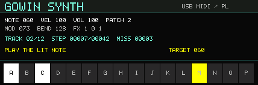

# GW25K PL 屏幕与 MIDI 引导

## W-DEMO 固定 D 上下文

双 138K 分支的 W-DEMO 使用显式 `WORKSTATION_WORKER_DEMO` 固件配置和
`workstation_worker_usb.sv` 输入 provider。它保留同一 Host、HS／FS 协商、
标准枚举、25K MIDI 与 PL local-v1 传输，退出 Push 映射、屏幕、灯光和曲谱专属
逻辑；非 25K 设备明确拒绝。M-DEMO 和既有默认配置仍沿用后文的演奏映射。
以下映射只在 W 固定 D 上下文生效，使用 25K 已有 NoteOn／Off，不增加线规、
菜单或长按。当前以默认移调零、MIDI 48–63 为键位范围。

| 触摸键／MIDI | W 主机提交的已有参数命令 |
|---|---|
| A–C／48–50 | 按住分别 CC20／21／22=100，释放=0：BitCrush／Drive／Delay Send |
| D–F／51–53 | 按下分别 CC87=0／1／2，向完整链加入 Delay／Chorus／Reverb |
| G／54 | 按下 CC88=127，切换完整效果链总开关 |
| H／55 | 按下 CC81=0，清空完整效果链选择 |
| I–O／56–62 | 按下 CC81=1–7，直接选择三项效果的对应位掩码 |
| P／63 | 按下 CC7=127，恢复主音量 |

重复 NoteOn 不重复追加／翻转，普通按键释放不再翻转。编码器1已有 CC7 和
编码器2短按 CC88 保留；W 不转发 A/B/C、音色或矢量选择请求。参数仍由音频域
`workstation_parameters` 唯一提交，USB 只做输入去重。PL 页面显示 D STREAM、
实际增益／输出声道、实际三项 D 深度和生效的完整链掩码；深度直接读取已提交
`control_options` 的 `[6:0]`／`[13:7]`／`[20:14]`，不以触摸请求回显冒充应用。

`sim/test_workstation_worker_usb.py` 覆盖上述生产固件、完整 PL 帧、真实事件
FIFO／CDC、断开旧输入作废和已退休 MMIO 拒绝。离线通过不代表实物触摸、
手机蓝牙、DAC、HDMI 或热插拔已经验收，最终证据按 `task2.md` 候选记录。

## 既有通用／M 演奏配置

138K 的 USB-A Host 现可连接 GW25K MIDI 键盘：接收键盘演奏、输出428×142横屏乐器/跟奏画面，并经标准MIDI回传点亮引导灯。Push 2 专用路径和普通 USB-MIDI 输入保留。此变更是离线软件候选，未烧录、未进行板间实测；现有 `LATEST_WORKSTATION.json` 的板上版本记录保持原样。

将138K J18 USB-A接GW25K的USB2数据口。GW25K需要包含PL local-v1的固件；2026-10-17构建候选为 `0x00003BE9`，该候选此前按要求尚未烧录。`0x00005A52`旧键盘镜像不能用于PL屏控验收。

## 设备识别与显示

`FB9A:FB9B`设备先走标准MIDI描述符扫描。只有同时发现MIDI OUT和接口2的vendor Bulk IN/OUT才启用GW25K模式；不完整设备回落为只收MIDI。实际复合配置为124字节：

| 接口 | 端点 | 用途 |
| --- | --- | --- |
| 1 MIDIStreaming | IN81 / OUT01 | 演奏输入 / 引导音符回传 |
| 2 vendor FF/00/00 | OUT02 / IN82 | PL请求 / PL应答 |

新 `gw25k_panel.h` 作为单一生产 `firmware.c` 的一部分编译。PL适配实现HELLO/CAPS、独立control/display序号、HEALTH、≤248像素RGB565LE tile、FRAME_END/DRAWN及严格响应检查。屏幕以62×4分块完整重画，最后一行/列自动缩小；画面包含音符/力度/音量、效果状态、曲目/进度/错误数和默认48–63音域指示。

首次有效tile让键盘进入输入页。E1长按进入本地设置时，Host读取manual状态后暂停像素并继续保活；退出、画布丢失或会话恢复都从(0,0)重新绘制整页。静态画面每50ms安排HEALTH；绘制期间事务边界更频繁检查心跳。显示请求尚未收完整响应时不插入同端点的新请求。250ms在线期限由键盘执行；具体物理刷新率未在本次验收。

USB OUT ACK丢失时保持同一片段及DATA PID重试，设备去重；PL BUSY不推进序号，原包重试。接收端独立维护DATA toggle并丢弃重复包。PL错误/截断/响应丢失会排空旧响应，等待100ms残帧期限后以新session握手；USB STALL、OUT超时导致DATA状态不确定或MIDI回传持续失败则断开重枚举。新PL session不重置USB toggle。



图为生产C渲染器生成的示意画面，非实板拍摄。

## MIDI与曲谱

普通NoteOn/Off、CC1/CC11、Program Change、Bend沿用现有音源语义。generic模式中，已接受的有效NoteOn同时进入现有 `push2_score_guide`；FIFO背压时不提前推进，不接受力度0或pressure为演奏匹配。

guide启用且选中曲目、有目标时，Host回传现有guide目标MIDI音高；guide关闭但score运行时回传service score_mask的提示音符。关闭旧目标后才开启新目标；初始化发送16通道CC123清理。本板选中哪个MIDI通道就接收该通道的灯光反馈，因此Host对16通道广播同一引导事件。每500ms重发仍有效的NoteOn，以恢复本板切换channel/transpose后清空的灯光。反馈不进入138K音源，本板也不将接收的引导音符回传。

反馈保留guide队列的MIDI音高，不把所有曲目音符强行折叠到16个按键；GW25K只点亮当前 `48 + transpose` 起的16个音符。曲目超出当前音域时，应调整键盘transpose。现有上游识别核自身的音高映射不由本适配修改。屏幕底部16键图示采用默认48–63音域，当前尚不读取键盘的本地transpose设置。

新增三个保留CC用于通用MIDI控制曲谱，任何通道均合并处理：

| CC | 数据值 | 操作 |
| --- | --- | --- |
| 110 | 0–63 / 64–127 | 关闭 / 打开guide，绝对状态、可重复发送 |
| 111 | 0 / 127 | 上一曲 / 下一曲，其他值忽略 |
| 112 | >=64上升沿 | 确认所选曲或返回曲单；发送0释放后才能再次触发 |

这些CC由USB控制模块消费，不再进入音源。普通CC和Program原语义不变。此变更不重新定义GW25K两个编码器的本地操作；键盘当前固件不会自动将旋钮转动转换为上述曲谱CC。已有曲谱控制源或支持发送CC的客户端可使用该入口。

## 新增Host MMIO

原 `0x5c` 保留。新增寄存器供C屏幕和灯光服务读取：

| 地址 | 位布局 |
| --- | --- |
| 0x60 | 6:0目标音高；7目标有效；8 guide_mode；9 chosen；10 analysis_done；11 score_running；12 record_enabled；16:13 browse；21:17 track_count；25:22 track_index |
| 0x64 | service score_mask，bit0对应MIDI36，bit31对应67 |
| 0x68 | 高16位score_count，低16位cursor |
| 0x6c | 低16位wrong_count |
| 0x24 | generic模式为最后实际音符/力度，低7位note、13:7 velocity |

## 构建与复现

普通构建和 `--current-workstation` 现在共用 `tools/stage_usb_firmware.py`。它复制活动 `firmware.c` 和 `gw25k_panel.h`，编译RV32I固件，并将相同的64KiB镜像写入工程根与 `src/usb_a` 的ROM文件。current-workstation同时覆盖活动 `push2_usb_a_control.sv`；冻结DDR/CNN输入的校验仍执行。二进制大小与text+data+BSS均须小于60000字节，保留栈空间。

可通过 `--riscv-prefix /path/to/riscv-none-elf` 或环境变量 `GW138K_RISCV_PREFIX` 选择GNU工具链。该prefix末尾不带 `-gcc`。完整工作站仍需要已验收的 `results/song_guide_full83_20261006_203125_607466` 源树与清单；缺失会明确报错。本次没有用旧冻结工程冒充full83/full85，也没有生成或发布整板位流。

在 `usb_a` 目录运行：

```sh
python3 sim/run_gw25k_panel.py
# 增加与键盘实际RTL端点的C/RTL闭环：
python3 sim/run_gw25k_panel.py --endpoint-rtl /path/to/GW_25K/example/MIDI_KEYBOARD/rtl/control/panel_display_endpoint.v
python3 sim/run_pl_guide.py
python3 sim/test_stage_usb_firmware.py
```

RTL测试使用Git中已有的 `../results/workstation_20260911_174045_306332/Prj1` 内CDC、FIFO、MIDI decoder和font源。稀疏检出时需包含这些源，或用 `--baseline /path/to/Prj1` 指定；不依赖其旧位流。

生产C测试只mock USB、时间和MMIO，使用真实124字节描述符，覆盖分片、重复DATA、NAK、丢ACK、BUSY、完整画面、manual/画布丢失重画、静态保活、错误恢复及引导音符清理。RTL测试使用真实控制/guide/FIFO/CDC，覆盖背压、普通MIDI、曲谱控制和原Push行为。构建测试区分mock工具链的staging检查与真实RV32I链接结果。验证记录见 `reports/GW25K_PANEL_20261017.json`；其中未执行的硬件、整板布局布线和时序验收不会标为通过。
