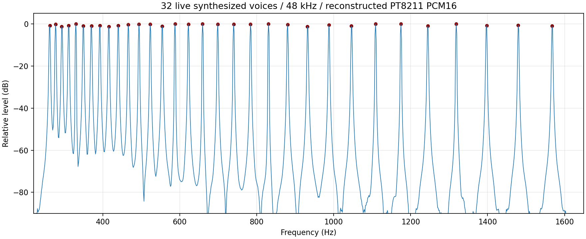

# 选题二要求、用户补充口径与当前验收对照（2026-10-19）

用户本次提供题目全文，并随后补充：“D 采样器、TF PCM 播放可以作为合规实时发声，题目禁止的是预播放处理后的音乐”。按该补充口径继续保留D／TF路径，不因PCM格式或素材来自TF而一概排除；此前口头将PCM素材全部排除的判断撤回。题目正文与补充解释分别保存在[要求原文](../docs/CONTEST_REQUIREMENTS.md)。本页是代码和证据对照，不表示已经完成全部赛题验收。

## 发声路径与EP-133借鉴

| 对象 | 本轮采用的边界 | 当前实现／证据 |
|---|---|---|
| A/B/C实时合成 | MIDI触发，HDL逐声部更新相位／频率／包络并混音 | 当前整机路径；本轮新增32个不同音高的串行输出和频谱证据 |
| D采样器、TF PCM | 作为可用技术路径保留，核对实际素材内容与演奏运算，禁止直接播放预处理音乐冒充实时合成 | D已有16声部变调、ADSR、混音／FX的独立后端；TF输入／导入／存储／voice本轮重新验证。D尚未接整机 |
| 素材导入与回录 | 沿用single_note／single_hit审核及限制编排回录的现有工程规则，不自行扩展为整曲、phrase、breakbeat导入或pattern音频回录 | `rtl/sampler/import_samples.py`及导入RTL检查声明／格式／CRC／长度；内容审核依赖真实素材，声明／CRC不等于能自动识别音乐内容 |
| TF识别／曲谱 | PCM也用于CQT／CNN分析；分析输入与扬声器输出用途分别核对 | Push保留CNN扒谱及引导；明确识别的25K继续隔离曲谱业务 |
| 直接播放预处理音乐 | 不能当作实时合成能力或计分声部；保留现有工程内容，不凭路径名称自动认定合规用途 | `build.py`仍有TF与合成串行输出选择；这次没有关闭媒体路径，也没有增加“竞赛模式”菜单或构建策略 |

EP-133官方effects指南的punch-in临时效果及组合操作是工作流参考；本产品仍用用户已定4×4布局、固定力度和现有USB／PL协议。可以继续借鉴播放不中断时操作效果、切换上下文时清楚反馈、保持其他已开启效果、复用现有分组和音符事件编排。分组／pattern等尚属候选；保留采样、切片、实时变调等现有技术能力不等于新增其产品入口。

25K按键效果上下文已由用户确认是产品目标。进入／退出动作、16键效果表、按住／松开或按次锁定规则、效果作用路径仍未给定，不以D合规口径推导这些具体选择；不修改CC89的A/B/C循环或编码器长按。CC20／21／22继续是独立D的BitCrush／Drive／Delay Send，0释放、1–127深度、默认0；现有工作站CC81是另一层的Delay／Chorus／Reverb选择，不能混同。用户所说16键对应效果也不能由目前三项后端测试推导为16种效果已完成。

## 按题目逐项对照

| 要求 | 已有代码／验证 | 尚需完成的证据或接入 |
|---|---|---|
| 自研交互≥2维 | 25K规划为16键选音／触发、连续滑条Pitch Bend，另有已定音量／音色编码器；已有QT2160诊断工程 | 完整25K源码现已由5a4bd71导入，已确认控件接入实际应用并有模型验证；触摸稳定性、键序及真实传感器链尚待实物验收，Push不能代替自研交互证据 |
| 音频全HDL | `gw138k_event_workstation`、`unified_oscillator_engine`及硬件效果／串行器形成合成链；D voice亦由HDL逐样本运算 | USB固件负责枚举与控制，不执行音频样本合成；离线素材转换不等于CPU现场合成。仍需最终整机RTL／实物对应性 |
| ≤10ms，拓展≤5ms且确定性 | 本次采集帧间隔1600音频时钟、帧内运算完成、无采集欠载；已有接入／演奏链功能测试 | 没有测量触摸扫描、25K、USB Full-Speed轮询、排队、音源及模拟DAC全链；固定帧周期／音序jitter0不能替代端到端延迟与抖动证明。时序待功能稳定后处理 |
| ≥4复音；拓展≥32 | 本次A模式32独立完整声部，MIDI60–91，独立相位／步长／包络／增益；实际串行重建音频有32谱峰。D独立voice测试16复音 | D的16声部不当作已达32；不把尚未同时集成的引擎相加为48复音 |
| 实时变调、ADSR、混音 | 当前合成器的音高／包络／混音路径；本次D voice覆盖128音符、256极端音高组合、16复音与独立包络操作 | 持音先全部旧Off再新On已在真实设备应用验证；最终本地移调入口／范围／越界仍待定，未据旧MK维护通道定义新产品入口 |
| ≥3维表达、≥2音色、硬件效果 | 主机支持力度／压力、Pitch Bend、CC1颤音、CC5滑音、CC11表达，已有五profile和Delay／Chorus／Reverb；D有独立BitCrush／Drive及Delay Send | 25K键力度固定100，不能写成已实现压力检测或力度动态；已确认滑条／编码器已接设备应用，各表达维度的现场证据仍需核对。Delay Send值通过不表示外部延迟音频已经验证 |
| HDL实时视觉反馈 | 138K已有RTL波形／频谱／矢量和Push引导相关路径；25K基础页复用MMIO／PL | 25K基础页图块在Host C代码生成，不能仅凭基础页证明新做了纯HDL绘图；复用现有反馈，尚无25K效果上下文UI／设备SPI闭环 |
| 脱机LED曲谱引导 | 已有Push专有识别／引导链和离线门禁；保留普通generic既有能力 | 不因题目拓展条款把引导迁入25K；蓝牙／App不是本轮新接入目标 |
| I2S至DAC | 当前实际接的是PT8211串行输出；准备工程`src/audio/pt8211_tx.v`及工作区`rtl/tf_audio/pt8211_tx.v`均明确为16bit right-justified | 这与标准I2S的WS提前一位格式存在差异；暂列接口验收差异。没有改硬件／引脚／串行格式，不能标记I2S已满足 |
| 现场多频测试与吞吐 | 新离线入口可复现32谱峰，按32×48000名义吞吐1536000振荡器采样／秒 | 这是仿真入口；没有新增板上菜单或现场触发入口。板上实际采样率、可闻声部、最终时序与频谱仍需后续实测 |

计数遵循保守口径：本次A模式每声部一分量，以32个完整声部证明32复音。C模式每声部32分量的存储／流水线配置不能直接转写成1024个完整可闻振荡器；若后续按加法分量计分，需分别证明实际非零幅度、有效频率范围及最终输出。过采样、空槽、仅存在的波表谐波、TF数据吞吐不计入本次32×48000。

## 新增离线验证与复现

本节两组音源测试新增`sim/contest/tb_realtime_synth.sv`和`sim/contest/run.py`，138K生产RTL／固件与上一轮功能验收哈希一致；随后25K导入及设备端控件改动单列于设备报告。没有改动既有验收快照、来源清单、固定哈希或原DDR冻结源码。新测试接受full83功能准备输入，使用其中依赖／ROM和当前工作区合成RTL，无活动CNN覆盖。

在`projects/138k/push2_workstation/usb_a`执行，先分别查看脚本`--help`：

```sh
python3 sim/contest/run.py --baseline results/workstation_scope83_20261019_002422_673274/Prj1 --output results/contest_synth_new
python3 sim/sampler/run.py
```

第一项实际输出为`results/contest_requirements_20261019`；第二项为`out/sampler_20261019_020429_230303`。两者都是本轮新的实际执行，不用历史passed替代。原始对象／可执行文件／PCM仍在忽略目录；本报告仅归档日志／输入哈希／JSON／频谱。

- 合成测试：32768个串行重建样本，32个不同谱峰，FFT分辨率1.46484375Hz；固定1600周期帧间隔，最大运算1072周期，采集欠载0，无deadline／overflow／drop，单独释放一个声部不污染其余31个。只从内部CPU事件口注入，未走传感器／USB。
- 采样器：9项RTL测试全部通过，导入工具5项测试通过，5个模块lint检查通过；voice为16声部、128音符范围、256极端音高对照，最大1405周期，deadline misses为0（本次DDR模型延迟边界内）。TF FIFO测试8字节且重启无旧字节，不当作真实SD卡吞吐或完整播放器板测。
- D组合：持续voice和音序器运行时8种效果组合、8次单项切换；5022帧、3次原音序同采样起音、音序jitter0、最大渲染62周期。Drive检查了PCM变化；Delay只检查send控制。
- 素材与存储：导入的声明／长度／格式／CRC／截断错误拒绝，存储事务成功／中止、旧epoch拒绝及TF生产者背压等现有断言全部通过；不会把这些测试解释为自动完成内容审核。

汇总：[verification.json](contest_requirements_20261019/verification.json)。具体输入：[合成输入哈希](contest_requirements_20261019/synth_inputs_sha256.json)、[采样器输入哈希](contest_requirements_20261019/sampler_inputs_sha256.json)；结果：[合成](contest_requirements_20261019/synth_verification.json)、[采样器](contest_requirements_20261019/sampler_verification.json)、[谱峰数据](contest_requirements_20261019/spectral_peaks.csv)。图中红点为逐一检查的32个谱峰：



## 后续边界

继续先完善功能，再集中修时序。完整25K工程及硬件资料已由新远程提交5a4bd71导入并保留来源，已确认输入映射接入真实应用，未使用占位模块。详情见[设备控件落地报告](GW25K_CONTROLS_20261019.md)。用户未决定的入口和效果表另列，实物验证仍缺。D／TF继续作为保留技术路径，完整预处理音乐播放不得用于替代实时发声验证。

本轮未板测、未烧录、未改硬件或引脚、未SYN／P&R、未启动新时序实验；时序仍未闭合，汇总`passed=true`只表示上述两组离线测试通过。

## 外部技术依据

- Teenage Engineering官方EP-133指南effects／11.7：`https://teenage.engineering/guides/ep-133/effects`，只用于核对借鉴工作流。
- NXP I2S bus specification UM11732：`https://www.nxp.com/docs/en/user-manual/UM11732.pdf`，只用于核对串行接口格式差异。

## 同轮后续：完整25K工程已到位

收尾fetch发现并接入`5a4bd71`的完整25K工程，已处理唯一README重叠并保留其他工作。真实设备应用补齐已接受控件，138K Host与实际PL端点闭环通过；该变化不改写本节32音／采样器测试的输入哈希。设备来源、完整回归和未完成的专有功能见[设备控件落地报告](GW25K_CONTROLS_20261019.md)。当前QT2160配置有16ms名义扫描间隔，不能以本轮模型通过宣称传感器端到端≤10ms／≤5ms；参数需结合实物验证处理，本轮没有修改触摸采集参数。
