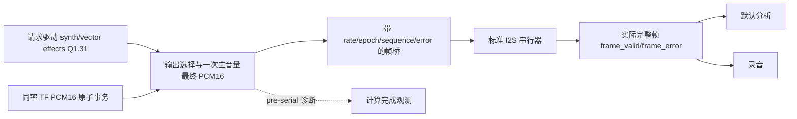

# 最终 PCM 与实际完成帧的独立边界

`workstation_final_pcm_router` 是常开计算域的新 owner 组件，`workstation_pcm_frame_fanout` 是 selected-MCLK 域的物理完成帧分发组件。它们尚未被任何 accepted／完整工作站 profile 选择；旧 `workstation_output_router`、PT8211 和 FPC 路径保留默认行为。公共参数继续由 `workstation_parameters` 提交，路由器只在接受 slot 时快照其投影，增益状态只表示音频限幅器的 applied gain。

## 源与数值矩阵

| 源 | 输入及效果语义 | 最终数值处理 | 当前两率范围 |
|---|---|---|---|
| A／B／C | `EXTERNAL_MASTER_VOLUME=1` render service，既有 expression／mix／effects／左右 route 后 Q1.31 stereo；A/B/C 原有复音与 timbre 不变 | 输出选择后，沿用旧 PT8211 的 Q1.31→PCM16 转换，再只乘一次最终主音量 | 整服务目前 48 kHz；44.1 明确返回 error，等待完整 effects 接入 |
| vector | 同一 render service 的真实 stereo geometry PCM，既有 vector 与 effects 语义 | 同上，不另给 vector 乘 CC7 | 同上 |
| TF | 真实解码器产出的 PCM16 stereo；保持旧 TF 直接播放、旁路 synth effects 的语义 | 已是 PCM16，选择后只乘一次相同主音量，不再次量化／增益 | 独立组件接受实际 48000 或 44100 且与输出 slot 同率的原子输入 |
| 未来 D | 尚无已集成最终源接口 | X01 必须明确实时变调／包络／mix／effects 后再接入 | 此组件不假定 D 已完成 |

Q1.31 转 PCM16 使用旧 PT 的 round-to-nearest、半格远离零，正满幅舍入溢出饱和到 32767，负满幅为 -32768。之后用无符号 Q1.15 gain 作一次有符号乘法、算术右移 15 位，饱和到 PCM16；这保持旧 PT→FPC 在稳定增益时的数值顺序。正常公共 CC7 仍为 0…32768；组件数值级还对更大 Q1.15 输入提供饱和，不回写公共参数。量化与乘法的溢出有 clip 帧计数。

保留旧 FPC 的 gain slew：48 kHz 每个接受 slot 至多变动 256，目标 0 或 mute 当拍对应 slot 立即置零；44.1 kHz 用 160/147 和余数累积，使正常连续 slot 下的物理变化时间一致。0→unity 为 48 kHz 的 128 slot 或 44.1 kHz 的 118 slot，误差小于一个 slot。跨 rate／epoch 不复位这个 DSP gain 状态。slot 被拒绝时不虚构时间或样本；错误恢复与淡入时序由外层受控事务处理。没有复制旧 FPC 的 latest-PCM 保持来掩盖欠载。

## 请求、身份与失败

所有 router 端口属于 `clk_i`。`request_i && request_ready_o` 接受一笔物理输出 slot；复制原 rate／32-bit epoch／32-bit sequence，不分配或重写这些身份。选择逻辑沿用 `tf_active_i && !scope_enable_i`，scope 即使静音也不会回退到 TF。选择、gain、mute、cancel epoch 和 TF 代次在接受时锁定，左右声道始终同帧；请求期间修改普通控制值从下一接受 slot 生效。

render 分支只向已有 service 发一次请求，并等其一次响应。service 接收后继续负责 PANIC、旧流水排空与单次完成；本组件不复位引擎或停止采样调度。忙时新 slot 拒绝计数，不覆盖旧身份。render 未返回时组件保留旧请求；外层的物理 deadline／超时故障处理不能通过清除此状态伪造排空。

TF 输入必须是**同一计算域中原子的 `{valid, PCM L/R, actual sample rate, transport generation, error}`**。只有选中 TF、输出身份当前、实际采样率完全相等且 TF generation 当前时才允许消费；静音仍消费当前样本以推进正常时间线。无 PCM 则本 slot 显式零／error，不重放上一对。异率、旧 TF generation 或旧输出身份不消费 PCM；上层可拒绝文件播放，或先封存录音、停发请求、排空、清旧 TF FIFO、完成受控时钟／DSP 切换，再以新代次重试。此组件不作 ASRC、保持或抽取。

现有 `tf_workstation_audio_bridge` 的 `pcm_active`／单独同步的 rate 还没有上述原子身份合同。因此实际 WAV decoder 的 coherent-clock 验证是独立接入点，不能直接把现有异步 TF 桥端口接上并宣称完成。跨域还需在 TF owner 补完整事务／generation／ready、受控 clear 和物理 CDC 证明。

router 结束前若 active rate／epoch、cancel epoch 或当前 TF generation 改变，仍以原 slot 身份返回零／error，防止旧结果被新代次消费。error bits 为：bit0 源错误，bit1 TF 欠载，bit2 异率，bit3 旧源／旧请求，bit4 取消／上下文变化，bit5 render 忙；其他位为零。计数饱和且只由全局复位清零。router 的 `quiescent_o` 仅证明自己的事务／流水空；系统切换还要合并 render service 真正 ready、TF／effects history、桥和串行 quiet，不能替代其他 owner 的 ACK。

## 实际完成帧分发

router 的 `frame_valid_o` 只是 **pre-serial 诊断／桥返回**。桥可能迟到，串行器可能欠载，所以默认分析和录音必须接 `workstation_i2s_serializer.frame_*`，再进入 `workstation_pcm_frame_fanout`。桥的 error 位及串行器 `SAMPLE_ERROR_ENABLE=1` 必须同时接通；源错误零帧保留 source-error 计数，与物理 deadline underrun 分开。

fanout 与串行器完成帧同属 selected-MCLK 域；只接受全局复位，使本地流复位后的 epoch 变化仍可见。它原样广播实际 PCM／rate／epoch／sequence／error，没有二次增益。analysis／record `valid` 是单拍实时事件，sink 仅在 `valid && ready` 接受；不 ready 就丢本帧、饱和计数并独立发 `analysis_gap_o`／`record_fault_o`，绝不反压 I2S。源 error、序号 gap 或代次变化同样使分析废弃窗口、录音 owner 封存／失败；fanout 不管理录音对象。两域消费者仍须使用保留完整 payload 的有界 CDC，不能裸采多 bit 帧或计数。

新 serializer 首个 request 之前，桥的全局 reset release／quiesce 同步必须已经完成。受控事务负责这个 readiness 顺序；只释放 serializer 而不等桥就绪会失去 slot0 预填充。启动和停钟控制不属于此组件。

## 校验与尚未迁移项

`sim/audio/run_final_pcm.py --project <实际 prepared Prj1> --output <新目录>` 覆盖独立算术／取消／切源、真实 A/B/C 32 声部及 vector 8 声部和 WAV 解码、旧 PT→选择器／observer→真实 FPC 稳定增益逐帧对照，以及新桥→标准 I2S→physical fanout 的两个方向采样率切换、源错误／迟到欠载、慢 tap 和实际逐 bit PCM。

真实源与物理串行联测是两个独立 fixture；尚未把真实 render、production TF CDC、完整双率 effects、最终桥／I2S、显示与 BLE 录音同时接入同一整机候选。旧 128-bit 诊断格式、BLE 48 kHz 格式 1、显示布局与录音对象协议都没有被暗改为双率。没有综合、P&R、物理 CDC／PLL、DAC／模拟音频、SRAM 或 Flash 接受。
