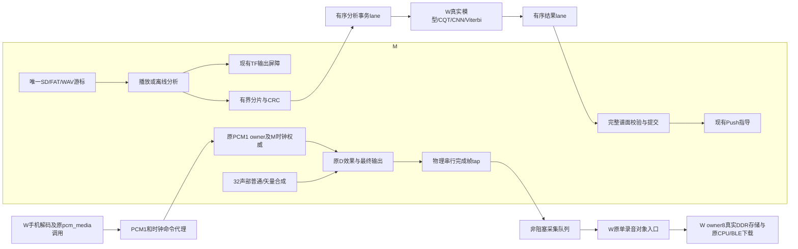

# 双138K逻辑框架

本框架先把实际业务边界接通，再按同一框架检验、迭代。它是可准备、可展开的双板逻辑组合，不是可下载的单板顶层。入口是 `workstation_task3_tf_cnn_framework`、`workstation_task3_audio_exchange` 和 `workstation_task3_channel_mux`；完整来源由 `task3_framework_sources.json` 锁定。所有物理LCD接口继续关闭。

图中的跨板线是内部事务边界。LCD线序、电平、方向、时钟、CRC帧、信用、CDC及实际吞吐仍须在目标板上验证；图中没有假定W能访问M的TF、USB、DDR、HDMI或DAC。

## 已装配的边界

| 组合 | 真实输入及实际计算 | 输出及权威 |
|---|---|---|
| TF/CNN | M唯一SD/FAT/WAV owner，播放/离线分析独占文件游标；每片最多96,000帧；W实际模型装载、DDR写入及读回CRC、CQT、六层CNN、Viterbi | M收到全部片段、完整音符及成功终态后才发布Push谱面；最多2,048音符，超出明确失败 |
| 手机/D | W原PCM1、clock命令调用经双调用者仲裁及单在途代理，M守卫核对身份/序号/回执 | M原PCM owner及原时钟服务应用；PCM位于原D效果和最终增益之前；M保留最终调度 |
| 录音 | M最终串行完成帧，无ready反压采样；256帧队列，远端arm确认后才发帧；W真实record_ingress | 继续进入已有HCI单对象/owner8，CPU与BLE操作同一对象，不创建第二录音后端 |
| 传输队列 | 各通道有限FIFO、公平轮转、背压时保持完整事务；分析描述/PCM/seal共用有序lane，音符/terminal共用有序lane | cancel独立于PCM信用；断链/PANIC清空旧队列。full offer计数是等待周期，不冒充丢样计数 |

TF分析可暂停解码游标；播放和基础合成不等待分析ready。分析分片保留到下一个未消费PCM，真实LAST才是全曲结束。当前分析格式为48k stereo16，片段拼接尚无跨窗音乐上下文融合。播放仍支持维护链的48k/44.1k；44.1k跨板识别和实际切率另验。

W识别配置通过原生参数链明确选择：WIN44100、FRAMES8、9 octave、hop22050/4、tile16、coarse guidance；signal与CQT系数使用W本地BSRAM。默认参数保持历史行为，新框架没有维度文字覆盖。此前不可变BSRAM候选的资源和3.225秒仿真结果仅用于分工决策，不转授为这份新框架的综合或性能证据。

## 装配与检验顺序

先用现有 `build.py --prepare-task3-framework --prepare-only --task3-framework-output <新目录>` 生成锁定快照。准备入口只复制已声明来源，缺失、漂移或非法路径失败；UART复用版本化基线的明确成员。快照记录源提交、工作区diff、输入/暂存哈希、配置、filelist及入口。它不运行综合、P&R、JTAG或烧录。

TF/CNN组合对外的W memory口必须接现有 `workstation_media_memory` 的owner5，和真实owner6 Delay、owner8录音共享唯一DDR控制器。audio exchange的录音输出必须接已有HCI单对象入口；PCM1/clock出口必须接M原命令边界。它们是明确的组合接口，不能将未接线的输出或测试响应端称为完整板级通过。

下一步把逻辑组合选入新的M/W paired profile并完成整机连线，保持旧候选锁和板级回退。随后按来源、逻辑端到端、真实并发、整机综合/P&R、LCD实测、SRAM分阶段检验。反序排线的供电隔离和连通性核对完成前，不选择物理引脚配方。当前共时钟组合不构成跨板CDC证据。

M基础演奏、HDMI及输出仍由原子系统拥有；本框架不产生并行公共参数权威。通信、识别、文件及下载故障只撤销对应扩展分支；基础音频采样继续。断链不等于DDR控制器故障：链路故障走取消/身份隔离，真实内存通道故障继续执行原fatal/quarantine及共同复位要求。
