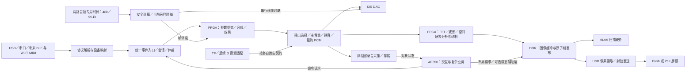

# 138K 完整工作站任务清单

核对日期：2026-10-30（Asia/Shanghai）。核对源码：`3579b81dfe429282b3b9771143f108bc18a9f062`；首次梳理时工作区干净，本次续订保留此前文档改动。已纳入架构评审的七项优化，以及用户确认的两路音频专用时钟（分别对应 48 kHz／44.1 kHz，可切换）。本文交付的是实现计划，不表示以下功能已经全部实现，也不构成板卡操作授权。

目标：在现有 138K 工程上收敛完整工作站，保留 Push、25K、Android 及已有音频功能，完成统一 MIDI 输入、48 kHz／44.1 kHz 双时钟切换、FPGA 实时合成与可视化、DDR 显示读出、AE350 交互／业务处理，以及可复现构建、整机验证和竞赛交付。

## 1. 依据与使用方式

- 工程边界及交付规则：[架构入口](../../docs/architecture/README.md)、[整机接口规划](../../整机接口规划.md)、[原生装配](push2_workstation/usb_a/rtl/workstation/README.md)、[锁定来源](push2_workstation/usb_a/baselines/README.md)。
- 竞赛需求：[原始资料索引](../../docs/requests/README.md)、[赛题 2 汇总](../../docs/requests/赛题2：实时多音色合成电子乐器引擎信息汇总.md)。本清单按仓库汇总及其 PDF 页码／Excel 问答定位整理，不声称本轮重新逐页核验 PDF 或逐格复核 Excel；经验问答和旧届赛事信息不升格为本届正式裁定。
- 素材边界：[原题及用户补充口径](push2_workstation/usb_a/docs/CONTEST_REQUIREMENTS.md)。保留 D 采样器和 TF PCM 路径；单音／单打击素材、实时变调／包络／混音与直接播放预处理整段音乐分别核对，不删除既有功能，也不以文件播放证明实时合成。
- USB／PL、BLE 报文字段继续由 [GW25K_PANEL.md](push2_workstation/usb_a/GW25K_PANEL.md)、[BLUETOOTH_PROTOCOL_V1.md](../../BLUETOOTH_PROTOCOL_V1.md) 及其已协商扩展维护；本文不另立线协议。

任务方框只在该行验收全部完成且附证据后勾选。已有子系统成果列在“现状”，不能据此勾选整机任务。后续每项记录源码／配置身份、离线结果、实板结果、SRAM／Flash 状态；无证据写“未验证”。实验过程放入 `usb_a/reports/`，此处只更新任务状态及证据链接。

执行状态（2026-10-30）：已完成[环境与基线保全](push2_workstation/usb_a/reports/WORKSTATION_TASK_ENVIRONMENT_20261030.md)、F01 来源检查点及 F02 维护 AE350 固件接入；[revision 2 综合](push2_workstation/usb_a/reports/WORKSTATION_F02_SYNTHESIS_20261030.md)与完整来源审计通过，尚无本轮完整工作站物理验收。[A06 独立切换事务](push2_workstation/usb_a/reports/WORKSTATION_A06_TRANSACTION_20261030.md)、[双参考资格与 DCS](push2_workstation/usb_a/reports/WORKSTATION_F03_CLOCK_DOMAIN_20261030.md)、[带代次 I2S](push2_workstation/usb_a/reports/WORKSTATION_I2S_TRANSPORT_20261030.md)已分别离线验证；后续[原生联合音频链](push2_workstation/usb_a/reports/WORKSTATION_RUNTIME_AUDIO_COMPOSITION_20261030.md)已接真实 DSP／最终 PCM／物理 I2S fixture，仍未进入整机 profile。[DDR 预算](push2_workstation/usb_a/reports/WORKSTATION_DDR_BUDGET_20261030.md)及[revision 3 扫描 admission](push2_workstation/usb_a/reports/WORKSTATION_SCAN_ADMISSION_20261030.md)保留期限失败与未覆盖范围，A06／D01／D04 整项未完成。本轮用户另行授权综合、SRAM 与探针迭代；具体操作以各阶段实测记录为准，Flash 尚未获本轮授权。其余任务仍按下表逐项验收。

物理检查点：[固定 revision 2 P&R](push2_workstation/usb_a/reports/WORKSTATION_F02_PHYSICAL_20261030.md)及其 [F3 布局子候选](push2_workstation/usb_a/reports/WORKSTATION_F03_PHYSICAL_20261030.md)均未通过整机 STA，未部署。F3 精确 capture hold 为 +0.814 ns，但全局 setup 仍为 −2.475 ns；完整 maintained PLL、common CDC 和 native routes 子门禁通过，不抵消 STA 失败。[F4 区域约束被拒与 F5 修正准备](push2_workstation/usb_a/reports/WORKSTATION_F05_DQS_REGION_PREPARE_20261030.md)保留新身份及失败证据；[F5 路由失败及 F6 LUT-only 子候选](push2_workstation/usb_a/reports/WORKSTATION_F06_DQS_LUT_ONLY_PREPARE_20261030.md)记录 F5 的 297 条未布通网络，[F6 物理结果](push2_workstation/usb_a/reports/WORKSTATION_F06_PHYSICAL_20261030.md)为 302 条未布通网络，未生成位流／STA，未部署。[实际 DSP 来源／采样率审计](push2_workstation/usb_a/reports/WORKSTATION_SAMPLE_RATE_DSP_AUDIT_20261030.md)给出原 48k 实现及逐项适配依据，不将计划视作已实现。

独立音频阶段：[双时钟零 PCM 探针 B7](push2_workstation/usb_a/reports/WORKSTATION_AUDIO_PROBE_HARDWARE_20261030.md)两次数字采集通过，但完整 SRAM Verify 两次失败，不计硬件验收；已重载原 Flash 并独立读回 `C11028E5`，本轮未写 Flash。[双率渲染引擎](push2_workstation/usb_a/reports/WORKSTATION_RUNTIME_RENDER_ENGINES_20261030.md)、[完整效果链](push2_workstation/usb_a/reports/WORKSTATION_RUNTIME_EFFECTS_20261030.md)、[最终 PCM／物理完成帧 tap](push2_workstation/usb_a/reports/WORKSTATION_FINAL_PCM_ROUTING_20261030.md)已完成各自离线验证，尚未由整机 profile 选择，不据此勾选 A02—A07。

后续时序源码阶段：[ADSR 流水](push2_workstation/usb_a/reports/WORKSTATION_RUNTIME_ADSR_PIPELINE_20261030.md)、[灯光快照](push2_workstation/usb_a/reports/WORKSTATION_PUSH2_LIGHTS_SNAPSHOT_20261030.md)和[模型就绪级间约束](push2_workstation/usb_a/reports/WORKSTATION_READINESS_CONSTRAINT_20261030.md)已通过针对性回归并分别提交。新增[扫描欠载诊断流水](push2_workstation/usb_a/reports/WORKSTATION_SCANOUT_UNDERRUN_PIPELINE_20261030.md)的 12 组像素／真实黑行计数回归也通过。它们不包含在固定 revision 2 的 F3／F5／F6 网表中，仍须在下一明确源码候选中重新综合、P&R 和板测。

组合与消费者阶段：[完整双率 event/render 服务](push2_workstation/usb_a/reports/WORKSTATION_RUNTIME_RENDER_SERVICE_20261030.md)的父级独立回归通过 48,652 次请求／响应及 48,644 帧模型对照；原生联合音频链父级复验 20,190 物理帧，并完成默认资格／PDN／1,028 帧启动回归。它们不代表 USB／AE350／曲谱／TF 全部已接回整机。[物理观察 CDC](push2_workstation/usb_a/reports/WORKSTATION_PCM_OBSERVATION_BRIDGE_20261030.md)、[维护控制服务提取](push2_workstation/usb_a/reports/WORKSTATION_CONTROLLED_SERVICES_NATIVE_20261030.md)均已离线验证并提交，后续组合还在进行。[采样率元数据／Android 格式协商](push2_workstation/usb_a/reports/WORKSTATION_SAMPLE_RATE_METADATA_20261030.md)父级复核 73 项通过、2 项原物理前置跳过；显示 minor1 和 138K 设备后端仍未集成，无 APK／手机／硬件接受。A03—A07、F04／F05、R01／R03 方框保持未完成。

新增组合检查点：[真实 Gowin 声明修复](push2_workstation/usb_a/reports/WORKSTATION_RUNTIME_DECLARATION_FIX_20261030.md)与[音频组件综合](push2_workstation/usb_a/reports/WORKSTATION_RUNTIME_AUDIO_SYNTHESIS_20261030.md)消除了隐式／无驱动信号，仍非整机 P&R；[原生控制／物理帧消费者](push2_workstation/usb_a/reports/WORKSTATION_RUNTIME_CONTROLLED_NATIVE_20261030.md)、[TF 原子帧桥](push2_workstation/usb_a/reports/WORKSTATION_TF_FRAME_BRIDGE_NATIVE_20261030.md)、[音频时钟命令服务](push2_workstation/usb_a/reports/WORKSTATION_AUDIO_CLOCK_SERVICE_20261030.md)已独立复验并提交；[非零 epoch 配置](push2_workstation/usb_a/reports/WORKSTATION_STREAM_EPOCH_POLICY_20261030.md)由音频 owner 显式提供，近回绕／真实 APB／完整 I2S 回归通过。新 top/profile、完整时钟／CDC、TF 文件业务、显示 minor1 与真实录音后端仍在接回，不能将这些组件证据合并成整机验收。

后续原生阶段：[显示 minor1 与真实 PCM 分析](push2_workstation/usb_a/reports/WORKSTATION_DISPLAY_METADATA_V11_NATIVE_20261030.md)、[双率矢量逐周期等价与独立综合资源对比](push2_workstation/usb_a/reports/WORKSTATION_RUNTIME_VECTOR_RESOURCE_20261030.md)、[TF 文件与队列读排空](push2_workstation/usb_a/reports/WORKSTATION_TF_RUNTIME_SERVICE_NATIVE_20261030.md)、[HDMI minor1 组合](push2_workstation/usb_a/reports/WORKSTATION_RUNTIME_DISPLAY_NATIVE_20261030.md)、[内存故障守护](push2_workstation/usb_a/reports/WORKSTATION_RUNTIME_MEMORY_GUARD_20261030.md)及[显示末次丢帧／原子效果快照](push2_workstation/usb_a/reports/WORKSTATION_DISPLAY_OBSERVATION_HEALTH_20261030.md)均已完成各自父级复验并分别 push。TF 仍使用 DDR 文件中转，EOF 未证明物理有序排空；后续[真实 runtime＋内存守护](push2_workstation/usb_a/reports/WORKSTATION_RUNTIME_MEMORY_INTEGRATION_20261030.md)父级回归覆盖 10,034 个 I2S 帧、四类故障及旧读返回隔离，仍不是完整板级顶层或实际 PLL 故障验证。[revision 4 来源组合](push2_workstation/usb_a/reports/WORKSTATION_RUNTIME_PROFILE_REV4_20261030.md)已真实准备并通过来源／篡改／宏分支隔离检查，显式选入双率音频、TF 和 minor1 显示；完整时序／CDC／PLL 及板测仍未完成，相关任务方框不提前勾选。

当前整机检查点：[revision4 真实综合](push2_workstation/usb_a/reports/WORKSTATION_RUNTIME_REV4_SYNTHESIS_20261030.md)两次通过，最终候选 `41e653fe462e5ea3` 的 560 项输入前后保持；综合 Logic 119,348、Register 60,853、BSRAM 259（非物理占用）。HDMI 三条无驱动警告已关闭，其余诊断、完整 CDC／PLL／物理时序及功能门禁仍待处理；未 P&R、未生成位流、未部署。TF quiet 跨域与计算停钟内完整 USB 拔插的旧 FIFO 重放分别进入定向修复。

后续 [revision5 媒体准备整机检查点](push2_workstation/usb_a/reports/WORKSTATION_RUNTIME_PROFILE_REV5_20261030.md)已将保留持音、正常封存 REC／BLE、停止 score／TF 接回显式 profile。最终候选 `f1be50e853d3700a` 的 570 项输入保持，综合无 AG 组合环诊断，Logic 120,981、Register 61,345、综合 BSRAM 268；profile 18 项、来源 12 项、AE350 API 835 checks、时钟 4 项通过。[第二批实际 CDC](push2_workstation/usb_a/reports/WORKSTATION_RUNTIME_CDC_MEDIA_FENCE_20261030.md)通过 25 项／77 负控及真实 SDC 安装检查，但只覆盖 21／400 Gray 和 media／hold／USB fence；完整 CDC／PLL／物理时序／功能接受仍未完成。旧 45fe 组合环、9106 旧 USB setup cut 失败均保留原身份；[F7 查询失败／F8 精确适配](push2_workstation/usb_a/reports/WORKSTATION_RUNTIME_F7_QUERY_F8_PREPARE_20261030.md)已封存，F7 未进入布局，不计资源尝试；F8 prepare 的 17 个负控及全部输入核验通过，现已启动首次有效资源 P&R，结果另记。本阶段无位流、SRAM 或 Flash 部署，任务方框不提前勾选。

新增 [R00 未选择存储组件](push2_workstation/usb_a/reports/WORKSTATION_PCM_DDR_BACKEND_MAIN_INTEGRATION_20261030.md)完成父级及独立 24 项回归，覆盖双率、实际仲裁竞争、尾 mask 和同拍命令；新 prepare `60f1c843ad79aa6e` 的 profile 18 项、来源 12 项通过，570 项 staged 字节与 f1be 相同。生产 owner8／最终 PCM CDC／对象业务尚未接入，没有物理净资源收益或真实录音接受，R00／R01／R02 保持未完成；未转移旧候选综合或 CDC 接受，未部署。

[BLE release 维护 composition](push2_workstation/usb_a/reports/WORKSTATION_RUNTIME_BLE_RELEASE_COMPOSITION_20261030.md)已精准修复 F7 空查询，默认／accepted 来源隔离保持。新 prepare `bd40620bb1b139bb` 的 profile 19 项、来源 12 项、accepted sources 10 项及 CDC policy 4 项通过，真实 prepare 的三项篡改均被拒绝；570 项 staged 仅 SDC 变化。该阶段没有新综合／物理／硬件接受，完整 CDC／复位门禁仍未完成。

[F8 物理失败及 F9 第二次资源尝试](push2_workstation/usb_a/reports/WORKSTATION_RUNTIME_F8_PHYSICAL_F9_PREPARE_20261030.md)：F8 8,083 条未布通网络，物理 CLS 67,110／69,120、BSRAM 298／340、PRIMARY 与 LW 均 8／8，无位流或完整 routed STA；F9 只改为 place4/route1 和独立 UserCode，27 项输入及八个负控通过，已启动运行。当前仅一次有效资源失败，尚未触发用户允许的 CNN／曲谱裁剪；无部署。

[R00 owner8 主线复验](push2_workstation/usb_a/reports/WORKSTATION_RECORDING_DDR_OWNER8_MAIN_INTEGRATION_20261030.md)已完成原生路径 44 项、后端 41 项及严格 lint；新 prepare `7ffad19cde578d67` 的 profile 19 项／来源 12 项／accepted 10 项通过，570 staged 与 `bd40620bb1b139bb` 逐字节相同。组件仍未由整机选择，生产 owner8／最终 PCM CDC／录音对象业务尚未接入；没有新综合、物理或硬件接受，R00／R01／R02 方框不变。

[PCM/context CDC 维护组合](push2_workstation/usb_a/reports/WORKSTATION_RUNTIME_PCM_CDC_COMPOSITION_20261030.md)已完成父级实际 VG 14 项／81 负控，独立检查 229 位、862 selector、16 同步组与五组 release。新 prepare `9993a3602be582fa` 安装 50 行约束，profile 20 项／来源 12 项／accepted 10 项通过，570 staged 仅 SDC 改变。旧 25／77、f1be 综合及 F8／F9 身份不转移；新候选尚无综合，完整 CDC／功能复位／RAM 数据时序／物理与硬件接受仍未完成，无部署。

[F9 第二次有效资源失败](push2_workstation/usb_a/reports/WORKSTATION_RUNTIME_F09_RESOURCE_FAILURE_20261030.md)已封存：32,709 条未布通网络、CLS 报告99%、BSRAM 298／340、PRIMARY 与 LW 各8／8，27 项登记输入保持，无位流或完整 routed STA。F8／F9 两次真实资源尝试均失败，现已满足用户允许 CNN／曲谱引导裁剪的条件；独立 no-CNN 候选正在准备，当前主线尚未激活，不宣称资源节省或部署。

[采样率控制 level 注册修复](push2_workstation/usb_a/reports/WORKSTATION_RUNTIME_RATE_CONTROL_LEVELS_20261030.md)关闭了 PREFILL→RESUME 组合译码毛刺在数字模型中导致预填清空／重复请求的问题。双模式长期回归及旧行为负控、真实时钟／I2S、profile20／来源12／accepted10均通过；新 prepare `1aea3c01fa6c1b14` 仅一项RTL输入变化，已独立启动综合，结果另记。新网表的PCM源／完整closure需重新审核，完整物理／硬件接受仍未完成，无部署。

[条件 no-CNN 源码候选](push2_workstation/usb_a/reports/WORKSTATION_CONDITIONAL_NO_CNN_SOURCE_20261030.md)已在主线复验并明确选入下一轮实验：父级独立双 prepare、识别7项、enabled profile20项、两配置来源各12项、accepted10项及八项行为检查通过。新 `custom138k-workstation-no-cnn-v1-525ffff10d622031` 只关闭CNN／跟奏，保留手工cue／本地曲谱、TF、录音、音频效果与可视化；默认配置保留识别。已启动独立整机综合；净资源、完整CDC／PLL、物理时序与硬件均待验证，无部署，任务方框不提前勾选。

[注册控制候选整机综合](push2_workstation/usb_a/reports/WORKSTATION_REGISTERED_LEVELS_SYNTHESIS_20261030.md)已通过，570项输入保持、无AG组合环诊断；父级重新完成时钟4项／23负控及既有Gray／媒体／USB CDC27项／77负控。该接受范围仅绑定 `1aea3c01fa6c1b14` 的实际新VG，不转移给no-CNN；PCM精确适配、观察RAM数据弧、完整复位／CDC／PLL、物理与硬件仍未完成，无部署。

[观察RAM数字审查](push2_workstation/usb_a/reports/WORKSTATION_OBSERVATION_RAM_DIGITAL_AUDIT_20261030.md)已父级复验f1be实际25个RAM／98有效位、178项语义、19个网表负控及14项理想数字安全证明。32个投机转发FF按无效数据隔离单独处理；完整CLK→DO／RAD数据时序、Gray物理相干和复位仍未接受，约束提案未安装，不能升级为全部CDC或硬件通过。

[no-CNN实际整机综合](push2_workstation/usb_a/reports/WORKSTATION_NO_CNN_SYNTHESIS_20261030.md)通过，571项输入保持；综合估算Logic102,128／Register51,122／BSRAM245，七PLL及DCS仍在。静态501次约束查询仅17个加密DDR内部空query，可见端点无新增空项；尚非Gowin工具解析或物理收益。新VG的CDC／时钟审查和独立资源P&R准备继续进行，无位流或部署。

[no-CNN C11030FA物理准备](push2_workstation/usb_a/reports/WORKSTATION_NO_CNN_FA_PHYSICAL_PREPARE_20261030.md)父级／独立18项输入及23负控通过，使用原SDC／maintained ULPI CST与place2／route0启动P&R。新VG时钟4项／23负控和Gray／媒体／USB CDC27项／77负控通过；完整CDC／RAM／复位／PLL与routed时序仍未接受，物理结果另记，无部署。

[注册控制／no-CNN PCM检查器适配](push2_workstation/usb_a/reports/WORKSTATION_PCM_REGISTERED_AND_NO_CNN_AUDIT_20261030.md)父级在两份实际VG各完成15项／94负控，并独立复验同沿D锥／十负控；229位、864selector及65／263／141／207完整闭包保持严格，50行SDC不变。新双prepare为`63028f9b77637e25`／`60cae14e43255a2b`，staged与各自前序完全相同；来源回归全过，但新prepare尚未综合，FA不改名继承。完整CDC／reset／RAM物理／PLL／STA及硬件仍未接受，无部署。

[no-CNN FA 首轮物理失败](push2_workstation/usb_a/reports/WORKSTATION_NO_CNN_FA_RESOURCE_FAILURE_20261030.md)已封存，556 条未布通网络；实际 CLS 61,804／69,120、物理 BSRAM 272／340，PRIMARY／LW 仍各8／8。父级重验18项输入、六输出及日志，无位流或完整 routed STA，未操作板卡。继续独立算法试验，完整门禁及任务方框保持未完成。

[no-CNN 实际 shared CDC 数字复验](push2_workstation/usb_a/reports/WORKSTATION_NO_CNN_INSTALLED_SHARED_CDC_REVIEW_20261030.md)在父级独立副本逐字复现，14个网表负控全拒绝；实际88行覆盖43首级位／182 Gray位／1,308保持数据位。generic检查器的旧scope拒绝单独保留；13个DDR内部query、110复位pin语义、状态脉冲、保持协议及物理CDC均未接受，cache审查尚未成为维护工具，无部署。

优先级：P0 为主线基础和关键阻断；P1 为目标架构及完整工作站必需；P2 为依赖产品决策或额外硬件的扩展。P2 也需给出最终范围结论，不能默默省略后宣称“完整项目完成”。实施仍优先在 138K，25K 设备侧遵守既有只读核对／建议边界。

## 2. 本次确认的目标架构（含绘制勘误）

### 2.1 统一输入和音频

所有承载 MIDI 的入口先做协议解析与设备映射，再进入统一事件仲裁、会话清理和公共参数提交，驱动同一 FPGA 合成／效果／最终输出链路。USB、串口和后续 BLE／Wi-Fi MIDI 不各自创建一套音源或参数真值。AE350 的普通业务请求也经过同一提交边界；实时演奏不等待 CPU 绘图、下载或文件操作。

当前核心事件仍为 18 bit `{kind[3:0], a[6:0], b[6:0]}`，不含 channel、source、session、revision。保留现有全局 PANIC 和断开清音语义；若未来需要逐来源释放或保留完整 MIDI 通道，须先设计内部兼容封装，不能把这些字段假定为已经存在。

“统一 MIDI”不表示 TF 文件播放已经过合成器。TF、实时矢量、后续 D 的音频路由、效果作用点、主音量和录音 tap 必须逐项验证；当前 TF 独立支路在迁移前保持其明确语义。

#### 即时播放输入流式化

**用于即时播放的下载／文件读取链路改为流式处理，取消播放数据的 DDR 中转缓存。** 音符／曲谱事件经解析和有界事件队列驱动统一 FPGA 合成器；PCM／压缩音频经有界 FIFO／预取、解码及约定的实时变调／包络／混音／效果接入最终 PCM，单纯解码播放不作为音符合成证据。先盘点选定 profile 实际接入的入口，不把历史上传源码或尚未实现的无线入口当作已有链路。

小缓存按输入最坏停顿和实际吞吐量预算确定，定义预填充、背压、溢出、欠载及断开／取消行为，音频采样节拍不等待下载或文件读取。该目标只取消即时播放数据的 DDR 中转；长录音对象及其下载、显示、模型、Delay 和 D 素材随机访问所需存储分别保留，分析支路的消费与背压独立。迁移进入显式新候选，不自动改写 accepted／pinned 输入。

#### 双音频专用时钟与采样率切换

**用户已确认音频链路由两路音频专用时钟提供，分别对应 48 kHz 和 44.1 kHz，并支持切换。** 这两项数值是目标采样率，不直接作为晶振频率或 FPGA 计算时钟频率。任务以该硬件前提推进；“统一采样时间基准”指一次运行选择一套音频时基，合成帧调度与最终 I2S 帧消费保持明确的频率关系，不是只保留一颗晶振或把所有音频强制转成 48 kHz。同一整机候选须支持运行时安全切换，不能用更换两份单采样率位流代替。

当前原生源码的 [clocks.json](push2_workstation/usb_a/boards/custom_138k/clocks.json) 只声明 12.288 MHz DAC 参考及从 50 MHz 生成的 76.8 MHz 计算时钟，[FPC 输出](push2_workstation/usb_a/rtl/audio/workstation_fpc_audio.sv) 仍使用最新 PCM 保持方式。它们说明当前装配的覆盖范围，不能据此否定第二路硬件时钟，也不能证明双时钟切换已经集成。两路实际频率、引脚、选择器、DAC 支持的 MCLK／LRCK 比值和约束由 F03／A06 核对，本文不猜测第二路晶振频率或球位。

切换作为有界的硬件事务：接收并登记目标采样率 → 在完整帧边界进入受控静音 → 排空或作废旧采样代次的在途数据 → 使用器件支持的安全时钟选择／门控 → 确认目标时钟稳定并释放相关域复位 → 原子更新采样率相关配置与流代次 → 预填充、恢复完整帧输出并报告实际生效。常开控制域管理超时、失败和恢复，不依赖已停止的音频时钟完成握手；禁止普通组合 mux 直接切时钟或输出半个 I2S 帧。正常演奏仍持续采样，显示／下载／CPU 慢服务不得触发停钟；仅明确的采样率切换或时钟故障进入受控中断，切换静音时长单独记录。

每个音频块携带明确的实际采样率、流代次和帧序号；这些是待设计的内部契约，不塞入现有 18-bit MIDI 事件。两个运行模式分别核算合成／效果的帧预算和时序，不能把历史 `76.8 MHz / 1600 = 48 kHz` 当成 44.1 kHz 的调度方案。若计算域与选中的音频时基异步，须有受输出节拍约束的帧交付方案；异步 FIFO 不能单独解决永久频差。真正异步或与当前模式不同采样率的输入，需显式采样率转换或受控切换策略，不能只改文件头或保持／抽取旧 PCM 冒充转换。

兼容边界：现有 [BLE 协议格式 1](../../BLUETOOTH_PROTOCOL_V1.md) 固定为 48 kHz，[显示数据布局 v1](push2_workstation/usb_a/DISPLAY_DATA_LAYOUT_V1.md) 也固定记录 48000。44.1 kHz 的元数据、频轴和录音格式必须在这些既有维护入口明确版本／能力协商，并同步 Android 的对象校验与 WAV 封装；兼容扩展落地前不能重用旧格式宣称支持，旧客户端仍按原契约处理。已经封存的录音保留自身采样率，后续系统切换不影响其下载和播放解释。

#### 统一最终 PCM 与观察点

目标音频出口为“各音源及其约定效果 → 输出选择 → 主音量／静音 → 最终 PCM”，由同一完整帧驱动 I2S、默认显示分析和录音。当前新板 HDMI 使用主音量前的观察值，BLE 录音使用 FPC 主音量后的帧，须在 A03 中收敛；效果前／音量前的诊断保留为有明确名称的独立 tap。新板可在保持逐帧等价验证的前提下，减少“PT8211 串行化 → 观察器还原 PCM → I2S”的中间路径；旧板及 accepted 输入不自动改线。

### 2.2 FPGA 绘制，DDR 存图，显示硬件读出

**FFT／频谱、波形、李萨如图、空间场图等实时视听图像由 FPGA 计算和绘制，写入 DDR 的指定区域。AE350 主要负责交互、页面状态、控件逻辑和复杂业务。** 这取代“USB／HDMI 的显示绘制全部由 AE350 完成”的表述。普通菜单、文字或静态控件可按预算由 AE350 绘制辅助层，但实时图像的计算／栅格化不得迁到 CPU。

HDMI 扫描和 USB 显示发送硬件经统一 DDR 仲裁读取已提交像素；外部 Push／25K 不直接访问 DDR。USB 仍按 Push 或 PL 协议发送，允许小型 FIFO、行缓存、分块和格式转换。两端不强求同一分辨率或同一帧缓冲，但应消费一致的已提交参数和分析结果。

共享 FFT／空间场等分析结果，按输出端需要由 FPGA 绘制各自图像；HDMI 和 USB 分别持有读取引用、发布进度和缓冲回收状态。USB 慢端或重试只保留其正在发送的版本，不能锁住 HDMI 后续绘制。双／三缓冲、局部更新与渲染刷新率按实测预算选择，不强求每个端口复制完整 1080p 页面。采样率切换后，旧分析窗口作废或明确标记旧代次，新的频轴／时间轴与像素帧必须绑定同一采样率。

所有新增图像层、USB 页面和录音存储都先在 [ddr_address_map.vh](push2_workstation/usb_a/rtl/ddr_address_map.vh) 登记。这里不预分配一套新地址。设计必须明确写入者、前／后台缓冲所有权、完成条件、发布序号、读取引用和回收条件；未完成帧不得发布，慢 USB 读取不能被后续绘制覆盖，也不能拖住 HDMI 或音频。

### 2.3 FPGA 协议处理，AE350 复杂业务

| 所属 | 目标职责 | 边界 |
|---|---|---|
| 无线芯片 | 射频、芯片内已有控制器／固件能力 | 不把这些芯片内部功能写成 FPGA 自研实现 |
| FPGA 通信与搬运 | 接口时序、协议收发状态机、封解包／校验、链路时限、FIFO／DMA、流量与错误观测 | 保留有界缓存与断开清理；先划清各层协议职责，再迁移业务 |
| AE350 | 交互与页面状态、连接策略、命令业务语义、录音对象／下载任务管理、文件／曲目管理、错误恢复策略 | 通过请求接口操作公共参数；不计算合成 PCM、实时效果或实时图像 |
| FPGA 音频／分析／绘图 | 合成、包络、混音、效果、采样调度、FFT 等分析和实时绘制、最终串行输出 | 连续采样；CPU 或外设不可用时仍可演奏 |
| 现有 USB Host CPU／固件 | 迁移期间保留已验证的枚举、设备适配和发送职责 | 不能把“运行在 FPGA 芯片内的 CPU 软件”称为 HDL 协议实现；是否进一步归位按接口与预算验证，不顺手移植整栈 |

资源占用是迁移依据之一，还要核对服务时限、CPU ROM／RAM／栈、总线带宽和实现复杂度。旧报告提出的 ATT／GATT 整棵卸载只是候选建议；本次按“协议处理留 FPGA、复杂业务交 AE350”重新划分，不默认整栈迁移，也不预记资源收益。

CPU 接入点固定在已经解析／校验的完整业务命令及任务完成结果；连续 PCM、图像和大块文件数据由有界硬件队列／DMA 搬运，AE350 管理描述符、对象及策略，不逐字节中转实时数据。DMA 复用现有存储与总线边界，不为此建立一套通用大框架。

图中 TF／D 为音源边界示意，不表示 D 已接入或其效果被绕过；具体路由由 A03、X01 定义。显示、录音允许报告丢弃／失败，均不反压音频。

### 2.4 架构优化落地对照

| 优化点 | 落地要求 | 任务 |
|---|---|---|
| 双专用时钟下统一当前音频时基 | 支持 48 kHz／44.1 kHz 安全切换；当前模式内生产／消费有一致节拍，系数和元数据同步切换 | F03、A05—A07 |
| 统一最终 PCM | 主音量／静音后同一帧分发到 I2S、默认分析和录音，保留有名字的其他 tap | A03、A04 |
| 即时播放输入流式化 | 下载／文件读取经有界小缓存进入实时合成或音频处理，取消播放数据的 DDR 中转，核对片内缓存净成本 | M03、A03、D01 |
| DDR 最坏等待保障 | 按缓存水位、截止时间和最大突发分配服务，限制后台占用，不能只看平均带宽 | D01、D04、V03 |
| 共享分析、各端独立图像缓冲 | 读取引用与重试版本固定，USB 慢端不阻塞 HDMI，跳过旧帧但不覆盖正在读取的帧 | D02—D06 |
| AE350 处理完整业务命令 | 数据面硬件搬运、控制面 CPU 管理，核算 ROM／RAM／栈和最坏服务间隔 | C01—C05 |
| 提前建立 DDR 录音存储底座 | 先迁移大容量 PCM 后备，保留实时小缓存；同口径计净资源收益 | R00、R02、C04 |
| 状态一致性与可观测性 | 接受／应用／失败分开，快照与流带代次，诊断覆盖丢帧、队满和最大等待 | I05、C01、V03 |

## 3. 当前项目盘点

以下是不同身份的证据，不能拼成一份“全部通过的最新固件”，也不推断此刻板上内容。

| 子系统 | 已有实现／可复用成果 | 到完整目标仍缺什么 | 依据 |
|---|---|---|---|
| 构建与边界 | 三类完整工作站 prepare 已有锁定输入闭包；资源候选已有原生组合根、会话、参数、播放服务及输出路由 | 新板最终来源选择、AE350 可重编译输入、独立模块变更统一集成与新候选验收 | [基线](push2_workstation/usb_a/baselines/README.md)、[装配](push2_workstation/usb_a/rtl/workstation/README.md) |
| A/B/C／效果 | 32 声部、五音色、表情、延迟／合唱／混响及矢量路径已存在；32 音谱峰有离线证据 | 新板全链路实测、实际振荡器统计、端到端延迟、并发负载下持续采样 | [赛题对照](push2_workstation/usb_a/reports/CONTEST_REQUIREMENTS_20261019.md) |
| USB 输入 | 新板独立 `C11030A2` 已实际 Push HS 枚举、拔插后恢复 MIDI；原 FS 路径保留 | 同一修复进入完整音频工作站；Push／25K 分别复验。独立 HS 不升级 accepted FS 配置 | [USB 入口](example/USB_HS/README.md)、[10-30 实测](push2_workstation/usb_a/reports/USB2_PUSH_HOTPLUG_20261030.md) |
| HDMI／DDR | 独立 `C11028D5` 用户接受的显示基础；扫描取行窗口修复后实测持续欠载为零 | 完整工作站竞争负载、剩余闪烁／帧发布与物理时序；D5 历史 hold −0.251 ns 仍保留 | [模块入口](example/HDMI/README.md)、[D5 原始记录](push2_workstation/usb_a/reports/WORKSTATION_HDMI_SCAN_WINDOW_20261028.md) |
| USB 显示 | Push RTL 像素路径；25K Host C `gw_pixel()` 按 tile 绘制，PL 会话／重试已存在 | 统一从 DDR 已提交图像读取；不把现有 Host 分块绘制描述成 DDR 发送已完成 | [像素源](push2_workstation/usb_a/rtl/display_data/push2_surface_pixels.sv)、[PL 实现](push2_workstation/usb_a/gw25k_panel.h) |
| AE350 | 整机已有 APB 服务／UI 控制、DDR 页面与启动固件；D5 独立显示明确不含 AE350 | 复杂业务卸载、可维护的软件构建链、容量与服务时限验证 | [资源评估](push2_workstation/usb_a/reports/AE350_RESOURCE_OPTIMIZATION_20261027.md)、[整机连接](push2_workstation/usb_a/rtl/workstation/gw138k_push_workstation_top.v) |
| 新板音频输出 | FPC I2S 接口已有实现；AK4493 独立 `13802302` 修焊后用户确认 CN 扬声器出声 | 最终 PCM 到实际 DAC／左右声道／主音量／静音的整机验收；旧 PT8211 右对齐不能冒充标准 I2S | [功放入口](example/AK4493_AMP/README.md) |
| 双音频时钟 | 用户确认两路音频专用时钟分别对应 48 kHz／44.1 kHz，支持切换；当前受检整机配置仅描述 48 kHz 参考路径 | 第二路接入与安全选择、两种模式帧调度／系数／时序、切换期间各消费者行为尚需整机证明；不是硬件缺少第二路时钟 | [当前时钟清单](push2_workstation/usb_a/boards/custom_138k/clocks.json)、本次用户确认 |
| BLE | `C11027C1` 实板业务 GATT、重连、0.1 秒短录音和 CRC 下载／续传通过；容量 16,384 帧约 0.341 秒 | 当次 PCM 全零；真实乐音与 tap、公共参数、Android 真机、DDR 长录音及 AE350 业务迁移未验收 | [BLE 实测](push2_workstation/usb_a/reports/WORKSTATION_BLE_C11027C1_20261027.md) |
| 资源／时序 | C1 整机物理 BSRAM 含 GAO 为 318/340，CLS 61,184；数值 setup +0.003 ns | 严格检查仍有 GAO 时钟清单差异；新组合需重新验证。不能沿用早期“新板从无非负 STA”，也不能写成全门禁通过 | [C1 物理记录](push2_workstation/usb_a/reports/WORKSTATION_RESOURCE_A26_PHYSICAL_20261027.md) |
| TF／识别／引导 | WAV、DDR 双 bank、CQT→CNN→Viterbi、Push 曲谱／跟奏路径存在 | 模型冷启动、换曲／取消／拔卡、识别效果与演奏并发、最终演示闭环 | [架构运行链路](../../docs/architecture/README.md) |
| D／25K 专有效果 | D 采样器、音序器、CC20／21／22 效果有独立验证；25K 控件和基础页存在 | D 整机音源／DDR／显示集成；16 键效果上下文与操作规则未定；本地参数同步未齐 | [整机接口](../../整机接口规划.md) |
| Android | 协议、连接、录音下载、可靠检查点与 WAV／作品管理已有实现 | 138K 非静音真实录音闭环、手机权限／锁屏／恢复、真实参数应用反馈 | [Android](../../clients/android/README.md) |
| Wi-Fi／LCD／触摸 | 有历史例程或独立资料；新板 LCD 有性能快照消费者，触摸输入未接 | 受支持的产品入口、驱动闭包、网络业务契约、硬件与整机验证；不算已完成服务 | [模块索引](example/README.md)、[原生装配](push2_workstation/usb_a/rtl/workstation/README.md) |
| 部署记录 | 新板 E5 有 10-28 配置 Flash、保留分区校验及重载记录；A2 有后续 SRAM 诊断记录 | 它们不是完整目标固件，不能把 full85 当新板最新 Flash，也不能推断当前 SRAM | [E5 Flash](push2_workstation/usb_a/reports/USB2_HDMI_FLASH_20261028.md)、[A2](push2_workstation/usb_a/reports/USB2_PUSH_HOTPLUG_20261030.md) |

## 4. 赛题要求到任务的追踪

来源为 `docs/requests/` 汇总第 1—4 节、指南正文第 13—14 页（PDF 第 15—16 页）。下表用于验收设计，不新增赛事评分权重。

| 要求 | 目标与证明方式 | 对应任务 |
|---|---|---|
| 自主交互，至少 2 个独立维度 | 实物选音／触发与独立滑条等同时作用；触摸电容值不冒充力度 | I04、V02 |
| HDL 实时生成，至少 4 独立声部 | 给出真实 RTL 路径、独立相位／音高／包络状态，测同时发声和逐音释放 | A01、V01 |
| 实时变调、ADSR、混音 | 演奏中改变音高与包络，验证削波／饱和、尾音和抢占策略 | A01、A02 |
| 标准 I2S 至 DAC | 示波器／逻辑分析仪验证槽位、左右声道、MSB 相对 LRCK 的时序，再实测模拟输出 | A04、V02 |
| 基础总延迟 ≤10 ms，拓展 ≤5 ms | 两种运行模式分别记录传感器、接口、排队、合成、I2S／DAC 的最大值与分布；不能以 48 kHz 的约 20.833 µs 或 44.1 kHz 的约 22.676 µs 采样周期代替总延迟；主动切换的静音间隔另报 | I03、A05、A06、V02 |
| ≥32 复音，或 ≥32 加法分量，或多路物理建模 | 优先证明现有 32 声部；输出不同频率谱峰，独立释放，报告实际活跃可闻振荡器数 × 实测输出采样率 | A01、V01 |
| ≥3 维表情、≥2 音色、硬件效果 | 对照力度／滑音／颤音等真实可操作维度，验证五音色和全部现有效果；固定力度 100 不算可变力度 | I04、A02、V01 |
| FPGA 实时可视化 | FFT／波形／李萨如／空间场等由 HDL 绘制至 DDR；对照实际音频和状态，不用 CPU 动画代替 | D02—D05、V03 |
| 脱机 LED 引导 | TF／模型就绪后 Push 曲谱与 LED 可脱机运行；25K 不因此获得曲谱功能 | M01、M02、V04 |
| 手机联动拓展 | 真实参数、曲谱资源／键位配置的范围落实，以及录音回传成 WAV；分别验证设备能力 | B02、R03、X03、V04 |
| 现场说明与交付 | 纯硬件证据、延迟／谱峰实测、来源许可、报告／视频／操作手册与可复现源码 | V01—V06 |

## 5. 实现任务

下表“依赖”指对应接口或实现先完成；实板验收统一进入第 7 节，避免把原有独立验收转移给新组合。

### 5.1 主线、构建和平台（P0）

| 完成 | ID | 任务／维护位置 | 验收与交付 | 依赖 |
|---|---|---|---|---|
| [x] | F01 | 固定新板完整工作站 profile、模块来源和 feature matrix；维护 `usb_a/build.py`、现有 prepare／composition | 显式 revision 1、233 来源／230 编译输入及真实 prepare／篡改拒绝通过；A2／D5／C1 复用和缺口分别绑定，不转移历史实板验收。见 [F01 证据](push2_workstation/usb_a/reports/WORKSTATION_F01_PROFILE_20261030.md) | 无 |
| [x] | F02 | 梳理 AE350 实际固件来源并建立可重编译维护入口 | 九项维护源码到 ELF／boot.mem、工具／容量／栈容量报告和显式 profile revision 2 接入已验证；默认来源仍锁定旧 ROM，冻结基线不动。见 [F02 证据](push2_workstation/usb_a/reports/WORKSTATION_F02_AE350_20261030.md)；运行时容量与业务时限另由 C04 验收 | F01 |
| [ ] | F03 | 新板时钟、复位、电气、DDR 初始化与就绪门控复核 | 锁定网表／CST／SDC；登记两路音频专用时钟的实际频率／引脚／选择路径及 DAC 时钟比值，ULPI、电平转换与供电匹配；两种音频模式、冷／暖启动及失钟分别检查，不用新增 false path 掩盖切换问题；旧电气疑点逐项关闭 | F01 |
| [ ] | F04 | 整合已验证模块到 `rtl/workstation/` 原生组合根 | USB→真实音频→FPC I2S 与 FPGA 绘图→DDR→HDMI 同一候选运行；只做连接／CDC／readiness，业务放回所属子系统 | F01、F03、I01、A04、D01 |
| [ ] | F05 | 收敛源选择与剩余临时 overlay | 稳定第一方逻辑进入版本化源码；剩余适配逐项绑定哈希、唯一锚点、漂移失败、退出任务；干净准备不读私有暂存 | F01、F02 |

### 5.2 MIDI、会话和公共参数（P0／P1）

| 完成 | ID | 任务／维护位置 | 验收与交付 | 依赖 |
|---|---|---|---|---|
| [ ] | I01 | P0：把 A2 USB 修复接回原生输入 owner 和音频链 | 真实 Push／25K／普通 MIDI 各自枚举、断开、重连；初始化期间保序，旧会话清空，PANIC 可越过普通队列；分别记录 FS／HS，不假定所有设备同速 | F01 |
| [ ] | I02 | P1：统一 USB、串口、AE350 命令及未来无线 MIDI 适配 | 只进入既有事件／参数边界；同一语义不因入口不同而改变。保留 18 bit 与全局清音限制；需要新元数据时单独版本设计 | I01、C01 |
| [ ] | I03 | P0：量化事件队列、仲裁、溢出和抢占 | 每入口规定可背压性、容量和最大等待；不可背压入口满时可观测并有清音恢复，不能静默丢 Note Off；普通事件、公参、PANIC、初始化压力测试无卡音 | I01 |
| [ ] | I04 | P1：落实实际交互维度和多端状态反馈 | 核对 25K 16 键／滑条／编码器、Push 力度／表情；反馈实际已提交值，区分 requested／applied；原始音量／音色等缺失字段先定兼容接口，25K 修改先列建议与范围 | I02、C02 |
| [ ] | I05 | P1：状态一致性与分边界诊断 | 命令分别记录接受／应用／失败；完整状态快照、音频流和显示帧明确序号／代次／实际采样率；汇总现有未接出的 CDC drop、队列峰值、最大等待、deadline／欠载和显示跳帧，明确计数复位／饱和语义。新增字段先定兼容内部契约，不修改 18-bit MIDI 布局或扩大外部能力位 | I01、A06、C01 |

### 5.3 音频引擎和最终输出（P0／P1）

| 完成 | ID | 任务／维护位置 | 验收与交付 | 依赖 |
|---|---|---|---|---|
| [ ] | A01 | P0：保全 A/B/C、32 声部、ADSR、混音和矢量；`rtl/audio/` | 不同音高并发、独立相位／包络、逐音释放、延音／抢占／尾音、PANIC 和模式实际提交回归；列明声部与算子两种数量 | I01 |
| [ ] | A02 | P1：保全五音色、滑音／颤音／力度及 Delay／Chorus／Reverb | 两种采样率分别覆盖参数边界、效果顺序整链提交、开关切换、空间混响和削波保护；验证音高、包络时间和效果时间参数不随模式错误漂移，报告音质／数值误差与延迟，不以删效果省资源 | A01、A07 |
| [ ] | A03 | P0：统一最终 PCM 边界及各音源／效果／tap 矩阵 | A/B/C、矢量、TF、未来 D 各列采样率／位宽／缩放／延迟；最终主音量／静音只应用一次，I2S、默认显示分析与录音消费同一完整帧。效果前／音量前 tap 显式命名；评估新板直接 PCM 路由替代 PT8211 往返并做逐帧对照。TF／D 素材与输出模式不同率时有明确转换或切换策略 | A01、A06 |
| [ ] | A04 | P0：完整工作站接 AK4493 I2S；`workstation_fpc_audio` 及 output router | 48 kHz／44.1 kHz 两种模式均核对 MCLK／BCK／LRCK 及 32-bit slot，主音量只应用一次、立体声原子交接；启动／失钟／恢复／受控切换静音正确；真实演奏替换独立测试音后双声道出声，两个方向切换无畸形脉冲／残帧 | F03、A03、A06 |
| [ ] | A05 | P0：两种模式的持续采样与资源预算 | 历史 76.8 MHz／1600 clocks 仅作 48 kHz 对照；按选中时基分别建立 48 kHz／44.1 kHz 的真实计算及交付预算，长时间频差／相位压力下不靠重复或跳样维持。满复音＋效果＋DDR 压力无 deadline 丢失；取消零帧和旧代次丢弃明确，正常欠载不被补零掩盖，切换静音单独计时 | A02、A04、A07、D01 |
| [ ] | A06 | P0：双专用时钟选择与采样率切换事务 | 在平台／音频边界实现安全选择及当前模式唯一控制，AE350 只请求；完整帧边界静音、旧流排空／作废、目标时钟资格、复位释放和恢复确认可测。覆盖两个方向切换、目标失钟、超时／回退、连续请求、持音／Note Off／PANIC；明确事件队列与恢复策略，不因切换漏掉释放；无隐式全局复位或组合时钟 mux | F03 |
| [ ] | A07 | P1：采样率相关 DSP、分析及数据格式适配 | 审计硬编码 48000：DDS／矢量频率字、ADSR／滑音／LFO、delay／reverb 长度和系数、D／TF 变调、FFT 窗长／频轴／时间轴均绑定当前采样率。切换时滤波／延迟历史明确清理或转换，旧窗口不混入新窗口；CNN 分析重采样率独立保留 profile。显示布局和 BLE/WAV 固定 48 kHz 字段在原维护入口定义兼容扩展，消费者分别由 D02／B01／R03 接入，未协商不能假报 44.1 kHz 能力 | A03、A06 |

### 5.4 DDR、FPGA 绘图和双显示（P0／P1）

| 完成 | ID | 任务／维护位置 | 验收与交付 | 依赖 |
|---|---|---|---|---|
| [ ] | D01 | P0：统一 DDR 客户端与最坏等待预算；地址图／arbiter | 核对视频、display data、AE350 页、TF、CNN、delay 及新增 USB／录音／D 占用与 owner tag；按缓存水位、截止时间、最大突发及后台限额规定可测服务上界，避免固定优先级饥饿；记录读返回、outstanding、写掩码、队列峰值／最大等待，两种音频模式均覆盖；字节地址与 native word 不混用 | F01、F03 |
| [ ] | D02 | P1：FPGA 共享分析并绘制各端图像到指定 DDR 区 | 复用现有分析／renderer，缺失的空间场图补齐；共享 A03 的真实 tap 和分析结果，按 HDMI／Push／25K 各自分辨率由 FPGA 绘制。绑定参数／分析帧／采样率／代次；用两种采样率的已知信号核对频轴和图像，不在 CPU 重算实时像素 | A03、A07、D01 |
| [ ] | D03 | P1：定义各输出缓冲所有权和原子帧发布 | 明确分辨率／像素格式／stride／范围、FPGA 动态层与可选 CPU 辅助层策略；写完成屏障、缓存一致性、epoch／引用／回收齐全。HDMI 按帧切换，USB 独立持有发送／重试版本，慢端不锁住其他输出；双／三缓冲按预算决定，复位／取消不发布残帧 | D01、D02、C01 |
| [ ] | D04 | P0：把 D5 扫描取行窗口策略接入完整工作站 | 保留扫描／帧切换有效实现；与 TF、delay、CNN、录音竞争时测服务界限，既不黑行／撕裂，也不饿死音频客户端；剩余屏闪用帧内容与物理输出证据定位 | D01、D03、F04 |
| [ ] | D05 | P1：USB 显示改为 DDR 像素消费；Push 发送器／PL Host | 去除目标配置对实时 Host `gw_pixel()` 重绘的依赖，硬件读取完整已提交帧或 tile；按各端格式发送。PL 序号／重试／FRAME_END／DRAWN 保持兼容；一帧重试仍读同一版本 | D03、I01 |
| [ ] | D06 | P1：显示隔离与带宽实测 | HDMI 连续扫描、USB 慢端／BUSY／断开和 CPU 辅助层同时运行；允许丢旧完整帧，不能覆盖被读缓冲；分别公布 FS／HS／SPI 有效刷新率，不把标称速率当可用带宽 | D04、D05 |
| [ ] | D07 | P2：明确本机 LCD／触摸的产品范围 | 若保留 LCD，消费同一已提交状态／图像；触摸仅产生交互事件，不形成参数副本。入口、方向／坐标、断连／误触与硬件证据齐全；未接入时 UI 不显示假能力 | C02、D03 |

### 5.5 AE350 交互与复杂业务（P1）

| 完成 | ID | 任务／维护位置 | 验收与交付 | 依赖 |
|---|---|---|---|---|
| [ ] | C01 | 在已解析业务命令处定义 CPU↔FPGA 有界接口；现有 APB／AHB 服务边界 | FPGA 交付完整已校验命令，CPU 返回业务操作／结果；接受／应用／失败分开。PCM／像素／文件数据由硬件队列／DMA 搬运，CPU 只管理描述符与对象；定义长度、所有权、取消、序号、超时、复位、缓存可见性和坏描述符处理，不能阻塞总线等无线完成 | F02、D01 |
| [ ] | C02 | 实现交互协调、页面状态、任务状态和错误展示 | AE350 请求公共参数，读取实际提交快照；屏幕缓存不是权威值；没有首帧仍可演奏；菜单操作不调用实时音频运算 | C01、I01 |
| [ ] | C03 | 分批迁移占资源的非实时业务 | 先迁命令／连接策略，再迁录音对象和下载调度、文件／曲目业务；每批协议向量与旧实现对照。协议封解包／链路时限和实时 DSP／绘图保留 FPGA；新旧业务不能同时拥有状态 | C01、C02 |
| [ ] | C04 | 验证 CPU 与整机净资源收益 | 基于当前 16 KiB 启动 ROM／8 KiB 工作 RAM 约束核对实际 linker map、栈／最坏服务间隔；新增缓冲与 DDR 访问计入成本；同配置综合及 P&R 比较，不能把 7.7k CLS 粗估当实测节省 | C03 |
| [ ] | C05 | CPU 故障、慢服务和恢复隔离 | UI 卡住／业务洪泛／队列满／CPU 复位时演奏和 I2S 持续；任务可失败／取消并报告原因，恢复后不重放已失效命令或旧图像 | C03、A05、D06 |

### 5.6 BLE、Wi-Fi 和录音下载（P1／P2）

| 完成 | ID | 任务／维护位置 | 验收与交付 | 依赖 |
|---|---|---|---|---|
| [ ] | B01 | P1：复用 C1 BLE 传输并按新分工接 AE350 业务 | UART／H5／HCI 传输、协议解析与服务业务边界逐层列明；保留原 UUID／CRC／重放／MTU 协商／错误码向量。原格式 1 仍为 48 kHz；44.1 kHz 录音须按 A07 的兼容扩展协商，旧客户端按原规拒绝不支持模式，不能改报文标签伪装；重连、坏包、信用耗尽及 CPU 服务延迟可恢复 | C01、C03、A07 |
| [ ] | B02 | P1：BLE 公共命令／状态接入统一控制 | Android 发出的参数请求只在唯一提交点应用；状态标明有效字段，实际生效再反馈；下载期间控制可用，能力位只声明已实现范围 | B01、I02、I04 |
| [ ] | B03 | P2：Wi-Fi 最小纵向链路与业务范围 | 先核对现有硬件／固件、IO／供电／总线及模块能力；明确用于控制、MIDI 或文件传输，再复用公共命令与录音对象。协议处理在 FPGA、复杂业务在 AE350 的分工可验证；不虚构已存在的网络线规 | F03、C01；产品范围决定 |
| [ ] | R00 | P0：提前建设 DDR PCM 存储底座并核对净资源收益 | 复用地址图和仲裁，先实现采集 FIFO→突发写入→DDR→下载预取的有界路径，用两种采样率和竞争负载验证；保留实时小缓存，不把 FFT 工作区／扫描行缓存一并搬走。已有物理盘点中 64 KiB PCM 后备占 32 块 BSRAM，迁移净收益需扣除新增 FIFO／预取及 DMA，并以同配置 P&R 确认；模块通过不替代 R01 真实音频验收 | D01、A03、A06 |
| [ ] | R01 | P1：先补非静音短录音闭环 | 从 A03／A04 最终 tap 采集实际乐音；比对左右声道、主音量、效果、静音和切源；缺帧／停钟报错，容量满封存，不能重复旧样本伪装连续。先复验原 48 kHz 格式，再按已协商能力验 44.1 kHz；录音中切换按已选策略拒绝或先封存，不向同一对象混入两种采样率 | A04、A07、B01 |
| [ ] | R02 | P1：接入 DDR 长录音对象生命周期 | 复用 R00，登记容量和最大时长：双声道 PCM16 在 48 kHz 为 192,000 B/s，在 44.1 kHz 为 176,400 B/s；每个对象固定实际采样率／格式／流代次。DMA 不反压采样，满／溢出／取消／复位有终态；READY 后不可变，清除与传输引用互锁；切换不改写旧对象格式，不挪用现有 delay／TF 区 | R00、R01、C03 |
| [ ] | R03 | P1：可靠下载到 Android WAV／作品 | 复用现有协议及压缩扩展，按协商对象格式封装 WAV，sample_rate／byte_rate／时长与 PCM 一致；现有协议格式 1 的 48 kHz 语义不变。实际 PCM CRC、对象身份、范围、断点／ACK 和可靠落盘一致；普通重连可续传，重启／重配置／重录不拼接旧对象；校验后可试听／导出 | R02、B02、A07 |
| [ ] | R04 | P1：手机真机与并发验收 | 权限拒绝／恢复、MTU 差异、锁屏、省电、断连、杀进程、磁盘不足、重复／丢片；演奏＋显示＋录音＋下载并行无新增音频欠载；公布容量、持续时长和有效吞吐 | R03、D06 |

R00 的 32 块来源于 [2026-10-23 物理存储盘点](push2_workstation/usb_a/reports/BSRAM_NATIVE_DETAIL_20261023.md)，只表示可迁移对象的历史规模；不能直接从另一候选的占用量减去 32 就宣称新的剩余资源。

### 5.7 媒体、识别、D 与产品扩展（P1／P2）

| 完成 | ID | 任务／维护位置 | 验收与交付 | 依赖 |
|---|---|---|---|---|
| [ ] | M01 | P1：TF 文件／播放与模型装载；playback service、media／CNN | WAV 为明确支持项；其他格式按实际 profile 声明；文件采样率与当前输出模式分别记录，不同率时按 A03 转换或受控切换。校验模型来源／CRC／就绪，坏卡／坏文件／拔卡／换曲／取消清理旧事务；不等待分析才能播放，不用 UART 临时加载冒充冷启动完成 | F04、A03、A07、C03 |
| [ ] | M02 | P1：CQT→CNN→Viterbi→Push 曲谱／LED／跟奏闭环 | accepted 与资源候选分析参数分别评估，分析重采样率不跟随 DAC 模式直接改值；输出时钟切换按任务代次清理旧窗口。给出样本集、识别指标和人工试听／跟奏记录；仅 Push 消费其曲谱交互，25K 隔离保持；模型失败时基础演奏可用 | M01、I01、D06、A07 |
| [ ] | M03 | P1：用于即时播放的下载／文件读取链路改为流式处理，取消播放数据的 DDR 中转缓存；playback service、媒体输入／解码及事件适配 | 登记实际入口及迁移前后路径，事件驱动统一合成、音频流经解码和约定处理后接 A03；参考已有 TF 直读实现，FIFO／预取容量按最坏输入停顿确定。48 kHz／44.1 kHz 分别验证预填充、持续供给、背压／溢出／欠载、断连／拔卡／取消及旧流清理，分析慢端不阻塞播放；以对应客户端请求记录证明播放路径无 DDR 中转读写，报告延迟、缓存水位和同配置综合／P&R 的片内资源净变化；长录音／下载及其他必要存储按 2.1 节边界保留 | D01、A03、A07、M01 |
| [ ] | X01 | P1：D 通过正式音源接口接整机 | 复用独立采样器／音序器／CC20／21／22；登记 DDR 素材、DMA、变调／循环／包络／效果／录音路由；保留素材审核；A/B/C／TF／矢量无回归，D 切换规则先确定 | D01、A03；D 交互决定 |
| [ ] | X02 | P2：25K 4×4 专有效果工作流与双向同步 | 明确入口／退出、16 键表、按住或锁定、组合与作用音频路径；不得复用旧 Push 8×8 映射或自行新增长按。先给 138K 适配及设备侧建议，再按后续确认范围实施 | I04、X01；控件规则决定 |
| [ ] | X03 | P2：手机曲谱资源下载与键位自定义 | 明确曲谱格式／存储／版本／失败回退，键位配置的范围／应用点／持音变更规则；必要扩展在现有协议入口版本化；未支持能力不在 App 伪报成功 | B02、M02；产品范围决定 |

## 6. 实施顺序与需要落实的范围

### 6.1 里程碑

| 里程碑 | 主要任务 | 退出条件 |
|---|---|---|
| M0：来源、双音频时钟与 DDR 契约固定 | F01—F03、D01 的分配／服务预算、A06 的接口设计 | 两路音频专用时钟与选择路径、CPU 构建及 IO 可追溯；先冻结切换／最终 PCM 接口和 DDR 最坏等待预算 |
| M1：两种采样率的完整发声与 HDMI 主链 | I01、I03、A01—A07、F04、D04 的已有显示接入部分 | 先落实安全时钟选择及统一最终 PCM，再验证 USB→合成／效果→I2S；48 kHz／44.1 kHz 稳态和往返切换可验；已有显示接入，尚不宣称双显示迁移完成 |
| M2：目标显示、业务边界与录音存储底座 | D01 完整压力验证、D02—D06、C01—C05、I02／I04／I05、R00、F05 | FPGA 共享分析并绘图到 DDR，各端独立持有图像版本；AE350 处理完整业务命令；提前建立 DDR PCM 底座并计净资源收益，资源／时序重新验证 |
| M3：完整业务闭环 | B01／B02、R01—R04、M01—M03、X01 | 真音频录制下载、手机控制、即时播放流式路径、媒体识别引导和 D 接入分别完成，不挪用独立工程验收 |
| M4：扩展范围落实 | B03、D07、X02／X03 | Wi-Fi、LCD／触摸、25K 工作流、曲谱／键位配置按确认范围落地；若延期，列明缺失，整体仍为阶段交付 |
| M5：整机与竞赛交付 | V01—V06 | 同一候选的功能、物理、实板及部署证据齐全，演示材料与真实能力一致 |

任务编号保留原有引用，执行顺序以依赖为准：先 A06 再 A03，随后其余音频适配；R00 先于完整录音／手机业务，不等待 B01 或 R01 才开展存储迁移。M1 的 D04 只先接入已有扫描策略；完整 D04 验收需等 D03 的帧发布和 M2/M3 负载齐备。A07 的格式契约在 M1 确定，显示／BLE／Android 消费者分别在 M2/M3 接入。跨阶段任务只有全体验收完成才勾选。可并行做独立模块开发，但每轮先局部回归再合入同一组合候选，不能用多个探针拼验收。

### 6.2 范围决策清单

这些是后续实施入口的未决项，当前文档不擅自替用户决定，也不阻塞基础架构与代码盘点。

| 决策 | 当前约束 | 影响任务 |
|---|---|---|
| CLK／BSRAM 压力下的曲谱引导与 CNN 取舍 | 用户追加授权：时间有限，若新候选在 CLK／BSRAM 紧张时尝试两次布局布线仍难成功，可舍弃曲谱引导及 CNN 相关功能。先保留两次同源候选的实际失败与资源证据；关闭时建立显式配置和新候选，列明移除范围、接口状态及同配置综合／物理差异，不能继续宣称已关闭功能可用。目前尚未按此授权关闭功能 | M01／M02、C04、V03／V05 |
| 采样率切换入口及持音／录音／TF 运行时策略 | 已确认两路专用时钟及 48 kHz／44.1 kHz 切换；切换保留持音，先封存录音、停止当前乐谱／TF，等各自实际结束后由唯一采样率核心切换。首入口为 AE350 命令接口，后续页面复用同一入口，不增加 MIDI CC。录音对象保留录制时的采样率，不随系统后续切换改写。当前受控 96-bit 有界录音仅支持 48 kHz；其封存离线验证不能替代 BLE 录音封存、DDR 长录音、双率录制或同候选板测验收，任务验收框保持未勾选 | A06、R01／R02、M01 |
| Wi-Fi 首个用途及连接方式 | 现有新板整机仍禁用 Wi-Fi；控制／MIDI／文件传输的带宽和时限不同，不能一开始就承诺全部 | B03 |
| D 模式切入／退出、切入是否清零、效果作用路径 | 已定 CC20／21／22 和默认零；不能借任务清单改变既有 CC89／CC90 语义 | X01 |
| 25K 效果上下文、16 键分配、按住／锁定 | 已确认 EP-133 方向，未确认具体操作；25K 侧修改须有明确后续范围 | X02 |
| 本机 LCD／触摸是否为最终必备交互 | 独立硬件和旧例程不能代替整机可用性；若保留，复用共享状态 | D07 |
| 长录音时长、槽位与掉电保存 | 0.341 秒是现有 48 kHz 短录音上限，不是目标；按两种采样率分别计算容量／时长。DDR 是易失内存，持久化到 TF 需单独纳入文件写入契约 | R00、R02 |
| 手机曲谱／键位配置产品边界 | 赛题列为拓展，不把“可下载录音”当作这些能力已实现 | X03 |

帧缓冲数量、FIFO 容量、总线调度与内部模块划分由实测预算决定；保持本次已确认边界，不为常规实现细节反复请求确认。

## 7. 验证、硬件验收和交付任务

| 完成 | ID | 验收任务 | 必须留下的证据 |
|---|---|---|---|
| [ ] | V01 | 基础与拓展音频证据 | 同一候选在 48 kHz／44.1 kHz 分别验证 HDL 路径、≥4 声部及 32 声部／可计数振荡器；不同频率谱峰、逐音释放、ADSR／混音／表情／音色／效果时间常数正确；按实际采样率计算吞吐量，保留非预录说明 |
| [ ] | V02 | 真实交互、双音频时钟切换、I2S 与延迟 | 两路参考／MCLK／BCK／LRCK 实测及安全选择证据；两个方向切换、失钟／恢复、持音／PANIC、忙时策略、静音时长和状态反馈；25K／Push 至真实 DAC 的分段时间戳、最大延迟与抖动在两种稳态模式各测。基础 ≤10 ms、拓展 ≤5 ms 各判定，不能用切换静音掩盖正常采样欠载 |
| [ ] | V03 | 声画与并发压力 | HDMI＋USB 显示、最大复音／效果、TF／CNN、长录音／下载组合矩阵，在两种采样率和切换边界分别运行；DDR 最坏服务间隔、队列峰值、视频欠载／旧帧丢弃、音频序号／deadline／FIFO overflow 可查；显示频轴与录音对应实际 PCM；热插拔／取消无旧音旧图，明确测试持续时长 |
| [ ] | V04 | 脱机和手机完整业务 | 模型／曲目启动、Push 引导；两种采样率真实录音的 PCM／WAV 格式及 CRC 比对，旧 BLE 格式拒绝不支持模式与新扩展协商；切换时对象封存／忙拒绝按约定执行；手机恢复、设备重启身份变化及 D、Wi-Fi、LCD、25K 扩展分别验收 |
| [ ] | V05 | 同一发布候选的来源、功能与物理门禁 | commit＋工作区差异、配置、全部输入／固件／模型／约束哈希、工具版本、位流 SHA256／新 UserCode；综合与物理资源分列；两种时钟模式及切换路径的 setup／hold／recovery／removal／pulse-width、CDC、PLL／时钟控制和功能保全均通过，不能靠放宽频率或例外通过；工具退出码不替代门禁 |
| [ ] | V06 | 授权部署、冷启动、回退与竞赛材料 | SRAM 操作前后身份、人工声画验收；Flash 另获授权后备份／保留分区／写入校验／重载／物理断电启动和回退；报告、演示视频、操作手册、源码／依赖许可与复现说明。赛事匿名、提交格式／日期按当届正式通知另核实 |

V01—V04 的硬件访问同样需要明确授权。先形成离线候选，再分别授权 SRAM 与 Flash；本文没有授权下载、抓取板端状态或操作板卡。历史 E5 固化、A2 SRAM 或 full83 用户验收不能转授给新位流。

### 7.1 现有离线验证入口

以下是按改动选择的入口，不表示本次文档工作已经运行 RTL／固件／EDA 测试。`python3` 指 Python 3，Windows 可使用等效 `python`；依赖外部 RISC-V／仿真／Gowin 工具的测试须先记录环境。

| 变化范围 | 现有入口（相对 `push2_workstation/usb_a/`） | 补充验收 |
|---|---|---|
| accepted 输入边界 | `sim/test_current_workstation_sources.py` | 来源隔离及相关功能回归 |
| baseline／固件重建 | `sim/test_stage_usb_firmware.py`、`sim/test_workstation_baselines.py` | 设置 `GW138K_VERIFY_CLEAN_PREPARE=1` 验证三类完整 prepare；详情见基线 README |
| 会话／参数／输出 | `sim/run_workstation_attach.py`、`sim/architecture/run.py`、`sim/architecture/run_serial_delivery.py` | 使用说明所需的 project／reference／output 参数，包含真实非静音 PANIC 与取消相位 |
| 新板 USB | `sim/test_workstation_usb2_host_probe.py`、`sim/test_workstation_usb2_input.py`、`sim/test_workstation_usb2_audio.py` | 使用真实控制器与设备回归，不只测 MMIO stub |
| DDR／显示 | `sim/test_workstation_ddr_bist.py`、`sim/test_workstation_hdmi_isolation.py`、`sim/run_pl_guide.py` | 补 USB DDR 读图、原子帧、后台写竞争、超时／旧 epoch 定向测试 |
| 音频时钟／I2S／BLE | `sim/test_workstation_fpc_audio.py`、`sim/test_workstation_bluetooth.py` | 现有测试不等于双时钟支持已验收；补两种模式、双向安全切换、频差／相位、失钟／超时、持音／PANIC、DSP 系数与 FFT 频轴、录音采样率协商和真实 PCM 比对 |
| 新板组合与门禁 | `sim/test_workstation_custom_board.py`、`sim/test_workstation_custom_board_implementation.py`、`sim/test_workstation_custom_timing.py` | 更新时钟清单和检查器的明确支持范围；同一支持切换的候选完成实际综合／P&R，分别核验两种模式及切换路径的时序、routed CDC／PLL／时钟控制和物理资源，不放宽原门禁 |

模块来源分类可执行 `python3 projects/138k/example/check.py` 与 `python3 projects/138k/example/test_examples.py`。25K／Android 使用各自 README 的独立测试；跨端改动同时运行对应协议回归，不能以 138K 单元测试覆盖手机或面板实现。

### 7.2 完整项目完成判据

- 本文目标架构在同一明确配置中成立；M0—M5 必需项有证据，所有未决范围有明确结论。延期的已选功能仍列缺口，只能称阶段版本。
- MIDI→合成／效果→统一最终 PCM→真实 I2S DAC、FPGA 实时绘图→DDR→USB／HDMI、AE350 交互／业务三条主链闭环；默认分析和录音取同一最终 PCM，显示输出各自持有缓冲版本。
- 两路音频专用时钟对应的 48 kHz／44.1 kHz 模式及安全切换已验证；DSP 时间／音高、显示频轴、录音对象及 WAV 与实际采样率一致。稳态运行时 CPU／显示／下载不停止采样，主动切换／失钟的受控静音和失败恢复有独立证据。
- 整机物理与功能门禁、板上声画、端到端延迟、手机真实录音、脱机启动和相应扩展分别验收；无失败门禁被“工具成功”覆盖。
- 实际部署引用同一个候选身份及完整证据；源码、离线候选、SRAM、Flash、冷启动状态分别记录，已知回退可复现。
