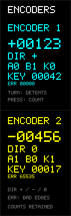

# 双编码器与 NV3007 屏幕调试

面向本板 `GW5A-LV25MG121NC1/I0`、两只 EC11E15244B2 编码器和 142×428 NV3007 SPI 屏幕的独立工程。

本目录包含完整源码、约束、仿真、构建和下载脚本，可单独复制使用。默认配置为 **A/B 消抖 20 μs、按键消抖 1 ms、LCD SPI 5 MHz、刷新间隔 2 ms**。

2026-10-16 22:18（Asia/Shanghai）镜像已通过实板 **SRAM Program+Verify**，UserCode=`06D1`，Status=`70022020`。固定下载清单为 [verified_build.json](reports/verified_build.json)，原始证据见 [SRAM 报告](reports/hardware_20261016/sram_encoder_lcd_20261016_221844_506162.json)。整理来源和源码哈希见 [PACKAGED_FROM.json](PACKAGED_FROM.json)。手动旋转、按压后的实板画面仍需现场观察；预览图是 RTL 渲染输出。

## 操作与显示

上半部青色 `ENCODER 1` 对应 SW1，下半部黄色 `ENCODER 2` 对应 SW2。

| 显示 | 含义 |
| --- | --- |
| `+00000` / `-00000` | 有符号位置，每个机械挡位加一或减一；范围 −32767…32767，边界饱和 |
| `DIR + / - / 0` | 最近一次有效旋转方向；尚未旋转为 0，停止后保留最近方向 |
| `A1 B1 K0` | 去抖后的 A/B 电平，K=1 表示按下、K=0 表示松开 |
| `KEY 00000` | 累计按下次数，长按只计一次；范围 0…65535，边界饱和 |
| `ERR 00000` | A/B 同时改变造成的非法相变累计次数；范围 0…65535，边界饱和 |

正相序为 `11→01→00→10→11`，物理顺时针方向以装配实物为准。原理图器件库标注 30 挡/15 脉冲，因此每两次有效相变计一挡，每圈名义 30 格。半步往返抵消，非法相变丢弃当前未完成半步。按键不会清除位置；重新加载 SRAM 调试镜像会清零全部计数。上电时按住的按键去抖后计为一次按下。

建议检查两个编码器分别正反转、慢速每挡、快速转动和按压：位置应双向变化、反转可返回原值，按键单击 KEY 加一、长按不连续增加。两只编码器应相互独立，正常手转时 ERR 应保持 0；若持续增加，结合 A/B 显示检查接触、焊接和快速旋转时的相位宽度。



## 引脚

| 编码器 | A | B | KEY（低有效） |
| --- | --- | --- | --- |
| SW1 | K10 | L8 | L10 |
| SW2 | L7 | K7 | J7 |

时钟 E2 / 50 MHz；LCD MOSI H8、SCK K5、DC L5、NCS J5、TE H5。均为 LVCMOS33；六路编码器输入具有外部 10k 上拉，内部上拉也开启。LCD 无可控复位和背光引脚，TE 在本例中不参与刷新。

每路采用两级输入同步，AB **成对**稳定 20 μs 后接受，按键稳定 1 ms 后接受。输入到第一级同步寄存器 D 的异步路径单独豁免，后续同步和解码路径仍按 50 MHz 检查。小于滤波门限的相位会被丢弃；本例用于手动编码器。LCD SPI 默认从 1 MHz 提升到 5 MHz，两个动态区域的可见刷新延迟也随之缩短；如实物模组对 SPI 频率有额外限制，可通过 `SPI_HALF_PERIOD` 恢复更慢速率。

## 显示与文件

LCD 复用已在本板显示正常的 [NV3007_LCD](../NV3007_LCD/README.md) 初始化 ROM、SPI 字节引擎、RGB565 和列偏移 12，使用 5 MHz SPI mode 0。首次完整绘制页面，随后只刷新两个 126×98 区域（x=8…133；y=72…169 / 256…353）。两区域共享一次编码器快照，等待 32 个时钟完成十进制转换，RGB565 高低字节也共用一次像素锁存，避免数字混帧。默认刷新间隔为 2 ms；相较旧版 1 MHz/20 ms 配置，动态数值的可见等待明显缩短，输入同步和计数始终运行。

- `src/encoder_input.v`：可复用编码器输入和去抖。
- `src/encoder_lcd_view.v`：快照、六路 16 拍 BCD 转换、字体与页面渲染。
- `src/encoder_lcd_display.v`：初始化、全屏及局部刷新调度。
- `src/encoder_lcd_top.v`：双编码器、页面与显示驱动连接。
- `src/encoder_lcd.cst` / `.sdc`：板级引脚和时序。
- `sim/`：编码器、渲染、SPI 引脚级显示及顶层集成自检。
- `nv3007_279_init.txt` / `generate_init.py`：本地 LCD 初始化原表与 ROM / 仿真数据生成器。
- `build.sh` / `build.tcl` / `tools/`：独立构建入口。
- `program_sram.py`：镜像、器件和时序检查，SRAM 下载及回读校验。
- `builds/`：最终版本及后续成功构建产物。
- `reports/verified_build.json`：固定指向 22:18 已通过 SRAM 校验的镜像，路径相对于本例程。
- `reports/hardware_20261016/`：该镜像原始构建和下载记录；`validation.json` 保留功能验证摘要。
- `archive/debug_20261016/`：早期调试镜像、失败构建和旧报告，不参与默认构建。

初始化来源及 BSD 许可保留于 [THIRD_PARTY_LICENSE.txt](THIRD_PARTY_LICENSE.txt)。未改动原 NV3007、USB 或 BLE 工程。

## 重建和下载

从仓库根目录进入本例程，先检查并加载自带的已验证镜像：

```sh
cd example/ENCODER_LCD
python3 program_sram.py --manifest reports/verified_build.json --check-only
python3 program_sram.py --manifest reports/verified_build.json
```

重新仿真、构建并检查新产物：

```sh
sh run_sim.sh
sh build.sh
python3 program_sram.py --manifest reports/last_build.json --check-only
# 需要加载新构建时执行：
python3 program_sram.py --manifest reports/last_build.json
```

`last_build.json` 在每次构建成功后更新；新构建完成不代表已下载，固定已下载镜像仍由 `verified_build.json` 指向。原始构建记录保留在 [hardware_20261016](reports/hardware_20261016/build_20261016_221809_282658.json)，其中绝对路径只反映历史位置。日常入口和可迁移清单不依赖这些历史路径。

仿真需要 Python 3、Icarus Verilog（`iverilog`、`vvp`），可通过 `IVERILOG` / `VVP` 环境变量指定。构建和下载面向 macOS Gowin EDA，默认位于 `/Applications/GowinIDE.app/Contents/Resources/Gowin_EDA/`；构建可设置 `GW25K_IDE_DIR` 指向其他 IDE 目录，下载脚本使用本机 Programmer 默认安装路径。构建使用 ASCII 暂存目录、综合/PnR 分进程及全局构建锁。下载器使用 FT2232HL channel 0、15 MHz，只提供 SRAM Program+Verify；断电后需重新加载。

## 参数调整

在 `src/encoder_lcd_top.v` 修改参数默认值后重新构建：

| 参数 | 默认值（50 MHz） | 用途 |
| --- | --- | --- |
| `AB_FILTER_CYCLES` | 1000 | A/B 成对稳定 20 μs 后接受 |
| `KEY_FILTER_CYCLES` | 50000 | 按键稳定 1 ms 后接受 |
| `SPI_HALF_PERIOD` | 5 | SCK = 50 MHz / (2 × 5) = 5 MHz |
| `REFRESH_GAP_MS` | 2 | 两区域刷新完毕后的等待时间，并非整对画面的刷新周期 |

初始化表更新时运行 `python3 generate_init.py`；构建和仿真入口都会执行 `--check` 核对 ROM 和预期数据是否与原表一致。

整理后已通过独立构建，并在仓库外含空格的目录中运行全部五项仿真和两份下载清单的离线检查。结果见 [packaging_verification.json](reports/packaging_verification.json) 和 [仿真日志](reports/packaging_simulation.log)。本次整理保留全部 RTL 和约束字节不变；新构建未下载到实板。

验证结果：编码器 275 项基础自检和 40 项真实 50 MHz 响应自检通过；响应测试确认 19.5 μs A/B 相位会被忽略、20.5 μs 相位可接受，900 μs 按键会被忽略、1.1 ms 按键可接受且长按只计一次。BCD 边界覆盖到 65535，60776 个像素及快照隔离检查通过；SPI 引脚级核对全部初始化字节和 220336 个全屏/局部像素字节，并检查默认 5 MHz SCK；顶层验证双编码器在刷屏期间持续采集、反转和按键独立。50 MHz setup/hold 违规均为 0，最新报告最差 setup slack 为 0.016 ns，Fmax 50.040 MHz。LCD 外部 AC/PCB 时序资料尚未补齐，该结果为 FPGA 内部时序检查。

最终位流 SHA256：

```text
2456abb48e1d5bd01a453531338bd7bb5c53acbd382ae5118582dfc0ffb15f39
```
