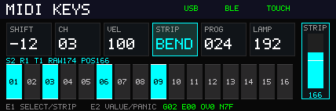

# GW25K 16键 MIDI 键盘

按附件分别构建两份完整固件：`build.sh --input-panel touch`（默认）和`build.sh --input-panel pluck`（兼容`--pluck`）。两版共用本工程，均保留USB双速、BLE、LCD、PL、编码器及灯光，只移除不使用的附件前端；不复制工程，不再要求单个位流自动切换附件。换附件需使用匹配固件，构建身份、验证与部署边界见[双配置报告](reports/INPUT_PROFILES_20261101.md)。此前单个位流合并超资源的记录保留在[合并实验报告](reports/PLUCK_INTEGRATION_20261101.md)。

手机BLE-MIDI接收现在除更新灯光外，也单向转发到USB／138K，保留原通道、音高、力度与控制消息；USB主机的引导灯光反馈不反向转发，避免回环。两附件配置均包含此功能，背压、断连清音与新候选验证见[BLE转发报告](reports/BLE_USB_FORWARDING_20261101.md)。

转发版触摸`C125C202`、弹拨`C125D202`已通过综合、P&R及严格时序门禁；145项离线回归、138K原生HS／FS输入仿真通过。未上板、未下载SRAM或写Flash；弹拨版物理BSRAM已用满56/56，后续扩展需重新核算。

上一轮完整触摸候选`C125C201`与完整弹拨候选`C125D201`均已通过综合、P&R及原时序门禁，相同输入143项离线回归通过，但尚不含上述手机转发。它们均未上板、未下载SRAM或写Flash，不能继承历史候选的实体验收；新候选不能复用这两个身份。

弹拨 ADC 配置与电脑 MIDI/原始数据 GUI 见 [PLUCK_INTERFACE.md](docs/PLUCK_INTERFACE.md)。弹拨完整版在ADC online后自动开启指定五路50%PWM，25kHz双串行采样、2ms窗口Vpp、无遮挡参考与下降迟滞检测，无需GUI租约。`--pluck-probe`仅为弹拨＋USB诊断，不含完整键盘外围，发射器默认关闭。历史`C125B101`已有授权SRAM下载、校验、独立回读及关闭状态USB/GUI检查，随后用户反馈识别满意；不将该反馈继承给新完整版。原始证据见[PWM报告](reports/PLUCK_PWM_20261101.md)，旧证据见[噪声校准报告](reports/PLUCK_NOISE_20261101.md)和[10月31日报告](reports/PLUCK_BRINGUP_20261031.md)。本轮未操作板卡或写Flash。

USB2 可选独立 JTAG 观察配置见 [USB2_DEBUG.md](docs/USB2_DEBUG.md)：保留完整键盘功能，用于检查 PHY 初始化、枚举地址及真实 MIDI 受理计数；默认构建不启用。

138K USB1 全速主机连接本板 USB2 的双速回退、复位尾段修正及验证边界见 [USB2_FS_FALLBACK.md](docs/USB2_FS_FALLBACK.md)；不切换本板 USB1，也不改变 MIDI/PL 线规。

本工程将所选附件（触摸键盘／触摸条，或五路弹拨）、两个编码器、灯光和横屏界面接入同一套 MIDI 应用：USB2 / USB3300 提供 USB-MIDI 1.0 与独立屏幕控制接口，RTL8723DS 提供标准 BLE MIDI 服务。USB与BLE两路可同时发送，接收主机音符用于灯光反馈。旧 USB、BLE、编码器和屏幕例程保持独立，派生文件在本目录维护。

2026-10-17用户已补全键序：A–P依次对应QT2160原始0基位`5 3 1 7 13 11 9 15 4 2 0 6 12 10 8 14`。GPIO与原理图一致，当前源码在顶层将原始快照经`midi_key_layout`统一重排，再交给MIDI、显示、WS2812和主机按键反馈。WS链序保持`ABCDHGFEIJKLPONM`；PCA9685仍指示滑条位置，屏幕保持反向横屏、滑条在右侧。见 [键序核对](docs/KEY_ORDER_AUDIT.md)。

当前源码设置按键NTHR=12、NDIL=1、BL=4，以及滑条NTHR=12、NDIL=3、BL=8；两颗均写入并读回LP=1、BREP=1。2026-11-02为降低触摸到灯亮的延迟，按键NDIL由7降至芯片允许的最小值1，即从连续8次采集确认降为2次；前后状态复核、新按差值≥12与保持差值≥10的迟滞保留。滑条仍使用3 counts死区及大跳变连续读样确认。这些是分别可调的编译期参数，USB协议不提供运行时灵敏度设置，详见 [触摸驱动](docs/TOUCH_DRIVER.md)。历史基线的构建和烧录记录不覆盖本次调参；新版实际延迟与误触率待实板验证，未下载SRAM或写Flash。

导入的历史固件、回归、时序和实板记录见 [BUILD_VALIDATION.md](docs/BUILD_VALIDATION.md) 与 [FLASH_PROGRAMMING.md](docs/FLASH_PROGRAMMING.md)。Android系统配对及BLE MIDI应用连接已在`0x00005A52`确认；该历史版本新增外部输入画面与E1长按设置；当前默认138K面板路径不分配长按，按 [PL local-v1接口](docs/PANEL_DISPLAY_PROTOCOL.md) 接收RGB565像素。

| 部分 | 已实现行为 |
| --- | --- |
| 16键 | U1原始16键经已确认A–P映射；新按/保持迟滞；默认 MIDI 48..63，固定力度100、Note Off力度0，持音移调先全部旧Off再新On |
| 触摸条 | U2单独配置8电极滑条模式；8位位置，3 counts死区和大跳变确认；默认固定Pitch Bend、中心／释放8192；MOD/EXPR只保留在旧兼容分支 |
| 编码器 | 默认E1音量CC7／短按CC89，E2指定Program循环／短按CC88；每物理档一步，两长按未分配 |
| 灯光 | PCA9685 的16路滑条灯显示条形位置；16颗 WS2812 按确认链序显示按键反馈，共用全局亮度 |
| USB2 | USB3300 ULPI、复合设备 EP0、MIDI bulk 端点及独立屏幕 bulk 端点、50/60 MHz跨域 |
| BLE | UART8E1/H5/HCI、ROM-v2补丁、128位 MIDI 服务、Legacy Just Works、Read/Write Without Response/Notify、CCCD、断线重广播 |
| LCD | NV3007反向横屏428×142；本地60 Hz变化区域渲染，外部RGB565 tile与安全页面切换 |

## 当前138K面板控制

生产顶层和应用默认`HOST_PANEL_CONTROLS=1`；2026-10-23热插拔修复、资源实现和各阶段验证／固化状态见[热插拔报告](reports/HOST_HOTPLUG_20261023.md)，后续滑条修复状态见[滑条反馈报告](reports/SLIDER_FEEDBACK_20261023.md)，维护边界见[HOST_HOTPLUG.md](docs/HOST_HOTPLUG.md)。上电／USB接入时本地音量127、Program73、弯音发送缓存中心8192；本地滑条位置和灯条独立于USB／BLE连接更新，接入不重置灯条。16键力度100、释放0；138K统一初始化音源，设备不重发48条清理或补播旧持音。主机远端页期间控件继续工作，两编码器长按不触发短按或设置切换。

| 操作 | 消息 |
|---|---|
| 旋转E1 | 每物理档CC7±1，0–127，无加速 |
| 短按E1 | 仅CC89=1，138K保留模式实际提交条件 |
| 旋转E2 | Program 73、40、56、12、0循环，可反向 |
| 短按E2 | 仅一次CC88=127，无释放消息 |
| 滑条 | Pitch Bend，0／8192／16383，释放回8192，分段线性与可调中心死区 |
| 持音移调 | 现有MK配置改变移调后先全部旧Off再新On100；未新增物理入口或确定最终产品范围 |

本地默认音量／音色已对齐Host初始值，后续主机其他入口变化的完整双向同步仍待现有字段能力核对。旧本地六卡页面保留为诊断回退UI，专有效果上下文和16键效果表尚未接入。源码与证据见[设备控件落地报告](../../../138k/push2_workstation/usb_a/reports/GW25K_CONTROLS_20261019.md)。`config/board.json`中的六参数控件说明保留导入时的独立例程口径，不作为当前面板控制策略的生成来源；物理配置与约束未改。

<details>
<summary>原独立例程控制策略（HOST_PANEL_CONTROLS=0，保留历史兼容）</summary>


上电默认：MIDI通道1、移调0、力度100、触摸条MOD、音色1（线上Program 0）、灯光亮度96。A–P依次对应 MIDI音符48..63；原始通道转换见完整键序表，实际灯珠及演奏效果仍需实板核验。触摸板没有击键力度传感器，`VEL` 是所有新音符共用的固定力度，不会从电容差值伪造力度。

| 操作 | 结果 |
| --- | --- |
| 旋转 E1 | 循环选择 SHIFT、CH、VEL、STRIP、PROG、LAMP |
| 短按释放 E1（本地页） | 循环 MOD → EXPR → BEND |
| 长按 E1 1秒 | 输入页进入设置并锁定；再次长按解除锁定、等待主机完整重画 |
| 旋转 E2，SHIFT | 每调节步±12半音，范围-48..+48；USB控制协议也可逐半音设置 |
| 旋转 E2，CH | 通道1..16循环 |
| 旋转 E2，VEL | 力度1..127，默认100 |
| 旋转 E2，STRIP | 循环选择MOD、EXPR、BEND |
| 旋转 E2，PROG | Program Change 0..127，屏幕显示1..128 |
| 旋转 E2，LAMP | 亮度0..255，每调节步8并在端点饱和 |
| 按 E2 | panic：所有16通道 CC120、CC123、Pitch Bend回中；按住的键需松开后才能重触发 |

输入画面期间E1/E2旋转和E1短按暂停调参，E2的紧急停音始终有效。两个编码器均按实板反馈反转原方向，调节速度减半：每两个机械卡位输出一次调节步，30卡位一圈对应15步。正反各转一个卡位互相抵消，非法相位跳变清除未完成的半步；A/B成对20 µs滤波和按键1 ms滤波保持不变。

MOD 发送 CC1，EXPR 发送 CC11，位置0..255映射为0..127；松手保持末值。BEND将8位位置映射为14位弯音步进64，中心8192，松手回中。切模式或通道会清理原通道的控制器。修改移调/通道后松键仍使用按下时保存的音高/通道。链路重连先发所有通道恢复消息，再仅向恢复链路补发仍按住的活动音符。

USB与BLE分别维护队列、背压和会话；断线清掉该链路旧队列。PANIC完成表示本地事件已提交，无法证明主机合成器已经处理，仍需端到端验证。


</details>

## 横屏界面

屏幕显示六个参数卡、USB/BLE/触摸状态、右侧竖向触摸条和16个键状态。新增两行U2诊断：`S2 R1 T0 RAW128 POS128`显示就绪、滤波后触摸标志、原始/滤波位置；`G02 E00 OV0 N7F`显示实际General Status、错误、历史扫描超限和成功采样计数。`G02`的CC位为正常状态，不能当作错误码；`OV`锁存至FPGA复位，`N`为8位循环计数。全部字段随同一帧快照更新，数值说明见 [触摸驱动](docs/TOUCH_DRIVER.md)。

原生GRAM保持 MADCTL=00、列偏移12，默认反向横屏，逻辑坐标为 `x=427-native_y, y=native_x`；RGB565高字节先发。显示按60 Hz节拍抓取完整场景快照，`midi_display_regions`比较上次快照，仅发送变化区域，静态场景不产生SPI流量。50 MHz ODDRC mode0连续SPI与四像素FIFO使传输和四级像素渲染重叠；RTL仿真中全部26个动态区域共35,860像素在11.539220 ms内完成，满足16.666667 ms场景周期。首次、主题或背景改变需全屏重画，仿真耗时19.450840 ms；此时保持同一批快照，记录错过的节拍，完成后才抓下一场景。

60 Hz适用于当前界面的动态区域更新；428×142 RGB565任意全屏60 fps需要至少58.345 Mbit/s，50 MHz SPI仅像素传输的理论上限约51.42 fps。NV3007的PFSET仅支持16/18位格式，不能靠RGB444压缩达到目标。MOSI名义setup/hold各10 ns正好达到手册最低值；FPGA时序检查和理想引脚仿真不能替代板上SPI波形或TE验证，当前未宣称实屏全屏60 fps。架构与测试范围见 [DISPLAY_60HZ.md](docs/DISPLAY_60HZ.md)，最终构建/烧录状态见 [BUILD_VALIDATION.md](docs/BUILD_VALIDATION.md) 与 [FLASH_PROGRAMMING.md](docs/FLASH_PROGRAMMING.md)。音符、触摸、USB/BLE和灯光不等待刷屏；LCD没有独立复位或背光GPIO，LAMP调节滑条灯与按键灯。



预览由Icarus逐点采样 `midi_landscape_view` 的428×142像素生成，工具为 `tools/render_preview.py`，需要Python和Pillow；不是手绘mock。`SET_THEME`/`CLEAR`控制界面颜色，`SET_PAGE`保留寄存器和响应，MK保持固定乐器总览页；新增PL协议可接收任意RGB565矩形，见 [外部输入页](docs/PANEL_DISPLAY_PROTOCOL.md)。

外部输入页复用USB2接口2的屏控链路：没有像素输入时显示当前界面，首个有效tile进入输入页，250 ms无有效会话请求则恢复当前界面。主机每100 ms发送HEALTH可维持静态画面；兼容分支的E1长按设置覆盖期间，继续输入不会抢回页面；当前面板分支未为长按连接该入口。按用户确认，MIDI与屏幕控制均走USB2，不新增连接器或引脚；附件作为业务协议规划参考，已补全本板使用的消息编号和载荷定义。

## 文件与验证入口

USB1 12 Mbit/s 另有显式 [Full-Speed 配置](docs/USB1_FS.md)，复用现有 MIDI/MK/PL 和完整键盘业务，不经过 USB3300。默认 `build.sh` 仍为 USB2；USB1 当前仅离线仿真/综合，未下载或固化。

```text
rtl/instrument/  演奏状态、编码器、panic和重连恢复
rtl/input/       板级A–P键位映射与键盘事件转换
rtl/peripheral/  QT2160、开漏I²C、PCA9685、WS2812
rtl/usb_board/   USB3300设备链路、端点、描述符与CDC
rtl/ble_board/   RTL8723DS H5/HCI与MIDI ATT/GATT、ROM-v2补丁
rtl/display/     NV3007 SPI与横屏像素渲染
rtl/core/       双链路事件队列与路由
rtl/transport/  USB/BLE MIDI编解码
rtl/control/    MK设备设置、PL外部像素、共享字节流路由
sim/            独立外设、协议、应用和显示测试
tools/          描述符、主机协议、验证、构建和RTL预览工具
config/         板级引脚与USB/BLE配置
docs/           实现细节、协议和验收边界
```

从仓库根目录执行：

```sh
sh projects/25k/example/MIDI_KEYBOARD/run_sim.sh
sh projects/25k/example/MIDI_KEYBOARD/build.sh --user-code <新的八位十六进制标识>
```

整机入口为 `tools/run_checks.py` 和 `tools/gowin_build.py`，新结果写入独立 `results/` 目录，导入的历史 `reports/validation.json` 与 `reports/last_build.json` 保留。`build.sh`要求显式的新UserCode，支持PATH中的Linux工具包装器，使用系统ASCII暂存目录，分别运行综合与布局布线，并在ROM载入、时序或输入校验失败时拒绝发布固件。维护、构建和热插拔边界见 [HOST_HOTPLUG.md](docs/HOST_HOTPLUG.md)。可选 `build_core.sh` / `tools/synthesize.py` 仅用于旧抽象核心的独立综合回归。ROM默认相对路径以本工程为工作目录；单独编译BLE时需保留 `rtl/ble_board/rtl8723ds_patch.mem`。板级接线见 [board.json](config/board.json)，该JSON不是Gowin约束文件。

屏幕协议工具生成/解析16字节CRC帧，例如：

```sh
python3 example/MIDI_KEYBOARD/tools/screen_control.py channel 0 --seq 1
python3 example/MIDI_KEYBOARD/tools/screen_control.py transpose -12 --seq 2
python3 example/MIDI_KEYBOARD/tools/screen_control.py theme 0x07ff --seq 3
```

它输出十六进制，不会自行打开USB设备。USB当前 `FB9A:FB9B` 继承自本地实验，属于诊断标识，不能据此视为已获分配的产品VID/PID；发行前须替换为获授权的标识并重新生成描述符。

## 来源和支持边界

用户提供 `QT2160_Keypad16_Slider_Source_20261016.zip`，SHA256 `5f0e37cfe9e83efed4fd6b5b993215b369ed635660f2048b83b84f524abc990d`；原件展开于 `vendor/qt2160_reference/`并保持不变。新驱动保留参考的配置/校准流程，采用块读、最小扫描间隔和故障释放，并针对实板反馈分别调整阈值、迟滞和滑条滤波，详见 [TOUCH_DRIVER.md](docs/TOUCH_DRIVER.md)。PCA9685与WS2812是本工程实际驱动，实物LED限流、3.3V供电和波形仍需测量。

USB派生自旧USB3300/ultraembedded基础；BLE派生自旧RTL8723DS H5/HCI与厂商ROM-v2固件；显示沿用旧NV3007初始化。各目录保留来源和许可，不能用新封装覆盖第三方权利。协议和限制分别见 [USB_PROFILE.md](docs/USB_PROFILE.md)、[BLE_PROFILE.md](docs/BLE_PROFILE.md)、[BLE_IMPLEMENTATION.md](docs/BLE_IMPLEMENTATION.md)、[SCREEN_PROTOCOL.md](docs/SCREEN_PROTOCOL.md) 与 [INTEGRATION.md](docs/INTEGRATION.md)。

当前MIDI子集包含完整1..3字节消息；不支持SysEx、running status、BLE一个值多消息打包或实时字节交错。BLE为单连接、ATT MTU23，支持Legacy Just Works配对和加密，单个bond仅保留在RAM；板卡复位/断电后需在手机忘记旧配对再重新配对。USB/BLE可接收主机音符作灯光反馈，不自动回送或本地发声。最终验收还应覆盖主机枚举、稳定无线连接、两路并发、触摸抗扰、复位/重连、无残留音符及整机供电。
