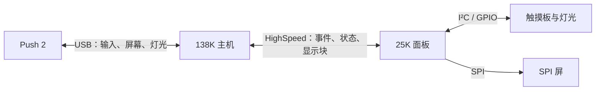

# FPGA 工作站

固定拓扑：**Push 2 ↔ USB ↔ 138K ↔ HighSpeed ↔ 25K**；触摸板与 SPI 屏连接 25K。

打开[系统连线图](系统连线.canvas)，点击卡片查看各模块分工。

| 查看内容 | 笔记 |
|---|---|
| 主机与已有音频工程 | [[138K主机]]、[[工程架构报告]] |
| 本地面板 | [[25K面板]]、[[触摸板]]、[[SPI屏]] |
| Push 接口与显示复用 | [[Push 2]] |
| 板间协议与来源管理 | [[HighSpeed接口]]、[[整机接口规划]] |
| 尚需确认的硬件 | [[待确认]] |

138K 保留一套业务状态和音频引擎，25K 负责本地采集、灯光与写屏。显示复用优先共用状态、字体及适用绘图逻辑，不新增整屏 DDR 缓存。

报告文件夹是本次工程文档的导入快照，标明了源文件路径。模块笔记和连线图用于讨论；当前尚未实现的接口均按规划标注。

本知识库已连接当前 Codex，可直接检索、读取和修改笔记。
