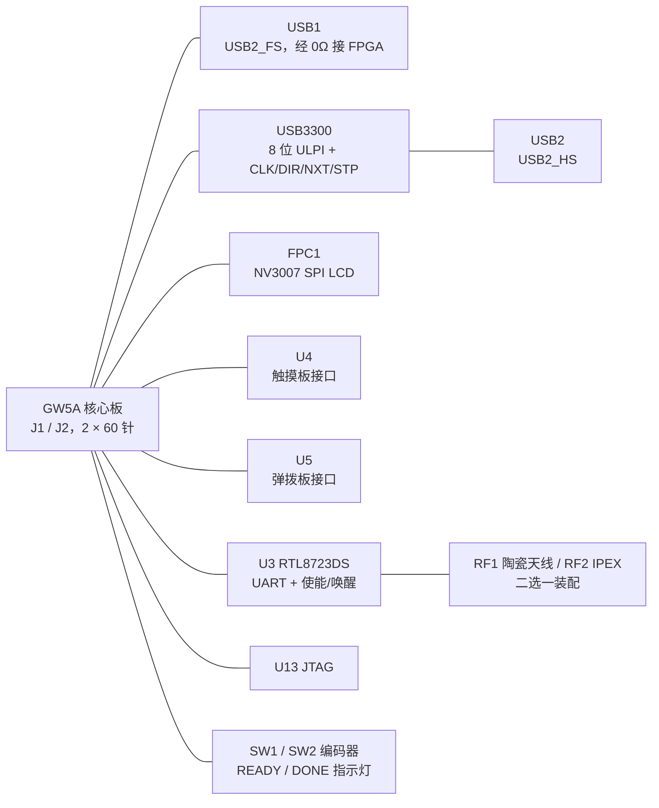

# GW_25K 项目原理图信息汇总

**2026-10-16 新增资料：** 已读取触摸子板 [SCH_Schematic1_2026-10-16.pdf](SCH_Schematic1_2026-10-16.pdf)，与本底板 U4/J1 逐针核对一致。新增两颗 AT42QT2160、PCA9685 和 16 颗 WS2812 的总线/地址/上拉记录见 [触摸接口核对](example/MIDI_KEYBOARD/docs/TOUCH_INTERFACE.md)。尤其底板 `CS/A11` 对应共享 `CHANGE12` 输入，`WS_DIN/D11` 对应 WS2812 输出。下文对“首次资料中没有触摸控制芯片/地址”的描述保留为 2026-10-15 底板资料基线，不再代表当前资料完整性；本次未改动原图或完成触摸驱动。

整理日期：2026-10-15。项目目录：`GW_25K`。本文件面向原理图查阅、FPGA 引脚分配、外围驱动开发及后续硬件复核。

**实板更新（用户于 2026-10-15 确认）：所有 BANK 电平后期已全部改为 3.3V，包括 BANK2/3。** 后续接口设计以此为当前实板状态；原图中 BANK2/3 为 1.8V 的标注以及 `VDD_1V8 = VCCIO2/3` 的连接记录保留为改版前资料。原先基于 1.8V BANK2 的 ULPI 电平不匹配项已关闭，详见[复核意见](/Users/zhaojiying/Library/CloudStorage/飞牛同步-云工作空间/GW_25K/原理图汇总复核.md)。USB3300 内部 `VDD18` / `VDDA1.8` 仍为 1.8V，不属于此次 BANK 电平更改。

## 1. 读取范围与信息依据

本次完整读取了项目根目录中的原理图 PDF、原生 EDA 工程及 README，并读取了随附 BLE 源码包的全部文件。原始文件未修改。

| 来源 | 本次用途 | 边界 |
| --- | --- | --- |
| [25K底板及说明.epro2](/Users/zhaojiying/Library/CloudStorage/飞牛同步-云工作空间/GW_25K/25K底板及说明.epro2) | 解析工程、实际器件属性、符号引脚、原理图连线与短接标识、PCB 焊盘网络 | 作为器件值和电气连接的主要依据 |
| [SCH_Schematic1_2026-10-15.pdf](/Users/zhaojiying/Library/CloudStorage/飞牛同步-云工作空间/GW_25K/SCH_Schematic1_2026-10-15.pdf) | 完整渲染整页，并逐区域视觉核对布局、连接、接口标注和说明 | PDF 存在字体引用问题，部分中文和标题栏字符缺失；用原生工程补齐 |
| [README.md](/Users/zhaojiying/Library/CloudStorage/飞牛同步-云工作空间/GW_25K/README.md) | 主控型号、屏幕型号、分辨率、官方例程链接 | 只有项目简要背景，没有完整核心板原理图 |
| [rtl8723ds_ble_verilog.zip](/Users/zhaojiying/Library/CloudStorage/飞牛同步-云工作空间/GW_25K/rtl8723ds_ble_verilog.zip) | 蓝牙逻辑接口、时钟、复位、固件、集成约束及历史验证范围 | 独立源码资产，不能视为本板已适配或已实测 |

原生工程名为 `25K_DOCK`，编辑器版本 `3.2.166`；包含 `Schematic1 / P1` 一页原理图及 `PCB1`。图框版本为 `V1.0`。原生图框保存的创建/更新日期字段为 `2026-10-05`；PDF 标题栏提取日期为创建 `2026-10-08`、更新 `2026-10-15`，两者均按原文件记录，不据此推断硬件改版。PDF 为 1 页，页面约 596.14 × 421.96 mm（A2 尺寸），标题栏字段仍写 `A4`。

### 1.1 完整性核对结果

- 原生归档的 `25K_DOCK.epru` 含 72 个文档段；逐行解析时区分了 66 条空正文记录，未把它们当作有效图元。
- 原理图共 195 个 COMPONENT 对象：68 个带位号实际器件、58 个 `Short-Symbol` 短接标识、68 个全局电源/地符号、1 个图框。
- 68 个实际器件共 414 个符号引脚；对应 PCB 也有 414 条 PAD_NET 记录，全部按位号和引脚编号对应。
- 341 个非空网络引脚形成 87 个连接网络。识别符号旋转、全局网名及 `Short-Symbol` 后，原理图与 PCB 的这 87 组端点集合完全一致。
- 另有 73 个空网络引脚：44 个在原理图中明确标 `NO_CONNECT=yes`，其余 29 个为 J1/J2 的未连接引脚。未把“未连接”自动等同于器件功能上的 NC。
- 实际器件包括 27 个电阻、20 个电容，以及 21 个芯片/连接器/指示灯/编码器/晶体/射频器件。位号不连续：没有 C20/C21、R27/R28/R29，也没有 U6/U8～U12；不补造缺失位号。

上述核对验证的是工程记录中的逻辑连通关系；没有运行 EDA ERC/DRC、检查所有实际铜皮连通性、进行阻抗仿真或接板测量。

### 1.2 本文记法

`J1.2` 表示 J1 的第 2 引脚。`BANK1_H5` 等网名中的末段是工程标注的 FPGA 球号；它们来自底板图纸，并非本次根据芯片手册重新验证的封装映射。

图中菱形 `Short-Symbol` 用于连接两个不同名称的同一网络，例如 `LCD_TE = BANK1_H5`；它不是实际需要采购或焊接的串联器件。本文的“原理图别名”保留这些名称，“PCB 网络”保留工程选用的名称。`$1N...` 是 PCB 自动生成的未命名网络编号。

“明确 NC”指原理图主动放置的不连接标识；“未连接”指既无网络也无该标识。器件符号自身把一个引脚命名为 `NC`，与这两种连接状态也应分别理解。

## 2. 项目定位与整体结构

README 指定主控为 **GW5A-LV25MG121NC1/I0**，对应 Tang Primer 25K 相关开发背景；屏幕为 **NV3007，142 × 428，SPI**。这份原理图画的是连接核心板的底板，FPGA 本体、核心电源、启动存储器和核心板系统晶振没有在本页展开。

底板通过两个 60 针板对板连接器 J1/J2 引出 FPGA BANK 和电源，外接 USB 全速接口、USB3300 高速 PHY、LCD、触摸板接口、弹拨板接口、RTL8723DS 蓝牙模块、JTAG、状态灯和两只旋转编码器。

## 3. 电源、地与 BANK 电平

### 3.1 电源网络

下表及后续引脚、网络附录记录原始工程连接；其中 `VDD_1V8 = VCCIO2/3` 属于改版前状态。用户已确认当前所有 BANK 为 3.3V，但尚未提供更新后的供电连线图，不能据此推断核心板 `VDD_1V8` 电源本身也改为 3.3V，或沿用原图中的 1.8V/3.3V 合网关系描述改后实板。

| 原理图网络/同网别名 | PCB 网络 | 来源/连接 | 负载或作用 |
| --- | --- | --- | --- |
| `+5V` | `+5V` | 两个 USB 口 VBUS 与 J2.26～30 直接同网 | U1/U7 输入和使能、U5.1、U2 VBUS 经 R12 检测 |
| `VDD_3V3 = VCCIO0/1 = VCCIO6/7` | `VCCIO0/1` | J1.12/13、J1.45/46、J2.23～25；通过 Short-Symbol 合网 | LCD、上拉电阻、状态灯、JTAG 参考电源、经 R19 给 USB_3V3 |
| `VDD_1V8 = VCCIO2/3` | `VCCIO2/3` | J2.1/2/19/20；原始工程通过 Short-Symbol 合网 | 改版前 BANK2/3 的1.8V供电记录；当前所有 BANK 已改为3.3V |
| `VDD_2V5` | `VDD_2V5` | J2.21/22 | 本页没有其它实际器件负载 |
| `TC_3V3` | `TC_3V3` | U1 的 3.3V 输出 | U4.13/14 触摸板供电，C3/C4 去耦 |
| `BT_3V3` | `BT_3V3` | U7 的 3.3V 输出 | U3.9 VBAT_IN、U3.22 VDDIO、R20 上拉，C18/C19 去耦 |
| `USB_3V3` | `USB_3V3` | `VDD_3V3 → R19=0R` | U2.6/16/25/30 VDD3.3 与 U2.31 REG_EN，C15/C16 去耦 |
| `VDD18` | `VDD18` | U2.15/26 两个 VDD1.8 引脚相连 | C13/C14 各 100nF 到地；与 `VDD_1V8` 不是同网 |
| U2.29 VDDA1.8 的局部网络 | `$1N107` | 仅 U2.29、C11.1、C12.1 | C11=4.7uF、C12=100nF 到地；没有与 `VDD18` 直接合网 |
| `GND` | `GND` | 全板公共地 | 含 U3 AGND、U2 EP、USB 外壳、接口固定焊脚及编码器固定脚 |

`VDD18`、`VDD_1V8`、U2.29 的 `$1N107` 虽都涉及 1.8V 命名或引脚功能，但在本工程中是三个不同网络，查线和写文档时不能合并。

U1/U7 均为 **ME6217C33M5G，SOT-23-5**：1 VIN 和 3 CE 接 +5V，2 VSS 接地，4 明确 NC，5 为各自输出。器件库记录标称 3.3V/800mA、最高供电 6.5V；整板实际可用电流还受 USB 输入、连接器、LDO 压降和散热限制。U1 输入 C1=100nF、C2=10uF，输出 C3=100nF、C4=10uF；U7 输入 C7=100nF、C8=10uF，输出 C18=100nF、C19=10uF。

### 3.2 BANK 电平及供电关系

原图完整文字为：“**除BANK2与BANK3为1.8V，其余各个BANK都是3.3V**”。这是改版前图注；用户于 2026-10-15 确认所有 BANK 后期已全部改为 **3.3V**。当前电平依据用户确认记录，尚未由本次接板测量或检查 FPGA 约束验证。

| BANK | 本页功能 | 改版前图注电平 | 当前实板电平（用户确认） |
| --- | --- | --- | --- |
| BANK0 | RTL8723DS UART、BT_DIS#、BT_HOST_WAKE_DEV | 3.3V | 3.3V |
| BANK1 | LCD SPI、TE | 3.3V | 3.3V |
| BANK2 | USB3300 全部 ULPI 数据/控制/时钟 | 1.8V | 3.3V |
| BANK3 | 本页无实际信号引出 | 1.8V | 3.3V |
| BANK4 | READY、DONE | 3.3V | 3.3V |
| BANK5 | PWM1～7、D8_RECFG | 3.3V | 3.3V |
| BANK6 | 触摸板 SCL/SDA、CS、WS_DIN | 3.3V | 3.3V |
| BANK7 | USB2_FS、编码器、弹拨板 IO0～4 | 3.3V | 3.3V |
| BANK10 | JTAG | 3.3V | 3.3V |

两个 USB 口的 VBUS 没有隔离、自动择源或受控开关器件，且与核心板 +5V 同网。双口同时供电、外部电源反灌及主机模式 VBUS 管理需要在实际使用方式确定后核对。U5 有 +5V 电源脚，不代表其 FPGA 信号脚能承受 5V。

## 4. J1/J2 板对板连接器与完整引脚分配

J1/J2 均为 **DF40C-60DS-0.4V(51)**，60P、0.4mm 间距、双排、母座，器件库订货号 `C597938`、额定电流记录为 300mA/触点。图中在两组连接器附近均写有“记得验证引脚的实际对应关系”。下表是图纸及 PCB 的一致记录；接实物前仍需核对核心板连接器视角、上下板方向与封装编号。

### 4.1 J1（60 针）

| 引脚 | PCB BANK/电源网 | 功能/原理图别名 |
| --- | --- | --- |
| 1 | `GND` | `GND` |
| 2 | `BANK1_H5` | `LCD_TE` |
| 3 | `BANK1_J5` | `LCD_NCS` |
| 4 | `BANK1_L5` | `LCD_DC` |
| 5 | `BANK1_K5` | `LCD_SCK` |
| 6 | `BANK1_H8` | `LCD_MOSI` |
| 7 | — | 未连接 |
| 8 | — | 未连接 |
| 9 | — | 未连接 |
| 10 | — | 未连接 |
| 11 | — | 未连接 |
| 12 | `VCCIO0/1` | `VCCIO0/1` = `VCCIO6/7` = `VDD_3V3` |
| 13 | `VCCIO0/1` | `VCCIO0/1` = `VCCIO6/7` = `VDD_3V3` |
| 14 | `GND` | `GND` |
| 15 | `BANK7_L6` | `USB2_FS_DP` |
| 16 | `BANK7_K6` | `USB2_FS_DM` |
| 17 | `BANK7_K7` | `SW2_B` |
| 18 | `BANK7_J7` | `SW2_KEY` |
| 19 | `BANK7_L7` | `SW2_A` |
| 20 | `BANK7_L8` | `SW1_B` |
| 21 | `BANK7_L10` | `SW1_KEY` |
| 22 | `BANK7_K10` | `SW1_A` |
| 23 | — | 未连接 |
| 24 | — | 未连接 |
| 25 | `GND` | `GND` |
| 26 | — | 未连接 |
| 27 | — | 未连接 |
| 28 | `BANK6_A11` | `CS` |
| 29 | `BANK6_A10` | `SDA3` |
| 30 | `GND` | `GND` |
| 31 | `GND` | `GND` |
| 32 | `BANK6_B10` | `SDA2` |
| 33 | `BANK6_B11` | `SDA1` |
| 34 | `BANK6_C10` | `SCL2` |
| 35 | `BANK6_C11` | `SCL1` |
| 36 | `BANK6_D10` | `SCL3` |
| 37 | `BANK6_D11` | `WS_DIN` |
| 38 | `GND` | `GND` |
| 39 | `BANK7_G10` | `IO4` |
| 40 | `BANK7_G11` | `IO3` |
| 41 | `BANK7_H10` | `IO2` |
| 42 | `BANK7_H11` | `IO1` |
| 43 | `BANK7_J10` | `IO0` |
| 44 | — | 未连接 |
| 45 | `VCCIO0/1` | `VCCIO0/1` = `VCCIO6/7` = `VDD_3V3` |
| 46 | `VCCIO0/1` | `VCCIO0/1` = `VCCIO6/7` = `VDD_3V3` |
| 47 | `GND` | `GND` |
| 48 | `BANK4_D7` | `DONE` |
| 49 | — | 未连接 |
| 50 | — | 未连接 |
| 51 | — | 未连接 |
| 52 | `BANK4_E8` | `READY` |
| 53 | `GND` | `GND` |
| 54 | — | 未连接 |
| 55 | — | 未连接 |
| 56 | `BANK0_K8` | `BT_DIS#` |
| 57 | `BANK0_J8` | `BT_TX` |
| 58 | `BANK0_K9` | `BT_RX` |
| 59 | `BANK0_L9` | `BT_HOST_WAKE_DEV` |
| 60 | `GND` | `GND` |

### 4.2 J2（60 针）

| 引脚 | PCB BANK/电源网 | 功能/原理图别名 |
| --- | --- | --- |
| 1 | `VCCIO2/3` | `VCCIO2/3` = `VDD_1V8` |
| 2 | `VCCIO2/3` | `VCCIO2/3` = `VDD_1V8` |
| 3 | `BANK2_L2` | `USB_D0` |
| 4 | `BANK2_L1` | `USB_D1` |
| 5 | `BANK2_K1` | `USB_D2` |
| 6 | `BANK2_K2` | `USB_D3` |
| 7 | `BANK2_J4` | `USB_D4` |
| 8 | `BANK2_K4` | `USB_D5` |
| 9 | `BANK2_G2` | `USB_D6` |
| 10 | `BANK2_G1` | `USB_D7` |
| 11 | `BANK2_L4` | `USB2_CLKOUT` |
| 12 | `BANK2_L3` | `USB2_STP` |
| 13 | `BANK2_J1` | `USB2_DIR` |
| 14 | `BANK2_J2` | `USB2_NXT` |
| 15 | — | 未连接 |
| 16 | — | 未连接 |
| 17 | — | 未连接 |
| 18 | — | 未连接 |
| 19 | `VCCIO2/3` | `VCCIO2/3` = `VDD_1V8` |
| 20 | `VCCIO2/3` | `VCCIO2/3` = `VDD_1V8` |
| 21 | `VDD_2V5` | `VDD_2V5` |
| 22 | `VDD_2V5` | `VDD_2V5` |
| 23 | `VCCIO0/1` | `VCCIO0/1` = `VCCIO6/7` = `VDD_3V3` |
| 24 | `VCCIO0/1` | `VCCIO0/1` = `VCCIO6/7` = `VDD_3V3` |
| 25 | `VCCIO0/1` | `VCCIO0/1` = `VCCIO6/7` = `VDD_3V3` |
| 26 | `+5V` | `+5V` |
| 27 | `+5V` | `+5V` |
| 28 | `+5V` | `+5V` |
| 29 | `+5V` | `+5V` |
| 30 | `+5V` | `+5V` |
| 31 | `GND` | `GND` |
| 32 | — | 未连接 |
| 33 | — | 未连接 |
| 34 | `GND` | `GND` |
| 35 | — | 未连接 |
| 36 | — | 未连接 |
| 37 | `GND` | `GND` |
| 38 | — | 未连接 |
| 39 | — | 未连接 |
| 40 | `GND` | `GND` |
| 41 | — | 未连接 |
| 42 | — | 未连接 |
| 43 | `GND` | `GND` |
| 44 | — | 未连接 |
| 45 | — | 未连接 |
| 46 | `GND` | `GND` |
| 47 | `BANK10_A3` | `JTAG_TDI` |
| 48 | `BANK10_A2` | `JTAG_TDO` |
| 49 | `BANK10_B1` | `JTAG_TMS` |
| 50 | `BANK10_C1` | `JTAG_TCK` |
| 51 | `GND` | `GND` |
| 52 | `BANK5_D1` | `PWM1` |
| 53 | `BANK5_E1` | `PWM2` |
| 54 | `BANK5_D8_RECFG` | — |
| 55 | `BANK5_A1` | `PWM3` |
| 56 | `BANK5_F1` | `PWM4` |
| 57 | `BANK5_F2` | `PWM5` |
| 58 | `BANK5_C2` | `PWM6` |
| 59 | `BANK5_B2` | `PWM7` |
| 60 | `GND` | `GND` |

## 5. 各功能电路

### 5.1 USB1：USB2_FS 直连 FPGA

USB1 为 `TYPEC-16P_C53207802`，16P Type-C。A6/B6 并联为 D+，经 R5=0R 接 `USB2_FS_DP = BANK7_L6 = J1.15`；A7/B7 并联为 D-，经 R6=0R 接 `USB2_FS_DM = BANK7_K6 = J1.16`。

CC1/A5 经 R2=5.1K 到地，CC2/B5 经 R1=5.1K 到地；两组 VBUS 均为 +5V，接地脚与四个外壳固定脚接 GND，SBU1/A8 与 SBU2/B8 明确 NC。

本页没有独立的 USB 全速收发器、USB 协议控制器或明确绘出的独立 1.5K D+ 上拉。USB 全速的协议逻辑、连接检测和电气实现需由 FPGA 设计与板级方案共同确定；`USB2_FS` 是图中用途命名，不能据名称认定现有工程已经能枚举。

### 5.2 USB2：USB3300 高速 PHY 与 ULPI

USB2 的 Type-C 接口与 USB1 同型号。A6/B6 经 R7=0R 到 `USB2_HS_DP`，接 U2.7 DP；A7/B7 经 R8=0R 到 `USB2_HS_DM`，接 U2.8 DM。CC1/A5 经 R4=5.1K 到地，CC2/B5 经 R3=5.1K 到地；SBU 和接地处理同 USB1。

U2 为 **USB3300-EZK**，`QFN-32-EP(5x5)`，LCSC `C108954`。库记录支持 USB 2.0、480Mbps、ULPI；它提供 PHY，FPGA 侧仍需 USB 控制逻辑及目标设备/主机协议。

| U2 引脚 | PHY 功能 | 信号名 | FPGA BANK/球号 | J2 |
| --- | --- | --- | --- | --- |
| 11 | NXT | `USB2_NXT` | `BANK2_J2` | `J2.14` |
| 12 | DIR | `USB2_DIR` | `BANK2_J1` | `J2.13` |
| 13 | STP | `USB2_STP` | `BANK2_L3` | `J2.12` |
| 14 | CLKOUT | `USB2_CLKOUT` | `BANK2_L4` | `J2.11` |
| 17 | DATA7 | `USB_D7` | `BANK2_G1` | `J2.10` |
| 18 | DATA6 | `USB_D6` | `BANK2_G2` | `J2.9` |
| 19 | DATA5 | `USB_D5` | `BANK2_K4` | `J2.8` |
| 20 | DATA4 | `USB_D4` | `BANK2_J4` | `J2.7` |
| 21 | DATA3 | `USB_D3` | `BANK2_K2` | `J2.6` |
| 22 | DATA2 | `USB_D2` | `BANK2_K1` | `J2.5` |
| 23 | DATA1 | `USB_D1` | `BANK2_L1` | `J2.4` |
| 24 | DATA0 | `USB_D0` | `BANK2_L2` | `J2.3` |

U2 周边与未使用引脚：

- OSC1 为无源 **24MHz、12pF 标称负载、±10ppm** 晶体，型号 `3225 24M 12PF 10PPM`、SMD3225-4P、`C5181479`。1 接 `XIN_24M → U2.28 XI`，3 接 `XOUT_24M → U2.27 XO`，2/4 接地；C9/C10 均 12pF，分别到地。24MHz 是 PHY 晶体频率；图注“输出60M时钟”对应 U2.14 CLKOUT，不是核心板已有系统时钟证明。
- U2.32 RBIAS 经 R10=12K 接地。
- U2.4 VBUS 经 R12=2.4K 接 +5V，同 +5V 旁有 C17=100nF 去耦；R12 是串联电阻，本页没有构成两电阻分压器。
- U2.9 RESET 直接接 GND，没有 FPGA 独立复位控制线。此处只记录连接，复位极性和上电工作条件需查器件手册。
- U2.3 CPEN、5 ID、10 EXTVBUS 明确 NC；1/2 GND、33 EP 接地。
- 供电和各去耦网络见第 3 节；内部稳压输出/外部供电模式及 1.8V 引脚的使用方式需对照手册确认。

**ULPI 电平状态：** 12 根信号都接 BANK2，U2 的 VDD3.3 接 USB_3V3，图中没有单独的 ULPI 电平转换器。原图 BANK2 的 1.8V 配置不满足 USB3300 最低 2.0V 输入高门限；用户已确认后期全部 BANK 改为 3.3V，故此项针对 1.8V 的电平不匹配问题已关闭。后续 FPGA I/O 标准应与当前 3.3V VCCIO 匹配；ULPI 时序、USB 协议及本板功能仍需实际验证。两个 USB 口均为 CC 下拉、VBUS 共网，U2 的 CPEN/ID 也未使用，因此不能仅凭 USB3300 支持 Host/OTG 就认定本板已具备完整 Host/OTG 供电和角色管理。

### 5.3 LCD：NV3007 SPI，142 × 428

屏幕型号及分辨率来自 README；图纸给出接口连线，没有屏幕初始化表、像素格式、GRAM 地址偏移、SPI 模式或最高频率。

FPC1 为 **FPC-05F-10PH15**，10P、0.5mm 间距、下接翻盖、卧贴，LCSC `C2856816`；库记录排线厚度 0.3mm、座高 1.5mm，额定电压/电流为 50V/500mA。这些是连接器额定值，屏幕实际供电仍为 3.3V。11/12 为连接器附加固定焊脚，均接地。

| FPC1 引脚 | 屏幕功能 | 连接/网络 | FPGA/电源 |
| --- | --- | --- | --- |
| 1 | SDA / SPI MOSI | `LCD_MOSI` | `BANK1_H8` |
| 2 | SCL / SPI SCK | `LCD_SCK` | `BANK1_K5` |
| 3 | DC | `LCD_DC` | `BANK1_L5` |
| 4 | RST，固定高 | `VCCIO0/1` = `VCCIO6/7` = `VDD_3V3` | `VCCIO0/1` |
| 5 | CS，片选 | `LCD_NCS` | `BANK1_J5` |
| 6 | TE，同步信号 | `LCD_TE` | `BANK1_H5` |
| 7 | VDD | `VCCIO0/1` = `VCCIO6/7` = `VDD_3V3` | `VCCIO0/1` |
| 8 | LEDK，背光阴极 | `R9.2` | `$1N80` |
| 9 | LEDA，背光阳极 | `VCCIO0/1` = `VCCIO6/7` = `VDD_3V3` | `VCCIO0/1` |
| 10 | GND | `GND` | `GND` |
| 11 | 固定焊脚 | `GND` | `GND` |
| 12 | 固定焊脚 | `GND` | `GND` |

FPC1.4 的屏幕 RST 固定接 VDD_3V3，不能通过现有 FPGA 信号独立拉低；FPC1.5 CS 则由 J5 球对应信号控制。LEDA 接 3.3V，LEDK 经 R9=56R 到地，没有背光 MOS 开关或 PWM 控制线；亮度和电流取决于实际背光串联结构及电阻，不能由 56Ω 单独得出确定电流。C22=100nF 跨接 VDD_3V3/GND。

本接口的 SDA 对应 `LCD_MOSI`，SCL 对应 `LCD_SCK`，并不因此成为 I²C。没有单独 MISO；是否支持在 SDA 上双向读回需按屏幕资料确认。TE 是屏幕输出给 FPGA 的同步信号；其它 SPI 控制线方向按屏幕接口语义理解，仍应与屏幕资料核对。

### 5.4 U4：触摸板接口

U4 为 **HC-JN254-2-07-Z**，2×7、2.54mm 直插简牛座，`C5372866`，库记录额定电流 3A。供电由 U1 的 TC_3V3 提供；不是直接使用 FPGA VDD_3V3，实际可用电流不由连接器额定值决定。

| U4 引脚 | 功能/图中信号 | PCB BANK/电源网 | 核心板连接器 |
| --- | --- | --- | --- |
| 1 | 明确 NC | — | — |
| 2 | 明确 NC | — | — |
| 3 | `SDA1` | `BANK6_B11` | `J1.33` |
| 4 | `SDA2` | `BANK6_B10` | `J1.32` |
| 5 | `SCL1` | `BANK6_C11` | `J1.35` |
| 6 | `SCL2` | `BANK6_C10` | `J1.34` |
| 7 | `WS_DIN` | `BANK6_D11` | `J1.37` |
| 8 | `SCL3` | `BANK6_D10` | `J1.36` |
| 9 | `CS` | `BANK6_A11` | `J1.28` |
| 10 | `SDA3` | `BANK6_A10` | `J1.29` |
| 11 | `GND` | `GND` | — |
| 12 | `GND` | `GND` | — |
| 13 | `TC_3V3` | `TC_3V3` | — |
| 14 | `TC_3V3` | `TC_3V3` | — |

SCL1/SDA1、SCL2/SDA2、SCL3/SDA3 是图中三组命名信号，另有 CS 与 WS_DIN。图中没有触摸控制芯片、外设地址或总线协议定义，也没有为这些 SCL/SDA 绘制外部上拉。`WS_DIN` 的具体外设含义不由名称推断。

### 5.5 U5：弹拨板接口

U5 同为 **HC-JN254-2-07-Z**，2×7、2.54mm 直插简牛座，`C5372866`，库记录额定电流 3A。1 为 +5V、3 为 GND，其余包括 7 路 PWM 命名信号和 5 路 IO 命名信号。

| U5 引脚 | 功能/图中信号 | PCB BANK/电源网 | 核心板连接器 |
| --- | --- | --- | --- |
| 1 | `+5V` | `+5V` | — |
| 2 | `PWM1` | `BANK5_D1` | `J2.52` |
| 3 | `GND` | `GND` | — |
| 4 | `PWM2` | `BANK5_E1` | `J2.53` |
| 5 | `IO0` | `BANK7_J10` | `J1.43` |
| 6 | `PWM3` | `BANK5_A1` | `J2.55` |
| 7 | `IO1` | `BANK7_H11` | `J1.42` |
| 8 | `PWM4` | `BANK5_F1` | `J2.56` |
| 9 | `IO2` | `BANK7_H10` | `J1.41` |
| 10 | `PWM5` | `BANK5_F2` | `J2.57` |
| 11 | `IO3` | `BANK7_G11` | `J1.40` |
| 12 | `PWM6` | `BANK5_C2` | `J2.58` |
| 13 | `IO4` | `BANK7_G10` | `J1.39` |
| 14 | `PWM7` | `BANK5_B2` | `J2.59` |

本页没有电机、线圈、功率驱动或电平转换电路；PWM/IO 直接连 FPGA，信号方向和频率由后续逻辑定义，不能直接按 5V 功率输出使用。

### 5.6 U3：RTL8723DS 蓝牙及射频

U3 为 **RTL8723DS模块**，`SMD-44P,12.0x12`，`C2920724`。工程库未给出该模块的数据手册 URL。U3.9 VBAT_IN 和 U3.22 VDDIO 都接 U7 输出 BT_3V3；AGND 脚 1/3/20/31/33/36/41 接公共 GND。

| U3 引脚/功能 | 图中信号 | FPGA BANK/球号 | 核心板连接器 | 方向说明 |
| --- | --- | --- | --- | --- |
| 42 UART_OUT | BT_TX | BANK0_J8 | J1.57 | 模组 TX → FPGA RX |
| 43 UART_IN | BT_RX | BANK0_K9 | J1.58 | FPGA TX → 模组 RX |
| 34 BT_DIS# | BT_DIS# | BANK0_K8 | J1.56 | FPGA → 模组；R20=10K 上拉至 BT_3V3 |
| 6 BT_HOST_WAKE_DEV | BT_HOST_WAKE_DEV | BANK0_L9 | J1.59 | 按模组引脚名为主机唤醒模组；当前 BLE 包没有该顶层控制端口 |

`BT_TX/BT_RX` 网名采用模块视角，写 FPGA 顶层端口时应注意反向对应。U3.44 UART_CTS、7 BT_DEV_WAKE_HOST、12 WL_DIS#、13 WL_DEV_WAKE_HOST、14～19 SDIO、24 SUSCLK_IN、25～28 PCM、30 MAIN_XTAL_IN、35 VBAT_EN 均明确 NC，其余未使用脚详见附录 B。图纸没有接出 Wi-Fi SDIO；当前底板不能仅靠编写本包逻辑就获得已有 SDIO 连线。

射频拓扑如下：

`U3.2 ANT / $1N265 ─ L1 ─ $1N266 ─ RF1.1 或 RF2.1`

- C6=2.2pF 从模组侧 `$1N265` 到地；C5=1.8pF 从天线侧 `$1N266` 到地。
- L1 是 `L_0603` 电感符号/封装，但原理图实例与 PCB 的 Value 都写 **`2.2nF`**。本文原样保留，不能自行改成 2.2nH；这是明确的数值单位核对项。
- RF1 为 **RFECA3216060A1T** 陶瓷天线，1206、`C127620`；库记录 2.4GHz、50Ω、2dBi、83.5MHz 带宽。2 接地。
- RF2 为 **BWIPX-1-001E** IPEX 接座，`C496552`；1 为信号，2/3 接地，库记录 50Ω、Value=6GHz。6GHz 是接座属性，不代表本模块工作在 6GHz。
- RF1/RF2 的信号脚直接共网，图注写“二选一”。这是天线装配选择，没有射频开关。匹配值、天线净空、走线阻抗和实际射频性能需要另行验证。

### 5.7 DEBUG：U13 JTAG

U13 为 **HC-JN254-2-05-W**，2×5、2.54mm 弯插简牛座，`C5372873`，库记录额定电流 3A。

| U13 引脚 | 功能/图中信号 | PCB BANK/电源网 | 核心板连接器 |
| --- | --- | --- | --- |
| 1 | `JTAG_TCK` | `BANK10_C1` | `J2.50` |
| 2 | `GND` | `GND` | — |
| 3 | `JTAG_TDO` | `BANK10_A2` | `J2.48` |
| 4 | 经 R11=0R 接 VDD_3V3 | `$1N100` | — |
| 5 | `JTAG_TMS` | `BANK10_B1` | `J2.49` |
| 6 | 明确 NC | — | — |
| 7 | 明确 NC | — | — |
| 8 | 明确 NC | — | — |
| 9 | `JTAG_TDI` | `BANK10_A3` | `J2.47` |
| 10 | `GND` | `GND` | — |

JTAG_TCK 经 R13=5.1K 下拉至地；U13.4 经 R11=0R 接 VDD_3V3，作为该接口电源/参考连接。6/7/8 明确 NC。板上没有独立 USB-JTAG 桥，需外部下载器或核心板已有调试方案。

### 5.8 POWER、READY、DONE 指示灯

三个指示灯均用 `LED_0603-B` 库器件，0603；1 为 C（阴极）接地，2 为 A（阳极）。库未指定完整 LED 订货型号、额定电流或确定的发光颜色，不从名称后缀 B 推断实物颜色。

| 指示灯 | 阳极供电路径 | 相关 FPGA 连接 | 其它电阻 |
| --- | --- | --- | --- |
| POWER | VDD_3V3 → R14=10K → POWER.2 | 无 | 无 |
| READY | READY → R15=10K → READY.2 | BANK4_E8 / J1.52 | R17=10K 从 VDD_3V3 上拉 READY |
| DONE | DONE → R16=10K → DONE.2 | BANK4_D7 / J1.48 | R18=10K 从 VDD_3V3 上拉 DONE |

READY/DONE 是本页给出的网络名称；具体何时点亮由核心板引脚用途及逻辑决定，本页不能证明它们已自动代表 FPGA 配置完成。10K 串联限流值按原图保留，其亮度是否符合预期需要实测。

### 5.9 SW1/SW2 旋转编码器

SW1/SW2 均为 **EC11E15244B2_C470754**，`C470754`，带按压开关。库记录为增量式、30 挡/15 脉冲、两相输出，额定电压/电流 5V/10mA；本图各信号采用 3.3V 上拉。A/B 为两相信号，C 接地，D 为按压 KEY，E 接地，6/7 固定脚也接地。

| 编码器 | 功能脚 | 信号 | BANK/球号 | J1 | 3.3V 上拉 |
| --- | --- | --- | --- | --- | --- |
| SW1 | A | SW1_A | BANK7_K10 | 22 | R22=10K |
| SW1 | B | SW1_B | BANK7_L8 | 20 | R23=10K |
| SW1 | D | SW1_KEY | BANK7_L10 | 21 | R21=10K |
| SW2 | A | SW2_A | BANK7_L7 | 19 | R25=10K |
| SW2 | B | SW2_B | BANK7_K7 | 17 | R26=10K |
| SW2 | D | SW2_KEY | BANK7_J7 | 18 | R24=10K |

触点闭合时对地拉低；A/B 实际顺逆时针相序仍以装配方向和实物为准。图中没有外部 RC 去抖，FPGA 逻辑应考虑输入同步、触点抖动及按键滤波。

### 5.10 RECFG

J2.54 为 `BANK5_D8_RECFG`，R30=4.7K 将其上拉到 VDD_3V3，没有接到其它底板接口。它带专用配置功能标记，使用前需确认 FPGA 的管脚复用/重配置设置及核心板现有连接，不能直接当作普通空闲 PWM 管脚。

## 6. 随附 RTL8723DS BLE 包的集成信息

ZIP 共 41 个文件，解压总大小 383226 字节；包含 7 个 RTL 源文件、板级三态示例、Xilinx XDC 示例、3 个 testbench、脚本、固件/ROM及历史资源和验证记录。本次读取了包内全部文件；这部分是原理图对应的软件资产说明。

### 6.1 本板连接与源码端口对应

| 源码接口 | 本板接法 | 说明 |
| --- | --- | --- |
| `uart_rx` / 示例 `module_uart_tx` | J8 / BT_TX / U3.42 | FPGA 输入，接模块 UART_OUT |
| `uart_tx` / 示例 `module_uart_rx` | K9 / BT_RX / U3.43 | FPGA 输出值；板级按 OE 实现三态 |
| `bt_enable` / 示例 `module_bt_dis` | K8 / BT_DIS# / U3.34 | 模块蓝牙使能/复位控制 |
| 示例 `module_wl_dis` | 本板 U3.12 未连接 | 不能照抄示例认定已有物理控制路径 |
| 无对应控制端口 | L9 / BT_HOST_WAKE_DEV / U3.6 | 本包未提供该信号控制；所需电平/时序待模组手册确认 |
| 硬件流控（本符号仅列 UART_CTS） | U3.44 明确 NC | 本包配置关闭硬件流控 |
| `clk` | 本页未提供已确认的 FPGA 系统时钟来源 | 默认 50MHz；需在目标核心板提供并匹配 CLK_HZ |
| `resetn`、`enable` | FPGA 内部逻辑/板级控制 | resetn 低有效，enable 必须同步于 clk |
| `outputs_active` | 控制 UART_TX/BT_DIS 的 I/O 输出使能 | 仅输出标志，必须由芯片 I/O 边界实现三态 |

默认 UART 为 **115200、8E1（8 数据位、偶校验、1 停止位）**，H5 三线协议，不是通常的 8N1。默认时钟参数 `CLK_HZ=50000000`；没有 PLL 或当前 GW5A 的 `.cst/.sdc`、球号与 I/O 电平配置。不能把 USB3300 的 60MHz CLKOUT 未经设计就当作本 BLE 顶层的 50MHz 时钟。

### 6.2 默认运行参数与功能

| 参数 | 默认值/行为 |
| --- | --- |
| DISABLE_MS | 200ms，先保持 BT_DIS 低 |
| STARTUP_MS | 2000ms，BT_DIS 拉高后等待 |
| SESSION_MS | 180000ms，从 enable 后计时；0 表示立即到期，不是无限运行 |
| NOTIFY_MS | 500ms，受控制器发送信用限制 |
| PATCH_FILE | rtl8723ds_patch.mem |
| PATCH_BYTES | 30147 |
| 适配目标 | RTL8723DS ROM version 2，固定 HCI 型号字段 |
| 广播 | RTL8723-BLE，约 100ms 广播间隔 |
| GATT | 服务 FFF0，特征 FFF1，read + notify，CCCD 2902，ATT MTU=23 |

初始化包含 H5 建链、型号/ROM/地址读取、120 个补丁片和 BLE 广播配置。默认应用产生 20 字节测试数据：`BTST` + 小端序号 + 小端毫秒计时 + `00 01 02 03 04 05` + CRC16-CCITT。没有任意业务 payload 输入接口，也没有与 NV3007、触摸板或弹拨板连接的现成业务通路；不含通用 Wi-Fi 驱动、配对/加密、长 ATT 或通用经典蓝牙栈。

**OE/复位边界：** 源码表达式为 `outputs_active = enable && !failed && !session_ended`，不直接受 resetn 门控。resetn=0 且 enable=1 时不能保证相关 FPGA 引脚高阻；需要释放输出时 enable=0，或在板级顶层按需求加入复位门控。高阻后 BT_DIS# 仍受到板上 R20 上拉，不能把“FPGA 停止驱动”认定为“模块射频已关闭”。失败或到期后，需先 enable=0 再置 1 重新开会话。

### 6.3 固件、资源与验证边界

固件原始文件为 48988 字节、config 为 47 字节，按 ROM v2 规则选择及修改后形成 30147 字节有效内容，补零至 32768 字节 ROM；`.mem` 文本为 131072 字节、32768 行。综合需加入 `.mem`，确认 Gowin 正确实现同步 ROM 读延迟及初始化。源码的 `rom_style="block"`、`ASYNC_REG` 是工具属性提示，移植时不能只因属性存在就认定实现满足要求。

包内资源统计来自 **2026-10-03、Vivado 2026.1、xc7z020clg400-2 的 Routed 设计**：BLE core 7925 LUT、12525 FF、8 BRAM36、0 DSP；完整原板测试设计另含 PS/ILA/VIO 等。该数字不能直接换算为 GW5A 利用率。CDC/ROM 报告保留了经人工分析的警告，也不是目标器件时序或 CDC 签核。

包内保存了 4 个 XSim 用例 PASS 和板级示例编译/展开 PASS 的历史记录，以及原板接收 40 条 BLE 通知的记录；相关原始 bitstream、DCP、全部实现报告和完整硬件证据并未全部随包导出。

本次实际进行的只读校验：MANIFEST 40/40 文件长度及 SHA256 一致；从原固件/config 重建的 30147 字节内容与 ROM 一致，末尾补零一致；40 条已保存历史 payload 的 CRC/序号/固定字段重算一致。未重新运行 Vivado/XSim、Gowin 综合或本板 BLE 实测。

### 6.4 包内文件职责清单

以下路径均相对 ZIP 内的 `rtl8723ds_ble/` 目录。

| 类别 | 文件 | 信息/作用 |
| --- | --- | --- |
| 说明 | `README.md`、`NOTICE.md` | 接口、参数、集成限制、来源与第三方固件许可边界 |
| 完整性 | `MANIFEST.json` | format=1，控制器 RTL8723DS ROM v2，顶层 rtl8723ds_ble，Verilog-2001；包含另外 40 文件的字节数及 SHA256 |
| 源文件入口 | `sources.f` | 顺序列出 bt_uart、bt_h5_transport、bt_hci_init、bt_gatt、bt_verilog_core、reset_release_sync、rtl8723ds_ble 共 7 个 RTL |
| UART | `rtl/bt_uart.v` | 双向 8E1、两级输入同步、偶校验/停止位错误丢弃 |
| 传输 | `rtl/bt_h5_transport.v` | H5 三线 UART、SLIP、序号/ACK、重传、280 字节负载上限 |
| 初始化 | `rtl/bt_hci_init.v` | 型号/ROM 检查、补丁 ROM、补丁下载、HCI 与广播参数 |
| 应用 | `rtl/bt_gatt.v` | 固定 ATT 数据库、CCCD、读取/通知、控制器发送信用、测试负载 |
| 核心 | `rtl/bt_verilog_core.v` | 上电/会话时序、各子模块仲裁、状态与 24 个调试字 |
| 复位 | `rtl/reset_release_sync.v` | 低有效异步置位复位、两级同步解除 |
| 通用顶层 | `rtl/rtl8723ds_ble.v` | 固定 115200 波特率及 30147 补丁字节，提供可移植接口 |
| 板级示例 | `examples/rtl8723ds_ble_board_top.v` | UART RX/BT_DIS/WL_DIS 在芯片 I/O 边界的三态 OE 示例 |
| 示例约束 | `constraints/vivado_example.xdc` | 50 MHz 时钟和 UART 外部输入至一级同步器 false-path；无球号、无 I/O 电平 |
| ROM | `rtl8723ds_patch.mem` | 32768 行 8 位十六进制，前 30147 字节有效，尾部补零 |
| 厂商固件 | `firmware/rtl8723ds_fw.bin`、`firmware/rtl8723ds_config.bin`、`firmware_manifest.json` | 原始固件 48988 字节、配置 47 字节、来源/哈希/有效配置 |
| 资源及实现审阅 | `reports/resource_summary.json`、`reports/utilization.rpt`、`reports/utilization_core.rpt`、`reports/utilization_hierarchical.rpt`、`reports/CDC_ROM_AUDIT.md` | 2026-10-03 的 XC7Z020 已布线设计记录 |
| 验证脚本 | `scripts/verify_package.py`、`scripts/simulate.ps1`、`scripts/sim_bt_h5.tcl`、`scripts/sim_bt_gatt.tcl`、`scripts/sim_bt_system.tcl` | 清单校验；Vivado XSim 四个用例；板级示例编译及展开 |
| 用例 | `tests/tb_bt_h5.v`、`tests/tb_bt_gatt.v`、`tests/tb_bt_verilog_system.v` | H5 单元、GATT 单元及 UART 边界整机控制器模型 |
| 原板数据 | `validation/arm_stopped_state.txt`、`validation/initialized_state.json`、`validation/final_state.json`、`validation/stopped_state.json`、`validation/pc_receive.json`、`validation/independent_audit.json` | 原 Zynq 板 ARM 停止及 BLE 实收/状态记录 |
| 导出包装层仿真历史 | `validation/portable/result.json`、`validation/portable/h5_normal.log`、`validation/portable/gatt_normal.log`、`validation/portable/system_normal.log`、`validation/portable/system_wrong_rom.log` | 2026-10-03 的四项 PASS 和已验证源码 SHA256 |

## 7. 需要保留的设计核对项与缺失资料

| 项目 | 已确认事实 | 后续需要确认的内容 |
| --- | --- | --- |
| FPGA 与连接器 | 图中两处要求验证实际对应关系 | 核心板版本、连接器朝向、球号、BANK 和专用脚复用 |
| L1 | 电感类型，Value=2.2nF，SCH/PCB 一致 | 实际电感值和单位；不要按猜测采购 |
| USB ULPI 电平 | 用户确认所有 BANK 后期已改为3.3V；原图 BANK2/3 的1.8V为改版前状态 | 原1.8V电平不匹配项已关闭；后续按3.3V配置I/O标准，并验证ULPI时序与功能 |
| USB3300 RESET | U2.9 直接接地 | 复位极性、上电条件和恢复方式 |
| USB 供电/角色 | 双 USB VBUS 与 J2 +5V 共网，CC 均下拉 | 实际供电组合、反灌、设备/主机角色支持 |
| USB1 全速实现 | 经0Ω直连 FPGA，没有独立PHY | USB 电气、上拉、协议/枚举实现 |
| LCD | RST 固定3.3V，LEDK经56Ω到地，无MISO/PWM | NV3007 初始化、复位需求、SPI时序、背光电流和排线方向 |
| 蓝牙模块 | UART及两根控制线接出，CTS/SDIO/PCM/外部时钟相关脚NC | 模块准确规格、内部时钟、唤醒和使能默认条件 |
| 射频 | RF1/RF2共网，图注二选一，匹配元件见原图 | 实际装配、匹配与天线净空/阻抗 |
| 触摸/弹拨板 | 只有连接器及网名 | 外设原理图、协议、地址、方向、负载与电平 |
| 编码器 | 每路10K上拉，无外部RC | 输入同步、去抖、相序和事件逻辑 |
| READY/DONE | 10K上拉及10K串联LED | 逻辑语义、负载、默认状态与亮度 |
| 时钟/约束 | 只明确本页PHY的24MHz晶体/60MHz输出 | FPGA系统时钟、PLL、CST/SDC及所有I/O标准 |
| 可制造性/信号质量 | PCB含两层板能力规则模板；HS_DP/DM 的差分组/等长组字段为空 | EDA DRC、实际布线、阻抗、时序和板级测试；不能据本汇总认定90Ω或等长已验收 |

工程库中还包含 `ME6211C18M5G-N`、`SI2300A` 等未实例化器件；它们不是本页实际安装的 1.8V LDO 或背光 MOS 驱动。不要把库目录中出现的器件全部算进 BOM。

首次整理时项目内没有核心板完整原理图、屏幕详细规格/初始化表、触摸板/弹拨板子板原理图、Gowin 工程约束和目标板测试记录；器件额定值和资料链接主要来自工程内保存的库属性。后续复核已读取官方 USB3300 手册和 Tang Primer 25K 52300 核心板图纸，具体结论及来源见[复核意见](/Users/zhaojiying/Library/CloudStorage/飞牛同步-云工作空间/GW_25K/原理图汇总复核.md)。

## 附录 A：完整器件表（68 个位号）

通用电阻、电容按“器件库默认值 + 实例覆盖值”展开，避免把未显式写 Value 的电容漏记为未知。“未指定”物料号/厂商表示工程未提供具体记录，不能从封装和容值反推出采购型号。通用电容未指定介质、耐压和公差，通用电阻未指定功率和公差，采购时还需补全。

| 位号 | 器件/库名称 | 有效Value | 封装/安装 | 厂商 | LCSC物料号 | 用途 |
| --- | --- | --- | --- | --- | --- | --- |
| `C1` | CAP_0603 | `100nF` | 0603 | 未指定 | 未指定 | U1输入高频去耦 |
| `C2` | CAP_0603 | `10uF` | 0603 | 未指定 | 未指定 | U1输入储能 |
| `C3` | CAP_0603 | `100nF` | 0603 | 未指定 | 未指定 | TC_3V3去耦 |
| `C4` | CAP_0603 | `10uF` | 0603 | 未指定 | 未指定 | TC_3V3储能 |
| `C5` | CAP_0603 | `1.8pF` | 0603 | 未指定 | 未指定 | 天线侧射频并联匹配 |
| `C6` | CAP_0603 | `2.2pF` | 0603 | 未指定 | 未指定 | 模组侧射频并联匹配 |
| `C7` | CAP_0603 | `100nF` | 0603 | 未指定 | 未指定 | U7输入高频去耦 |
| `C8` | CAP_0603 | `10uF` | 0603 | 未指定 | 未指定 | U7输入储能 |
| `C9` | CAP_0603 | `12pF` | 0603 | 未指定 | 未指定 | XI晶体负载电容 |
| `C10` | CAP_0603 | `12pF` | 0603 | 未指定 | 未指定 | XO晶体负载电容 |
| `C11` | CAP_0603 | `4.7uF` | 0603 | 未指定 | 未指定 | U2.29 VDDA1.8去耦 |
| `C12` | CAP_0603 | `100nF` | 0603 | 未指定 | 未指定 | U2.29 VDDA1.8去耦 |
| `C13` | CAP_0603 | `100nF` | 0603 | 未指定 | 未指定 | U2 VDD18去耦 |
| `C14` | CAP_0603 | `100nF` | 0603 | 未指定 | 未指定 | U2 VDD18去耦 |
| `C15` | CAP_0603 | `4.7uF` | 0603 | 未指定 | 未指定 | USB_3V3储能 |
| `C16` | CAP_0603 | `100nF` | 0603 | 未指定 | 未指定 | USB_3V3去耦 |
| `C17` | CAP_0603 | `100nF` | 0603 | 未指定 | 未指定 | +5V/PHY VBUS附近去耦 |
| `C18` | CAP_0603 | `100nF` | 0603 | 未指定 | 未指定 | BT_3V3去耦 |
| `C19` | CAP_0603 | `10uF` | 0603 | 未指定 | 未指定 | BT_3V3储能 |
| `C22` | CAP_0603 | `100nF` | 0603 | 未指定 | 未指定 | LCD VDD_3V3去耦 |
| `DONE` | LED_0603-B | — | 0603 | 未指定 | 未指定 | DONE状态指示灯 |
| `FPC1` | FPC-05F-10PH15 | — | SMD,P=0.5mm,卧贴 | XUNPU(讯普) | C2856816 | LCD 10P + 2固定脚连接器 |
| `J1` | DF40C-60DS-0.4V(51) | — | SMD,P=0.4mm | HRS(广濑) | C597938 | 核心板连接器：LCD、编码器、触摸、弹拨IO、蓝牙、状态灯 |
| `J2` | DF40C-60DS-0.4V(51) | — | SMD,P=0.4mm | HRS(广濑) | C597938 | 核心板连接器：ULPI、JTAG、PWM、配置脚及电源 |
| `L1` | L_0603 | `2.2nF` | L0603 | 未指定 | 未指定 | 射频串联匹配，单位待确认 |
| `OSC1` | 3225 24M 12PF 10PPM | `24MHz` | SMD3225-4P | SOSET(索斯特) | C5181479 | USB3300无源24MHz晶体 |
| `POWER` | LED_0603-B | — | 0603 | 未指定 | 未指定 | 电源指示灯 |
| `R1` | Res_0603 | `5.1K` | 0603 | 未指定 | 未指定 | USB1 CC2下拉 |
| `R2` | Res_0603 | `5.1K` | 0603 | 未指定 | 未指定 | USB1 CC1下拉 |
| `R3` | Res_0603 | `5.1K` | 0603 | 未指定 | 未指定 | USB2 CC2下拉 |
| `R4` | Res_0603 | `5.1K` | 0603 | 未指定 | 未指定 | USB2 CC1下拉 |
| `R5` | Res_0603 | `0R` | 0603 | 未指定 | 未指定 | USB1 D+串联 |
| `R6` | Res_0603 | `0R` | 0603 | 未指定 | 未指定 | USB1 D-串联 |
| `R7` | Res_0603 | `0R` | 0603 | 未指定 | 未指定 | USB2 D+串联 |
| `R8` | Res_0603 | `0R` | 0603 | 未指定 | 未指定 | USB2 D-串联 |
| `R9` | Res_0603 | `56R` | 0603 | 未指定 | 未指定 | LCD背光阴极限流 |
| `R10` | Res_0603 | `12K` | 0603 | 未指定 | 未指定 | USB3300 RBIAS |
| `R11` | Res_0603 | `0R` | 0603 | 未指定 | 未指定 | JTAG参考电源串联 |
| `R12` | Res_0603 | `2.4K` | 0603 | 未指定 | 未指定 | USB3300 VBUS检测串联 |
| `R13` | Res_0603 | `5.1K` | 0603 | 未指定 | 未指定 | JTAG TCK下拉 |
| `R14` | Res_0603 | `10K` | 0603 | 未指定 | 未指定 | POWER串联限流 |
| `R15` | Res_0603 | `10K` | 0603 | 未指定 | 未指定 | READY串联限流 |
| `R16` | Res_0603 | `10K` | 0603 | 未指定 | 未指定 | DONE串联限流 |
| `R17` | Res_0603 | `10K` | 0603 | 未指定 | 未指定 | READY上拉 |
| `R18` | Res_0603 | `10K` | 0603 | 未指定 | 未指定 | DONE上拉 |
| `R19` | Res_0603 | `0R` | 0603 | 未指定 | 未指定 | USB_3V3供电跳接 |
| `R20` | Res_0603 | `10K` | 0603 | 未指定 | 未指定 | BT_DIS#上拉 |
| `R21` | Res_0603 | `10K` | 0603 | 未指定 | 未指定 | SW1_KEY上拉 |
| `R22` | Res_0603 | `10K` | 0603 | 未指定 | 未指定 | SW1_A上拉 |
| `R23` | Res_0603 | `10K` | 0603 | 未指定 | 未指定 | SW1_B上拉 |
| `R24` | Res_0603 | `10K` | 0603 | 未指定 | 未指定 | SW2_KEY上拉 |
| `R25` | Res_0603 | `10K` | 0603 | 未指定 | 未指定 | SW2_A上拉 |
| `R26` | Res_0603 | `10K` | 0603 | 未指定 | 未指定 | SW2_B上拉 |
| `R30` | Res_0603 | `4.7K` | 0603 | 未指定 | 未指定 | D8_RECFG上拉 |
| `READY` | LED_0603-B | — | 0603 | 未指定 | 未指定 | READY状态指示灯 |
| `RF1` | RFECA3216060A1T | — | 1206 | Walsin(华新科) | C127620 | 2.4GHz陶瓷天线，和RF2二选一 |
| `RF2` | BWIPX-1-001E | `6GHz` | SMD | BAT WIRELESS(蝙蝠无线) | C496552 | IPEX接座，和RF1二选一 |
| `SW1` | EC11E15244B2_C470754 | — | 插件 | ALPSALPINE(阿尔卑斯阿尔派) | C470754 | 旋转编码器1及按键 |
| `SW2` | EC11E15244B2_C470754 | — | 插件 | ALPSALPINE(阿尔卑斯阿尔派) | C470754 | 旋转编码器2及按键 |
| `U1` | ME6217C33M5G | — | SOT-23-5 | MICRONE(南京微盟) | C427602 | 触摸板3.3V LDO |
| `U2` | USB3300-EZK | — | QFN-32-EP(5x5) | MICROCHIP(美国微芯) | C108954 | USB2.0 HS PHY / ULPI |
| `U3` | RTL8723DS模块 | — | SMD-44P,12.0x12 | 未指定 | C2920724 | 蓝牙模块（SDIO等未连接） |
| `U4` | HC-JN254-2-07-Z | — | 插件,P=2.54mm | HCTL(华灿天禄) | C5372866 | 触摸板2×7接口 |
| `U5` | HC-JN254-2-07-Z | — | 插件,P=2.54mm | HCTL(华灿天禄) | C5372866 | 弹拨板2×7接口 |
| `U7` | ME6217C33M5G | — | SOT-23-5 | MICRONE(南京微盟) | C427602 | 蓝牙3.3V LDO |
| `U13` | HC-JN254-2-05-W | — | 弯插,P=2.54mm | HCTL(华灿天禄) | C5372873 | JTAG 2×5接口 |
| `USB1` | TYPEC-16P_C53207802 | — | SMD | JXTCONN(聚兴泰) | C53207802 | USB2_FS Type-C 接口 |
| `USB2` | TYPEC-16P_C53207802 | — | SMD | JXTCONN(聚兴泰) | C53207802 | USB2_HS Type-C 接口 |

## 附录 B：全部 414 个引脚的网络对照

本附录保留改版前原始工程的网名和连接；当前实板所有 BANK 已由用户确认改为 3.3V，旧 `VDD_1V8 = VCCIO2/3` 记录不代表改后的供电连线。

按位号列出所有实际器件的每一个符号引脚。多别名来自有效短接标识和全局网名合并；PCB列保留实际工程网名。芯片引脚的名称是原符号定义，LCD 等连接器的功能注释在对应功能章节给出。

### B.1 C1：CAP_0603

| 引脚 | 原符号引脚名 | 原理图网络/同网别名 | PCB网络 | 状态 |
| --- | --- | --- | --- | --- |
| 1 | 1 | `GND` | `GND` | 已连接 |
| 2 | 2 | `+5V` | `+5V` | 已连接 |

### B.2 C2：CAP_0603

| 引脚 | 原符号引脚名 | 原理图网络/同网别名 | PCB网络 | 状态 |
| --- | --- | --- | --- | --- |
| 1 | 1 | `GND` | `GND` | 已连接 |
| 2 | 2 | `+5V` | `+5V` | 已连接 |

### B.3 C3：CAP_0603

| 引脚 | 原符号引脚名 | 原理图网络/同网别名 | PCB网络 | 状态 |
| --- | --- | --- | --- | --- |
| 1 | 1 | `GND` | `GND` | 已连接 |
| 2 | 2 | `TC_3V3` | `TC_3V3` | 已连接 |

### B.4 C4：CAP_0603

| 引脚 | 原符号引脚名 | 原理图网络/同网别名 | PCB网络 | 状态 |
| --- | --- | --- | --- | --- |
| 1 | 1 | `GND` | `GND` | 已连接 |
| 2 | 2 | `TC_3V3` | `TC_3V3` | 已连接 |

### B.5 C5：CAP_0603

| 引脚 | 原符号引脚名 | 原理图网络/同网别名 | PCB网络 | 状态 |
| --- | --- | --- | --- | --- |
| 1 | 1 | `GND` | `GND` | 已连接 |
| 2 | 2 | 局部网络 `$1N266` | `$1N266` | 已连接 |

### B.6 C6：CAP_0603

| 引脚 | 原符号引脚名 | 原理图网络/同网别名 | PCB网络 | 状态 |
| --- | --- | --- | --- | --- |
| 1 | 1 | `GND` | `GND` | 已连接 |
| 2 | 2 | 局部网络 `$1N265` | `$1N265` | 已连接 |

### B.7 C7：CAP_0603

| 引脚 | 原符号引脚名 | 原理图网络/同网别名 | PCB网络 | 状态 |
| --- | --- | --- | --- | --- |
| 1 | 1 | `GND` | `GND` | 已连接 |
| 2 | 2 | `+5V` | `+5V` | 已连接 |

### B.8 C8：CAP_0603

| 引脚 | 原符号引脚名 | 原理图网络/同网别名 | PCB网络 | 状态 |
| --- | --- | --- | --- | --- |
| 1 | 1 | `GND` | `GND` | 已连接 |
| 2 | 2 | `+5V` | `+5V` | 已连接 |

### B.9 C9：CAP_0603

| 引脚 | 原符号引脚名 | 原理图网络/同网别名 | PCB网络 | 状态 |
| --- | --- | --- | --- | --- |
| 1 | 1 | `XIN_24M` | `XIN_24M` | 已连接 |
| 2 | 2 | `GND` | `GND` | 已连接 |

### B.10 C10：CAP_0603

| 引脚 | 原符号引脚名 | 原理图网络/同网别名 | PCB网络 | 状态 |
| --- | --- | --- | --- | --- |
| 1 | 1 | `GND` | `GND` | 已连接 |
| 2 | 2 | `XOUT_24M` | `XOUT_24M` | 已连接 |

### B.11 C11：CAP_0603

| 引脚 | 原符号引脚名 | 原理图网络/同网别名 | PCB网络 | 状态 |
| --- | --- | --- | --- | --- |
| 1 | 1 | 局部网络 `$1N107` | `$1N107` | 已连接 |
| 2 | 2 | `GND` | `GND` | 已连接 |

### B.12 C12：CAP_0603

| 引脚 | 原符号引脚名 | 原理图网络/同网别名 | PCB网络 | 状态 |
| --- | --- | --- | --- | --- |
| 1 | 1 | 局部网络 `$1N107` | `$1N107` | 已连接 |
| 2 | 2 | `GND` | `GND` | 已连接 |

### B.13 C13：CAP_0603

| 引脚 | 原符号引脚名 | 原理图网络/同网别名 | PCB网络 | 状态 |
| --- | --- | --- | --- | --- |
| 1 | 1 | `VDD18` | `VDD18` | 已连接 |
| 2 | 2 | `GND` | `GND` | 已连接 |

### B.14 C14：CAP_0603

| 引脚 | 原符号引脚名 | 原理图网络/同网别名 | PCB网络 | 状态 |
| --- | --- | --- | --- | --- |
| 1 | 1 | `VDD18` | `VDD18` | 已连接 |
| 2 | 2 | `GND` | `GND` | 已连接 |

### B.15 C15：CAP_0603

| 引脚 | 原符号引脚名 | 原理图网络/同网别名 | PCB网络 | 状态 |
| --- | --- | --- | --- | --- |
| 1 | 1 | `GND` | `GND` | 已连接 |
| 2 | 2 | `USB_3V3` | `USB_3V3` | 已连接 |

### B.16 C16：CAP_0603

| 引脚 | 原符号引脚名 | 原理图网络/同网别名 | PCB网络 | 状态 |
| --- | --- | --- | --- | --- |
| 1 | 1 | `GND` | `GND` | 已连接 |
| 2 | 2 | `USB_3V3` | `USB_3V3` | 已连接 |

### B.17 C17：CAP_0603

| 引脚 | 原符号引脚名 | 原理图网络/同网别名 | PCB网络 | 状态 |
| --- | --- | --- | --- | --- |
| 1 | 1 | `GND` | `GND` | 已连接 |
| 2 | 2 | `+5V` | `+5V` | 已连接 |

### B.18 C18：CAP_0603

| 引脚 | 原符号引脚名 | 原理图网络/同网别名 | PCB网络 | 状态 |
| --- | --- | --- | --- | --- |
| 1 | 1 | `GND` | `GND` | 已连接 |
| 2 | 2 | `BT_3V3` | `BT_3V3` | 已连接 |

### B.19 C19：CAP_0603

| 引脚 | 原符号引脚名 | 原理图网络/同网别名 | PCB网络 | 状态 |
| --- | --- | --- | --- | --- |
| 1 | 1 | `GND` | `GND` | 已连接 |
| 2 | 2 | `BT_3V3` | `BT_3V3` | 已连接 |

### B.20 C22：CAP_0603

| 引脚 | 原符号引脚名 | 原理图网络/同网别名 | PCB网络 | 状态 |
| --- | --- | --- | --- | --- |
| 1 | 1 | `GND` | `GND` | 已连接 |
| 2 | 2 | `VCCIO0/1` = `VCCIO6/7` = `VDD_3V3` | `VCCIO0/1` | 已连接 |

### B.21 DONE：LED_0603-B

| 引脚 | 原符号引脚名 | 原理图网络/同网别名 | PCB网络 | 状态 |
| --- | --- | --- | --- | --- |
| 1 | C | `GND` | `GND` | 已连接 |
| 2 | A | 局部网络 `$1N165` | `$1N165` | 已连接 |

### B.22 FPC1：FPC-05F-10PH15

| 引脚 | 原符号引脚名 | 原理图网络/同网别名 | PCB网络 | 状态 |
| --- | --- | --- | --- | --- |
| 1 | 1 | `BANK1_H8` = `LCD_MOSI` | `BANK1_H8` | 已连接 |
| 2 | 2 | `BANK1_K5` = `LCD_SCK` | `BANK1_K5` | 已连接 |
| 3 | 3 | `BANK1_L5` = `LCD_DC` | `BANK1_L5` | 已连接 |
| 4 | 4 | `VCCIO0/1` = `VCCIO6/7` = `VDD_3V3` | `VCCIO0/1` | 已连接 |
| 5 | 5 | `BANK1_J5` = `LCD_NCS` | `BANK1_J5` | 已连接 |
| 6 | 6 | `BANK1_H5` = `LCD_TE` | `BANK1_H5` | 已连接 |
| 7 | 7 | `VCCIO0/1` = `VCCIO6/7` = `VDD_3V3` | `VCCIO0/1` | 已连接 |
| 8 | 8 | 局部网络 `$1N80` | `$1N80` | 已连接 |
| 9 | 9 | `VCCIO0/1` = `VCCIO6/7` = `VDD_3V3` | `VCCIO0/1` | 已连接 |
| 10 | 10 | `GND` | `GND` | 已连接 |
| 11 | 11 | `GND` | `GND` | 已连接 |
| 12 | 12 | `GND` | `GND` | 已连接 |

### B.23 J1：DF40C-60DS-0.4V(51)

| 引脚 | 原符号引脚名 | 原理图网络/同网别名 | PCB网络 | 状态 |
| --- | --- | --- | --- | --- |
| 1 | 1 | `GND` | `GND` | 已连接 |
| 2 | 2 | `BANK1_H5` = `LCD_TE` | `BANK1_H5` | 已连接 |
| 3 | 3 | `BANK1_J5` = `LCD_NCS` | `BANK1_J5` | 已连接 |
| 4 | 4 | `BANK1_L5` = `LCD_DC` | `BANK1_L5` | 已连接 |
| 5 | 5 | `BANK1_K5` = `LCD_SCK` | `BANK1_K5` | 已连接 |
| 6 | 6 | `BANK1_H8` = `LCD_MOSI` | `BANK1_H8` | 已连接 |
| 7 | 7 | — | — | 未连接 |
| 8 | 8 | — | — | 未连接 |
| 9 | 9 | — | — | 未连接 |
| 10 | 10 | — | — | 未连接 |
| 11 | 11 | — | — | 未连接 |
| 12 | 12 | `VCCIO0/1` = `VCCIO6/7` = `VDD_3V3` | `VCCIO0/1` | 已连接 |
| 13 | 13 | `VCCIO0/1` = `VCCIO6/7` = `VDD_3V3` | `VCCIO0/1` | 已连接 |
| 14 | 14 | `GND` | `GND` | 已连接 |
| 15 | 15 | `BANK7_L6` = `USB2_FS_DP` | `BANK7_L6` | 已连接 |
| 16 | 16 | `BANK7_K6` = `USB2_FS_DM` | `BANK7_K6` | 已连接 |
| 17 | 17 | `BANK7_K7` = `SW2_B` | `BANK7_K7` | 已连接 |
| 18 | 18 | `BANK7_J7` = `SW2_KEY` | `BANK7_J7` | 已连接 |
| 19 | 19 | `BANK7_L7` = `SW2_A` | `BANK7_L7` | 已连接 |
| 20 | 20 | `BANK7_L8` = `SW1_B` | `BANK7_L8` | 已连接 |
| 21 | 21 | `BANK7_L10` = `SW1_KEY` | `BANK7_L10` | 已连接 |
| 22 | 22 | `BANK7_K10` = `SW1_A` | `BANK7_K10` | 已连接 |
| 23 | 23 | — | — | 未连接 |
| 24 | 24 | — | — | 未连接 |
| 25 | 25 | `GND` | `GND` | 已连接 |
| 26 | 26 | — | — | 未连接 |
| 27 | 27 | — | — | 未连接 |
| 28 | 28 | `BANK6_A11` = `CS` | `BANK6_A11` | 已连接 |
| 29 | 29 | `BANK6_A10` = `SDA3` | `BANK6_A10` | 已连接 |
| 30 | 30 | `GND` | `GND` | 已连接 |
| 31 | 31 | `GND` | `GND` | 已连接 |
| 32 | 32 | `BANK6_B10` = `SDA2` | `BANK6_B10` | 已连接 |
| 33 | 33 | `BANK6_B11` = `SDA1` | `BANK6_B11` | 已连接 |
| 34 | 34 | `BANK6_C10` = `SCL2` | `BANK6_C10` | 已连接 |
| 35 | 35 | `BANK6_C11` = `SCL1` | `BANK6_C11` | 已连接 |
| 36 | 36 | `BANK6_D10` = `SCL3` | `BANK6_D10` | 已连接 |
| 37 | 37 | `BANK6_D11` = `WS_DIN` | `BANK6_D11` | 已连接 |
| 38 | 38 | `GND` | `GND` | 已连接 |
| 39 | 39 | `BANK7_G10` = `IO4` | `BANK7_G10` | 已连接 |
| 40 | 40 | `BANK7_G11` = `IO3` | `BANK7_G11` | 已连接 |
| 41 | 41 | `BANK7_H10` = `IO2` | `BANK7_H10` | 已连接 |
| 42 | 42 | `BANK7_H11` = `IO1` | `BANK7_H11` | 已连接 |
| 43 | 43 | `BANK7_J10` = `IO0` | `BANK7_J10` | 已连接 |
| 44 | 44 | — | — | 未连接 |
| 45 | 45 | `VCCIO0/1` = `VCCIO6/7` = `VDD_3V3` | `VCCIO0/1` | 已连接 |
| 46 | 46 | `VCCIO0/1` = `VCCIO6/7` = `VDD_3V3` | `VCCIO0/1` | 已连接 |
| 47 | 47 | `GND` | `GND` | 已连接 |
| 48 | 48 | `BANK4_D7` = `DONE` | `BANK4_D7` | 已连接 |
| 49 | 49 | — | — | 未连接 |
| 50 | 50 | — | — | 未连接 |
| 51 | 51 | — | — | 未连接 |
| 52 | 52 | `BANK4_E8` = `READY` | `BANK4_E8` | 已连接 |
| 53 | 53 | `GND` | `GND` | 已连接 |
| 54 | 54 | — | — | 未连接 |
| 55 | 55 | — | — | 未连接 |
| 56 | 56 | `BANK0_K8` = `BT_DIS#` | `BANK0_K8` | 已连接 |
| 57 | 57 | `BANK0_J8` = `BT_TX` | `BANK0_J8` | 已连接 |
| 58 | 58 | `BANK0_K9` = `BT_RX` | `BANK0_K9` | 已连接 |
| 59 | 59 | `BANK0_L9` = `BT_HOST_WAKE_DEV` | `BANK0_L9` | 已连接 |
| 60 | 60 | `GND` | `GND` | 已连接 |

### B.24 J2：DF40C-60DS-0.4V(51)

| 引脚 | 原符号引脚名 | 原理图网络/同网别名 | PCB网络 | 状态 |
| --- | --- | --- | --- | --- |
| 1 | 1 | `VCCIO2/3` = `VDD_1V8` | `VCCIO2/3` | 已连接 |
| 2 | 2 | `VCCIO2/3` = `VDD_1V8` | `VCCIO2/3` | 已连接 |
| 3 | 3 | `BANK2_L2` = `USB_D0` | `BANK2_L2` | 已连接 |
| 4 | 4 | `BANK2_L1` = `USB_D1` | `BANK2_L1` | 已连接 |
| 5 | 5 | `BANK2_K1` = `USB_D2` | `BANK2_K1` | 已连接 |
| 6 | 6 | `BANK2_K2` = `USB_D3` | `BANK2_K2` | 已连接 |
| 7 | 7 | `BANK2_J4` = `USB_D4` | `BANK2_J4` | 已连接 |
| 8 | 8 | `BANK2_K4` = `USB_D5` | `BANK2_K4` | 已连接 |
| 9 | 9 | `BANK2_G2` = `USB_D6` | `BANK2_G2` | 已连接 |
| 10 | 10 | `BANK2_G1` = `USB_D7` | `BANK2_G1` | 已连接 |
| 11 | 11 | `BANK2_L4` = `USB2_CLKOUT` | `BANK2_L4` | 已连接 |
| 12 | 12 | `BANK2_L3` = `USB2_STP` | `BANK2_L3` | 已连接 |
| 13 | 13 | `BANK2_J1` = `USB2_DIR` | `BANK2_J1` | 已连接 |
| 14 | 14 | `BANK2_J2` = `USB2_NXT` | `BANK2_J2` | 已连接 |
| 15 | 15 | — | — | 未连接 |
| 16 | 16 | — | — | 未连接 |
| 17 | 17 | — | — | 未连接 |
| 18 | 18 | — | — | 未连接 |
| 19 | 19 | `VCCIO2/3` = `VDD_1V8` | `VCCIO2/3` | 已连接 |
| 20 | 20 | `VCCIO2/3` = `VDD_1V8` | `VCCIO2/3` | 已连接 |
| 21 | 21 | `VDD_2V5` | `VDD_2V5` | 已连接 |
| 22 | 22 | `VDD_2V5` | `VDD_2V5` | 已连接 |
| 23 | 23 | `VCCIO0/1` = `VCCIO6/7` = `VDD_3V3` | `VCCIO0/1` | 已连接 |
| 24 | 24 | `VCCIO0/1` = `VCCIO6/7` = `VDD_3V3` | `VCCIO0/1` | 已连接 |
| 25 | 25 | `VCCIO0/1` = `VCCIO6/7` = `VDD_3V3` | `VCCIO0/1` | 已连接 |
| 26 | 26 | `+5V` | `+5V` | 已连接 |
| 27 | 27 | `+5V` | `+5V` | 已连接 |
| 28 | 28 | `+5V` | `+5V` | 已连接 |
| 29 | 29 | `+5V` | `+5V` | 已连接 |
| 30 | 30 | `+5V` | `+5V` | 已连接 |
| 31 | 31 | `GND` | `GND` | 已连接 |
| 32 | 32 | — | — | 未连接 |
| 33 | 33 | — | — | 未连接 |
| 34 | 34 | `GND` | `GND` | 已连接 |
| 35 | 35 | — | — | 未连接 |
| 36 | 36 | — | — | 未连接 |
| 37 | 37 | `GND` | `GND` | 已连接 |
| 38 | 38 | — | — | 未连接 |
| 39 | 39 | — | — | 未连接 |
| 40 | 40 | `GND` | `GND` | 已连接 |
| 41 | 41 | — | — | 未连接 |
| 42 | 42 | — | — | 未连接 |
| 43 | 43 | `GND` | `GND` | 已连接 |
| 44 | 44 | — | — | 未连接 |
| 45 | 45 | — | — | 未连接 |
| 46 | 46 | `GND` | `GND` | 已连接 |
| 47 | 47 | `BANK10_A3` = `JTAG_TDI` | `BANK10_A3` | 已连接 |
| 48 | 48 | `BANK10_A2` = `JTAG_TDO` | `BANK10_A2` | 已连接 |
| 49 | 49 | `BANK10_B1` = `JTAG_TMS` | `BANK10_B1` | 已连接 |
| 50 | 50 | `BANK10_C1` = `JTAG_TCK` | `BANK10_C1` | 已连接 |
| 51 | 51 | `GND` | `GND` | 已连接 |
| 52 | 52 | `BANK5_D1` = `PWM1` | `BANK5_D1` | 已连接 |
| 53 | 53 | `BANK5_E1` = `PWM2` | `BANK5_E1` | 已连接 |
| 54 | 54 | `BANK5_D8_RECFG` | `BANK5_D8_RECFG` | 已连接 |
| 55 | 55 | `BANK5_A1` = `PWM3` | `BANK5_A1` | 已连接 |
| 56 | 56 | `BANK5_F1` = `PWM4` | `BANK5_F1` | 已连接 |
| 57 | 57 | `BANK5_F2` = `PWM5` | `BANK5_F2` | 已连接 |
| 58 | 58 | `BANK5_C2` = `PWM6` | `BANK5_C2` | 已连接 |
| 59 | 59 | `BANK5_B2` = `PWM7` | `BANK5_B2` | 已连接 |
| 60 | 60 | `GND` | `GND` | 已连接 |

### B.25 L1：L_0603

| 引脚 | 原符号引脚名 | 原理图网络/同网别名 | PCB网络 | 状态 |
| --- | --- | --- | --- | --- |
| 1 | 1 | 局部网络 `$1N266` | `$1N266` | 已连接 |
| 2 | 2 | 局部网络 `$1N265` | `$1N265` | 已连接 |

### B.26 OSC1：3225 24M 12PF 10PPM

| 引脚 | 原符号引脚名 | 原理图网络/同网别名 | PCB网络 | 状态 |
| --- | --- | --- | --- | --- |
| 1 | OSC1 | `XIN_24M` | `XIN_24M` | 已连接 |
| 2 | GND | `GND` | `GND` | 已连接 |
| 3 | OSC2 | `XOUT_24M` | `XOUT_24M` | 已连接 |
| 4 | GND | `GND` | `GND` | 已连接 |

### B.27 POWER：LED_0603-B

| 引脚 | 原符号引脚名 | 原理图网络/同网别名 | PCB网络 | 状态 |
| --- | --- | --- | --- | --- |
| 1 | C | `GND` | `GND` | 已连接 |
| 2 | A | 局部网络 `$1N163` | `$1N163` | 已连接 |

### B.28 R1：Res_0603

| 引脚 | 原符号引脚名 | 原理图网络/同网别名 | PCB网络 | 状态 |
| --- | --- | --- | --- | --- |
| 1 | 1 | 局部网络 `$1N19` | `$1N19` | 已连接 |
| 2 | 2 | `GND` | `GND` | 已连接 |

### B.29 R2：Res_0603

| 引脚 | 原符号引脚名 | 原理图网络/同网别名 | PCB网络 | 状态 |
| --- | --- | --- | --- | --- |
| 1 | 1 | 局部网络 `$1N20` | `$1N20` | 已连接 |
| 2 | 2 | `GND` | `GND` | 已连接 |

### B.30 R3：Res_0603

| 引脚 | 原符号引脚名 | 原理图网络/同网别名 | PCB网络 | 状态 |
| --- | --- | --- | --- | --- |
| 1 | 1 | 局部网络 `$1N18` | `$1N18` | 已连接 |
| 2 | 2 | `GND` | `GND` | 已连接 |

### B.31 R4：Res_0603

| 引脚 | 原符号引脚名 | 原理图网络/同网别名 | PCB网络 | 状态 |
| --- | --- | --- | --- | --- |
| 1 | 1 | 局部网络 `$1N17` | `$1N17` | 已连接 |
| 2 | 2 | `GND` | `GND` | 已连接 |

### B.32 R5：Res_0603

| 引脚 | 原符号引脚名 | 原理图网络/同网别名 | PCB网络 | 状态 |
| --- | --- | --- | --- | --- |
| 1 | 1 | 局部网络 `$1N27` | `$1N27` | 已连接 |
| 2 | 2 | `BANK7_L6` = `USB2_FS_DP` | `BANK7_L6` | 已连接 |

### B.33 R6：Res_0603

| 引脚 | 原符号引脚名 | 原理图网络/同网别名 | PCB网络 | 状态 |
| --- | --- | --- | --- | --- |
| 1 | 1 | 局部网络 `$1N28` | `$1N28` | 已连接 |
| 2 | 2 | `BANK7_K6` = `USB2_FS_DM` | `BANK7_K6` | 已连接 |

### B.34 R7：Res_0603

| 引脚 | 原符号引脚名 | 原理图网络/同网别名 | PCB网络 | 状态 |
| --- | --- | --- | --- | --- |
| 1 | 1 | 局部网络 `$1N25` | `$1N25` | 已连接 |
| 2 | 2 | `USB2_HS_DP` | `USB2_HS_DP` | 已连接 |

### B.35 R8：Res_0603

| 引脚 | 原符号引脚名 | 原理图网络/同网别名 | PCB网络 | 状态 |
| --- | --- | --- | --- | --- |
| 1 | 1 | 局部网络 `$1N26` | `$1N26` | 已连接 |
| 2 | 2 | `USB2_HS_DM` | `USB2_HS_DM` | 已连接 |

### B.36 R9：Res_0603

| 引脚 | 原符号引脚名 | 原理图网络/同网别名 | PCB网络 | 状态 |
| --- | --- | --- | --- | --- |
| 1 | 1 | `GND` | `GND` | 已连接 |
| 2 | 2 | 局部网络 `$1N80` | `$1N80` | 已连接 |

### B.37 R10：Res_0603

| 引脚 | 原符号引脚名 | 原理图网络/同网别名 | PCB网络 | 状态 |
| --- | --- | --- | --- | --- |
| 1 | 1 | 局部网络 `$1N87` | `$1N87` | 已连接 |
| 2 | 2 | `GND` | `GND` | 已连接 |

### B.38 R11：Res_0603

| 引脚 | 原符号引脚名 | 原理图网络/同网别名 | PCB网络 | 状态 |
| --- | --- | --- | --- | --- |
| 1 | 1 | `VCCIO0/1` = `VCCIO6/7` = `VDD_3V3` | `VCCIO0/1` | 已连接 |
| 2 | 2 | 局部网络 `$1N100` | `$1N100` | 已连接 |

### B.39 R12：Res_0603

| 引脚 | 原符号引脚名 | 原理图网络/同网别名 | PCB网络 | 状态 |
| --- | --- | --- | --- | --- |
| 1 | 1 | `+5V` | `+5V` | 已连接 |
| 2 | 2 | 局部网络 `$1N121` | `$1N121` | 已连接 |

### B.40 R13：Res_0603

| 引脚 | 原符号引脚名 | 原理图网络/同网别名 | PCB网络 | 状态 |
| --- | --- | --- | --- | --- |
| 1 | 1 | `BANK10_C1` = `JTAG_TCK` | `BANK10_C1` | 已连接 |
| 2 | 2 | `GND` | `GND` | 已连接 |

### B.41 R14：Res_0603

| 引脚 | 原符号引脚名 | 原理图网络/同网别名 | PCB网络 | 状态 |
| --- | --- | --- | --- | --- |
| 1 | 1 | `VCCIO0/1` = `VCCIO6/7` = `VDD_3V3` | `VCCIO0/1` | 已连接 |
| 2 | 2 | 局部网络 `$1N163` | `$1N163` | 已连接 |

### B.42 R15：Res_0603

| 引脚 | 原符号引脚名 | 原理图网络/同网别名 | PCB网络 | 状态 |
| --- | --- | --- | --- | --- |
| 1 | 1 | `BANK4_E8` = `READY` | `BANK4_E8` | 已连接 |
| 2 | 2 | 局部网络 `$1N164` | `$1N164` | 已连接 |

### B.43 R16：Res_0603

| 引脚 | 原符号引脚名 | 原理图网络/同网别名 | PCB网络 | 状态 |
| --- | --- | --- | --- | --- |
| 1 | 1 | `BANK4_D7` = `DONE` | `BANK4_D7` | 已连接 |
| 2 | 2 | 局部网络 `$1N165` | `$1N165` | 已连接 |

### B.44 R17：Res_0603

| 引脚 | 原符号引脚名 | 原理图网络/同网别名 | PCB网络 | 状态 |
| --- | --- | --- | --- | --- |
| 1 | 1 | `VCCIO0/1` = `VCCIO6/7` = `VDD_3V3` | `VCCIO0/1` | 已连接 |
| 2 | 2 | `BANK4_E8` = `READY` | `BANK4_E8` | 已连接 |

### B.45 R18：Res_0603

| 引脚 | 原符号引脚名 | 原理图网络/同网别名 | PCB网络 | 状态 |
| --- | --- | --- | --- | --- |
| 1 | 1 | `VCCIO0/1` = `VCCIO6/7` = `VDD_3V3` | `VCCIO0/1` | 已连接 |
| 2 | 2 | `BANK4_D7` = `DONE` | `BANK4_D7` | 已连接 |

### B.46 R19：Res_0603

| 引脚 | 原符号引脚名 | 原理图网络/同网别名 | PCB网络 | 状态 |
| --- | --- | --- | --- | --- |
| 1 | 1 | `VCCIO0/1` = `VCCIO6/7` = `VDD_3V3` | `VCCIO0/1` | 已连接 |
| 2 | 2 | `USB_3V3` | `USB_3V3` | 已连接 |

### B.47 R20：Res_0603

| 引脚 | 原符号引脚名 | 原理图网络/同网别名 | PCB网络 | 状态 |
| --- | --- | --- | --- | --- |
| 1 | 1 | `BANK0_K8` = `BT_DIS#` | `BANK0_K8` | 已连接 |
| 2 | 2 | `BT_3V3` | `BT_3V3` | 已连接 |

### B.48 R21：Res_0603

| 引脚 | 原符号引脚名 | 原理图网络/同网别名 | PCB网络 | 状态 |
| --- | --- | --- | --- | --- |
| 1 | 1 | `VCCIO0/1` = `VCCIO6/7` = `VDD_3V3` | `VCCIO0/1` | 已连接 |
| 2 | 2 | `BANK7_L10` = `SW1_KEY` | `BANK7_L10` | 已连接 |

### B.49 R22：Res_0603

| 引脚 | 原符号引脚名 | 原理图网络/同网别名 | PCB网络 | 状态 |
| --- | --- | --- | --- | --- |
| 1 | 1 | `VCCIO0/1` = `VCCIO6/7` = `VDD_3V3` | `VCCIO0/1` | 已连接 |
| 2 | 2 | `BANK7_K10` = `SW1_A` | `BANK7_K10` | 已连接 |

### B.50 R23：Res_0603

| 引脚 | 原符号引脚名 | 原理图网络/同网别名 | PCB网络 | 状态 |
| --- | --- | --- | --- | --- |
| 1 | 1 | `VCCIO0/1` = `VCCIO6/7` = `VDD_3V3` | `VCCIO0/1` | 已连接 |
| 2 | 2 | `BANK7_L8` = `SW1_B` | `BANK7_L8` | 已连接 |

### B.51 R24：Res_0603

| 引脚 | 原符号引脚名 | 原理图网络/同网别名 | PCB网络 | 状态 |
| --- | --- | --- | --- | --- |
| 1 | 1 | `VCCIO0/1` = `VCCIO6/7` = `VDD_3V3` | `VCCIO0/1` | 已连接 |
| 2 | 2 | `BANK7_J7` = `SW2_KEY` | `BANK7_J7` | 已连接 |

### B.52 R25：Res_0603

| 引脚 | 原符号引脚名 | 原理图网络/同网别名 | PCB网络 | 状态 |
| --- | --- | --- | --- | --- |
| 1 | 1 | `VCCIO0/1` = `VCCIO6/7` = `VDD_3V3` | `VCCIO0/1` | 已连接 |
| 2 | 2 | `BANK7_L7` = `SW2_A` | `BANK7_L7` | 已连接 |

### B.53 R26：Res_0603

| 引脚 | 原符号引脚名 | 原理图网络/同网别名 | PCB网络 | 状态 |
| --- | --- | --- | --- | --- |
| 1 | 1 | `VCCIO0/1` = `VCCIO6/7` = `VDD_3V3` | `VCCIO0/1` | 已连接 |
| 2 | 2 | `BANK7_K7` = `SW2_B` | `BANK7_K7` | 已连接 |

### B.54 R30：Res_0603

| 引脚 | 原符号引脚名 | 原理图网络/同网别名 | PCB网络 | 状态 |
| --- | --- | --- | --- | --- |
| 1 | 1 | `BANK5_D8_RECFG` | `BANK5_D8_RECFG` | 已连接 |
| 2 | 2 | `VCCIO0/1` = `VCCIO6/7` = `VDD_3V3` | `VCCIO0/1` | 已连接 |

### B.55 READY：LED_0603-B

| 引脚 | 原符号引脚名 | 原理图网络/同网别名 | PCB网络 | 状态 |
| --- | --- | --- | --- | --- |
| 1 | C | `GND` | `GND` | 已连接 |
| 2 | A | 局部网络 `$1N164` | `$1N164` | 已连接 |

### B.56 RF1：RFECA3216060A1T

| 引脚 | 原符号引脚名 | 原理图网络/同网别名 | PCB网络 | 状态 |
| --- | --- | --- | --- | --- |
| 1 | 1 | 局部网络 `$1N266` | `$1N266` | 已连接 |
| 2 | 2 | `GND` | `GND` | 已连接 |

### B.57 RF2：BWIPX-1-001E

| 引脚 | 原符号引脚名 | 原理图网络/同网别名 | PCB网络 | 状态 |
| --- | --- | --- | --- | --- |
| 1 | SIG | 局部网络 `$1N266` | `$1N266` | 已连接 |
| 2 | GND | `GND` | `GND` | 已连接 |
| 3 | GND | `GND` | `GND` | 已连接 |

### B.58 SW1：EC11E15244B2_C470754

| 引脚 | 原符号引脚名 | 原理图网络/同网别名 | PCB网络 | 状态 |
| --- | --- | --- | --- | --- |
| 6 | 6 | `GND` | `GND` | 已连接 |
| 7 | 7 | `GND` | `GND` | 已连接 |
| A | A | `BANK7_K10` = `SW1_A` | `BANK7_K10` | 已连接 |
| B | B | `BANK7_L8` = `SW1_B` | `BANK7_L8` | 已连接 |
| C | C | `GND` | `GND` | 已连接 |
| D | D | `BANK7_L10` = `SW1_KEY` | `BANK7_L10` | 已连接 |
| E | E | `GND` | `GND` | 已连接 |

### B.59 SW2：EC11E15244B2_C470754

| 引脚 | 原符号引脚名 | 原理图网络/同网别名 | PCB网络 | 状态 |
| --- | --- | --- | --- | --- |
| 6 | 6 | `GND` | `GND` | 已连接 |
| 7 | 7 | `GND` | `GND` | 已连接 |
| A | A | `BANK7_L7` = `SW2_A` | `BANK7_L7` | 已连接 |
| B | B | `BANK7_K7` = `SW2_B` | `BANK7_K7` | 已连接 |
| C | C | `GND` | `GND` | 已连接 |
| D | D | `BANK7_J7` = `SW2_KEY` | `BANK7_J7` | 已连接 |
| E | E | `GND` | `GND` | 已连接 |

### B.60 U1：ME6217C33M5G

| 引脚 | 原符号引脚名 | 原理图网络/同网别名 | PCB网络 | 状态 |
| --- | --- | --- | --- | --- |
| 1 | VIN | `+5V` | `+5V` | 已连接 |
| 2 | VSS | `GND` | `GND` | 已连接 |
| 3 | CE | `+5V` | `+5V` | 已连接 |
| 4 | NC | — | — | 明确 NC |
| 5 | VOUT | `TC_3V3` | `TC_3V3` | 已连接 |

### B.61 U2：USB3300-EZK

| 引脚 | 原符号引脚名 | 原理图网络/同网别名 | PCB网络 | 状态 |
| --- | --- | --- | --- | --- |
| 1 | GND | `GND` | `GND` | 已连接 |
| 2 | GND | `GND` | `GND` | 已连接 |
| 3 | CPEN | — | — | 明确 NC |
| 4 | VBUS | 局部网络 `$1N121` | `$1N121` | 已连接 |
| 5 | ID | — | — | 明确 NC |
| 6 | VDD3.3 | `USB_3V3` | `USB_3V3` | 已连接 |
| 7 | DP | `USB2_HS_DP` | `USB2_HS_DP` | 已连接 |
| 8 | DM | `USB2_HS_DM` | `USB2_HS_DM` | 已连接 |
| 9 | RESET | `GND` | `GND` | 已连接 |
| 10 | EXTVBUS | — | — | 明确 NC |
| 11 | NXT | `BANK2_J2` = `USB2_NXT` | `BANK2_J2` | 已连接 |
| 12 | DIR | `BANK2_J1` = `USB2_DIR` | `BANK2_J1` | 已连接 |
| 13 | STP | `BANK2_L3` = `USB2_STP` | `BANK2_L3` | 已连接 |
| 14 | CLKOUT | `BANK2_L4` = `USB2_CLKOUT` | `BANK2_L4` | 已连接 |
| 15 | VDD1.8 | `VDD18` | `VDD18` | 已连接 |
| 16 | VDD3.3 | `USB_3V3` | `USB_3V3` | 已连接 |
| 17 | DATA7 | `BANK2_G1` = `USB_D7` | `BANK2_G1` | 已连接 |
| 18 | DATA6 | `BANK2_G2` = `USB_D6` | `BANK2_G2` | 已连接 |
| 19 | DATA5 | `BANK2_K4` = `USB_D5` | `BANK2_K4` | 已连接 |
| 20 | DATA4 | `BANK2_J4` = `USB_D4` | `BANK2_J4` | 已连接 |
| 21 | DATA3 | `BANK2_K2` = `USB_D3` | `BANK2_K2` | 已连接 |
| 22 | DATA2 | `BANK2_K1` = `USB_D2` | `BANK2_K1` | 已连接 |
| 23 | DATA1 | `BANK2_L1` = `USB_D1` | `BANK2_L1` | 已连接 |
| 24 | DATA0 | `BANK2_L2` = `USB_D0` | `BANK2_L2` | 已连接 |
| 25 | VDD3.3 | `USB_3V3` | `USB_3V3` | 已连接 |
| 26 | VDD1.8 | `VDD18` | `VDD18` | 已连接 |
| 27 | XO | `XOUT_24M` | `XOUT_24M` | 已连接 |
| 28 | XI | `XIN_24M` | `XIN_24M` | 已连接 |
| 29 | VDDA1.8 | 局部网络 `$1N107` | `$1N107` | 已连接 |
| 30 | VDD3.3 | `USB_3V3` | `USB_3V3` | 已连接 |
| 31 | REG_EN | `USB_3V3` | `USB_3V3` | 已连接 |
| 32 | RBIAS | 局部网络 `$1N87` | `$1N87` | 已连接 |
| 33 | EP | `GND` | `GND` | 已连接 |

### B.62 U3：RTL8723DS模块

| 引脚 | 原符号引脚名 | 原理图网络/同网别名 | PCB网络 | 状态 |
| --- | --- | --- | --- | --- |
| 1 | AGND | `GND` | `GND` | 已连接 |
| 2 | ANT | 局部网络 `$1N265` | `$1N265` | 已连接 |
| 3 | AGND | `GND` | `GND` | 已连接 |
| 4 | NC | — | — | 明确 NC |
| 5 | NC | — | — | 明确 NC |
| 6 | BT_HOST_WAKE_DEV | `BANK0_L9` = `BT_HOST_WAKE_DEV` | `BANK0_L9` | 已连接 |
| 7 | BT_DEV_WAKE_HOST | — | — | 明确 NC |
| 8 | NC | — | — | 明确 NC |
| 9 | VBAT_IN | `BT_3V3` | `BT_3V3` | 已连接 |
| 10 | NC | — | — | 明确 NC |
| 11 | NC | — | — | 明确 NC |
| 12 | WL_DIS# | — | — | 明确 NC |
| 13 | WL_DEV_WAKE_HOST | — | — | 明确 NC |
| 14 | SD_D2 | — | — | 明确 NC |
| 15 | SD_D3 | — | — | 明确 NC |
| 16 | SD_CMD | — | — | 明确 NC |
| 17 | SD_CLK | — | — | 明确 NC |
| 18 | SD_D0 | — | — | 明确 NC |
| 19 | SD_D1 | — | — | 明确 NC |
| 20 | AGND | `GND` | `GND` | 已连接 |
| 21 | NC | — | — | 明确 NC |
| 22 | VDDIO | `BT_3V3` | `BT_3V3` | 已连接 |
| 23 | NC | — | — | 明确 NC |
| 24 | SUSCLK_IN | — | — | 明确 NC |
| 25 | PCM_OUT | — | — | 明确 NC |
| 26 | PCM_CLK | — | — | 明确 NC |
| 27 | PCM_IN | — | — | 明确 NC |
| 28 | PCM_SYNC | — | — | 明确 NC |
| 29 | NC | — | — | 明确 NC |
| 30 | MAIN_XTAL_IN | — | — | 明确 NC |
| 31 | AGND | `GND` | `GND` | 已连接 |
| 32 | NC | — | — | 明确 NC |
| 33 | AGND | `GND` | `GND` | 已连接 |
| 34 | BT_DIS# | `BANK0_K8` = `BT_DIS#` | `BANK0_K8` | 已连接 |
| 35 | VBAT_EN | — | — | 明确 NC |
| 36 | AGND | `GND` | `GND` | 已连接 |
| 37 | NC | — | — | 明确 NC |
| 38 | NC | — | — | 明确 NC |
| 39 | NC | — | — | 明确 NC |
| 40 | NC | — | — | 明确 NC |
| 41 | AGND | `GND` | `GND` | 已连接 |
| 42 | UART_OUT | `BANK0_J8` = `BT_TX` | `BANK0_J8` | 已连接 |
| 43 | UART_IN | `BANK0_K9` = `BT_RX` | `BANK0_K9` | 已连接 |
| 44 | UART_CTS | — | — | 明确 NC |

### B.63 U4：HC-JN254-2-07-Z

| 引脚 | 原符号引脚名 | 原理图网络/同网别名 | PCB网络 | 状态 |
| --- | --- | --- | --- | --- |
| 1 | 1 | — | — | 明确 NC |
| 2 | 2 | — | — | 明确 NC |
| 3 | 3 | `BANK6_B11` = `SDA1` | `BANK6_B11` | 已连接 |
| 4 | 4 | `BANK6_B10` = `SDA2` | `BANK6_B10` | 已连接 |
| 5 | 5 | `BANK6_C11` = `SCL1` | `BANK6_C11` | 已连接 |
| 6 | 6 | `BANK6_C10` = `SCL2` | `BANK6_C10` | 已连接 |
| 7 | 7 | `BANK6_D11` = `WS_DIN` | `BANK6_D11` | 已连接 |
| 8 | 8 | `BANK6_D10` = `SCL3` | `BANK6_D10` | 已连接 |
| 9 | 9 | `BANK6_A11` = `CS` | `BANK6_A11` | 已连接 |
| 10 | 10 | `BANK6_A10` = `SDA3` | `BANK6_A10` | 已连接 |
| 11 | 11 | `GND` | `GND` | 已连接 |
| 12 | 12 | `GND` | `GND` | 已连接 |
| 13 | 13 | `TC_3V3` | `TC_3V3` | 已连接 |
| 14 | 14 | `TC_3V3` | `TC_3V3` | 已连接 |

### B.64 U5：HC-JN254-2-07-Z

| 引脚 | 原符号引脚名 | 原理图网络/同网别名 | PCB网络 | 状态 |
| --- | --- | --- | --- | --- |
| 1 | 1 | `+5V` | `+5V` | 已连接 |
| 2 | 2 | `BANK5_D1` = `PWM1` | `BANK5_D1` | 已连接 |
| 3 | 3 | `GND` | `GND` | 已连接 |
| 4 | 4 | `BANK5_E1` = `PWM2` | `BANK5_E1` | 已连接 |
| 5 | 5 | `BANK7_J10` = `IO0` | `BANK7_J10` | 已连接 |
| 6 | 6 | `BANK5_A1` = `PWM3` | `BANK5_A1` | 已连接 |
| 7 | 7 | `BANK7_H11` = `IO1` | `BANK7_H11` | 已连接 |
| 8 | 8 | `BANK5_F1` = `PWM4` | `BANK5_F1` | 已连接 |
| 9 | 9 | `BANK7_H10` = `IO2` | `BANK7_H10` | 已连接 |
| 10 | 10 | `BANK5_F2` = `PWM5` | `BANK5_F2` | 已连接 |
| 11 | 11 | `BANK7_G11` = `IO3` | `BANK7_G11` | 已连接 |
| 12 | 12 | `BANK5_C2` = `PWM6` | `BANK5_C2` | 已连接 |
| 13 | 13 | `BANK7_G10` = `IO4` | `BANK7_G10` | 已连接 |
| 14 | 14 | `BANK5_B2` = `PWM7` | `BANK5_B2` | 已连接 |

### B.65 U7：ME6217C33M5G

| 引脚 | 原符号引脚名 | 原理图网络/同网别名 | PCB网络 | 状态 |
| --- | --- | --- | --- | --- |
| 1 | VIN | `+5V` | `+5V` | 已连接 |
| 2 | VSS | `GND` | `GND` | 已连接 |
| 3 | CE | `+5V` | `+5V` | 已连接 |
| 4 | NC | — | — | 明确 NC |
| 5 | VOUT | `BT_3V3` | `BT_3V3` | 已连接 |

### B.66 U13：HC-JN254-2-05-W

| 引脚 | 原符号引脚名 | 原理图网络/同网别名 | PCB网络 | 状态 |
| --- | --- | --- | --- | --- |
| 1 | 1 | `BANK10_C1` = `JTAG_TCK` | `BANK10_C1` | 已连接 |
| 2 | 2 | `GND` | `GND` | 已连接 |
| 3 | 3 | `BANK10_A2` = `JTAG_TDO` | `BANK10_A2` | 已连接 |
| 4 | 4 | 局部网络 `$1N100` | `$1N100` | 已连接 |
| 5 | 5 | `BANK10_B1` = `JTAG_TMS` | `BANK10_B1` | 已连接 |
| 6 | 6 | — | — | 明确 NC |
| 7 | 7 | — | — | 明确 NC |
| 8 | 8 | — | — | 明确 NC |
| 9 | 9 | `BANK10_A3` = `JTAG_TDI` | `BANK10_A3` | 已连接 |
| 10 | 10 | `GND` | `GND` | 已连接 |

### B.67 USB1：TYPEC-16P_C53207802

| 引脚 | 原符号引脚名 | 原理图网络/同网别名 | PCB网络 | 状态 |
| --- | --- | --- | --- | --- |
| 1 | EH | `GND` | `GND` | 已连接 |
| 2 | EH | `GND` | `GND` | 已连接 |
| 3 | EH | `GND` | `GND` | 已连接 |
| 4 | EH | `GND` | `GND` | 已连接 |
| A5 | CC1 | 局部网络 `$1N20` | `$1N20` | 已连接 |
| A6 | D1+ | 局部网络 `$1N27` | `$1N27` | 已连接 |
| A7 | D1- | 局部网络 `$1N28` | `$1N28` | 已连接 |
| A8 | SBU1 | — | — | 明确 NC |
| A9B4 | VBUS | `+5V` | `+5V` | 已连接 |
| A12B1 | GND | `GND` | `GND` | 已连接 |
| B5 | CC2 | 局部网络 `$1N19` | `$1N19` | 已连接 |
| B6 | D2+ | 局部网络 `$1N27` | `$1N27` | 已连接 |
| B7 | D2- | 局部网络 `$1N28` | `$1N28` | 已连接 |
| B8 | SBU2 | — | — | 明确 NC |
| B9A4 | VBUS | `+5V` | `+5V` | 已连接 |
| B12A1 | GND | `GND` | `GND` | 已连接 |

### B.68 USB2：TYPEC-16P_C53207802

| 引脚 | 原符号引脚名 | 原理图网络/同网别名 | PCB网络 | 状态 |
| --- | --- | --- | --- | --- |
| 1 | EH | `GND` | `GND` | 已连接 |
| 2 | EH | `GND` | `GND` | 已连接 |
| 3 | EH | `GND` | `GND` | 已连接 |
| 4 | EH | `GND` | `GND` | 已连接 |
| A5 | CC1 | 局部网络 `$1N17` | `$1N17` | 已连接 |
| A6 | D1+ | 局部网络 `$1N25` | `$1N25` | 已连接 |
| A7 | D1- | 局部网络 `$1N26` | `$1N26` | 已连接 |
| A8 | SBU1 | — | — | 明确 NC |
| A9B4 | VBUS | `+5V` | `+5V` | 已连接 |
| A12B1 | GND | `GND` | `GND` | 已连接 |
| B5 | CC2 | 局部网络 `$1N18` | `$1N18` | 已连接 |
| B6 | D2+ | 局部网络 `$1N25` | `$1N25` | 已连接 |
| B7 | D2- | 局部网络 `$1N26` | `$1N26` | 已连接 |
| B8 | SBU2 | — | — | 明确 NC |
| B9A4 | VBUS | `+5V` | `+5V` | 已连接 |
| B12A1 | GND | `GND` | `GND` | 已连接 |

## 附录 C：全部 87 个非空网络及端点

本附录为改版前原始工程快照；当前实板所有 BANK 为 3.3V，不据旧网络别名推定改后的电源连接。

下面包含自动编号网络；同一网络中的端点全部列出。空网络引脚不合并为一个网络，已逐个列在附录 B。经 R19、R11、R5～R8 等0Ω电阻连接的两侧仍是不同网表网络，不在该表跨器件合并。

| PCB网络 | 原理图名称/别名 | 端点数 | 全部端点 |
| --- | --- | --- | --- |
| `$1N17` | 自动编号局部网络 | 2 | `R4.1`、`USB2.A5` |
| `$1N18` | 自动编号局部网络 | 2 | `R3.1`、`USB2.B5` |
| `$1N19` | 自动编号局部网络 | 2 | `R1.1`、`USB1.B5` |
| `$1N20` | 自动编号局部网络 | 2 | `R2.1`、`USB1.A5` |
| `$1N25` | 自动编号局部网络 | 3 | `R7.1`、`USB2.A6`、`USB2.B6` |
| `$1N26` | 自动编号局部网络 | 3 | `R8.1`、`USB2.A7`、`USB2.B7` |
| `$1N27` | 自动编号局部网络 | 3 | `R5.1`、`USB1.A6`、`USB1.B6` |
| `$1N28` | 自动编号局部网络 | 3 | `R6.1`、`USB1.A7`、`USB1.B7` |
| `$1N80` | 自动编号局部网络 | 2 | `FPC1.8`、`R9.2` |
| `$1N87` | 自动编号局部网络 | 2 | `R10.1`、`U2.32` |
| `$1N100` | 自动编号局部网络 | 2 | `R11.2`、`U13.4` |
| `$1N107` | 自动编号局部网络 | 3 | `C11.1`、`C12.1`、`U2.29` |
| `$1N121` | 自动编号局部网络 | 2 | `R12.2`、`U2.4` |
| `$1N163` | 自动编号局部网络 | 2 | `POWER.2`、`R14.2` |
| `$1N164` | 自动编号局部网络 | 2 | `R15.2`、`READY.2` |
| `$1N165` | 自动编号局部网络 | 2 | `DONE.2`、`R16.2` |
| `$1N265` | 自动编号局部网络 | 3 | `C6.2`、`L1.2`、`U3.2` |
| `$1N266` | 自动编号局部网络 | 4 | `C5.2`、`L1.1`、`RF1.1`、`RF2.1` |
| `+5V` | `+5V` | 20 | `C1.2`、`C2.2`、`C7.2`、`C8.2`、`C17.2`、`J2.26`、`J2.27`、`J2.28`、`J2.29`、`J2.30`、`R12.1`、`U1.1`、`U1.3`、`U5.1`、`U7.1`、`U7.3`、`USB1.A9B4`、`USB1.B9A4`、`USB2.A9B4`、`USB2.B9A4` |
| `BANK0_J8` | `BANK0_J8` = `BT_TX` | 2 | `J1.57`、`U3.42` |
| `BANK0_K8` | `BANK0_K8` = `BT_DIS#` | 3 | `J1.56`、`R20.1`、`U3.34` |
| `BANK0_K9` | `BANK0_K9` = `BT_RX` | 2 | `J1.58`、`U3.43` |
| `BANK0_L9` | `BANK0_L9` = `BT_HOST_WAKE_DEV` | 2 | `J1.59`、`U3.6` |
| `BANK1_H5` | `BANK1_H5` = `LCD_TE` | 2 | `FPC1.6`、`J1.2` |
| `BANK1_H8` | `BANK1_H8` = `LCD_MOSI` | 2 | `FPC1.1`、`J1.6` |
| `BANK1_J5` | `BANK1_J5` = `LCD_NCS` | 2 | `FPC1.5`、`J1.3` |
| `BANK1_K5` | `BANK1_K5` = `LCD_SCK` | 2 | `FPC1.2`、`J1.5` |
| `BANK1_L5` | `BANK1_L5` = `LCD_DC` | 2 | `FPC1.3`、`J1.4` |
| `BANK2_G1` | `BANK2_G1` = `USB_D7` | 2 | `J2.10`、`U2.17` |
| `BANK2_G2` | `BANK2_G2` = `USB_D6` | 2 | `J2.9`、`U2.18` |
| `BANK2_J1` | `BANK2_J1` = `USB2_DIR` | 2 | `J2.13`、`U2.12` |
| `BANK2_J2` | `BANK2_J2` = `USB2_NXT` | 2 | `J2.14`、`U2.11` |
| `BANK2_J4` | `BANK2_J4` = `USB_D4` | 2 | `J2.7`、`U2.20` |
| `BANK2_K1` | `BANK2_K1` = `USB_D2` | 2 | `J2.5`、`U2.22` |
| `BANK2_K2` | `BANK2_K2` = `USB_D3` | 2 | `J2.6`、`U2.21` |
| `BANK2_K4` | `BANK2_K4` = `USB_D5` | 2 | `J2.8`、`U2.19` |
| `BANK2_L1` | `BANK2_L1` = `USB_D1` | 2 | `J2.4`、`U2.23` |
| `BANK2_L2` | `BANK2_L2` = `USB_D0` | 2 | `J2.3`、`U2.24` |
| `BANK2_L3` | `BANK2_L3` = `USB2_STP` | 2 | `J2.12`、`U2.13` |
| `BANK2_L4` | `BANK2_L4` = `USB2_CLKOUT` | 2 | `J2.11`、`U2.14` |
| `BANK4_D7` | `BANK4_D7` = `DONE` | 3 | `J1.48`、`R16.1`、`R18.2` |
| `BANK4_E8` | `BANK4_E8` = `READY` | 3 | `J1.52`、`R15.1`、`R17.2` |
| `BANK5_A1` | `BANK5_A1` = `PWM3` | 2 | `J2.55`、`U5.6` |
| `BANK5_B2` | `BANK5_B2` = `PWM7` | 2 | `J2.59`、`U5.14` |
| `BANK5_C2` | `BANK5_C2` = `PWM6` | 2 | `J2.58`、`U5.12` |
| `BANK5_D1` | `BANK5_D1` = `PWM1` | 2 | `J2.52`、`U5.2` |
| `BANK5_D8_RECFG` | `BANK5_D8_RECFG` | 2 | `J2.54`、`R30.1` |
| `BANK5_E1` | `BANK5_E1` = `PWM2` | 2 | `J2.53`、`U5.4` |
| `BANK5_F1` | `BANK5_F1` = `PWM4` | 2 | `J2.56`、`U5.8` |
| `BANK5_F2` | `BANK5_F2` = `PWM5` | 2 | `J2.57`、`U5.10` |
| `BANK6_A10` | `BANK6_A10` = `SDA3` | 2 | `J1.29`、`U4.10` |
| `BANK6_A11` | `BANK6_A11` = `CS` | 2 | `J1.28`、`U4.9` |
| `BANK6_B10` | `BANK6_B10` = `SDA2` | 2 | `J1.32`、`U4.4` |
| `BANK6_B11` | `BANK6_B11` = `SDA1` | 2 | `J1.33`、`U4.3` |
| `BANK6_C10` | `BANK6_C10` = `SCL2` | 2 | `J1.34`、`U4.6` |
| `BANK6_C11` | `BANK6_C11` = `SCL1` | 2 | `J1.35`、`U4.5` |
| `BANK6_D10` | `BANK6_D10` = `SCL3` | 2 | `J1.36`、`U4.8` |
| `BANK6_D11` | `BANK6_D11` = `WS_DIN` | 2 | `J1.37`、`U4.7` |
| `BANK7_G10` | `BANK7_G10` = `IO4` | 2 | `J1.39`、`U5.13` |
| `BANK7_G11` | `BANK7_G11` = `IO3` | 2 | `J1.40`、`U5.11` |
| `BANK7_H10` | `BANK7_H10` = `IO2` | 2 | `J1.41`、`U5.9` |
| `BANK7_H11` | `BANK7_H11` = `IO1` | 2 | `J1.42`、`U5.7` |
| `BANK7_J7` | `BANK7_J7` = `SW2_KEY` | 3 | `J1.18`、`R24.2`、`SW2.D` |
| `BANK7_J10` | `BANK7_J10` = `IO0` | 2 | `J1.43`、`U5.5` |
| `BANK7_K6` | `BANK7_K6` = `USB2_FS_DM` | 2 | `J1.16`、`R6.2` |
| `BANK7_K7` | `BANK7_K7` = `SW2_B` | 3 | `J1.17`、`R26.2`、`SW2.B` |
| `BANK7_K10` | `BANK7_K10` = `SW1_A` | 3 | `J1.22`、`R22.2`、`SW1.A` |
| `BANK7_L6` | `BANK7_L6` = `USB2_FS_DP` | 2 | `J1.15`、`R5.2` |
| `BANK7_L7` | `BANK7_L7` = `SW2_A` | 3 | `J1.19`、`R25.2`、`SW2.A` |
| `BANK7_L8` | `BANK7_L8` = `SW1_B` | 3 | `J1.20`、`R23.2`、`SW1.B` |
| `BANK7_L10` | `BANK7_L10` = `SW1_KEY` | 3 | `J1.21`、`R21.2`、`SW1.D` |
| `BANK10_A2` | `BANK10_A2` = `JTAG_TDO` | 2 | `J2.48`、`U13.3` |
| `BANK10_A3` | `BANK10_A3` = `JTAG_TDI` | 2 | `J2.47`、`U13.9` |
| `BANK10_B1` | `BANK10_B1` = `JTAG_TMS` | 2 | `J2.49`、`U13.5` |
| `BANK10_C1` | `BANK10_C1` = `JTAG_TCK` | 3 | `J2.50`、`R13.1`、`U13.1` |
| `BT_3V3` | `BT_3V3` | 6 | `C18.2`、`C19.2`、`R20.2`、`U3.9`、`U3.22`、`U7.5` |
| `GND` | `GND` | 93 | `C1.1`、`C2.1`、`C3.1`、`C4.1`、`C5.1`、`C6.1`、`C7.1`、`C8.1`、`C9.2`、`C10.1`、`C11.2`、`C12.2`、`C13.2`、`C14.2`、`C15.1`、`C16.1`、`C17.1`、`C18.1`、`C19.1`、`C22.1`、`DONE.1`、`FPC1.10`、`FPC1.11`、`FPC1.12`、`J1.1`、`J1.14`、`J1.25`、`J1.30`、`J1.31`、`J1.38`、`J1.47`、`J1.53`、`J1.60`、`J2.31`、`J2.34`、`J2.37`、`J2.40`、`J2.43`、`J2.46`、`J2.51`、`J2.60`、`OSC1.2`、`OSC1.4`、`POWER.1`、`R1.2`、`R2.2`、`R3.2`、`R4.2`、`R9.1`、`R10.2`、`R13.2`、`READY.1`、`RF1.2`、`RF2.2`、`RF2.3`、`SW1.6`、`SW1.7`、`SW1.C`、`SW1.E`、`SW2.6`、`SW2.7`、`SW2.C`、`SW2.E`、`U1.2`、`U2.1`、`U2.2`、`U2.9`、`U2.33`、`U3.1`、`U3.3`、`U3.20`、`U3.31`、`U3.33`、`U3.36`、`U3.41`、`U4.11`、`U4.12`、`U5.3`、`U7.2`、`U13.2`、`U13.10`、`USB1.1`、`USB1.2`、`USB1.3`、`USB1.4`、`USB1.A12B1`、`USB1.B12A1`、`USB2.1`、`USB2.2`、`USB2.3`、`USB2.4`、`USB2.A12B1`、`USB2.B12A1` |
| `TC_3V3` | `TC_3V3` | 5 | `C3.2`、`C4.2`、`U1.5`、`U4.13`、`U4.14` |
| `USB2_HS_DM` | `USB2_HS_DM` | 2 | `R8.2`、`U2.8` |
| `USB2_HS_DP` | `USB2_HS_DP` | 2 | `R7.2`、`U2.7` |
| `USB_3V3` | `USB_3V3` | 8 | `C15.2`、`C16.2`、`R19.2`、`U2.6`、`U2.16`、`U2.25`、`U2.30`、`U2.31` |
| `VCCIO0/1` | `VCCIO0/1` = `VCCIO6/7` = `VDD_3V3` | 23 | `C22.2`、`FPC1.4`、`FPC1.7`、`FPC1.9`、`J1.12`、`J1.13`、`J1.45`、`J1.46`、`J2.23`、`J2.24`、`J2.25`、`R11.1`、`R14.1`、`R17.1`、`R18.1`、`R19.1`、`R21.1`、`R22.1`、`R23.1`、`R24.1`、`R25.1`、`R26.1`、`R30.2` |
| `VCCIO2/3` | `VCCIO2/3` = `VDD_1V8` | 4 | `J2.1`、`J2.2`、`J2.19`、`J2.20` |
| `VDD18` | `VDD18` | 4 | `C13.1`、`C14.1`、`U2.15`、`U2.26` |
| `VDD_2V5` | `VDD_2V5` | 2 | `J2.21`、`J2.22` |
| `XIN_24M` | `XIN_24M` | 3 | `C9.1`、`OSC1.1`、`U2.28` |
| `XOUT_24M` | `XOUT_24M` | 3 | `C10.2`、`OSC1.3`、`U2.27` |

## 附录 D：原理图 TEXT 原文（38 条）

以下保留原图文字。其中 BANK2/3 为 1.8V 的说明已被用户确认的“所有 BANK 后期改为 3.3V”取代。

按原生工程记录顺序保留重复项。坐标为 EDA 内部绘图坐标，仅用于定位，不是毫米或 PCB 尺寸。部分中文在 PDF 中缺失，本表以原生工程为准。

| 序号 | 原文 | 坐标 (x, y) |
| --- | --- | --- |
| 1 | VDD | (1395, -1410) |
| 2 | GND | (1395, -1380) |
| 3 | LEDA | (1395, -1390) |
| 4 | LEDK | (1395, -1400) |
| 5 | TE | (1395, -1420) |
| 6 | RST | (1395, -1440) |
| 7 | DC | (1395, -1450) |
| 8 | SCL | (1395, -1460) |
| 9 | SDA | (1395, -1470) |
| 10 | CS | (1395, -1430) |
| 11 | 触摸 | (2155, -1545) |
| 12 | 弹拨 | (2155, -1160) |
| 13 | 输出60M时钟 | (665, -895) |
| 14 | 记得验证引脚的实际对应关系 | (235, -660) |
| 15 | 记得验证引脚的实际对应关系 | (715, -660) |
| 16 | 各个BANK电平说明 除BANK2与BANK3为1.8V，其余各个BANK都是3.3V | (405, -45) |
| 17 | 二选一 | (1520, -800.0000000000001) |
| 18 | USB2_FS | (370, -1360) |
| 19 | USB2_HS | (925, -880) |
| 20 | LCD | (1485, -1345) |
| 21 | LED | (1950, -1105) |
| 22 | DEBUG | (1520, -1030) |
| 23 | 触摸板 | (2225, -1385) |
| 24 | 弹拨板 | (2215, -1010) |
| 25 | 蓝牙 | (2065, -600) |
| 26 | 旋转编码器 | (2110, -265) |
| 27 | 板对板连接器 | (995, -205) |
| 28 | LCD | (115, -580) |
| 29 | USB2_FS | (45, -470) |
| 30 | 旋转编码器 | (50, -425) |
| 31 | 触摸板 | (455, -360) |
| 32 | 触摸板 | (100, -340) |
| 33 | 蓝牙 | (505, -590) |
| 34 | LED | (455, -520) |
| 35 | USB2_HS | (540, -540) |
| 36 | DEBUG | (970, -490) |
| 37 | 弹拨 | (970, -565) |
| 38 | 弹拨 | (455, -425) |

## 附录 E：工程内资料链接与源文件指纹

项目背景链接来自 README：

- [GW5A-LV25MG121NC1/I0 产品链接](http://www.gowinsemi.com.cn/prod_view.aspx?TypeId=74&FId=t3:10:3&Id=188)
- [TangPrimer-25K-example](https://github.com/sipeed/TangPrimer-25K-example)

下列器件资料链接取自实际实例化器件的工程库，不代表本次已经下载或确认外站资料版本：

| 位号 | 型号 | LCSC号 | 资料 |
| --- | --- | --- | --- |
| `FPC1` | FPC-05F-10PH15 | C2856816 | [工程库资料链接](https://item.szlcsc.com/datasheet/FPC-05F-10PH15/3056914.html) |
| `J1`、`J2` | DF40C-60DS-0.4V(51) | C597938 | [工程库资料链接](https://item.szlcsc.com/datasheet/DF40C-60DS-0.4V(51)/626554.html) |
| `OSC1` | 3225 24M 12PF 10PPM | C5181479 | [工程库资料链接](https://item.szlcsc.com/datasheet/3225%252024M%252012PF%252010PPM/5840830.html) |
| `RF1` | RFECA3216060A1T | C127620 | [工程库资料链接](https://item.szlcsc.com/datasheet/RFECA3216060A1T/138903.html) |
| `RF2` | BWIPX-1-001E | C496552 | [工程库资料链接](https://item.szlcsc.com/datasheet/BWIPX-1-001E/508501.html) |
| `SW1`、`SW2` | EC11E15244B2_C470754 | C470754 | [工程库资料链接](https://item.szlcsc.com/datasheet/EC11E15244B2/476834.html) |
| `U1`、`U7` | ME6217C33M5G | C427602 | [工程库资料链接](https://item.szlcsc.com/datasheet/ME6217C33M5G/421842.html) |
| `U2` | USB3300-EZK | C108954 | [工程库资料链接](https://item.szlcsc.com/datasheet/USB3300-EZK/110174.html) |
| `U4`、`U5` | HC-JN254-2-07-Z | C5372866 | [工程库资料链接](https://item.szlcsc.com/datasheet/HC-JN254-2-07-Z/6225230.html) |
| `U13` | HC-JN254-2-05-W | C5372873 | [工程库资料链接](https://item.szlcsc.com/datasheet/HC-JN254-2-05-W/6225237.html) |
| `USB1`、`USB2` | TYPEC-16P_C53207802 | C53207802 | [工程库资料链接](https://item.szlcsc.com/datasheet/TYPEC-16P/56243867.html) |

源文件指纹用于标识本次读取的具体版本，后续文件变化后应重新核对：

| 源文件 | 字节数 | SHA256 |
| --- | --- | --- |
| `25K底板及说明.epro2` | 737236 | `500cf7320b35534067f10b96119a65f42100232d62bdbb6ce21954a7e1b6def1` |
| `SCH_Schematic1_2026-10-15.pdf` | 357500 | `85df574a3e65b2a72de2425217ec52a75b985da842738fc3cfcbe42e79175de3` |
| `README.md` | 199 | `57fbc3b1fbc3b561abd09bea86fe56984ff9f87986e1dffa2769829a3aa8d1e7` |
| `rtl8723ds_ble_verilog.zip` | 117461 | `05ad2e1301cd836d27d34cb37b59e55e2ab7ec3043703649ccc52e742e414cc6` |

