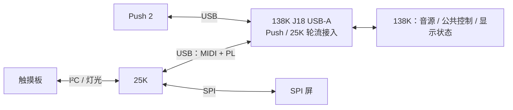

# 138K、Push 2、25K 与触摸板接口规划

更新：2026-10-20。初始fetch基准为`9660406207993914abf2e007906815fcb0df42be`；本轮收尾fetch发现25K导入提交，已检查唯一重叠README并保留本地内容后快进至`5a4bd71011fcf1c19a2a996428603d7b41b4d86a`，协议代码依据为`51bd50c`。用户已回复“都接受，开工”，授权本页首批RTL／固件离线实施。工作区已实现初始化、消息保留／断开作废、25K曲谱隔离与D效果改号；离线验证与整机构建边界见[首批实施记录](projects/138k/push2_workstation/usb_a/reports/INTERFACE_BATCH_20261018.md)。尚未烧录或进行板间实测。

现有线规以 [GW25K_PANEL.md](projects/138k/push2_workstation/usb_a/GW25K_PANEL.md) 为准，原文保留。USB端点、PL包、会话、序号、重试、心跳及已有指令语义沿用；本批只扩展138K内部0x00寄存器的保留bit2用于识别GW25K，原bit0／1不变，详见下文。控件映射与功能范围单列，不把25K设备端规划视作已经实现。

## 工程目录与当前顺序

2026-10-18已按用户要求将两个板级工程放在共同父目录 `projects/`：138K现有工程迁至 `projects/138k/`，25K接入目录为 `projects/25k/`。Git根目录仍为本仓库；完整25K设备工程现已由`5a4bd71`导入，位于`projects/25k/example/MIDI_KEYBOARD`。旧 `migration/gw138k_audio` 为指向138K新目录的兼容链接，历史验收输入、内容哈希与本地结果保留。职责及入口见 [projects/README.md](projects/README.md)。

当前顺序为先整理目录、继续完善已授权功能与离线验证，功能稳定后再集中修理时序。时序候选与失败记录继续保留，不将未闭合候选作为交付版本；不烧录。

## 连接与分工

| 部分 | 已确认职责 |
|---|---|
| 138K | USB Host、音源与效果、公共参数；统一执行设备接入初始化 |
| Push 2 | 直接连接138K；特有交互为CNN扒谱与谱面引导，算法／业务状态由138K承载 |
| 25K | 连接触摸板和SPI屏；特有交互借鉴EP-133，4×4兼顾演奏和播放中的组合效果控制；触摸转MIDI、本地移调与外围由25K负责 |
| 板间连接 | 现阶段用138K板载USB-A；Push与25K均可热插拔，轮流使用，自动识别 |
| 后续HighSpeed | 物理层、引脚、位宽和时钟待定；现有Host是USB Full-Speed，不能按名称视作已支持USB High-Speed |

2026-10-19用户已明确25K专有方向：借鉴K.O.II／EP-133，4×4键除发声外，进入相应效果上下文后各键可对应效果，在已有声音播放时随时开关并组合多个效果；在不违反题目要求的情况下多借鉴其工作流。此方向已确认，具体进入／退出方式、16键分配、按住或锁定触发规则及作用音频路径仍待定。25K继续不分配曲谱入口、跟奏画面或引导灯，也不以演奏推进曲谱。

## 25K专有功能的当前完成度

独立D已有采样播放、音序器及CC20／21／22三项效果后端，但尚未接入整机；旧`sampler_push`按Push的8×8布局解释输入，不能直接作为25K的48–63连续16键映射。Host基础页也未实现16键效果上下文。因此当前是独立后端雏形，不能称为25K专有功能完成。

2026-10-19补测播放中三项效果的全部8种组合和8次单项切换，独立D通过5022帧、jitter0、最大渲染62 clocks；Delay只验证导出的send控制，未验证外部P10音频。该轮补测未改生产RTL／固件。目标、可借鉴候选与证据见[25K现场演奏核对](projects/138k/push2_workstation/usb_a/reports/GW25K_PERFORMANCE_SCOPE_20261019.md)。题目原文及用户补充口径已于2026-10-19收到：D采样器与TF PCM路径保留，禁止直接播放预处理音乐冒充实时合成；仍沿用现有素材／回录边界，不能把候选设计写成已确认或已实现。

## 选题二要求与补充口径（2026-10-19）

[题目正文与用户补充解释](projects/138k/push2_workstation/usb_a/docs/CONTEST_REQUIREMENTS.md)分别保存。按用户补充口径，D采样器、TF PCM播放可以作为合规实时发声技术路径；判断对象是素材内容与演奏处理过程，不能因PCM格式或TF来源一概排除。禁止直接播放预处理音乐冒充实时合成，现有single_note／single_hit导入与编排回录限制保持。此前将PCM素材一概排除的口头判断撤回，不据此删除功能。

新离线测试从内部事件口驱动32个不同音高，经过现有PT8211串行发送器重建音频，确认32个不同谱峰、独立释放和采集欠载0；名义48kHz对应1536000振荡器采样／秒。完整采样器回归9个RTL测试、5个导入工具测试及5个模块lint通过，D播放中8种效果组合继续通过。生产RTL／固件与上一轮功能验收一致，未重跑18道整机门禁。逐项职责、输入哈希和证据见[赛题验收对照](projects/138k/push2_workstation/usb_a/reports/CONTEST_REQUIREMENTS_20261019.md)。

当前PT8211发送格式为16bit右对齐，与题目写出的标准I2S存在接口差异；本轮不改硬件或引脚，暂列验收缺口。传感器至模拟音频的≤10ms／≤5ms、完整25K自研交互、实际板上32音测试及最终时序均未验收；不能以固定采样帧周期或独立D的jitter0替代。继续先完善功能，最后修理时序。

## 25K源码导入后的已确认控件落地

远程`5a4bd71`于本轮导入完整25K源码、例程和硬件文档，已快进接入；此前缺源码的记录保留为历史。本地README有独立备份和stash，其他138K未提交内容哈希一致。顶层默认使用`HOST_PANEL_CONTROLS=1`的确认控件映射；原六参数／PANIC／长按设置行为保留在兼容分支中，未强行覆盖其他人的实现。

真实设备应用已接16键固定力度、Pitch Bend、音量／音色旋转和CC89／CC88短按；USB重新接入不发送48条初始化清理或补播旧持音，本地音量／音色初值与Host一致；PL恢复不触发音源初始化。原编码器每两物理档才发一个step，面板分支已改为每档一个step且保持原去抖。持音移调通过现有MK配置通道验证先全部旧Off再新On，不新增移调入口或定义产品范围。

实际PL端点已与138K生产Host离线闭环通过1019请求、2个完整帧；新控件定向测试覆盖256弯音位置、48条排队控制、持音移调、快重连、PL/MK控制会话独立及新BLE连接不继承旧USB控制。完整设备回归与来源边界见[设备控件落地报告](projects/138k/push2_workstation/usb_a/reports/GW25K_CONTROLS_20261019.md)。25K专有效果上下文／16键表及整机D仍未接入；本地退回页面仍是历史诊断UI，后续主机参数变化的双向全量同步未完成。触摸／SPI实物、端到端延迟和最终时序仍待验收。

## 当前实现边界

| 部分 | 代码现状 | 尚未完成 |
|---|---|---|
| 音源与Push | A/B/C三种分音配置、32声部、五音色、MIDI、延迟／合唱／混响、Push输入与声光反馈已接整机 | 当前工作站仍需完整Push重连及声画复验 |
| TF、识别与显示 | TF WAV播放、CQT→CNN→Viterbi、跟奏、矢量与共享显示数据已有整机路径 | 双面板公共UI尚未抽出；本批25K使用基础音源页，专有页面待定 |
| 25K USB候选 | Host接收MIDI演奏，提供PL会话和428×142基础音源页面；已隔离25K曲谱控制、判定、画面和引导回传 | 完整整机暂存、SYN与18道离线门禁通过；时序未闭合，本轮先完善功能，未烧录／板间实测；25K源码现已导入，已确认控件已接真实应用，硬件验收未完成 |
| 触摸板 | 已有独立QT2160配置、读取和诊断工程 | 实物采样异常与误触待解决；25K整机接入未完成 |
| 模式D | 16声部采样器、导入／变调／切片／loop、步进音序器有独立实现与验证 | 未接入当前整机、未板测；独立效果已改号20／21／22并通过控件回归 |
| 本批代码 | 138K初始化、放行、断开作废和25K曲谱隔离已实现，D独立改号已完成 | CNN输入检查阻塞已修复；p10实际SYN/PNR BSRAM为217/262（容量340）；p27的PLL及CDC通过，最差setup仍为-0.018ns；p34功能等价与18项回归通过，但9460条网络未布通，无有效最终STA。当前无构建运行，未板测 |

当前整机入口默认按full83验收清单取用73个CNN目录文件，活动CNN差异单独记录。时序候选显式使用`--cnn-timing85`，从固定full85快照选取6个既有时序基准，其中link再加入7路DDR诊断电平（含复位与校准完成）的50MHz两级同步；其余67个文件仍与full83逐字相同；活动Flash改动不覆盖候选。完整输入与原DDR冻结源码继续核对；为修复实际DDR路径，暂存HDMI包装层复用现有8客户端缓冲，变换前后哈希单列，不增设DDR客户端或地址区。音频量化、声部选择、Push像素流水线、窄范围CDC约束和PLL初始化逻辑的内部局部放置已开展多轮完整布线验证，仍未闭合，见[时序修复记录](projects/138k/push2_workstation/usb_a/reports/WORKSTATION_TIMING_20261018.md)；旧暂存阻塞和来源依据见[CNN输入核对](projects/138k/push2_workstation/usb_a/reports/CURRENT_WORKSTATION_SOURCES_20261018.md)。

最近工作站Flash留存记录为full85／`0x85`，2026-10-12；全板时序、物理断电启动及完整Push验收仍有缺口。该记录不表示板卡此刻正在运行full85。板端状态以 [LATEST_WORKSTATION.json](projects/138k/push2_workstation/usb_a/LATEST_WORKSTATION.json) 及对应验收记录为准。

## 25K演奏与控件映射（已确认）

以下为25K→138K的逻辑消息；Push的物理按钮号、旋钮号仍经自身映射层处理。

| 控件／动作 | 消息 | 取值与行为 |
|---|---|---|
| 16个触摸键按下 | Note On | 默认连续半音MIDI48–63，逻辑键0=48、键15=63；力度固定100，一次按下发送一次 |
| 触摸键松开 | Note Off | 释放该键当前音高，释放力度0；尾音由138K音源处理 |
| 8电极滑条 | Pitch Bend | 左端降音、中央原音、右端升音；松手回中8192（LSB=0、MSB=64）；幅度沿用138K现有设置 |
| 编码器1转动（演奏页） | CC7 | 绝对值0–127，每档1、不加速；顺时针增大、逆时针减小，接入初值127 |
| 编码器1短按（演奏页） | CC89=1 | 循环切换A/B/C；由138K在声部释放、流水线空闲后提交 |
| 编码器1长按 | 暂不分配 | 本轮提出的“长按进入本地设置”建议已撤回；与现有manual行为的差异见下文 |
| 编码器2转动（演奏页） | Program Change | 笛73→弦40→铜管56→马林巴12→钢琴0循环；每档一项，顺时针下一种、逆时针上一种 |
| 编码器2短按（演奏页） | CC88=127 | 每次短按只发一条，切换效果总开关；松开不发CC88 |
| 编码器2长按 | 暂不分配 | 专有方向已明确，具体按键操作待定 |

Program编号均为MIDI原始零基数值。QT2160电容采样值不作为力度或压力。当前CC88接收任意值都会翻转，松开再发0会造成重复翻转；发送端去抖需保证一次短按一条消息。

持音移调由25K立即处理，不等待所有键松开：先发送本面板**全部旧音**的Note Off，再为仍按住的键按新音高发送Note On，力度100。接受重新触发包络；最终松手释放更新后的音符。该过程沿用Note On／Off，不用全局CC120／123代替逐音释放。

滑条已接受分段线性映射，中心死区与滤波可调；具体参数、长短按时限和去抖随设备调试确定。导入工程已含确认电极顺序及原协议维护配置，仍需实物复验；移调最终产品入口／范围／越界行为待定，不增加菜单或长按功能。

## 接入初始化（已确认）

Push或25K接入后，**由138K统一应用固定默认参数，两设备共用一套主机流程**，覆盖当前共享参数，不恢复上次使用值。下表CC／Program表示沿用的逻辑语义；由138K音频域经现有参数消费端执行，不要求面板发送初始化命令。

| 参数 | 固定值 | 处理含义 |
|---|---|---|
| 总音量 | CC7=127 | 25K编码器1从127开始调节 |
| 音色 | Program Change=73 | 默认笛，25K编码器2从笛开始选择 |
| 分音模式 | CC80=2 | 请求C模式，保留现有模式提交条件 |
| 效果选择 | CC81=0 | 清空选中效果，默认干声 |

CC81=0沿用当前代码：`effect_master=1`、选中效果为0，因此输出干声；这不等于把总开关设为关闭。尚未选择效果时，编码器2短按总开关不会改变听感。初始化不以盲发CC88翻转确定绝对状态。

本批执行顺序：接入先全局PANIC清旧音并停止演示／TF运行，再依次执行CC96=0、CC104=0、CC90=0、Pitch Bend=8192、CC64=0、CC11=127、CC1=0、CC5=0、CC82=0，最后执行上表四项参数。CC104退出TF，CC90退出现场矢量，CC82=0恢复立体声。初始化只有在全部参数已消费且C模式实际提交、无待提交模式时才结束，保留原音源模式提交条件。

Note On／Off、CC7、Program Change、Pitch Bend、CC88／89及其他已有普通音源控制，共用现有18 bit异步FIFO和读端一级缓存，按混合后的到达顺序保留。FIFO满则背压USB CPU，不覆盖旧项；初始化完成后依次处理，接受短按延后发声。Push原始USB字在映射前还等待两次新反馈快照，以对齐PANIC epoch和本地旋钮状态；等待与屏幕首帧无关。曲谱CC仍在USB模块消费，不混入音源FIFO。

USB断开使FIFO复位，并经真实读端排空无复位脚的输出缓存；新的写入等待清空确认。片上生命周期消息绕过USB／CPU外层仲裁缓存，清除该缓存及音频侧本地事件和内层仲裁旧暂存项，重连重新初始化，不补播或补做全部尚未处理的旧演奏／控制消息。PANIC在MMIO入口越过普通队列，立即清音并清队列；若正初始化则重启默认值流程。PL会话单独恢复不会触发这套USB接入初始化。

屏幕保持独立初始化，发声不等首帧。当前18 bit事件无来源标识，断开与PANIC仍是全局清音；不据此承诺其他同时输入的声部独立保留。25K本地音量／音色状态同步仍需完整设备工程落地，不能把主机实现写成25K控件已实现。

## 已接受的集中清单与首批范围

用户已于2026-10-18回复“都接受，开工”，接受下表全部处理及首批范围，并授权本批RTL／固件离线修改；不再逐条询问。队列容量、背压、超时、去抖、内部执行顺序和测试覆盖由开发者依据现有代码处理；涉及功能或用户操作的选择集中列在下表。

| 事项 | 已接受处理 | 本批边界 |
|---|---|---|
| 其余输入与紧急清音 | CC88／CC89及其他已有普通演奏、音源控制消息也在初始化期间共同按序保留；PANIC继续用于立即清音，不等待初始化队列 | 不改变已有指令含义；曲谱仅属Push，不能借此给25K开放跟奏 |
| 接入后的其他音源状态 | 弯音回中8192、CC64=0取消延音、CC11=127、CC1=0、CC5=0、CC82=0立体声；停止演示并退出TF播放／现场矢量，再应用已定四项固定值 | 新增默认值已接受；避免继承造成偏音、无声或仍由其他音源路径占用输出 |
| 25K操作细节 | 音量每档1、不加速；音色每档一项；滑条先用分段线性映射、中心死区与滤波可调。移调入口暂缓，范围与越界行为随入口集中确定，不增设菜单或长按功能 | 具体去抖、长短按时限和滤波参数由板端调试确定；现有移调时Note Off／On规则保持已确认状态 |
| 25K页面与功能 | 本批先让138K提供现有基础音源状态与显示资源；移除25K目标路径中的曲谱交互／跟奏显示／引导反馈。专有方向已于2026-10-19明确，效果上下文入口和按键表仍待定 | 保留Push及非25K generic既有能力；不改PL线规，不自行设计25K专有入口 |
| D接入范围 | 本批仅做独立D效果改号20／21／22及相应离线回归；整机D模式、DDR接入、控件和每次切入是否清零留到D接入批次 | 已定固定默认值0不变；本批不把D写成已接整机 |
| 实施所需资料与后续硬件 | 25K完整工程路径、板型、SPI屏控制器／尺寸／连线、实际电极键序待核对；HighSpeed物理接口后续再定 | 当前仓库可先开展138K及独立D离线修改；25K设备端和硬件联调待资料齐全，不烧录 |

已授权首批交付：138K固定参数初始化、输入保留与放行、USB断开旧消息作废、25K曲谱功能隔离，以及独立D效果改号；完成相应离线回归与文档对照。25K完整设备端、引脚／硬件、整板烧录及D整机集成不列入首批。该首批范围与上表新增默认值均已接受；实现、验证范围及复现命令见首批实施记录。

## D效果与曲谱编号（独立改号已实现）

| D参数 | 新逻辑CC | 值域 | 固定默认值 |
|---|---:|---|---:|
| BitCrush深度 | 20 | 0释放，1–127为深度 | 0 |
| Drive深度 | 21 | 0释放，1–127为深度 | 0 |
| Delay Send深度 | 22 | 0释放，1–127为深度 | 0 |

三项默认0，沿用独立模块复位值，默认干声。25K对应控件尚未分配，每次切入D是否清零也未约定。D尚未接整机；`sampler_fx.sv`已改用CC20／21／22，控件回归验证新号生效、0释放、旧110／111／112不触发D效果。历史D完整验证证据仍对应旧输入，本批证据单列。

曲谱原编号保留：

| CC | 现有语义 |
|---:|---|
| 110 | 0–63关闭guide，64–127打开；绝对状态 |
| 111 | 0上一曲，127下一曲，其他值忽略 |
| 112 | ≥64上升沿确认／返回，<64释放后才能再触发，建议释放值0 |

曲谱CC在USB控制模块消费，不进入音频FIFO。Push原始物理按钮CC20／21／22已有其效果链映射，不能直接当作上表D逻辑CC透传。现有CC89模式循环、CC90矢量与CC104等含义保持原样；D是否加入模式循环、具体控件与路由仍属后续接入规划。

## USB／PL与显示复用

沿用现有 [GW25K_PANEL.md](projects/138k/push2_workstation/usb_a/GW25K_PANEL.md)：

| 项目 | 现有接口 |
|---|---|
| 设备 | VID:PID=`FB9A:FB9B`；完整复合设备才启用GW25K模式，不完整时回落MIDI输入 |
| MIDIStreaming接口1 | IN81演奏输入、OUT01端点保留，本批25K不发送曲谱引导回传 |
| vendor接口2 | FF/00/00；OUT02发送PL请求、IN82接收PL应答 |
| 显示 | PL local-v1、428×142、RGB565LE、62×4 tile、每块≤248像素；一帧固定场景快照 |
| 会话 | HELLO/CAPS、独立control/display序号、HEALTH、FRAME_END/DRAWN；BUSY重试、USB DATA去重及恢复规则保持原规范 |

当前候选每帧分块完整重画，无整屏缓存、无heap、无新增DDR客户端；尚未实现脏矩形。25K负责把收到的像素写入SPI屏，最终控制器、颜色顺序、窗口写入、SPI速率和实测刷新率待核对。

复用方向是138K的音源状态、分析结果与适用绘图，25K保留外围驱动和小块缓冲。波形／频谱优先取已有分析数据。现有Push像素路径没有独立整屏显存；25K候选的C渲染器和5×7字库是新增实现，尚未共享Push RTL字体ROM或绘图实例。字体／绘图如何共用需另作资源核对，不能把移除Push显示等同于释放大块RAM。

138K内部兼容扩展：0x00保持bit0=连接、bit1=generic，新增bit2=已完整识别的GW25K；Push写1、普通generic写3、GW25K写7、断开写0。Host固件与控制RTL须配套更新，旧固件写3不能启用25K隔离。内部事件kind15用于断开／接入／PANIC／初始化完成握手，不作为MIDI或PL消息公开；18 bit普通事件和其原含义不变。

## 25K基础页实际字段（2026-10-20主机续接）

本次修正数值标签，只使用现有MMIO和PL传输。代码依据：`gw138k_controlled_adapter.sv`将`synth_gain`放在control高16位，`gw138k_event_workstation.sv`计算CC7与CC11的有效增益并输出音色profile、实际提交的mode、有效效果mask，以及`{MSB,LSB[6]}`弯音索引；`push2_usb_a_control.sv`通过0x10／14／1c／20／24提供快照。未增加寄存器或消息。

| 页面字段 | 来源与含义 | 精度／限制 |
|---|---|---|
| NOTE／VEL | 0x24的note[6:0]／velocity[13:7] | 最近USB接收并受理的音符／力度或压力；对应Note Off／velocity0后力度归0，不是当前全部发声声部或初始化消费确认 |
| GAIN | 0x10[31:16]，Q15有效增益 | 显示`min(127, gain >> 8)`；CC11=127时与CC7一致，表达降低后显示乘积结果，不能用来反推原始CC7 |
| TONE | 0x10[9:7]，内部profile0–4 | 笛／弦／铜管／马林巴／钢琴；对应已定Program73／40／56／12／0，显示名称，不冒充原始Program值 |
| MODE | 0x10[4:3] | A／B／C为实际已提交模式；不表示CC89请求已经立刻提交；非法保留值显示问号，不暗示D已接入 |
| ACTIVE | 0x10[15:10] | 2026-10-20新增显示实际非空闲声部数，包含包络尾音；不是held键数／分量数；静音路由下也可非零 |
| OUT | 0x10[6:5] | 2026-10-20新增STEREO／LEFT／RIGHT／MUTED实际输出路由 |
| GLIDE | 0x14[17:11] | 2026-10-20新增CC5控制量0–127，不标作毫秒 |
| SUSTAIN | 0x14[3] | 2026-10-20新增实际延音ON／OFF |
| MOD | 0x14[10:4] | CC1颤音深度0–127 |
| BEND IDX | 0x14[25:18] | 8bit弯音表索引0–255，即原始14bit值右移6位；8192显示128，不能据此还原低6位 |
| FX DCR | 0x10[2:0] | 按Delay／Chorus／Reverb顺序显示实际生效位；000既可为清空选择也可为master关闭，不能单独表示总开关状态；与独立D效果20／21／22无关 |
| 底部A–P键格 | 0x1c／20的音频域held快照 | 固定显示MIDI48–63，Note Off后不显示包络尾音；仍未获知25K本地transpose，移调后超出此范围的音符不投射到这些格子 |

`gw25k_panel.h`在开始一帧时读取并冻结上述字段，全帧tile与重试复用同一份数据；帧中变更在下一帧完整重画。稳定场景仅保活；manual／画布丢失和PL恢复沿用原有重画规则。没有脏矩形、整屏缓存或新DDR客户端，刷新率仍受USB Full-Speed和设备SPI吞吐限制。25K本地编码器音量／音色同步仍未实现，基础页不能充当设备端同步ACK。

本轮guide声明兼容修复与页面核对、最终测试输入和结果见[功能优先续验](projects/138k/push2_workstation/usb_a/reports/FUNCTION_FIRST_20261019.md)。2026-10-18的失败验证原件保留，不能将其改写为通过。

本轮最终汇总为`passed=true`：CNN来源边界10项、full83整机18道门禁、接入／演奏链、guide、生产25K Host及D控件／独立模式均通过；最终裸机固件交叉编译与ROM／RAM检查也通过。仅为离线功能验证，未接实际25K端点，未SYN／P&R、未烧录／板测，时序未闭合。

## 138K音频与DDR边界

现有音频域76.8 MHz，48 kHz节拍，每1600周期一帧。界面和传屏等待不能改变采样时基。Push与generic MIDI共用音频事件FIFO；内部18 bit事件没有来源标识，多来源的同音释放与掉线清理需单独对齐。

整机使用一套DDR3控制器与业务仲裁：DQ32、BL8，单事务256 bit／32字节。`app_addr`以32 bit word计数，字节地址÷4，低3 bit为0，相邻事务加8；业务字节地址、CPU映射地址与`app_addr`须区分。

读请求附3 bit owner标签，按返回顺序分发；写命令和写数据同时就绪才受理。启动先完成BIST，运行时视频扫描优先；TF音频优先于普通业务，`music_turn`为识别保留非扫描时隙，其他客户端按现有仲裁受理。当前不对所有客户端保证严格带宽。

| owner | 当前客户端 |
|---:|---|
| 0 | 启动BIST；完成后复用给显示数据读取 |
| 1 | 视频扫描 |
| 2／3 | CPU／画面写入 |
| 4 | TF音频DMA |
| 5 | 音乐识别 |
| 6 | 延迟环DMA |

新面板按寄存器快照和像素小块对接，不新增DDR客户端，也不向25K开放裸DDR地址。D接入须另核对客户端、响应tag与竞争负载；增长保留池为物理字节地址`0x09800000–0x0FFFFFFF`，当前整机尚未部署D客户端。现有分区保持 [ddr_address_map.vh](projects/138k/push2_workstation/usb_a/rtl/ddr_address_map.vh) 定义。

## 与原规范的差异及剩余接口

| 项目 | 现有代码／规范 | 已确认目标或待定事项 |
|---|---|---|
| E1长按 | 原文进入25K本地设置，Host按manual暂停像素、继续保活；同时声明不重定义两个编码器本地操作 | 本轮长按菜单建议已撤回；需与对端既有操作核对，保留原文和manual兼容处理 |
| 曲谱功能范围 | 原generic路径可进入guide，旧25K候选有曲谱画面与引导回传 | 本批仅隔离明确识别的GW25K：不消费曲谱控件、不以演奏推进guide、不显示曲谱、不回传引导MIDI；Push和其他generic保持已有能力 |
| D效果 | 历史独立代码使用110／111／112 | 本批独立改为20／21／22，默认0；整机路由、控件与每次切入是否清零仍待D接入批次 |
| 初始化 | 本批已实现主机统一默认值、按序保留、断开作废和PANIC越过队列 | 子系统离线通过；25K本地控件同步、整机打包及板测待完成 |
| 触摸板 | 两颗QT2160同为0x0D，当前分两组I²C；PCA9685为0x40，另有WS2812 | 迁至25K后保留必要独立总线；实际键序、信号异常与球位待核对 |
| 引脚与带宽 | 触摸测试与BLE的J8占用有重叠；LCD最终写入受SPI吞吐限制 | 触摸迁移至25K后再核对J8释放；后续HighSpeed引脚、SPI屏控制器及刷新预算待定 |

## 对接代码依据

- [USB与PL现有规范](projects/138k/push2_workstation/usb_a/GW25K_PANEL.md)、[生产Host固件](projects/138k/push2_workstation/usb_a/firmware.c)、[PL显示服务](projects/138k/push2_workstation/usb_a/gw25k_panel.h)。
- [输入／曲谱控制与MMIO](projects/138k/push2_workstation/usb_a/rtl/push2_usb_a_control.sv)、[音频事件与参数](projects/138k/push2_workstation/usb_a/rtl/audio/gw138k_event_workstation.sv)。
- [D当前实现](projects/138k/push2_workstation/usb_a/rtl/sampler/sampler_fx.sv)、[D接入原草案](projects/138k/push2_workstation/usb_a/rtl/sampler/MODE_D_INTEGRATION.md)。原草案的CC90模式循环描述早于当前实现，对接按现有CC89／CC90语义核对。
- [Push像素生成](projects/138k/push2_workstation/usb_a/rtl/display_data/push2_surface_pixels.sv)、[共享显示数据](projects/138k/push2_workstation/usb_a/DISPLAY_DATA_LAYOUT_V1.md)。
- [DDR仲裁](projects/138k/push2_workstation/usb_a/rtl/display_data/gw138k_ddr_arbiter.sv)、[地址分区](projects/138k/push2_workstation/usb_a/rtl/ddr_address_map.vh)、[触摸板当前问题](projects/138k/push2_workstation/touchboard_test/CURRENT_BLOCKER_20261013.md)。

## 2026-10-19用户调整：138K优先，撤回最近25K修复

用户要求“回退，尽量在138k上动刀，25k少动，最多给建议”。已撤回最近一轮25K连接／排队修复，精确恢复到上一轮已确认控件版本，新增边界测试移出设备活动工程并保留备份。此前基础控件、远程25K导入、138K功能及他人内容保留，不做整目录恢复。

后续实现优先放在138K RTL／固件／仿真／显示端；25K设备侧先做只读核对与建议，不继续直接改设备RTL、驱动、固件或测试。不得为补偿设备未发出的消息而在138K猜测短按、Note On或弯音回中，也不自行加超时控制或改变已有MIDI语义。

恢复后152项设备输入与上一轮38测试台证据完全一致；本次仅重跑顶层展开和已有控件定向测试，不声称重跑全部38项。最近39测试台结果标为已撤回候选；三处已复现设备缺口转为建议项。主机可继续承担公共初始化、队列背压、模式实际提交、参数和画面状态；专有效果入口／16键表及D整机边界仍待决定。详见[当前回退与建议记录](projects/138k/push2_workstation/usb_a/reports/GW25K_ROLLBACK_20261019.md)。

## 2026-10-20：138K真实状态反馈接入

本轮按最新范围只修改138K生产Host及仿真，25K源码和文档未改。原MMIO已回传但页面未使用的实际声部数、输出路由、滑音和延音现已接入428×142基础页；MODE仍按实际提交显示，帧内冻结、下一帧更新和稳定保活沿用原机制。未新增寄存器、MIDI映射、PL命令、菜单、效果入口或DDR客户端。代码依据与具体字段见[本轮报告](projects/138k/push2_workstation/usb_a/reports/HOST_FEEDBACK_20261020.md)。

本轮最终[verification.json](projects/138k/push2_workstation/usb_a/reports/host_feedback_20261020/verification.json)为passed=true：full83整机18道门禁、接入／快重连／背压／PANIC／模式提交／屏幕独立启动、Push引导与25K隔离、来源边界10项、生产Host及真实25K显示端点只读闭环通过。新增12组真实音频MMIO快照交给生产Host消费，验证待提交模式不提前显示、包络尾音仍计数、四路由与PCM一致以及重连默认值。13种字段变化各触发一帧，稳定只保活。新固件准备编译通过；仍选full83验收73个CNN文件，未纳入活动CNN差异。25K的1064项非results文件集合及哈希与本轮接手时一致。

此基础页不等于25K本地音量／音色完整双向同步；原始CC7／Program／完整14bit弯音和effect_master不能全部由现有显示字段无损重建。EP-133式专有效果方向保留，入口／16键表／按住或锁定规则／作用路径仍待决定；D整机模式与DDR／UI仍留后续。上一轮撤回的25K三处边界缺口未以主机猜测补偿。本轮未板测／烧录／改硬件引脚，未SYN／P&R或新增时序实验，时序未闭合。
