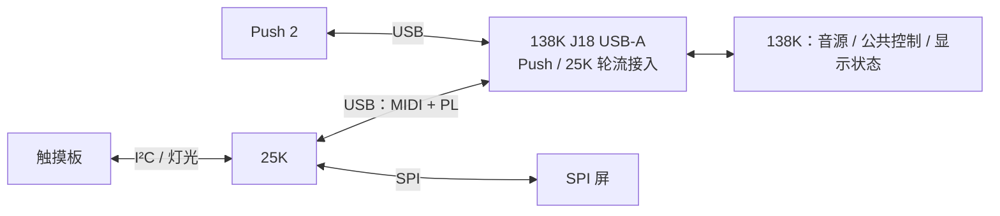

# 138K、Push 2、25K 与触摸板接口规划

更新：2026-10-17。代码基准：`51bd50c`。本页汇总已确认的接口决定，供两端开发对接；“已确认”表示规划已定，代码完成情况另列。接入后的初始化时序仍待确认。

现有线规以 [GW25K_PANEL.md](projects/138k/push2_workstation/usb_a/GW25K_PANEL.md) 为准：USB 端点、PL 包格式、会话、序号、重试、心跳、MMIO 及既有指令语义保持原定义。本页补充控件映射、固定默认值和产品功能范围；原规范与目标有差异的地方单列。

## 工程目录与当前顺序

2026-10-18已按用户要求将两个板级工程放在共同父目录 `projects/`：138K现有工程迁至 `projects/138k/`，25K接入目录为 `projects/25k/`。Git根目录仍为本仓库；完整25K设备工程尚未导入。旧 `migration/gw138k_audio` 为指向138K新目录的兼容链接，历史验收输入、内容哈希与本地结果保留。职责及入口见 [projects/README.md](projects/README.md)。

当前顺序为先整理目录、继续完善已授权功能与离线验证，功能稳定后再集中修理时序。时序候选与失败记录继续保留，不将未闭合候选作为交付版本；不烧录。

## 连接与分工

| 部分 | 已确认职责 |
|---|---|
| 138K | USB Host、音源与效果、公共参数；统一执行设备接入初始化 |
| Push 2 | 直接连接138K；沿用其输入、屏幕和灯光链路；曲谱跟奏为Push专有 |
| 25K | 连接触摸板和SPI屏；将触摸转为MIDI、处理本地移调和控件状态，驱动屏幕与灯光 |
| 板间连接 | 现阶段用138K板载USB-A；Push与25K均可热插拔，轮流使用，自动识别 |
| 后续HighSpeed | 物理层、引脚、位宽和时钟待定；现有Host是USB Full-Speed，不能按名称视作已支持USB High-Speed |

25K的其他专有功能由用户后续说明。当前不分配25K曲谱入口、跟奏画面或引导灯，也不以25K演奏推进曲谱。曲谱业务状态继续由138K承载，Push提供对应交互。

## 当前实现边界

| 部分 | 代码现状 | 尚未完成 |
|---|---|---|
| 音源与Push | A/B/C三种分音配置、32声部、五音色、MIDI、延迟／合唱／混响、Push输入与声光反馈已接整机 | 当前工作站仍需完整Push重连及声画复验 |
| TF、识别与显示 | TF WAV播放、CQT→CNN→Viterbi、跟奏、矢量与共享显示数据已有整机路径 | 双面板公共UI尚未抽出；25K适用页面待定 |
| 25K USB候选 | MIDI演奏输入、PL会话、428×142分块显示及MIDI引导回传已写入138K Host | 离线回归通过，未整板构建／烧录／板间实测；本仓库缺完整25K设备端工程 |
| 触摸板 | 已有独立QT2160配置、读取和诊断工程 | 实物采样异常与误触待解决；25K整机接入未完成 |
| 模式D | 16声部采样器、导入／变调／切片／loop、步进音序器有独立实现与验证 | 未接入当前整机、未板测；效果改号未实施 |
| 本页确认内容 | 控件映射、默认值和主机初始化归属已定 | 本次只提交文档，尚未据此修改RTL或固件 |

最近工作站Flash留存记录为full85／`0x85`，2026-10-12；全板时序、物理断电启动及完整Push验收仍有缺口。该记录不表示板卡此刻正在运行full85。板端状态以 [LATEST_WORKSTATION.json](projects/138k/push2_workstation/usb_a/LATEST_WORKSTATION.json) 及对应验收记录为准。

## 25K演奏与控件映射（已确认）

以下为25K→138K的逻辑消息；Push的物理按钮号、旋钮号仍经自身映射层处理。

| 控件／动作 | 消息 | 取值与行为 |
|---|---|---|
| 16个触摸键按下 | Note On | 默认连续半音MIDI48–63，逻辑键0=48、键15=63；力度固定100，一次按下发送一次 |
| 触摸键松开 | Note Off | 释放该键当前音高，释放力度0；尾音由138K音源处理 |
| 8电极滑条 | Pitch Bend | 左端降音、中央原音、右端升音；松手回中8192（LSB=0、MSB=64）；幅度沿用138K现有设置 |
| 编码器1转动（演奏页） | CC7 | 绝对值0–127，顺时针增大、逆时针减小总音量；接入初值127 |
| 编码器1短按（演奏页） | CC89=1 | 循环切换A/B/C；由138K在声部释放、流水线空闲后提交 |
| 编码器1长按 | 暂不分配 | 本轮提出的“长按进入本地设置”建议已撤回；与现有manual行为的差异见下文 |
| 编码器2转动（演奏页） | Program Change | 笛73→弦40→铜管56→马林巴12→钢琴0循环；顺时针下一种、逆时针上一种 |
| 编码器2短按（演奏页） | CC88=127 | 每次短按只发一条，切换效果总开关；松开不发CC88 |
| 编码器2长按 | 暂不分配 | 等待25K专有功能说明 |

Program编号均为MIDI原始零基数值。QT2160电容采样值不作为力度或压力。当前CC88接收任意值都会翻转，松开再发0会造成重复翻转；发送端去抖需保证一次短按一条消息。

持音移调由25K立即处理，不等待所有键松开：先发送本面板**全部旧音**的Note Off，再为仍按住的键按新音高发送Note On，力度100。接受重新触发包络；最终松手释放更新后的音符。该过程沿用Note On／Off，不用全局CC120／123代替逐音释放。

实际电极顺序、移调操作入口／范围／越界行为、滑条0–255到Pitch Bend的映射、中心死区、滤波、编码器步长及长短按时限仍待确认。

## 接入初始化（已确认）

Push或25K接入后，**由138K统一应用固定默认参数，两设备共用一套主机流程**，覆盖当前共享参数，不恢复上次使用值。下表CC／Program表示沿用的逻辑语义，具体内部执行路径待定，不新增USB／PL命令。

| 参数 | 固定值 | 处理含义 |
|---|---|---|
| 总音量 | CC7=127 | 25K编码器1从127开始调节 |
| 音色 | Program Change=73 | 默认笛，25K编码器2从笛开始选择 |
| 分音模式 | CC80=2 | 请求C模式，保留现有模式提交条件 |
| 效果选择 | CC81=0 | 清空选中效果，默认干声 |

CC81=0沿用当前代码：`effect_master=1`、选中效果为0，因此输出干声；这不等于把总开关设为关闭。尚未选择效果时，编码器2短按总开关不会改变听感。初始化不以盲发CC88翻转确定绝对状态。

**待确认的时序建议**：先完成音源默认参数初始化，再放行新设备演奏；屏幕独立初始化，发声无需等待首帧。用户尚未确认这项建议。初始化期间输入如何保留、状态核对、25K本地控件如何与主机对齐，以及弯音／延音等其他参数的接入处理均待定。

## D效果与曲谱编号（已确认规划，未改实现）

| D参数 | 新逻辑CC | 值域 | 固定默认值 |
|---|---:|---|---:|
| BitCrush深度 | 20 | 0释放，1–127为深度 | 0 |
| Drive深度 | 21 | 0释放，1–127为深度 | 0 |
| Delay Send深度 | 22 | 0释放，1–127为深度 | 0 |

三项默认0，沿用独立模块复位值，默认干声。25K对应控件尚未分配，每次切入D是否清零也未约定。D尚未接整机，当前 `sampler_fx.sv` **仍使用旧CC110／111／112**；直接接入会与generic USB曲谱入口冲突。

曲谱原编号保留：

| CC | 现有语义 |
|---:|---|
| 110 | 0–63关闭guide，64–127打开；绝对状态 |
| 111 | 0上一曲，127下一曲，其他值忽略 |
| 112 | ≥64上升沿确认／返回，<64释放后才能再触发，建议释放值0 |

曲谱CC在USB控制模块消费，不进入音频FIFO。Push原始物理按钮CC20／21／22已有其效果链映射，不能直接当作上表D逻辑CC透传。现有CC89模式循环、CC90矢量与CC104等含义保持原样；D是否加入模式循环、具体控件与路由仍属后续接入规划。

## USB／PL与显示复用

沿用现有 [GW25K_PANEL.md](projects/138k/push2_workstation/usb_a/GW25K_PANEL.md)：

| 项目 | 现有接口 |
|---|---|
| 设备 | VID:PID=`FB9A:FB9B`；完整复合设备才启用GW25K模式，不完整时回落MIDI输入 |
| MIDIStreaming接口1 | IN81演奏输入、OUT01引导回传 |
| vendor接口2 | FF/00/00；OUT02发送PL请求、IN82接收PL应答 |
| 显示 | PL local-v1、428×142、RGB565LE、62×4 tile、每块≤248像素；一帧固定场景快照 |
| 会话 | HELLO/CAPS、独立control/display序号、HEALTH、FRAME_END/DRAWN；BUSY重试、USB DATA去重及恢复规则保持原规范 |

当前候选每帧分块完整重画，无整屏缓存、无heap、无新增DDR客户端；尚未实现脏矩形。25K负责把收到的像素写入SPI屏，最终控制器、颜色顺序、窗口写入、SPI速率和实测刷新率待核对。

复用方向是138K的音源状态、分析结果与适用绘图，25K保留外围驱动和小块缓冲。波形／频谱优先取已有分析数据。现有Push像素路径没有独立整屏显存；25K候选的C渲染器和5×7字库是新增实现，尚未共享Push RTL字体ROM或绘图实例。字体／绘图如何共用需另作资源核对，不能把移除Push显示等同于释放大块RAM。

## 138K音频与DDR边界

现有音频域76.8 MHz，48 kHz节拍，每1600周期一帧。界面和传屏等待不能改变采样时基。Push与generic MIDI共用音频事件FIFO；内部18 bit事件没有来源标识，多来源的同音释放与掉线清理需单独对齐。

整机使用一套DDR3控制器与业务仲裁：DQ32、BL8，单事务256 bit／32字节。`app_addr`以32 bit word计数，字节地址÷4，低3 bit为0，相邻事务加8；业务字节地址、CPU映射地址与`app_addr`须区分。

读请求附3 bit owner标签，按返回顺序分发；写命令和写数据同时就绪才受理。启动先完成BIST，运行时视频扫描优先；TF音频优先于普通业务，`music_turn`为识别保留非扫描时隙，其他客户端按现有仲裁受理。当前不对所有客户端保证严格带宽。

| owner | 当前客户端 |
|---:|---|
| 0 | 启动BIST；完成后复用给显示数据读取 |
| 1 | 视频扫描 |
| 2／3 | CPU／画面写入 |
| 4 | TF音频DMA |
| 5 | 音乐识别 |
| 6 | 延迟环DMA |

新面板按寄存器快照和像素小块对接，不新增DDR客户端，也不向25K开放裸DDR地址。D接入须另核对客户端、响应tag与竞争负载；增长保留池为物理字节地址`0x09800000–0x0FFFFFFF`，当前整机尚未部署D客户端。现有分区保持 [ddr_address_map.vh](projects/138k/push2_workstation/usb_a/rtl/ddr_address_map.vh) 定义。

## 与原规范的差异及剩余接口

| 项目 | 现有代码／规范 | 已确认目标或待定事项 |
|---|---|---|
| E1长按 | 原文进入25K本地设置，Host按manual暂停像素、继续保活；同时声明不重定义两个编码器本地操作 | 本轮长按菜单建议已撤回；需与对端既有操作核对，保留原文和manual兼容处理 |
| 曲谱功能范围 | generic Note On可进入guide，25K已有曲谱画面和MIDI引导回传 | 用户限定Push专有；25K路径后续需限制，具体方案未定，本轮不改实现 |
| D效果 | 独立代码仍用110／111／112 | 新号20／21／22及默认0已确认，实际改号、控件和消费路径未实现 |
| 初始化 | 已确认由138K统一执行固定默认值 | 与首批演奏消息的顺序、本地控件同步和其他参数待定 |
| 触摸板 | 两颗QT2160同为0x0D，当前分两组I²C；PCA9685为0x40，另有WS2812 | 迁至25K后保留必要独立总线；实际键序、信号异常与球位待核对 |
| 引脚与带宽 | 触摸测试与BLE的J8占用有重叠；LCD最终写入受SPI吞吐限制 | 触摸迁移至25K后再核对J8释放；后续HighSpeed引脚、SPI屏控制器及刷新预算待定 |

## 对接代码依据

- [USB与PL现有规范](projects/138k/push2_workstation/usb_a/GW25K_PANEL.md)、[生产Host固件](projects/138k/push2_workstation/usb_a/firmware.c)、[PL显示服务](projects/138k/push2_workstation/usb_a/gw25k_panel.h)。
- [输入／曲谱控制与MMIO](projects/138k/push2_workstation/usb_a/rtl/push2_usb_a_control.sv)、[音频事件与参数](projects/138k/push2_workstation/usb_a/rtl/audio/gw138k_event_workstation.sv)。
- [D当前实现](projects/138k/push2_workstation/usb_a/rtl/sampler/sampler_fx.sv)、[D接入原草案](projects/138k/push2_workstation/usb_a/rtl/sampler/MODE_D_INTEGRATION.md)。原草案的CC90模式循环描述早于当前实现，对接按现有CC89／CC90语义核对。
- [Push像素生成](projects/138k/push2_workstation/usb_a/rtl/display_data/push2_surface_pixels.sv)、[共享显示数据](projects/138k/push2_workstation/usb_a/DISPLAY_DATA_LAYOUT_V1.md)。
- [DDR仲裁](projects/138k/push2_workstation/usb_a/rtl/display_data/gw138k_ddr_arbiter.sv)、[地址分区](projects/138k/push2_workstation/usb_a/rtl/ddr_address_map.vh)、[触摸板当前问题](projects/138k/push2_workstation/touchboard_test/CURRENT_BLOCKER_20261013.md)。
